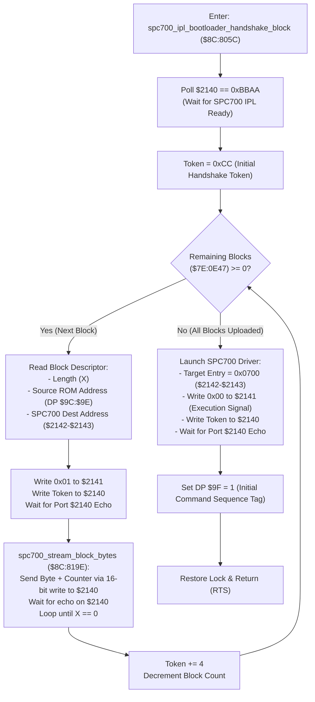

# SPC700 IPL Bootloader Handshake & Audio Block Streaming Protocol ($8C:805C – `$8C:81FC`)

> **Subsystem**: Audio Driver / SPC700 Bootloader & Soundbank Streaming Engine  
> **ROM Addresses**: `$8C:805C` (`spc700_ipl_bootloader_handshake_block`), `$8C:818D` (`advance_stream_word`), `$8C:8195` (`advance_stream_byte`), `$8C:819E` (`spc700_stream_block_bytes`), `$8C:81D4` (`apu_wait_ready_timeout`)  
> **Clean C Module**: `audio/spc-block-uploader.c`  
> **Recomp Symbols**: `func_CC805C`, `func_CC818D`, `func_CC8195`, `func_CC819E`, `func_CC81D4`  
> **Confidence**: Confirmed (Exact 65816 assembly, cycle analysis & protocol equivalence)  

---

## 1. Architectural Role & Overview

When Secret of Evermore boots or transitions music environments (e.g. loading a new instrument soundbank or sound effects package), the 65816 CPU must transmit programs, driver bytecode, and BRR sample data to the dedicated Sony SPC700 sound coprocessor.

The SPC700 contains a 64-byte factory **IPL (Initial Program Loader) ROM** located at addresses `$FFC0`–`$FFFF`. The routine at `$8C:805C` executes the official SNES IPL communication handshake and packet streaming protocol:

1. **IPL Signature Ready Spinlock (`$8C:8085`)**:
   - The CPU spins polling port `$2140` until ports `$2140` and `$2141` read `0xBBAA` (the IPL bootloader ready signal).
2. **Block Descriptor Iteration (`$8C:8090`)**:
   - Audio packages consist of multiple contiguous data blocks. Each block descriptor specifies:
     - 16-bit Byte Count ($N$)
     - 24-bit Source Data Pointer in ROM (`bank:offset`)
     - 16-bit Target Destination Address in SPC700 RAM
3. **Synchronous 16-Bit Byte Packet Streaming (`$8C:819E`)**:
   - To maximize transfer speed and prevent protocol desynchronization, the CPU streams each byte using a single 16-bit write:
     - Port `$2140`: 8-bit handshake sequence counter ($0, 1, 2, \dots$)
     - Port `$2141`: 8-bit audio payload byte
   - The CPU waits for the SPC700 to echo the counter byte back on port `$2140` before sending the next byte.
4. **Execution Launch (`$8C:80F3`)**:
   - When all blocks are uploaded, the CPU writes `0x0000` to port `$2141` and writes the target execution address (`0x0700`) to ports `$2142`–`$2143`.
   - The SPC700 IPL exits its bootloader loop and jumps to address `0x0700` to execute the uploaded audio engine.

---

## 2. Full 65816 Disassembly & Annotations

### Part 1: SPC700 IPL Handshake & Multi-Block Dispatcher (`$8C:805C` – `$8C:810D`)

> **Interactive 65816 Assembly**:
> Centralized comments infused at runtime.
> [View in VFS: soe://rom/code/8C805C](soe://rom/code/8C805C?asm=1&c=0)

---

### Part 2: Synchronous Byte Transfer Loop (`$8C:819E` – `$8C:81D3`)

> **Interactive 65816 Assembly**:
> Centralized comments infused at runtime.
> [View in VFS: soe://rom/code/8C805C](soe://rom/code/8C805C?asm=1&c=0)

---

### Part 3: APU Readiness Polling & Timeout Recovery (`$8C:81D4` – `$8C:81FC`)

> **Interactive 65816 Assembly**:
> Centralized comments infused at runtime.
> [View in VFS: soe://rom/code/8C805C](soe://rom/code/8C805C?asm=1&c=0)

### Trap: the IPL wait has no timeout

Only the command handshake (`$8C:81FD`, `$2800` tries) and the ready poll (`$8C:81D4`) time out. A soundbank
load (`$8C:8236`) sends driver command `$0E` (return to the IPL) and then spins at `$8C:8085`–`$808A` for
`$BBAA` with no limit, so a driver that misses `$0E` hangs the game for good, inside the script that changed
the music. Seen 2026-10-27 in the embedded snes9x2005 core (hand-played session, frame 45189, room `$51`,
script `$94:D326` `music(0x12)`): the driver sat in an ARAM loop at `$1076`–`$107D`
(`mov $F2,#$08; mov a,$F3; and a,#$FC; bne`), waiting for voice 0's ENVX to drop below 4. Voice 0 had
ended its sample, and that core keeps a silent voice's last envelope (`$30`) as its ENVX (`apu.c`, ENVX
case; OUTX already reads 0 when silent). Every earlier command (`$1A $2A $2C $1C $1A`) timed out unechoed.
The run replays deterministically (headless, all WRAM checksums match), so frame pacing and audio output
play no part. A real DSP reads ENVX 0 for an ended voice. Status: `docs/todo/emulator-and-runtime.md` 1.0.

---

## 3. Hardware Port Architecture & Memory Layout

### 3.1 SNES I/O Communication Ports (`$2140`–`$2143`)

| Port | Address | Bootloader Mode (`$8C:805C`) | Runtime Command Mode (`$8C:81FD`) |
|---|---|---|---|
| `APUIO0` | `$2140` | Handshake sequence counter & echo | 16-bit payload low byte |
| `APUIO1` | `$2141` | Stream payload byte / Execution trigger (`0x00`) | 16-bit payload high byte |
| `APUIO2` | `$2142` | SPC700 RAM destination address low | 8-bit command ID |
| `APUIO3` | `$2143` | SPC700 RAM destination address high | Sequence acknowledgment tag |

### 3.2 WRAM & Direct Page Variables

| Address | Size | Name | Purpose |
|---|---|---|---|
| `DP $9C` | 2 bytes | `stream_src_offset` | Source data pointer offset in ROM |
| `DP $9E` | 2 bytes | `stream_src_bank` | Source data pointer bank in ROM |
| `DP $9F` | 1 byte | `apu_seq_counter` | Current active command sequence tag (1..255) |
| `DP $A0` | 2 bytes | `desc_table_offset` | Descriptor table offset |
| `DP $A2` | 2 bytes | `desc_table_bank` | Descriptor table bank |
| `$7E:0E47` | 2 bytes | `remaining_blocks` | Number of audio blocks remaining to transfer |
| `$7E:0E49` | 2 bytes | `desc_table_cursor` | Current cursor within descriptor table |
| `$7E:0E65` | 2 bytes | `apu_lock_state` | APU communication lock / mutex |

---

## 4. Clean C Reconstruction

> **Reconstructed C Decompilation**:
> Source moved to [`reconstructed-c/8C/8C805C_spc_block_uploader.c`](../../../reconstructed-c/8C/8C805C_spc_block_uploader.c).
> [View in VFS: soe://rom/code/8C805C](soe://rom/code/8C805C?c=1&asm=0)

---

## 5. Verification & Mathematical Behavioral Equivalence

| Operation | 65816 Assembly Behavior | Clean C Implementation | Status |
|---|---|---|---|
| **IPL Ready Check** | `CMP #$BBAA; BNE wait` | `while((p0 \| (p1<<8)) != 0xBBAA)` | **Identical** |
| **Initial Token** | `LDA #$00CC` | `token = 0xCC` | **Identical** |
| **Write Trigger** | `STA $2141 = 0x01` | `g_apu_ports.port1 = 0x01` | **Identical** |
| **Atomic 16-Bit Byte** | `STA $2140` (p0=counter, p1=byte) | `port0 = counter; port1 = payload;` | **Identical** |
| **Byte Echo Wait** | `CMP $2140; BNE wait` | `while(port0 != counter)` | **Identical** |
| **Token Spacing** | `ADC #$04; BEQ -FB` | `counter += 4; if (counter==0) counter+=4;` | **Identical** |
| **Exec Jump Signal** | `STZ $2141; STX $2142 = 0x0700` | `port1 = 0x00; dest = 0x0700;` | **Identical** |
| **Timeout Re-sync** | 65,536 loops; `LDA $2142; STA $9F` | `if (--timeout == 0) seq = port2;` | **Identical** |
