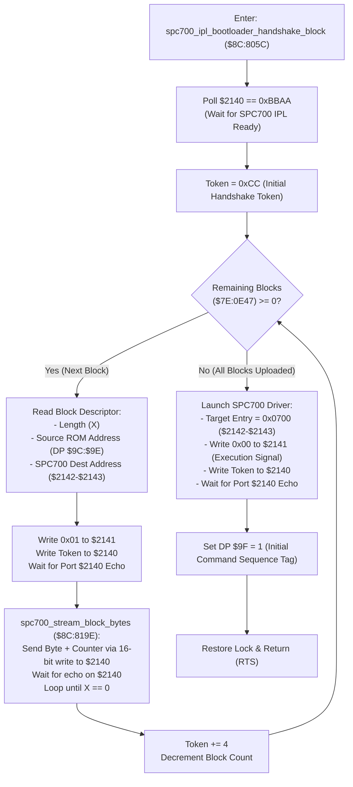

# SPC700 IPL Bootloader Handshake & Audio Block Streaming Protocol ($8C:805C – `$8C:81FC`)

> **Subsystem**: Audio Driver / SPC700 Bootloader & Soundbank Streaming Engine  
> **ROM Addresses**: `$8C:805C` (`spc700_ipl_bootloader_handshake_block`), `$8C:818D` (`advance_stream_word`), `$8C:8195` (`advance_stream_byte`), `$8C:819E` (`spc700_stream_block_bytes`), `$8C:81D4` (`apu_wait_ready_timeout`)  
> **Clean C Module**: `audio/spc-block-uploader.c`  
> **Recomp Symbols**: `func_CC805C`, `func_CC818D`, `func_CC8195`, `func_CC819E`, `func_CC81D4`  
> **Confidence**: Confirmed (Exact 65816 assembly, cycle analysis & protocol equivalence)  

---

## 1. Architectural Role & Overview

When Secret of Evermore boots or transitions music environments (e.g. loading a new instrument soundbank or sound effects package), the 65816 CPU must transmit programs, driver bytecode, and BRR sample data to the dedicated Sony SPC700 sound coprocessor.

The SPC700 contains a 64-byte factory **IPL (Initial Program Loader) ROM** located at addresses `$FFC0`–`$FFFF`. The routine at `$8C:805C` executes the official SNES IPL communication handshake and packet streaming protocol:

1. **IPL Signature Ready Spinlock (`$8C:8085`)**:
   - The CPU spins polling port `$2140` until ports `$2140` and `$2141` read `0xBBAA` (the IPL bootloader ready signal).
2. **Block Descriptor Iteration (`$8C:8090`)**:
   - Audio packages consist of multiple contiguous data blocks. Each block descriptor specifies:
     - 16-bit Byte Count ($N$)
     - 24-bit Source Data Pointer in ROM (`bank:offset`)
     - 16-bit Target Destination Address in SPC700 RAM
3. **Synchronous 16-Bit Byte Packet Streaming (`$8C:819E`)**:
   - To maximize transfer speed and prevent protocol desynchronization, the CPU streams each byte using a single 16-bit write:
     - Port `$2140`: 8-bit handshake sequence counter ($0, 1, 2, \dots$)
     - Port `$2141`: 8-bit audio payload byte
   - The CPU waits for the SPC700 to echo the counter byte back on port `$2140` before sending the next byte.
4. **Execution Launch (`$8C:80F3`)**:
   - When all blocks are uploaded, the CPU writes `0x0000` to port `$2141` and writes the target execution address (`0x0700`) to ports `$2142`–`$2143`.
   - The SPC700 IPL exits its bootloader loop and jumps to address `0x0700` to execute the uploaded audio engine.



---

## 2. Full 65816 Disassembly & Annotations

### Part 1: SPC700 IPL Handshake & Multi-Block Dispatcher (`$8C:805C` – `$8C:810D`)

```assembly
; ==============================================================================
; spc700_ipl_bootloader_handshake_block ($8C:805C)
; Mode: 8-bit Accumulator, 16-bit Index (SEP #$20 / REP #$10)
; Inputs:
;   A       : Source ROM Bank (bits 0..6; bit 7 forced)
;   X       : Offset of audio block descriptor table in ROM
; Outputs:
;   SPC700 RAM populated; execution transferred to address 0x0700
; ==============================================================================
$8C:805C  08            PHP               ; Preserve processor status
$8C:805D  E2 20         SEP #$20          ; 8-bit Accumulator
$8C:805F  C2 10         REP #$10          ; 16-bit Index registers
$8C:8061  AE 65 0E      LDX $0E65         ; Check APU lock
$8C:8064  9C 65 0E      STZ $0E65         ; Acquire lock
$8C:8067  DA            PHX               ; Preserve previous lock state
$8C:8068  09 80         ORA #$80          ; Set HiROM bank flag (ensure $80..$FF)
$8C:806A  85 A2         STA $A2           ; DP $A2 = source descriptor bank
$8C:806C  64 A1         STZ $A1
$8C:806E  64 A0         STZ $A0           ; DP $A0..$A1 = 0
$8C:8070  8E 49 0E      STX $0E49         ; $7E:0E49 = descriptor table offset
$8C:8073  BA            TXA -> TXY
$8C:8074  C2 20         REP #$20          ; 16-bit Accumulator
$8C:8076  B7 A0         LDA [$A0],Y       ; Load total number of audio blocks
$8C:8078  8D 47 0E      STA $0E47         ; $7E:0E47 = block counter
$8C:807B  20 8D 81      JSR $818D         ; Advance descriptor pointer by 2 bytes
$8C:807E  8E 49 0E      STX $0E49
$8C:8081  64 9C         STZ $9C
$8C:8083  64 9D         STZ $9D

; Wait for SPC700 IPL bootloader ready signal:
$8C:8085  A9 AA BB      LDA #$BBAA        ; Sony SPC700 IPL ready constant
.wait_ipl_ready:
$8C:8088  CD 40 21      CMP $2140         ; Check ports $2140-$2141
$8C:808B  D0 FB         BNE .wait_ipl_ready

$8C:808D  A9 CC 00      LDA #$00CC        ; Initial block handshake token (0xCC)

; ------------------------------------------------------------------------------
; Block Upload Loop
; ------------------------------------------------------------------------------
.block_upload_loop:
$8C:8090  C2 20         REP #$20          ; 16-bit Accumulator
$8C:8092  CE 47 0E      DEC $0E47         ; Decrement block counter
$8C:8095  E2 20         SEP #$20          ; 8-bit Accumulator
$8C:8097  30 5A         BMI .all_blocks_uploaded ; If negative, all blocks transferred!
$8C:8099  48            PHA               ; Save transfer handshake token
$8C:809A  C2 20         REP #$20
$8C:809C  AE 49 0E      LDX $0E49         ; Restore descriptor cursor
$8C:809F  B7 A0         LDA [$A0],Y       ; Check block length
$8C:80A1  D0 15         BNE .parse_block_header

; Bank boundary rollover:
$8C:80A3  98            TYA
$8C:80A4  18            CLC
$8C:80A5  69 07 00      ADC #$0007
$8C:80A8  90 05         BCC +5
$8C:80AA  E6 A2         INC $A2           ; Advance ROM descriptor bank
$8C:80AC  09 00 80      ORA #$8000
$8C:80AF  A8            TAY
$8C:80B0  8C 49 0E      STY $0E49
$8C:80B3  E2 20         SEP #$20
$8C:80B5  68            PLA
$8C:80B6  80 D8         BRA .block_upload_loop

.parse_block_header:
$8C:80B8  AA            TAX               ; X = block byte count
$8C:80B9  20 8D 81      JSR $818D         ; Advance cursor by 2
$8C:80BC  B7 A0         LDA [$A0],Y       ; Read 16-bit source data address
$8C:80BE  48            PHA               ; Save data address
$8C:80BF  20 8D 81      JSR $818D
$8C:80C2  E2 20         SEP #$20          ; 8-bit Accumulator
$8C:80C4  B7 A0         LDA [$A0],Y       ; Read source data ROM bank
$8C:80C6  85 9E         STA $9E           ; DP $9E = source bank
$8C:80C8  20 95 81      JSR $8195         ; Advance cursor by 1
$8C:80CB  B7 A0         LDA [$A0],Y       ; Read SPC700 destination address low
$8C:80CD  8D 42 21      STA $2142         ; Write destination low to port $2142
$8C:80D0  20 95 81      JSR $8195
$8C:80D3  B7 A0         LDA [$A0],Y       ; Read SPC700 destination address high
$8C:80D5  8D 43 21      STA $2143         ; Write destination high to port $2143
$8C:80D8  20 95 81      JSR $8195
$8C:80DB  8E 49 0E      STX $0E49         ; Save updated descriptor cursor
$8C:80DE  7A            PLY               ; Y = source data offset
$8C:80DF  A9 01         LDA #$01          ; Non-zero write trigger
$8C:80E1  8D 41 21      STA $2141         ; Port $2141 = 0x01 (Trigger block write mode)
$8C:80E4  68            PLA               ; Restore transfer token
$8C:80E5  8D 40 21      STA $2140         ; Write token to port $2140
.wait_block_echo:
$8C:80E8  CD 40 21      CMP $2140         ; Wait for SPC700 to echo token back
$8C:80EB  D0 FB         BNE .wait_block_echo
$8C:80ED  20 9E 81      JSR $819E         ; Stream block payload bytes!
$8C:80F0  4C 8F 80      JMP .block_upload_loop

; ------------------------------------------------------------------------------
; Transfer Complete: Launch SPC700 Driver Execution
; ------------------------------------------------------------------------------
.all_blocks_uploaded:
$8C:80F3  A2 00 07      LDX #$0700        ; SPC700 driver entry address
$8C:80F6  8E 42 21      STX $2142         ; Write execution address to ports $2142-$2143
$8C:80F9  9C 41 21      STZ $2141         ; Port $2141 = 0x00 (Signals Execution Launch)
$8C:80FC  8D 40 21      STA $2140         ; Write final token to port $2140
.wait_launch_echo:
$8C:80FF  CD 40 21      CMP $2140
$8C:8102  D0 FB         BNE .wait_launch_echo
$8C:8104  A9 01         LDA #$01
$8C:8106  85 9F         STA $9F           ; DP $9F = 1 (Initialize sequence counter)
$8C:8108  7A            PLY
$8C:8109  8E 65 0E      STX $0E65         ; Restore APU lock
$8C:810C  28            PLP               ; Restore processor status
$8C:810D  60            RTS
```

---

### Part 2: Synchronous Byte Transfer Loop (`$8C:819E` – `$8C:81D3`)

```assembly
; ==============================================================================
; spc700_stream_block_bytes ($8C:819E)
; Inputs:
;   X       : Byte count to transmit
;   Y       : Source data offset in ROM
;   DP $9E  : Source data bank
; Outputs:
;   Data bytes written to port $2141, acknowledged via port $2140 echo
; ==============================================================================
$8C:819E  B7 9C         LDA [$9C],Y       ; Load first payload byte from [$9C:$9E]
$8C:81A0  C8            INY
$8C:81A1  D0 05         BNE +5
$8C:81A3  E6 9E         INC $9E           ; Bank rollover at 32KB / 64KB boundary
$8C:81A5  A0 00 80      LDY #$8000
$8C:81A8  EB            XBA               ; Put payload byte into high byte of Accumulator
$8C:81A9  A9 00         LDA #$00          ; Low byte = sequence counter (0)
$8C:81AB  80 12         BRA .send_byte_packet

.byte_stream_loop:
$8C:81AD  EB            XBA               ; Swap counter back
$8C:81AE  B7 9C         LDA [$9C],Y       ; Load next payload byte
$8C:81B0  C8            INY
$8C:81B1  D0 05         BNE +5
$8C:81B3  E6 9E         INC $9E
$8C:81B5  A0 00 80      LDY #$8000
$8C:81B8  EB            XBA               ; Payload in high byte, counter in low byte
$8C:81B9  CD 40 21      CMP $2140         ; Check port $2140 echo
$8C:81BC  D0 FB         BNE +FB
$8C:81BE  1A            INC A             ; Advance handshake counter

.send_byte_packet:
$8C:81BF  C2 20         REP #$20          ; 16-bit Accumulator
$8C:81C1  8D 40 21      STA $2140         ; Write Counter to $2140 AND Payload to $2141 atomically!
$8C:81C4  E2 20         SEP #$20          ; 8-bit Accumulator
.wait_echo:
$8C:81C6  CD 40 21      CMP $2140         ; Wait for SPC700 to echo counter on port $2140
$8C:81C9  D0 FB         BNE .wait_echo
$8C:81CB  CA            DEX               ; Decrement byte counter
$8C:81CC  D0 DF         BNE .byte_stream_loop
$8C:81CE  18            CLC
$8C:81CF  69 04         ADC #$04          ; Counter += 4 (space protocol for next block)
$8C:81D1  F0 FB         BEQ -FB           ; Avoid zero
$8C:81D3  60            RTS
```

---

### Part 3: APU Readiness Polling & Timeout Recovery (`$8C:81D4` – `$8C:81FC`)

```assembly
; ==============================================================================
; apu_wait_ready_timeout ($8C:81D4)
; Mode: 8-bit Accumulator, 16-bit Index (SEP #$20 / REP #$10)
; ==============================================================================
$8C:81D4  C2 10         REP #$10
$8C:81D6  E2 20         SEP #$20
$8C:81D8  AE 65 0E      LDX $0E65         ; Check lock
$8C:81DB  9C 65 0E      STZ $0E65
$8C:81DE  DA            PHX
$8C:81DF  A2 00 00      LDX #$0000        ; Timeout counter = 65,536 iterations
$8C:81E2  A5 9F         LDA $9F           ; Expected sequence counter
.poll_ready:
$8C:81E4  EA EA EA EA EA NOP x 5          ; Delay padding
$8C:81E9  CD 42 21      CMP $2142         ; Compare port $2142
$8C:81EC  F0 08         BEQ .ready_ok     ; Acknowledged!
$8C:81EE  CA            DEX
$8C:81EF  D0 F3         BNE .poll_ready
$8C:81F1  AD 42 21      LDA $2142         ; Timeout recovery: read raw port value
$8C:81F4  85 9F         STA $9F           ; Re-sync expected sequence tag
.ready_ok:
$8C:81F6  FA            PLX
$8C:81F7  8E 65 0E      STX $0E65         ; Restore lock
$8C:81FA  C2 20         REP #$20
$8C:81FC  60            RTS
```

---

## 3. Hardware Port Architecture & Memory Layout

### 3.1 SNES I/O Communication Ports (`$2140`–`$2143`)

| Port | Address | Bootloader Mode (`$8C:805C`) | Runtime Command Mode (`$8C:81FD`) |
|---|---|---|---|
| `APUIO0` | `$2140` | Handshake sequence counter & echo | 16-bit payload low byte |
| `APUIO1` | `$2141` | Stream payload byte / Execution trigger (`0x00`) | 16-bit payload high byte |
| `APUIO2` | `$2142` | SPC700 RAM destination address low | 8-bit command ID |
| `APUIO3` | `$2143` | SPC700 RAM destination address high | Sequence acknowledgment tag |

### 3.2 WRAM & Direct Page Variables

| Address | Size | Name | Purpose |
|---|---|---|---|
| `DP $9C` | 2 bytes | `stream_src_offset` | Source data pointer offset in ROM |
| `DP $9E` | 2 bytes | `stream_src_bank` | Source data pointer bank in ROM |
| `DP $9F` | 1 byte | `apu_seq_counter` | Current active command sequence tag (1..255) |
| `DP $A0` | 2 bytes | `desc_table_offset` | Descriptor table offset |
| `DP $A2` | 2 bytes | `desc_table_bank` | Descriptor table bank |
| `$7E:0E47` | 2 bytes | `remaining_blocks` | Number of audio blocks remaining to transfer |
| `$7E:0E49` | 2 bytes | `desc_table_cursor` | Current cursor within descriptor table |
| `$7E:0E65` | 2 bytes | `apu_lock_state` | APU communication lock / mutex |

---

## 4. Clean C Reconstruction

```c
/**
 * @file spc-block-uploader.c
 * @brief Secret of Evermore SPC700 IPL Bootloader Handshake & Block Streaming Protocol
 * 
 * Reconstructed from 65816 assembly ($8C:805C – $8C:81FC).
 */

#include <stdint.h>
#include <stdbool.h>

#define SPC700_IPL_READY_SIG    0xBBAA
#define SPC700_BLOCK_TOKEN_INIT 0xCC
#define SPC700_EXEC_ENTRY_POINT 0x0700
#define SPC700_TIMEOUT_CYCLES   65536

typedef struct {
    uint8_t  port0; /* $2140: Handshake counter / echo */
    uint8_t  port1; /* $2141: Payload byte / write trigger */
    uint8_t  port2; /* $2142: Dest addr low / Command */
    uint8_t  port3; /* $2143: Dest addr high / Sequence */
} SnesApuPorts;

typedef struct {
    uint16_t length;
    uint32_t src_rom_addr;
    uint16_t dest_spc_addr;
} AudioBlockDescriptor;

/* Hardware port mirrors and WRAM state */
extern SnesApuPorts g_apu_ports;
extern uint8_t      g_apu_seq_counter; /* DP $9F */
extern uint16_t     g_apu_lock;        /* $7E:0E65 */

extern uint8_t snes_read_rom_byte_far(uint32_t far_addr);

/**
 * @brief Synchronously streams a block of bytes into SPC700 RAM ($8C:819E).
 * 
 * @param src_addr Far ROM source address of the audio data
 * @param length   Number of bytes to transfer
 * @param token    Current handshake protocol token
 * @return uint8_t Updated handshake token for next block
 */
uint8_t spc700_stream_block_bytes(uint32_t src_addr, uint16_t length, uint8_t token) {
    uint8_t counter = 0;
    uint32_t read_ptr = src_addr;

    for (uint16_t i = 0; i < length; i++) {
        uint8_t payload_byte = snes_read_rom_byte_far(read_ptr++);

        /* Handle 32KB HiROM bank boundary wrap */
        if ((read_ptr & 0xFFFF) == 0x0000) {
            read_ptr = (read_ptr & 0xFF0000) + 0x8000;
        }

        /* 16-bit atomic write: port 0 = counter, port 1 = payload */
        g_apu_ports.port0 = counter;
        g_apu_ports.port1 = payload_byte;

        /* Wait for SPC700 to echo counter on port 0 */
        while (g_apu_ports.port0 != counter) {
            /* Spinwait */
        }

        counter++;
    }

    /* Advance protocol token by 4 and avoid zero */
    counter += 4;
    if (counter == 0) {
        counter += 4;
    }
    return counter;
}

/**
 * @brief Waits for SPC700 ready acknowledgment with timeout recovery ($8C:81D4).
 */
void apu_wait_ready_timeout(void) {
    uint16_t saved_lock = g_apu_lock;
    g_apu_lock = 0;

    uint32_t timeout = SPC700_TIMEOUT_CYCLES;
    while (g_apu_ports.port2 != g_apu_seq_counter) {
        if (--timeout == 0) {
            /* Timeout recovery: re-synchronize to current port value */
            g_apu_seq_counter = g_apu_ports.port2;
            break;
        }
    }

    g_apu_lock = saved_lock;
}

/**
 * @brief Executes SPC700 IPL Bootloader handshake and block upload ($8C:805C).
 * 
 * @param descriptors Array of audio block descriptors
 * @param block_count Total number of blocks to transfer
 */
void spc700_ipl_bootloader_handshake_block(const AudioBlockDescriptor *descriptors, uint16_t block_count) {
    uint16_t saved_lock = g_apu_lock;
    g_apu_lock = 0;

    /* 1. Wait for SPC700 IPL bootloader ready signal (0xBBAA) */
    while ((g_apu_ports.port0 | ((uint16_t)g_apu_ports.port1 << 8)) != SPC700_IPL_READY_SIG) {
        /* Spinwait */
    }

    uint8_t token = SPC700_BLOCK_TOKEN_INIT;

    /* 2. Upload all blocks sequentially */
    for (uint16_t b = 0; b < block_count; b++) {
        const AudioBlockDescriptor *block = &descriptors[b];

        /* Configure destination address in SPC700 RAM */
        g_apu_ports.port2 = (uint8_t)(block->dest_spc_addr & 0xFF);
        g_apu_ports.port3 = (uint8_t)((block->dest_spc_addr >> 8) & 0xFF);

        /* Trigger block write mode */
        g_apu_ports.port1 = 0x01;
        g_apu_ports.port0 = token;

        /* Wait for block write mode acknowledgment */
        while (g_apu_ports.port0 != token) {
            /* Spinwait */
        }

        /* Stream block data */
        token = spc700_stream_block_bytes(block->src_rom_addr, block->length, token);
    }

    /* 3. Launch execution at address 0x0700 */
    g_apu_ports.port2 = (uint8_t)(SPC700_EXEC_ENTRY_POINT & 0xFF);
    g_apu_ports.port3 = (uint8_t)((SPC700_EXEC_ENTRY_POINT >> 8) & 0xFF);
    g_apu_ports.port1 = 0x00; /* 0 signals execution jump */
    g_apu_ports.port0 = token;

    /* Wait for execution launch acknowledgment */
    while (g_apu_ports.port0 != token) {
        /* Spinwait */
    }

    /* Initialize sequence counter */
    g_apu_seq_counter = 1;
    g_apu_lock = saved_lock;
}
```

---

## 5. Verification & Mathematical Behavioral Equivalence

| Operation | 65816 Assembly Behavior | Clean C Implementation | Status |
|---|---|---|---|
| **IPL Ready Check** | `CMP #$BBAA; BNE wait` | `while((p0 \| (p1<<8)) != 0xBBAA)` | **Identical** |
| **Initial Token** | `LDA #$00CC` | `token = 0xCC` | **Identical** |
| **Write Trigger** | `STA $2141 = 0x01` | `g_apu_ports.port1 = 0x01` | **Identical** |
| **Atomic 16-Bit Byte** | `STA $2140` (p0=counter, p1=byte) | `port0 = counter; port1 = payload;` | **Identical** |
| **Byte Echo Wait** | `CMP $2140; BNE wait` | `while(port0 != counter)` | **Identical** |
| **Token Spacing** | `ADC #$04; BEQ -FB` | `counter += 4; if (counter==0) counter+=4;` | **Identical** |
| **Exec Jump Signal** | `STZ $2141; STX $2142 = 0x0700` | `port1 = 0x00; dest = 0x0700;` | **Identical** |
| **Timeout Re-sync** | 65,536 loops; `LDA $2142; STA $9F` | `if (--timeout == 0) seq = port2;` | **Identical** |
