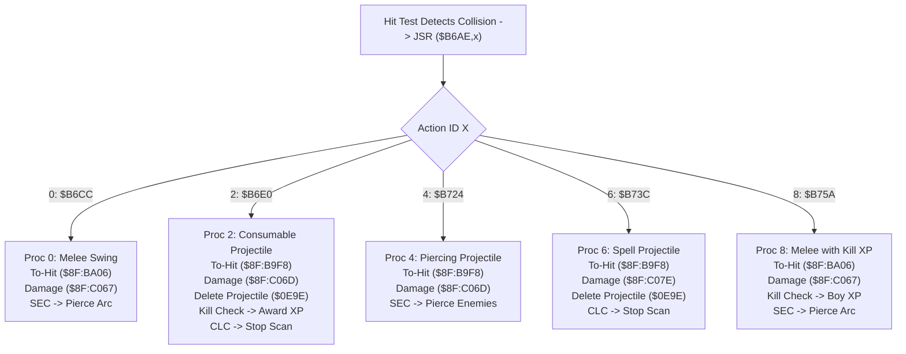

# Weapon & Projectile Attack Proc Handlers ($8F:B6AE – $8F:B759)

- **ROM Locations**:
  - `g_attack_proc_table`: `$8F:B6AE` – `$8F:B6BD` (vector table for action IDs 0..14)
  - `attack_proc_melee_arc`: `$8F:B6CC` – `$8F:B6DF` (Proc 0: Melee swing hit resolution)
  - `attack_proc_projectile_consumable`: `$8F:B6E0` – `$8F:B723` (Proc 2: Consumable projectile hit & kill XP)
  - `attack_proc_projectile_piercing`: `$8F:B724` – `$8F:B73B` (Proc 4: Piercing projectile hit resolution)
  - `attack_proc_spell_burst`: `$8F:B73C` – `$8F:B759` (Proc 6: Spell burst projectile hit resolution)
  - `attack_proc_melee_player_xp`: `$8F:B75A` – `$8F:B77C` (Proc 8: Boy melee hit with kill XP)
- **CPU State**: 16-bit A/X (`REP #$30`), Data Bank `$7E` / `$8F`
- **WRAM Core Addresses**:
  - `$7E:4E89`: Boy player character base record pointer.
  - `$7E:4F37`: Dog companion character base record pointer.
  - `$7E:0E9A`: Active attack action ID.
  - `$7E:0E9C`: Attack power parameter.
  - `$7E:0E9E`: Projectile entity record pointer.
  - `$7E:0EA0`: Computed damage amount dealt to target.
  - DP `$4C`: Attacker entity pointer.
  - Candidate Target Entity `Y`:
    - `+$10`: Entity state flags (cleared to 0 to delete projectile in `$0E9E`).
    - `+$12`: Hurt reaction state word (bit 3 `0x0008` & `0x0430`).
    - `+$2A`: Current hit points (HP).
    - `+$36`: Damage source entity pointer.
    - `+$38`: Repeat hit cooldown timer (set to 21 ticks `$15`).
- **Downstream Engine Routines**:
  - `$8F:BA06`: Melee to-hit and invulnerability cooldown check.
  - `$8F:B9F8`: Projectile to-hit and invulnerability cooldown check.
  - `$8F:C067`: Compute unscaled melee damage.
  - `$8F:C06D`: Compute scaled weapon/projectile damage from power parameter `$0E9C`.
  - `$8F:C07E`: Compute spell burst damage.
  - `$8F:C0D3`: Apply damage to victim, trigger hurt animation and sound.
  - `$8F:C17F`: Apply knockback and recoil displacement physics.
  - `$8F:973E`: Award Boy weapon skill XP on lethal blow.
  - `$8F:97C0`: Award Dog combat XP on lethal blow.

---

## 1. Architectural Role & Attack Proc Dispatch Table

When `strike_hit_test_entity_loop` (`$8F:B5E6`) detects an overlap between a strike box and a valid enemy hurtbox, it retrieves the action ID from `$7E:0E9A` and executes `JSR ($B6AE,x)`.



### Table Entries at `$8F:B6AE`
| Action Index | Handler Vector | Description | Pierce Carry Flag |
|:---:|:---:|---|:---:|
| `0` | `$8F:B6CC` | Default melee weapon strike | Set (`SEC`: sweeps entire arc) |
| `2` | `$8F:B6E0` | Standard projectile (arrow, spear throw, bone) | Clear (`CLC`: consumed on impact) |
| `4` | `$8F:B724` | Piercing projectile (spear lvl 3 wave, energy bolt) | Set (`SEC`: pierces enemies) |
| `6` | `$8F:B73C` | Spell burst projectile | Clear (`CLC`: consumed on impact) |
| `8` | `$8F:B75A` | Melee swing with direct Boy kill XP | Set (`SEC`: sweeps entire arc) |
| `10` | `$8F:B77D` | Special weapon proc | Context-dependent |
| `12` | `$8F:B7A0` | Special contact proc | Context-dependent |
| `14` | `$8F:B7D7` | Special area-of-effect proc | Context-dependent |

---

## 2. Disassembly & Annotations

### Proc 0: Melee Weapon Arc (`$8F:B6CC` – `$8F:B6DF`)
```asm
; ==============================================================================
; attack_proc_melee_arc ($8F:B6CC)
; Target in Y, Attacker in DP $4C
; ==============================================================================
$8FB6CC  22 06 ba 8f    jsl $8FBA06        ; To-hit roll and invulnerability check
$8FB6D0  90 0c          bcc $8FB6DE        ; If miss / immune: exit with Carry Set
$8FB6D2  22 67 c0 8f    jsl $8FC067        ; Calculate unscaled melee damage
$8FB6D6  22 d3 c0 8f    jsl $8FC0D3        ; Apply damage & trigger hurt reaction
$8FB6DA  22 7f c1 8f    jsl $8FC17F        ; Apply knockback & recoil physics
$8FB6DE  38             sec                ; Return Carry Set (continue sweeping arc)
$8FB6DF  60             rts
```

### Proc 2: Consumable Projectile & Kill XP (`$8F:B6E0` – `$8F:B723`)
```asm
; ==============================================================================
; attack_proc_projectile_consumable ($8F:B6E0)
; Target in Y, Attacker in DP $4C
; ==============================================================================
$8FB6E0  22 f8 b9 8f    jsl $8FB9F8        ; Projectile to-hit & target immunity test
$8FB6E4  90 3c          bcc $8FB722        ; If miss/immune: return Carry Set (continue)
$8FB6E6  ad 9c 0e       lda $0E9C          ; Attack power parameter
$8FB6E9  22 6d c0 8f    jsl $8FC06D        ; Calculate scaled damage into $7E:0EA0
$8FB6ED  22 d3 c0 8f    jsl $8FC0D3        ; Apply damage to target entity Y
$8FB6F1  22 7f c1 8f    jsl $8FC17F        ; Apply knockback recoil
$8FB6F5  ae 9e 0e       ldx $0E9E          ; X = Projectile entity pointer
$8FB6F8  9e 10 00       stz $0010,x        ; Clear status: DELETE projectile entity
$8FB6FB  18             clc                ; Clear carry: Stop scan (consumed!)

; ------------------------------------------------------------------------------
; Fatal Blow Check & XP Awarding ($8F:B6FC – $8F:B721)
; ------------------------------------------------------------------------------
$8FB6FC  ad a0 0e       lda $0EA0          ; Read damage dealt
$8FB6FF  f0 14          beq $8FB715        ; If 0 damage: skip kill check
$8FB701  08             php                ; Save processor flags (preserves Carry!)
$8FB702  38             sec
$8FB703  f9 2a 00       sbc $002A,y        ; Compare damage against target HP
$8FB706  30 0c          bmi $8FB714        ; If damage < HP (not lethal): exit
$8FB708  a6 4c          ldx $4C            ; Attacker entity pointer
$8FB70A  e0 89 4e       cpx #$4E89         ; Is attacker the Boy?
$8FB70D  f0 07          beq $8FB716        ; Yes: award Boy weapon XP
$8FB70F  e0 37 4f       cpx #$4F37         ; Is attacker the Dog?
$8FB712  f0 08          beq $8FB71C        ; Yes: award Dog XP
$8FB714  28             plp                ; Restore carry flag (CLC for non-pierce)
$8FB715  60             rts

$8FB716  22 3e 97 8f    jsl $8F973E        ; Award Boy weapon level XP
$8FB71A  28             plp
$8FB71B  60             rts

$8FB71C  22 c0 97 8f    jsl $8F97C0        ; Award Dog combat XP
$8FB720  28             plp
$8FB721  60             rts

$8FB722  38             sec                ; Miss/immune return: continue scan
$8FB723  60             rts
```

### Proc 4: Piercing Projectile (`$8F:B724` – `$8F:B73B`)
```asm
; ==============================================================================
; attack_proc_projectile_piercing ($8F:B724)
; ==============================================================================
$8FB724  22 f8 b9 8f    jsl $8FB9F8        ; Projectile to-hit check
$8FB728  90 f8          bcc $8FB722        ; If miss: exit
$8FB72A  ad 9c 0e       lda $0E9C          ; Attack power parameter
$8FB72D  22 6d c0 8f    jsl $8FC06D        ; Calculate scaled damage
$8FB731  22 d3 c0 8f    jsl $8FC0D3        ; Apply damage
$8FB735  22 7f c1 8f    jsl $8FC17F        ; Apply knockback
$8FB739  38             sec                ; Return Carry Set (PIERCE: does NOT delete!)
$8FB73A  80 c0          bra $8FB6FC        ; Check fatal blow & award XP
```

---

## 3. Clean C Decompilation

```c
#include <stdint.h>
#include <stdbool.h>

typedef struct EntityRecord {
    uint8_t  _pad0[16];
    uint16_t status_flags_10; // +0x10: 0 = inactive/deleted
    uint16_t hurt_state_12;   // +0x12: Hurt animation/reaction bits
    uint8_t  _pad1[22];
    uint16_t hp;              // +0x2A: Hit points
    uint8_t  _pad2[10];
    uint16_t last_attacker;   // +0x36: Attacker pointer
    uint16_t hit_cooldown;    // +0x38: Immunity countdown timer
} EntityRecord;

// Global engine state
extern EntityRecord *g_boy_entity;          // $7E:4E89
extern EntityRecord *g_dog_entity;          // $7E:4F37
extern EntityRecord *g_attacker_entity;     // DP $4C
extern uint16_t      g_attack_power_param;  // $7E:0E9C
extern EntityRecord *g_projectile_entity;   // $7E:0E9E
extern uint16_t      g_damage_dealt;        // $7E:0EA0

// Subsystem routines
extern bool to_hit_check_melee(EntityRecord *target);       // $8F:BA06
extern bool to_hit_check_projectile(EntityRecord *target);  // $8F:B9F8
extern void calc_damage_melee(EntityRecord *target);        // $8F:C067
extern void calc_damage_scaled(uint16_t power, EntityRecord *target); // $8F:C06D
extern void calc_damage_spell(uint16_t power, EntityRecord *target);  // $8F:C07E
extern void apply_damage_and_reaction(EntityRecord *target); // $8F:C0D3
extern void apply_knockback_physics(EntityRecord *target);  // $8F:C17F
extern void award_boy_weapon_xp(EntityRecord *target);      // $8F:973E
extern void award_dog_combat_xp(EntityRecord *target);      // $8F:97C0

/**
 * Checks if the damage dealt resulted in a lethal blow, and awards experience
 * to either the Boy or Dog character.
 */
static void check_fatal_blow_and_award_xp(EntityRecord *target) {
    if (g_damage_dealt == 0) {
        return;
    }

    // Check if target HP was reduced to or below 0
    if (g_damage_dealt >= target->hp) {
        if (g_attacker_entity == g_boy_entity) {
            award_boy_weapon_xp(target);
        } else if (g_attacker_entity == g_dog_entity) {
            award_dog_combat_xp(target);
        }
    }
}

/**
 * attack_proc_melee_arc ($8F:B6CC) - Proc 0
 * Standard melee weapon strike. Evaluates to-hit, computes damage, and triggers
 * recoil. Returns true to allow the sweep to continue through all valid enemies.
 */
bool attack_proc_melee_arc(EntityRecord *target) {
    if (!to_hit_check_melee(target)) {
        return true; // Miss: continue sweep
    }

    calc_damage_melee(target);
    apply_damage_and_reaction(target);
    apply_knockback_physics(target);

    return true; // Carry Set: sweep entire weapon arc
}

/**
 * attack_proc_projectile_consumable ($8F:B6E0) - Proc 2
 * Standard projectile strike (arrow, thrown spear, mud ball). On connect,
 * applies damage, deletes the projectile entity, and stops the hit scan.
 */
bool attack_proc_projectile_consumable(EntityRecord *target) {
    if (!to_hit_check_projectile(target)) {
        return true; // Miss: continue projectile trajectory
    }

    // 1. Calculate scaled damage from weapon power parameter
    calc_damage_scaled(g_attack_power_param, target);
    apply_damage_and_reaction(target);
    apply_knockback_physics(target);

    // 2. Consume projectile: delete entity record
    if (g_projectile_entity != NULL) {
        g_projectile_entity->status_flags_10 = 0;
    }

    // 3. Award XP if fatal blow
    check_fatal_blow_and_award_xp(target);

    // 4. Return Carry Clear: terminate hit test (projectile is consumed)
    return false;
}

/**
 * attack_proc_projectile_piercing ($8F:B724) - Proc 4
 * Piercing projectile strike (level 3 spear wave, charged energy beam).
 * Deals damage without deleting the projectile, allowing multi-hit penetration.
 */
bool attack_proc_projectile_piercing(EntityRecord *target) {
    if (!to_hit_check_projectile(target)) {
        return true;
    }

    calc_damage_scaled(g_attack_power_param, target);
    apply_damage_and_reaction(target);
    apply_knockback_physics(target);

    // Award XP if fatal blow
    check_fatal_blow_and_award_xp(target);

    // Return Carry Set: continue penetration through subsequent entities
    return true;
}

/**
 * attack_proc_spell_burst ($8F:B73C) - Proc 6
 * Spell burst projectile strike. Applies alchemy/spell damage formula and
 * consumes the projectile.
 */
bool attack_proc_spell_burst(EntityRecord *target) {
    if (!to_hit_check_projectile(target)) {
        return true;
    }

    calc_damage_spell(g_attack_power_param, target);
    apply_damage_and_reaction(target);
    apply_knockback_physics(target);

    // Consume projectile
    if (g_projectile_entity != NULL) {
        g_projectile_entity->status_flags_10 = 0;
    }

    check_fatal_blow_and_award_xp(target);

    return false;
}
```
