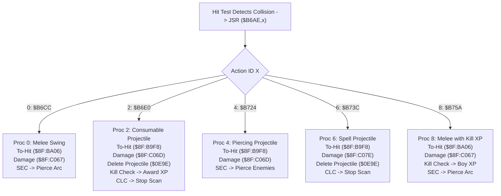

# Weapon & Projectile Attack Proc Handlers ($8F:B6AE – $8F:B759)

- **ROM Locations**:
  - `g_attack_proc_table`: `$8F:B6AE` – `$8F:B6BD` (vector table for action IDs 0..14)
  - `attack_proc_melee_arc`: `$8F:B6CC` – `$8F:B6DF` (Proc 0: Melee swing hit resolution)
  - `attack_proc_projectile_consumable`: `$8F:B6E0` – `$8F:B723` (Proc 2: Consumable projectile hit & kill XP)
  - `attack_proc_projectile_piercing`: `$8F:B724` – `$8F:B73B` (Proc 4: Piercing projectile hit resolution)
  - `attack_proc_spell_burst`: `$8F:B73C` – `$8F:B759` (Proc 6: Spell burst projectile hit resolution)
  - `attack_proc_melee_player_xp`: `$8F:B75A` – `$8F:B77C` (Proc 8: Boy melee hit with kill XP)
- **CPU State**: 16-bit A/X (`REP #$30`), Data Bank `$7E` / `$8F`
- **WRAM Core Addresses**:
  - `$7E:4E89`: Boy player character base record pointer.
  - `$7E:4F37`: Dog companion character base record pointer.
  - `$7E:0E9A`: Active attack action ID.
  - `$7E:0E9C`: Attack power parameter.
  - `$7E:0E9E`: Projectile entity record pointer.
  - `$7E:0EA0`: Computed damage amount dealt to target.
  - DP `$4C`: Attacker entity pointer.
  - Candidate Target Entity `Y`:
    - `+$10`: Entity state flags (cleared to 0 to delete projectile in `$0E9E`).
    - `+$12`: Hurt reaction state word (bit 3 `0x0008` & `0x0430`).
    - `+$2A`: Current hit points (HP).
    - `+$36`: Damage source entity pointer.
    - `+$38`: Repeat hit cooldown timer (set to 21 ticks `$15`).
- **Downstream Engine Routines**:
  - `$8F:BA06`: Melee to-hit and invulnerability cooldown check.
  - `$8F:B9F8`: Projectile to-hit and invulnerability cooldown check.
  - `$8F:C067`: Compute unscaled melee damage.
  - `$8F:C06D`: Compute scaled weapon/projectile damage from power parameter `$0E9C`.
  - `$8F:C07E`: Compute spell burst damage.
  - `$8F:C0D3`: Apply damage to victim, trigger hurt animation and sound.
  - `$8F:C17F`: Apply knockback and recoil displacement physics.
  - `$8F:973E`: Award Boy weapon skill XP on lethal blow.
  - `$8F:97C0`: Award Dog combat XP on lethal blow.

---

## 1. Architectural Role & Attack Proc Dispatch Table

When `strike_hit_test_entity_loop` (`$8F:B5E6`) detects an overlap between a strike box and a valid enemy hurtbox, it retrieves the action ID from `$7E:0E9A` and executes `JSR ($B6AE,x)`.

### Table Entries at `$8F:B6AE`
| Action Index | Handler Vector | Description | Pierce Carry Flag |
|:---:|:---:|---|:---:|
| `0` | `$8F:B6CC` | Default melee weapon strike | Set (`SEC`: sweeps entire arc) |
| `2` | `$8F:B6E0` | Standard projectile (arrow, spear throw, bone) | Clear (`CLC`: consumed on impact) |
| `4` | `$8F:B724` | Piercing projectile (spear lvl 3 wave, energy bolt) | Set (`SEC`: pierces enemies) |
| `6` | `$8F:B73C` | Spell burst projectile | Clear (`CLC`: consumed on impact) |
| `8` | `$8F:B75A` | Melee swing with direct Boy kill XP | Set (`SEC`: sweeps entire arc) |
| `10` | `$8F:B77D` | Special weapon proc | Context-dependent |
| `12` | `$8F:B7A0` | Special contact proc | Context-dependent |
| `14` | `$8F:B7D7` | Special area-of-effect proc | Context-dependent |

---

## 2. Disassembly & Annotations

### Proc 0: Melee Weapon Arc (`$8F:B6CC` – `$8F:B6DF`)
> **Interactive 65816 Assembly**:
> Centralized comments infused at runtime.
> [View in VFS: soe://rom/code/8FB6AE](soe://rom/code/8FB6AE?asm=1&c=0)

### Proc 2: Consumable Projectile & Kill XP (`$8F:B6E0` – `$8F:B723`)
> **Interactive 65816 Assembly**:
> Centralized comments infused at runtime.
> [View in VFS: soe://rom/code/8FB6AE](soe://rom/code/8FB6AE?asm=1&c=0)

### Proc 4: Piercing Projectile (`$8F:B724` – `$8F:B73B`)
> **Interactive 65816 Assembly**:
> Centralized comments infused at runtime.
> [View in VFS: soe://rom/code/8FB6AE](soe://rom/code/8FB6AE?asm=1&c=0)

---

## 3. Clean C Decompilation

> **Reconstructed C Decompilation**:
> Source moved to [`reconstructed-c/8F/8FB6AE_attack_procs.c`](../../../reconstructed-c/8F/8FB6AE_attack_procs.c).
> [View in VFS: soe://rom/code/8FB6AE](soe://rom/code/8FB6AE?c=1&asm=0)

