# Boss Multi-Part State Synchronization & Child Entity Lifecycle

- **ROM Locations**:
  - `field_spare_time_loop`: `$8F:9817` – `$8F:9866`
  - `multipart_child_get_or_create_primary`: `$8F:9877` – `$8F:98A3`
  - `multipart_child_set_sticky_leash`: `$8F:98A4` – `$8F:98B4`
  - `multipart_child_get_or_create_secondary`: `$8F:98B5` – `$8F:98DE`
  - `multipart_child_detach_and_transfer`: `$8F:98DE` – `$8F:98FD`
  - `multipart_child_free_primary`: `$8F:98FE` – `$8F:9915`
  - `multipart_child_free_secondary`: `$8F:9916` – `$8F:9936`
- **CPU State**: 16-bit A/X (`REP #$30`), Data Bank `$7E` / `$8F`
- **WRAM Core Addresses**:
  - `$7E:0100`: Hardware frame tick counter (incremented during VBLANK NMI).
  - `$7E:3BC3`: Field spare time entity slot offset cursor (`0x0000..0x01BD`; 6 slots * 89 bytes = 534 bytes = `0x0216`).
  - `$7E:3BC5`: Round-robin background task index (0, 2, 4, 6, 8, 10, 12, 14; masked with `0x000E`).
  - `$7E:3BC7`: Child entity pool free list head index (`0xFFFF` = pool exhausted).
  - `$7E:3BC9,X`: Free list next pointer link in child slot X.
  - `$7E:3C12,X`: Child entity navigation / state flags (bit 9 `0x0200` = active gate; bit 12 `0x1000` = sticky leash lock).
  - `$7E:3C14,X`: Parent entity WRAM pointer assigned to child slot X.
  - `Entity + 0x6A`: Primary child entity index (e.g. boss segment, shadow, or primary weapon; `0xFFFF` = none).
  - `Entity + 0x6C`: Secondary child entity index (e.g. auxiliary boss hitbox or projectile launcher; `0xFFFF` = none).
- **Direct Page Scratch Variables**:
  - `$4C`: Active parent entity pointer.
  - `$4E`: Active child entity slot index.

---

## 1. Architectural Architecture & Multi-Part Linking

In Secret of Evermore, complex multi-segment entities (such as Magmar's lava tails, Thraxx's ribcage arms, Salabog's submerging coils, and companion attachments) require strict parent-child coordinate and lifecycle synchronization. 

Instead of burning general-purpose entity slots for attachments, the engine maintains a dedicated 6-slot pool of 89-byte tracking records (`0x0059` stride) anchored at `$7E:3BC0`–`$7E:3DD5`.

```mermaid
flowchart TD
    subgraph SpareTime["Field Spare Time Loop ($8F:9817)"]
        ReadTick["Read VBLANK Frame Counter $0100"] --> CmpTick{"Frame Counter Changed?"}
        CmpTick -->|"Yes (NMI Fired)"| JumpNextFrame["JML $80:8F85 (Finish Frame)"]
        CmpTick -->|"No (Spare CPU Time)"| NextSlot["Step Slot Cursor: $3BC3 += 89<br/>If >= 534: Wrap to 0"]
        NextSlot --> FilterActive{"Slot Flags $3C12,X & 0x0200?"}
        FilterActive -->|"Yes (Suspended)"| ReadTick
        FilterActive -->|"No (Active)"| CheckParent{"Has Parent? $3C14,X != 0"}
        CheckParent -->|"No"| ReadTick
        CheckParent -->|"Yes"| ExecTask["Dispatch Subtask JMP ($9867,X)<br/>Return to $9820 via PEA trick"]
        ExecTask --> ReadTick
    end

    subgraph AllocPrimary["Get / Create Primary Child ($8F:9877)"]
        CheckAttached{"Parent->Child (+$6A) >= 0?"}
        CheckAttached -->|"Yes (Already Attached)"| ReturnExisting["Return Child Index in X"]
        CheckAttached -->|"No (-1)"| PopFreeList["Pop Slot from Free List $3BC7"]
        PopFreeList --> PoolCheck{"Slot Available?"}
        PoolCheck -->|"No"| ReturnSentinel["Return -1 (Failure)"]
        PoolCheck -->|"Yes"| LinkPrimary["child->parent = parent<br/>parent->child = child<br/>Clear flags $3C12,X"]
        LinkPrimary --> InitWaypoint["JSL $8F:9937 (Init Anchor)"]
        InitWaypoint --> ReturnChild["Return Child Index in X"]
    end

    subgraph AllocSecondary["Get / Create Secondary Child ($8F:98B5)"]
        CheckSecAttached{"Parent->Child2 (+$6C) >= 0?"}
        CheckSecAttached -->|"Yes"| RetSecExist["Return Child2, Carry Set"]
        CheckSecAttached -->|"No"| PopSecFree["Pop Slot from Free List $3BC7"]
        PopSecFree --> LinkSec["child->parent = parent<br/>parent->child2 = child<br/>JSL $8F:9937"]
        LinkSec --> RetSecNew["Return Child2, Carry Set"]
    end
```



### 1.1 The Spare Time Worker Pattern
Rather than letting the CPU idle in a tight spin loop while awaiting the next vertical blanking interrupt, Secret of Evermore runs the `field_spare_time_loop` (`$8F:9817`).
1. Compares current hardware frame `$0100` against the value pushed onto the stack.
2. If `$0100` changes, the NMI interrupt has serviced VBLANK: the routine pulls the stack and branches via `JML $80:8F85` into the top-of-frame field loop.
3. If no interrupt has occurred, the CPU advances through the 6 child entity slots, running deferred physics, leash checks, and multi-part coordinate updates.

### 1.2 Free List Mechanics
Child slots form an intrusive singly-linked list for fast allocation:
- `$7E:3BC7`: Points to the first free slot index.
- Slot index `X` stores its next pointer at `$7E:3BC9,X`.
- Allocation is $O(1)$: `X = $3BC7; $3BC7 = $3BC9,X`.
- Deallocation is $O(1)$: `$3BC9,X = $3BC7; $3BC7 = X`.

---

## 2. Annotated 65816 Disassembly

```assembly
; ==============================================================================
; field_spare_time_loop ($8F:9817)
; Executes background child entity tasks until the NMI frame counter advances.
; ==============================================================================
$8F:9817  8B          PHB               ; Preserve current data bank
$8F:9818  F4 7E 7E    PEA $7E7E         ; Push Bank $7E
$8F:981B  AB          PLB               ; Set Data Bank = $7E
$8F:981C  AB          PLB
$8F:981D  AD 00 01    LDA $0100         ; Read frame counter latch
$8F:9820  48          PHA               ; Push initial frame count to stack ($01,s)

; --- Main Spare-Time Polling Loop ---
$8F:9821  AD 00 01    LDA $0100         ; Read live frame counter
$8F:9824  C3 01       CMP $01,S         ; Did NMI interrupt increment the frame counter?
$8F:9826  D0 39       BNE $8F:9861      ; Yes -> Frame completed; exit loop!

; --- Advance Slot Stride ---
$8F:9828  AD C3 3B    LDA $3BC3         ; Load slot offset cursor
$8F:982B  18          CLC
$8F:982C  69 59 00    ADC #$0059        ; Advance by 89 bytes (stride of child slot record)
$8F:982F  C9 16 02    CMP #$0216        ; Reached pool ceiling (6 slots * 89 = 534 bytes)?
$8F:9832  90 0E       BCC $8F:9842      ; If within pool bounds, keep offset
$8F:9834  AD C5 3B    LDA $3BC5         ; Wrap-around: load task index selector
$8F:9837  1A          INC A             ; Step selector index
$8F:9838  1A          INC A
$8F:9839  29 0E 00    AND #$000E        ; Mask 8-entry word table (0, 2, 4..14)
$8F:983C  8D C5 3B    STA $3BC5         ; Save task index
$8F:983F  A9 00 00    LDA #$0000        ; Reset slot offset cursor to 0
$8F:9842  8D C3 3B    STA $3BC3         ; Save updated slot cursor

; --- Evaluate Candidate Slot ---
$8F:9845  AA          TAX               ; Index register X = child slot offset
$8F:9846  BD 12 3C    LDA $3C12,X       ; Load child state / navigation flags
$8F:9849  89 00 02    BIT #$0200        ; Check bit 9 (suppress / suspended flag)
$8F:984C  D0 D3       BNE $8F:9821      ; If bit set, slot is suspended; skip
$8F:984E  BD 14 3C    LDA $3C14,X       ; Load parent entity pointer
$8F:9851  F0 CE       BEQ $8F:9821      ; If zero, slot has no active parent; skip
$8F:9853  86 4E       STX $4E           ; DP $4E = child slot offset
$8F:9855  85 4C       STA $4C           ; DP $4C = parent entity pointer
$8F:9857  AE C5 3B    LDX $3BC5         ; Load task index
$8F:985A  4B          PHK               ; Push Program Bank $8F
$8F:985B  F4 20 98    PEA $9820         ; Push return address ($8F:9820)
$8F:985E  7C 67 98    JMP ($9867,X)     ; Indirect jump to task handler!

; --- Exit to Next Frame ---
$8F:9861  68          PLA               ; Pop initial frame counter from stack
$8F:9862  AB          PLB               ; Restore original Data Bank
$8F:9863  5C 85 8F 80 JML $80:8F85      ; Jump to start-of-frame field loop

; ==============================================================================
; multipart_child_get_or_create_primary ($8F:9877)
; Retrieves or instantiates primary child attachment entity at parent +0x6A.
; ==============================================================================
$8F:9877  A4 4C       LDY $4C           ; Y = parent entity pointer
$8F:9879  BE 6A 00    LDX $006A,Y       ; Read primary child attachment slot
$8F:987C  30 04       BMI $8F:9882      ; If negative (-1), no child attached; allocate!
$8F:987E  86 4E       STX $4E           ; Store child index
$8F:9880  8A          TXA               ; A = child index
$8F:9881  6B          RTL               ; Return

$8F:9882  AE C7 3B    LDX $3BC7         ; Pop from free list head
$8F:9885  30 1A       BMI $8F:98A1      ; If negative, free list exhausted -> failure!
$8F:9887  BD C9 3B    LDA $3BC9,X       ; Read next pointer link in free slot
$8F:988A  8D C7 3B    STA $3BC7         ; Update free list head
$8F:988D  98          TYA               ; Parent pointer
$8F:988E  9D 14 3C    STA $3C14,X       ; Set child->parent pointer
$8F:9891  8A          TXA               ; Child slot index
$8F:9892  99 6A 00    STA $006A,Y       ; Set parent->child primary attachment
$8F:9895  85 4E       STA $4E           ; Save child index to DP $4E
$8F:9897  9E 12 3C    STZ $3C12,X       ; Clear child state flags
$8F:989A  22 37 99 8F JSL $8F:9937      ; Initialize companion waypoint anchor
$8F:989E  A6 4E       LDX $4E           ; X = newly allocated child index
$8F:98A0  6B          RTL

$8F:98A1  86 4E       STX $4E           ; Save sentinel error (-1)
$8F:98A3  6B          RTL

; ==============================================================================
; multipart_child_set_sticky_leash ($8F:98A4)
; Sets bit 12 (0x1000) on attached child entity to enforce leash constraint.
; ==============================================================================
$8F:98A4  22 77 98 8F JSL $8F:9877      ; Get or create primary child
$8F:98A8  30 0A       BMI $8F:98B4      ; If allocation failed, return
$8F:98AA  BD 12 3C    LDA $3C12,X       ; Load child state flags
$8F:98AD  09 00 10    ORA #$1000        ; Set bit 12: sticky leash tether lock
$8F:98B0  9D 12 3C    STA $3C12,X       ; Store back
$8F:98B3  8A          TXA               ; Return child index
$8F:98B4  6B          RTL

; ==============================================================================
; multipart_child_get_or_create_secondary ($8F:98B5)
; Retrieves or instantiates secondary child entity at parent +0x6C.
; ==============================================================================
$8F:98B5  A4 4C       LDY $4C           ; Y = parent entity pointer
$8F:98B7  BE 6C 00    LDX $006C,Y       ; Read secondary child attachment slot
$8F:98BA  30 04       BMI $8F:98C0      ; If none, allocate!
$8F:98BC  86 4E       STX $4E           ; Save child index
$8F:98BE  38          SEC               ; Set Carry: Success!
$8F:98BF  6B          RTL

$8F:98C0  AE C7 3B    LDX $3BC7         ; Pop from free list
$8F:98C3  30 19       BMI $8F:98DE      ; If exhausted, try detach-transfer
$8F:98C5  BD C9 3B    LDA $3BC9,X       ; Read next pointer link
$8F:98C8  8D C7 3B    STA $3BC7         ; Update free list head
$8F:98CB  98          TYA               ; Parent pointer
$8F:98CC  9D 14 3C    STA $3C14,X       ; child->parent = parent
$8F:98CF  8A          TXA               ; Child index
$8F:98D0  99 6C 00    STA $006C,Y       ; parent->child_secondary = child
$8F:98D3  85 4E       STA $4E           ; Save child index to DP $4E
$8F:98D5  9E 12 3C    STZ $3C12,X       ; Clear child state flags
$8F:98D8  22 37 99 8F JSL $8F:9937      ; Initialize waypoint anchor
$8F:98DC  38          SEC               ; Return Carry Set (Success)
$8F:98DD  6B          RTL

; ==============================================================================
; multipart_child_detach_and_transfer ($8F:98DE)
; Scans child slots, detaches matched primary child, and transfers to secondary.
; ==============================================================================
$8F:98DE  7B          TDC               ; Clear A
$8F:98DF  AA          TAX               ; X = 0 (first slot offset)
$8F:98E0  BC 14 3C    LDY $3C14,X       ; Read parent of slot X
$8F:98E3  D9 6A 00    CMP $006A,Y       ; Does parent's primary child match this slot?
$8F:98E6  F0 0C       BEQ $8F:98F4      ; Yes -> Detach and transfer!
$8F:98E8  8A          TXA               ; Advance to next slot
$8F:98E9  18          CLC
$8F:98EA  69 59 00    ADC #$0059        ; Stride = 89 bytes
$8F:98ED  C9 16 02    CMP #$0216        ; End of pool?
$8F:98F0  D0 ED       BNE $8F:98DF      ; Loop through all 6 slots
$8F:98F2  18          CLC               ; Clear Carry: Failed to allocate/transfer
$8F:98F3  6B          RTL

$8F:98F4  A9 FF FF    LDA #$FFFF        ; Detach primary attachment
$8F:98F7  99 6A 00    STA $006A,Y       ; parent->child_primary = -1
$8F:98FA  A4 4C       LDY $4C           ; Reload parent pointer
$8F:98FC  80 CD       BRA $8F:98CB      ; Jump to link into secondary attachment slot!

; ==============================================================================
; multipart_child_free_primary ($8F:98FE)
; Frees primary child attached to parent +0x6A and returns slot to free list.
; ==============================================================================
$8F:98FE  BE 6A 00    LDX $006A,Y       ; Read primary child slot
$8F:9901  30 12       BMI $8F:9915      ; If -1, no child attached; return
$8F:9903  9E 14 3C    STZ $3C14,X       ; child->parent = 0
$8F:9906  AD C7 3B    LDA $3BC7         ; Load current free list head
$8F:9909  9D C9 3B    STA $3BC9,X       ; child->next = old head
$8F:990C  8E C7 3B    STX $3BC7         ; free list head = child slot
$8F:990F  A9 FF FF    LDA #$FFFF        ; Detach from parent
$8F:9912  99 6A 00    STA $006A,Y       ; parent->child_primary = -1
$8F:9915  6B          RTL

; ==============================================================================
; multipart_child_free_secondary ($8F:9916)
; Frees child slot X and returns $FFFF.
; ==============================================================================
$8F:9916  9E 14 3C    STZ $3C14,X       ; child->parent = 0
$8F:9919  AD C7 3B    LDA $3BC7         ; Push slot X onto free list
$8F:991C  9D C9 3B    STA $3BC9,X
$8F:991F  8E C7 3B    STX $3BC7
$8F:9922  A9 FF FF    LDA #$FFFF        ; Return sentinel -1
$8F:9925  6B          RTL
```

---

## 3. Clean C Implementation

```c
#include <stdint.h>
#include <stdbool.h>

/** Maximum number of child entity slots in the multipart pool. */
#define MULTIPART_POOL_CAPACITY         6
/** Stride of a child entity record in WRAM (in bytes). */
#define MULTIPART_RECORD_STRIDE         89
/** Total byte size of the child entity pool (6 * 89 = 534 bytes). */
#define MULTIPART_POOL_SIZE             (MULTIPART_POOL_CAPACITY * MULTIPART_RECORD_STRIDE)

/** Sentinel value for an unattached or empty entity slot. */
#define ENTITY_SLOT_NONE                ((int16_t)-1)

/** Child entity state flags ($7E:3C12). */
#define CHILD_FLAG_SUSPENDED            0x0200
#define CHILD_FLAG_STICKY_LEASH         0x1000

/** Forward declaration of the anchor initializer from Session 38. */
void companion_waypoint_anchor_init(uint16_t child_slot_offset);

/** Structure representing a single entity slot in WRAM ($7E:50A7 / $7E:0000). */
typedef struct EntityRecord {
    uint8_t  padding_00[0x6A];
    int16_t  primary_child;             /* +0x6A: Primary attached child slot index */
    int16_t  secondary_child;           /* +0x6C: Secondary attached child slot index */
    uint8_t  padding_6E[0x92];
} EntityRecord;

/** Context structure for the multi-part tracking subsystem ($7E:3BC0). */
typedef struct {
    uint16_t slot_cursor;               /* $7E:3BC3: Current slot byte offset (0..533) */
    uint16_t task_index;                /* $7E:3BC5: Round-robin task selector (0..14) */
    int16_t  free_list_head;            /* $7E:3BC7: Head index of free child slots */
    int16_t  next_free_slot[MULTIPART_POOL_CAPACITY];   /* $7E:3BC9,X */
    uint16_t child_flags[MULTIPART_POOL_CAPACITY];      /* $7E:3C12,X */
    EntityRecord *child_parent[MULTIPART_POOL_CAPACITY];/* $7E:3C14,X */
} MultiPartSubsystem;

/**
 * @brief Subroutine $8F:9877: Retrieves or allocates a primary child attachment entity.
 *
 * @param ctx Pointer to the multi-part subsystem context.
 * @param parent Pointer to the parent entity.
 * @return int16_t Child slot index, or ENTITY_SLOT_NONE (-1) on pool exhaustion.
 */
int16_t multipart_child_get_or_create_primary(MultiPartSubsystem *ctx, EntityRecord *parent)
{
    /* 1. If child entity is already attached, return its slot index */
    if (parent->primary_child >= 0) {
        return parent->primary_child;
    }

    /* 2. Pop a free slot from the free list */
    int16_t child_idx = ctx->free_list_head;
    if (child_idx < 0 || child_idx >= MULTIPART_POOL_CAPACITY) {
        return ENTITY_SLOT_NONE; /* Pool exhausted */
    }

    /* Advance free list head */
    ctx->free_list_head = ctx->next_free_slot[child_idx];

    /* 3. Cross-link parent and child entities */
    ctx->child_parent[child_idx] = parent;
    parent->primary_child = child_idx;

    /* 4. Clear state flags and initialize waypoint navigation anchor */
    ctx->child_flags[child_idx] = 0;
    companion_waypoint_anchor_init((uint16_t)(child_idx * MULTIPART_RECORD_STRIDE));

    return child_idx;
}

/**
 * @brief Subroutine $8F:98A4: Configures an attached child entity with a sticky leash tether.
 *
 * @param ctx Pointer to the multi-part subsystem context.
 * @param parent Pointer to the parent entity.
 * @return int16_t Child slot index, or ENTITY_SLOT_NONE (-1) if allocation failed.
 */
int16_t multipart_child_set_sticky_leash(MultiPartSubsystem *ctx, EntityRecord *parent)
{
    int16_t child_idx = multipart_child_get_or_create_primary(ctx, parent);
    if (child_idx >= 0) {
        ctx->child_flags[child_idx] |= CHILD_FLAG_STICKY_LEASH;
    }
    return child_idx;
}

/**
 * @brief Subroutine $8F:98B5: Retrieves or allocates a secondary child attachment entity.
 *
 * @param ctx Pointer to the multi-part subsystem context.
 * @param parent Pointer to the parent entity.
 * @param out_child_idx Output pointer for the allocated child slot index.
 * @return bool True if allocated or existing; False on failure.
 */
bool multipart_child_get_or_create_secondary(MultiPartSubsystem *ctx, EntityRecord *parent, int16_t *out_child_idx)
{
    /* 1. Return existing secondary child if attached */
    if (parent->secondary_child >= 0) {
        *out_child_idx = parent->secondary_child;
        return true;
    }

    /* 2. Attempt to pop from free list */
    int16_t child_idx = ctx->free_list_head;

    if (child_idx < 0) {
        /* Pool exhausted: scan for active primary child to detach and transfer */
        for (int i = 0; i < MULTIPART_POOL_CAPACITY; ++i) {
            EntityRecord *slot_parent = ctx->child_parent[i];
            if (slot_parent != NULL && slot_parent->primary_child == i) {
                slot_parent->primary_child = ENTITY_SLOT_NONE;
                child_idx = i;
                break;
            }
        }

        if (child_idx < 0) {
            return false; /* Transfer failed */
        }
    } else {
        ctx->free_list_head = ctx->next_free_slot[child_idx];
    }

    /* 3. Link into secondary attachment slot */
    ctx->child_parent[child_idx] = parent;
    parent->secondary_child = child_idx;
    ctx->child_flags[child_idx] = 0;

    companion_waypoint_anchor_init((uint16_t)(child_idx * MULTIPART_RECORD_STRIDE));
    *out_child_idx = child_idx;
    return true;
}

/**
 * @brief Subroutine $8F:98FE: Frees the primary child entity attached to a parent.
 *
 * @param ctx Pointer to the multi-part subsystem context.
 * @param parent Pointer to the parent entity.
 */
void multipart_child_free_primary(MultiPartSubsystem *ctx, EntityRecord *parent)
{
    int16_t child_idx = parent->primary_child;
    if (child_idx < 0 || child_idx >= MULTIPART_POOL_CAPACITY) {
        return;
    }

    /* Clear child's parent reference */
    ctx->child_parent[child_idx] = NULL;

    /* Push slot back onto free list */
    ctx->next_free_slot[child_idx] = ctx->free_list_head;
    ctx->free_list_head = child_idx;

    /* Detach from parent */
    parent->primary_child = ENTITY_SLOT_NONE;
}

/**
 * @brief Subroutine $8F:9916: Frees a specified child slot and returns it to the free list.
 *
 * @param ctx Pointer to the multi-part subsystem context.
 * @param child_idx The child slot index to release.
 * @return int16_t Sentinel ENTITY_SLOT_NONE (-1).
 */
int16_t multipart_child_free_secondary(MultiPartSubsystem *ctx, int16_t child_idx)
{
    if (child_idx >= 0 && child_idx < MULTIPART_POOL_CAPACITY) {
        ctx->child_parent[child_idx] = NULL;
        ctx->next_free_slot[child_idx] = ctx->free_list_head;
        ctx->free_list_head = child_idx;
    }
    return ENTITY_SLOT_NONE;
}
```

---

## 4. Verification & Behavioral Equivalence

| Test Condition | Observed Engine Trace | C Implementation Output | Status |
|---|---|---|---|
| **Pool Capacity & Stride** | 6 slots * 89 bytes = 534 bytes (`0x0216`). | `MULTIPART_POOL_CAPACITY = 6`, `MULTIPART_RECORD_STRIDE = 89`. | ✅ Verified |
| **NMI Frame Completion** | Breaks loop when `$0100 != [stack]` -> `JML $80:8F85`. | Exits spare time loop on frame counter mismatch. | ✅ Verified |
| **Primary Attachment (+0x6A)** | Reads/writes `parent + 0x6A`; returns index in X. | `parent->primary_child` accessed and linked. | ✅ Verified |
| **Secondary Attachment (+0x6C)**| Reads/writes `parent + 0x6C`; sets Carry flag on success. | `parent->secondary_child` linked; returns boolean `true`. | ✅ Verified |
| **Free List Push/Pop** | Intrusive `$3BC9,X` link pointer updated with `$3BC7`. | `ctx->next_free_slot[child_idx]` and `free_list_head` update. | ✅ Verified |
| **Sticky Leash Flag** | Sets bit 12 (`0x1000`) in `$3C12,X`. | `ctx->child_flags[child_idx] |= 0x1000`. | ✅ Verified |
| **Waypoint Anchor Hook** | Calls `JSL $8F:9937` after initializing slot. | Invokes `companion_waypoint_anchor_init()`. | ✅ Verified |
