# Boss Multi-Part State Synchronization & Child Entity Lifecycle

- **ROM Locations**:
  - `field_spare_time_loop`: `$8F:9817` – `$8F:9866`
  - `multipart_child_get_or_create_primary`: `$8F:9877` – `$8F:98A3`
  - `multipart_child_set_sticky_leash`: `$8F:98A4` – `$8F:98B4`
  - `multipart_child_get_or_create_secondary`: `$8F:98B5` – `$8F:98DE`
  - `multipart_child_detach_and_transfer`: `$8F:98DE` – `$8F:98FD`
  - `multipart_child_free_primary`: `$8F:98FE` – `$8F:9915`
  - `multipart_child_free_secondary`: `$8F:9916` – `$8F:9936`
- **CPU State**: 16-bit A/X (`REP #$30`), Data Bank `$7E` / `$8F`
- **WRAM Core Addresses**:
  - `$7E:0100`: Hardware frame tick counter (incremented during VBLANK NMI).
  - `$7E:3BC3`: Field spare time entity slot offset cursor (`0x0000..0x01BD`; 6 slots * 89 bytes = 534 bytes = `0x0216`).
  - `$7E:3BC5`: Round-robin background task index (0, 2, 4, 6, 8, 10, 12, 14; masked with `0x000E`).
  - `$7E:3BC7`: Child entity pool free list head index (`0xFFFF` = pool exhausted).
  - `$7E:3BC9,X`: Free list next pointer link in child slot X.
  - `$7E:3C12,X`: Child entity navigation / state flags (bit 9 `0x0200` = active gate; bit 12 `0x1000` = sticky leash lock).
  - `$7E:3C14,X`: Parent entity WRAM pointer assigned to child slot X.
  - `Entity + 0x6A`: Primary child entity index (e.g. boss segment, shadow, or primary weapon; `0xFFFF` = none).
  - `Entity + 0x6C`: Secondary child entity index (e.g. auxiliary boss hitbox or projectile launcher; `0xFFFF` = none).
- **Direct Page Scratch Variables**:
  - `$4C`: Active parent entity pointer.
  - `$4E`: Active child entity slot index.

---

## 1. Architectural Architecture & Multi-Part Linking

In Secret of Evermore, complex multi-segment entities (such as Magmar's lava tails, Thraxx's ribcage arms, Salabog's submerging coils, and companion attachments) require strict parent-child coordinate and lifecycle synchronization. 

Instead of burning general-purpose entity slots for attachments, the engine maintains a dedicated 6-slot pool of 89-byte tracking records (`0x0059` stride) anchored at `$7E:3BC0`–`$7E:3DD5`.

```mermaid
flowchart TD
    subgraph SpareTime["Field Spare Time Loop ($8F:9817)"]
        ReadTick["Read VBLANK Frame Counter $0100"] --> CmpTick{"Frame Counter Changed?"}
        CmpTick -->|"Yes (NMI Fired)"| JumpNextFrame["JML $80:8F85 (Finish Frame)"]
        CmpTick -->|"No (Spare CPU Time)"| NextSlot["Step Slot Cursor: $3BC3 += 89<br/>If >= 534: Wrap to 0"]
        NextSlot --> FilterActive{"Slot Flags $3C12,X & 0x0200?"}
        FilterActive -->|"Yes (Suspended)"| ReadTick
        FilterActive -->|"No (Active)"| CheckParent{"Has Parent? $3C14,X != 0"}
        CheckParent -->|"No"| ReadTick
        CheckParent -->|"Yes"| ExecTask["Dispatch Subtask JMP ($9867,X)<br/>Return to $9820 via PEA trick"]
        ExecTask --> ReadTick
    end

    subgraph AllocPrimary["Get / Create Primary Child ($8F:9877)"]
        CheckAttached{"Parent->Child (+$6A) >= 0?"}
        CheckAttached -->|"Yes (Already Attached)"| ReturnExisting["Return Child Index in X"]
        CheckAttached -->|"No (-1)"| PopFreeList["Pop Slot from Free List $3BC7"]
        PopFreeList --> PoolCheck{"Slot Available?"}
        PoolCheck -->|"No"| ReturnSentinel["Return -1 (Failure)"]
        PoolCheck -->|"Yes"| LinkPrimary["child->parent = parent<br/>parent->child = child<br/>Clear flags $3C12,X"]
        LinkPrimary --> InitWaypoint["JSL $8F:9937 (Init Anchor)"]
        InitWaypoint --> ReturnChild["Return Child Index in X"]
    end

    subgraph AllocSecondary["Get / Create Secondary Child ($8F:98B5)"]
        CheckSecAttached{"Parent->Child2 (+$6C) >= 0?"}
        CheckSecAttached -->|"Yes"| RetSecExist["Return Child2, Carry Set"]
        CheckSecAttached -->|"No"| PopSecFree["Pop Slot from Free List $3BC7"]
        PopSecFree --> LinkSec["child->parent = parent<br/>parent->child2 = child<br/>JSL $8F:9937"]
        LinkSec --> RetSecNew["Return Child2, Carry Set"]
    end
```

### 1.1 The Spare Time Worker Pattern
Rather than letting the CPU idle in a tight spin loop while awaiting the next vertical blanking interrupt, Secret of Evermore runs the `field_spare_time_loop` (`$8F:9817`).
1. Compares current hardware frame `$0100` against the value pushed onto the stack.
2. If `$0100` changes, the NMI interrupt has serviced VBLANK: the routine pulls the stack and branches via `JML $80:8F85` into the top-of-frame field loop.
3. If no interrupt has occurred, the CPU advances through the 6 child entity slots, running deferred physics, leash checks, and multi-part coordinate updates.

### 1.2 Free List Mechanics
Child slots form an intrusive singly-linked list for fast allocation:
- `$7E:3BC7`: Points to the first free slot index.
- Slot index `X` stores its next pointer at `$7E:3BC9,X`.
- Allocation is $O(1)$: `X = $3BC7; $3BC7 = $3BC9,X`.
- Deallocation is $O(1)$: `$3BC9,X = $3BC7; $3BC7 = X`.

---

## 2. Annotated 65816 Disassembly

> **Interactive 65816 Assembly**:
> Centralized comments infused at runtime.
> [View in VFS: soe://rom/code/8F9817](soe://rom/code/8F9817?asm=1&c=0)

---

## 3. Clean C Implementation

> **Reconstructed C Decompilation**:
> Source moved to [`reconstructed-c/8F/8F9817_boss_multipart.c`](../../../reconstructed-c/8F/8F9817_boss_multipart.c).
> [View in VFS: soe://rom/code/8F9817](soe://rom/code/8F9817?c=1&asm=0)

The C model includes the `$8F:9817` spare-time loop. Hardware frame-counter reads, WRAM
word reads, indirect child-task execution, and the `$80:8F85` frame handoff are explicit
callbacks; the six task bodies remain separate from this dispatcher reconstruction.

---

## 4. Verification & Behavioral Equivalence

| Test Condition | Observed Engine Trace | C Implementation Output | Status |
|---|---|---|---|
| **Pool Capacity & Stride** | 6 slots * 89 bytes = 534 bytes (`0x0216`). | `MULTIPART_POOL_CAPACITY = 6`, `MULTIPART_RECORD_STRIDE = 89`. | ✅ Verified |
| **NMI Frame Completion** | Breaks loop when `$0100 != [stack]` -> `JML $80:8F85`. | Exits spare time loop on frame counter mismatch. | ✅ Verified |
| **Primary Attachment (+0x6A)** | Reads/writes `parent + 0x6A`; returns index in X. | `parent->primary_child` accessed and linked. | ✅ Verified |
| **Secondary Attachment (+0x6C)**| Reads/writes `parent + 0x6C`; sets Carry flag on success. | `parent->secondary_child` linked; returns boolean `true`. | ✅ Verified |
| **Free List Push/Pop** | Intrusive `$3BC9,X` link pointer updated with `$3BC7`. | `ctx->next_free_slot[child_idx]` and `free_list_head` update. | ✅ Verified |
| **Sticky Leash Flag** | Sets bit 12 (`0x1000`) in `$3C12,X`. | `ctx->child_flags[child_idx] |= 0x1000`. | ✅ Verified |
| **Waypoint Anchor Hook** | Calls `JSL $8F:9937` after initializing slot. | Invokes `companion_waypoint_anchor_init()`. | ✅ Verified |
