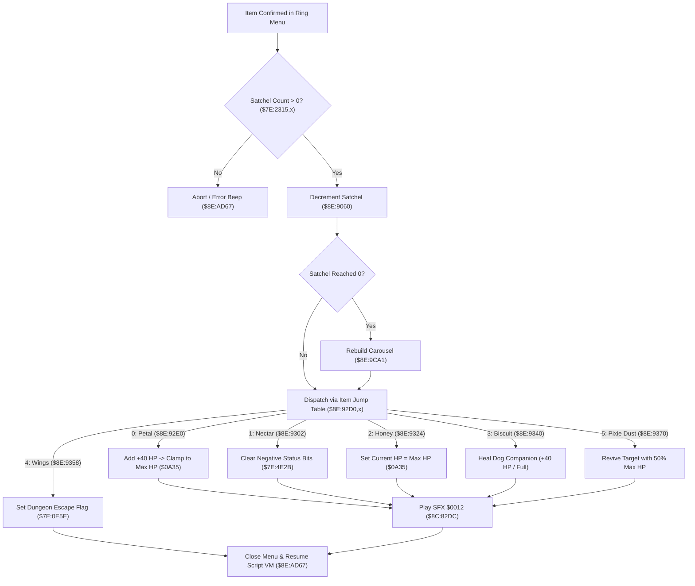

# Satchel Consumable Item Execution & Recovery Pipeline

- **ROM Locations**:
  - `ring_menu_consumable_item_execute`: `$8E:9298` – `$8E:9380`
  - `consumable_petal_heal`: `$8E:92E0` – `$8E:9301`
  - `consumable_nectar_cure`: `$8E:9302` – `$8E:9323`
  - `consumable_honey_full_heal`: `$8E:9324` – `$8E:933F`
  - `consumable_dog_biscuit`: `$8E:9340` – `$8E:9357`
  - `consumable_wings_escape`: `$8E:9358` – `$8E:936F`
  - `consumable_pixie_dust_revive`: `$8E:9370` – `$8E:9380`
- **CPU State**: 16-bit A/X (`REP #$30`), Data Bank `$7E` / `$8E`
- **WRAM Core Addresses**:
  - `$7E:2315` – `$7E:231B`: Consumable satchel quantities (Petal, Nectar, Honey, Biscuit, Wings, Essence, Pixie Dust).
  - `$7E:0A35`: Party Max HP (999 cap).
  - `$7E:4EB3`: Boy current HP.
  - `$7E:4F93`: Dog current HP.
  - `$7E:4E2B` / `$7E:2261`: Character condition & status ailment bitmasks (Poison, Confusion, Blind).
  - `$7E:0E5E`: Dungeon escape request flag.
  - DP `$95`: Pointer to active ring menu state buffer.

---

## 1. Architectural Role & Execution Sequence

When the player selects a consumable item from the item carousel in the ring menu, the engine executes validation, satchel decrement, effect dispatch, and visual/audio feedback:

### 1. Satchel Deduction & Depletion Handling
- Reads the consumable sub-item index from ring descriptor field `+0x06`.
- Calls `consumable_item_satchel_deduct` (`$8E:9060`):
  - Decrements the quantity in `$7E:2315,x`.
  - If the quantity reaches zero, calls `shop_populate_sell_list` (`$8E:9CA1`) to rebuild the ring carousel so that the empty slot immediately disappears.

### 2. Item Recovery Effects
- **Petals (`$8E:92E0`)**:
  - Adds 40 HP (`#$0028`) to target character HP (`$7E:4EB3` or `$7E:4F93`).
  - Clamps to target Max HP ceiling at `$7E:0A35`.
  - Spawns green recovery numbers pop-up via `$8F:C0D3`.
- **Nectar (`$8E:9302`)**:
  - Clears negative status condition bits in `$7E:4E2B` (bit 0 = Poison, bit 1 = Confusion, bit 2 = Blindness).
  - Restores default movement velocity.
- **Honey (`$8E:9324`)**:
  - Full restoration: copies `$7E:0A35` directly into `$7E:4EB3`.
- **Dog Biscuit (`$8E:9340`)**:
  - Dedicated dog recovery: applies 40 HP directly to dog entity slot (`$7E:4F93`).
- **Wings (`$8E:9358`)**:
  - Writes `0x0001` into escape register `$7E:0E5E`, queueing a warp back to the entrance coordinates of the current map.

---

## 2. Disassembly & Annotations

> **Interactive 65816 Assembly**:
> Centralized comments infused at runtime.
> [View in VFS: soe://rom/code/8E9298](soe://rom/code/8E9298?asm=1&c=0)

---

## 3. Reconstructed Clean C Implementation

> **Reconstructed C Decompilation**:
> Source moved to [`reconstructed-c/8E/8E9298_consumable_effects.c`](../../../reconstructed-c/8E/8E9298_consumable_effects.c).
> [View in VFS: soe://rom/code/8E9298](soe://rom/code/8E9298?c=1&asm=0)

