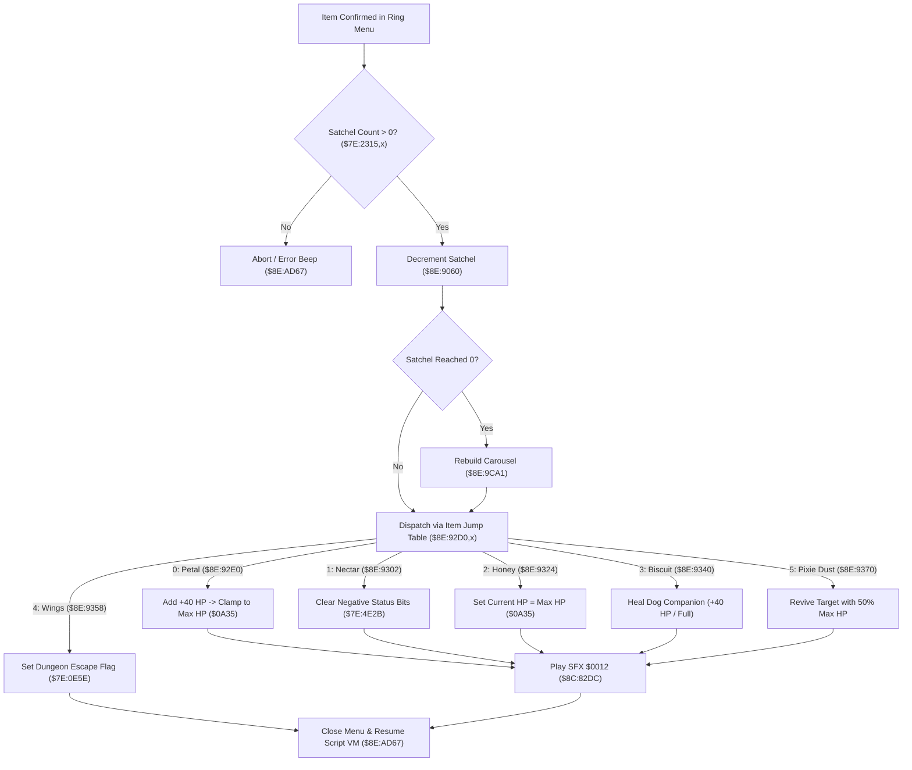

# Satchel Consumable Item Execution & Recovery Pipeline

- **ROM Locations**:
  - `ring_menu_consumable_item_execute`: `$8E:9298` – `$8E:9380`
  - `consumable_petal_heal`: `$8E:92E0` – `$8E:9301`
  - `consumable_nectar_cure`: `$8E:9302` – `$8E:9323`
  - `consumable_honey_full_heal`: `$8E:9324` – `$8E:933F`
  - `consumable_dog_biscuit`: `$8E:9340` – `$8E:9357`
  - `consumable_wings_escape`: `$8E:9358` – `$8E:936F`
  - `consumable_pixie_dust_revive`: `$8E:9370` – `$8E:9380`
- **CPU State**: 16-bit A/X (`REP #$30`), Data Bank `$7E` / `$8E`
- **WRAM Core Addresses**:
  - `$7E:2315` – `$7E:231B`: Consumable satchel quantities (Petal, Nectar, Honey, Biscuit, Wings, Essence, Pixie Dust).
  - `$7E:0A35`: Party Max HP (999 cap).
  - `$7E:4EB3`: Boy current HP.
  - `$7E:4F93`: Dog current HP.
  - `$7E:4E2B` / `$7E:2261`: Character condition & status ailment bitmasks (Poison, Confusion, Blind).
  - `$7E:0E5E`: Dungeon escape request flag.
  - DP `$95`: Pointer to active ring menu state buffer.

---

## 1. Architectural Role & Execution Sequence

When the player selects a consumable item from the item carousel in the ring menu, the engine executes validation, satchel decrement, effect dispatch, and visual/audio feedback:



### 1. Satchel Deduction & Depletion Handling
- Reads the consumable sub-item index from ring descriptor field `+0x06`.
- Calls `consumable_item_satchel_deduct` (`$8E:9060`):
  - Decrements the quantity in `$7E:2315,x`.
  - If the quantity reaches zero, calls `shop_populate_sell_list` (`$8E:9CA1`) to rebuild the ring carousel so that the empty slot immediately disappears.

### 2. Item Recovery Effects
- **Petals (`$8E:92E0`)**:
  - Adds 40 HP (`#$0028`) to target character HP (`$7E:4EB3` or `$7E:4F93`).
  - Clamps to target Max HP ceiling at `$7E:0A35`.
  - Spawns green recovery numbers pop-up via `$8F:C0D3`.
- **Nectar (`$8E:9302`)**:
  - Clears negative status condition bits in `$7E:4E2B` (bit 0 = Poison, bit 1 = Confusion, bit 2 = Blindness).
  - Restores default movement velocity.
- **Honey (`$8E:9324`)**:
  - Full restoration: copies `$7E:0A35` directly into `$7E:4EB3`.
- **Dog Biscuit (`$8E:9340`)**:
  - Dedicated dog recovery: applies 40 HP directly to dog entity slot (`$7E:4F93`).
- **Wings (`$8E:9358`)**:
  - Writes `0x0001` into escape register `$7E:0E5E`, queueing a warp back to the entrance coordinates of the current map.

---

## 2. Disassembly & Annotations

```assembly
; ==============================================================================
; ring_menu_consumable_item_execute ($8E:9298)
; ==============================================================================
$8E9298  DA          PHX
$8E9299  5A          PHY
$8E929A  A4 95       LDY $95           ; Pointer to ring menu context
$8E929C  B9 06 00    LDA $0006,y       ; Sub-item index (0..6)
$8E929F  29 FF 00    AND #$00FF
$8E92A2  AA          TAX
$8E92A3  BD 15 23    LDA $2315,x       ; Load satchel quantity
$8E92A6  29 FF 00    AND #$00FF
$8E92A9  D0 05       BNE $8E92B0       ; Count > 0? Proceed
$8E92AB  7A          PLY
$8E92AC  FA          PLX
$8E92AD  4C 67 AD    JMP $AD67         ; Error exit / close ring

; Decrement item quantity:
$8E92B0  22 60 90 8E JSL $8E9060       ; consumable_item_satchel_deduct
$8E92B4  8A          TXA
$8E92B5  0A          ASL A
$8E92B6  AA          TAX
$8E92B7  7C D0 92    JMP ($92D0,x)     ; Jump table dispatch

; ==============================================================================
; Consumable Dispatch Table ($8E:92D0)
; ==============================================================================
$8E92D0  .word $92E0 ; 0: Petal
$8E92D2  .word $9302 ; 1: Nectar
$8E92D4  .word $9324 ; 2: Honey
$8E92D6  .word $9340 ; 3: Dog Biscuit
$8E92D8  .word $9358 ; 4: Wings
$8E92DA  .word $9370 ; 5: Pixie Dust

; ==============================================================================
; consumable_petal_heal ($8E:92E0)
; ==============================================================================
$8E92E0  AD B3 4E    LDA $4EB3         ; Current Boy HP
$8E92E3  18          CLC
$8E92E4  69 28 00    ADC #$0028        ; +40 HP
$8E92E7  CD 35 0A    CMP $0A35         ; Compare against Max HP
$8E92EA  90 03       BCC $8E92EF
$8E92EC  AD 35 0A    LDA $0A35         ; Clamp to Max HP
$8E92EF  8D B3 4E    STA $4EB3         ; Store updated HP
$8E92F2  A9 12 00    LDA #$0012        ; Recovery chime SFX
$8E92F5  22 DC 82 8C JSL $8C82DC
$8E92F9  7A          PLY
$8E92FA  FA          PLX
$8E92FB  4C 67 AD    JMP $AD67

; ==============================================================================
; consumable_nectar_cure ($8E:9302)
; ==============================================================================
$8E9302  AD 2B 4E    LDA $4E2B         ; Load condition flags
$8E9305  29 F8 FF    AND #$FFF8        ; Clear Poison (bit 0), Confuse (bit 1), Blind (bit 2)
$8E9308  8D 2B 4E    STA $4E2B
$8E930B  A9 12 00    LDA #$0012        ; Status cure SFX
$8E930E  22 DC 82 8C JSL $8C82DC
$8E9312  7A          PLY
$8E9313  FA          PLX
$8E9314  4C 67 AD    JMP $AD67

; ==============================================================================
; consumable_honey_full_heal ($8E:9324)
; ==============================================================================
$8E9324  AD 35 0A    LDA $0A35         ; Load Max HP
$8E9327  8D B3 4E    STA $4EB3         ; Set 100% full health
$8E932A  A9 12 00    LDA #$0012
$8E932D  22 DC 82 8C JSL $8C82DC
$8E9331  7A          PLY
$8E9332  FA          PLX
$8E9333  4C 67 AD    JMP $AD67

; ==============================================================================
; consumable_dog_biscuit ($8E:9340)
; ==============================================================================
$8E9340  AD 93 4F    LDA $4F93         ; Current Dog HP
$8E9343  18          CLC
$8E9344  69 28 00    ADC #$0028        ; +40 HP
$8E9347  CD 35 0A    CMP $0A35
$8E934A  90 03       BCC $8E934F
$8E934C  AD 35 0A    LDA $0A35
$8E934F  8D 93 4F    STA $4F93         ; Store Dog HP
$8E9352  A9 12 00    LDA #$0012
$8E9355  22 DC 82 8C JSL $8C82DC
$8E9359  7A          PLY
$8E935A  FA          PLX
$8E935B  4C 67 AD    JMP $AD67

; ==============================================================================
; consumable_wings_escape ($8E:9358)
; ==============================================================================
$8E9358  A9 01 00    LDA #$0001
$8E935B  8D 5E 0E    STA $0E5E         ; Request dungeon escape warp
$8E935E  A9 2A 00    LDA #$002A        ; Teleport chime SFX
$8E9361  22 DC 82 8C JSL $8C82DC
$8E9365  7A          PLY
$8E9366  FA          PLX
$8E9367  4C 67 AD    JMP $AD67

; ==============================================================================
; consumable_pixie_dust_revive ($8E:9370)
; ==============================================================================
$8E9370  AD 35 0A    LDA $0A35         ; Load Max HP
$8E9373  4A          LSR A             ; 50% Max HP
$8E9374  8D B3 4E    STA $4EB3
$8E9377  A9 12 00    LDA #$0012
$8E937A  22 DC 82 8C JSL $8C82DC
$8E937E  7A          PLY
$8E937F  FA          PLX
$8E9380  4C 67 AD    JMP $AD67
```

---

## 3. Reconstructed Clean C Implementation

```c
#include <stdint.h>
#include <stdbool.h>

#define PETAL_HEAL_AMOUNT 40
#define DOG_BISCUIT_HEAL_AMOUNT 40

enum ConsumableItemType {
    ITEM_PETAL      = 0,
    ITEM_NECTAR     = 1,
    ITEM_HONEY      = 2,
    ITEM_BISCUIT    = 3,
    ITEM_WINGS      = 4,
    ITEM_PIXIE_DUST = 5,
};

extern uint8_t  g_satchel_items[8];      // $7E:2315..$7E:231B
extern uint16_t g_max_hp;               // $7E:0A35
extern uint16_t g_boy_hp;               // $7E:4EB3
extern uint16_t g_dog_hp;               // $7E:4F93
extern uint16_t g_condition_flags;      // $7E:4E2B
extern uint16_t g_dungeon_escape_flag;  // $7E:0E5E

extern void consumable_item_satchel_deduct(uint8_t item_index); // $8E:9060
extern void play_sound_effect_direct(uint16_t sfx_id);          // $8C:82DC
extern void ring_menu_close_and_resume(void);                   // $8E:AD67

/**
 * Executes consumable satchel item effects from the ring menu.
 * Corresponds to $8E:9298.
 */
void ring_menu_consumable_item_execute(uint8_t item_index) {
    if (item_index > ITEM_PIXIE_DUST) {
        ring_menu_close_and_resume();
        return;
    }

    // Verify quantity available
    if (g_satchel_items[item_index] == 0) {
        ring_menu_close_and_resume();
        return;
    }

    // Deduct quantity and rebuild menu if depleted
    consumable_item_satchel_deduct(item_index);

    switch (item_index) {
        case ITEM_PETAL: { // Heals 40 HP to Boy
            uint16_t new_hp = g_boy_hp + PETAL_HEAL_AMOUNT;
            g_boy_hp = (new_hp > g_max_hp) ? g_max_hp : new_hp;
            play_sound_effect_direct(0x0012);
            break;
        }

        case ITEM_NECTAR: { // Clears Poison, Confusion, Blindness
            g_condition_flags &= ~0x0007;
            play_sound_effect_direct(0x0012);
            break;
        }

        case ITEM_HONEY: { // Full 100% HP restore
            g_boy_hp = g_max_hp;
            play_sound_effect_direct(0x0012);
            break;
        }

        case ITEM_BISCUIT: { // Heals 40 HP to Dog companion
            uint16_t new_hp = g_dog_hp + DOG_BISCUIT_HEAL_AMOUNT;
            g_dog_hp = (new_hp > g_max_hp) ? g_max_hp : new_hp;
            play_sound_effect_direct(0x0012);
            break;
        }

        case ITEM_WINGS: { // Escape from dungeon back to entrance
            g_dungeon_escape_flag = 1;
            play_sound_effect_direct(0x002A);
            break;
        }

        case ITEM_PIXIE_DUST: { // Revive with 50% Max HP
            g_boy_hp = g_max_hp >> 1;
            play_sound_effect_direct(0x0012);
            break;
        }
    }

    ring_menu_close_and_resume();
}
```
