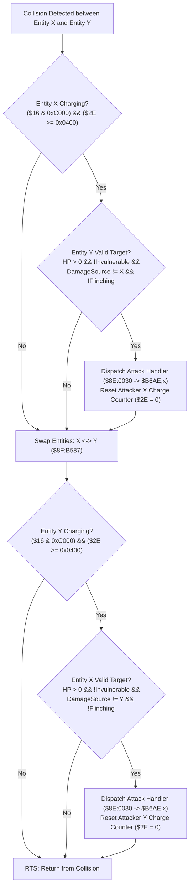

# Contact Damage & Mutual Charging Body Collision Subsystem

- **ROM Locations**:
  - `contact_damage_charging_body`: `$8F:B52C` – `$8F:B5E5`
- **CPU State**: 16-bit A/X (`REP #$30`), Data Bank `$7E` / `$8F`
- **WRAM Core Addresses**:
  - Entity Record Fields:
    - `+$10`: Entity state flags (bit 1 `0x0002`: non-colliding/passive, bit `0x5022`: status immunities/sleep).
    - `+$14`: Entity animation/state flags (mask `0x070D`: invulnerable/intangible state bits).
    - `+$16`: Entity collision & movement mode (bits `0xC000`: charging body active; mask `0x0021`: collision exempt).
    - `+$2A`: Current hit points (HP).
    - `+$2E`: Charging stamina / collision momentum counter (`>= 0x0400` enables attack).
    - `+$36`: Last damage source entity pointer (prevents repeat frame hits from same attacker).
    - `+$60`: Attacker weapon / contact damage type index.
    - `+$76`: Entity `last_damage` received (non-zero indicates active flinch/invulnerability).
  - ROM Master Tables:
    - `$8E:0030,x`: Contact attack action ID lookup table.
    - `$8F:B6AE,x`: Contact damage dispatch routine function pointers.
  - Direct Page `$4C`: Current active entity pointer in combat calculations.

---

## 1. Architectural Role & Charging Physics

When entities move in Secret of Evermore, charging enemies or player weapons build up momentum stored in stamina counter `+$2E`. When two entity collision boxes overlap, the engine executes `$8F:B52C` to evaluate mutual contact impacts:



### Key Principles of Contact Collisions
1. **Charge Threshold Requirement**:
   - Contact damage only triggers if the attacker has accumulated at least `0x0400` (1,024 units) of stamina/momentum in `+$2E`.
   - Once the hit connects, the charge meter is instantly zeroed (`STZ $002E,x`), preventing multi-hit machine gun damage from a single charge.
2. **Victim Eligibility Checks**:
   - `+$16 & 0x0021`: Bit 0 or 5 set means invulnerable/exempt.
   - `+$10 & 0x5022`: Certain active states (death, petrification, sleep) suppress contact damage.
   - `+$14 & 0x070D`: Additional invulnerability frames.
   - `+$76 != 0`: Entity is currently in its post-damage invincibility flash.
   - `+$2A == 0`: Zero HP (dead entity).
   - `+$36 == X`: Entity was already damaged by this exact attacker in the current engagement frame.
3. **Full Symmetry**:
   - The routine runs identically in both directions: first Entity X against Entity Y, then swaps pointers (`TXA; TYX; TAY`) and runs Entity Y against Entity X. If two charging enemies or players collide, both can deal damage to each other simultaneously.

---

## 2. Disassembly & Annotations

```asm
; ==============================================================================
; contact_damage_charging_body ($8F:B52C)
; Arguments: X = Entity 1 pointer, Y = Entity 2 pointer
; ==============================================================================
$8FB52C  bd 16 00       lda $0016,x        ; Check attacker charging flags
$8FB52F  89 00 c0       bit #$C000         ; Charging body bits
$8FB532  f0 53          beq $8FB587        ; If not charging, swap to test Y
$8FB534  bd 2e 00       lda $002E,x        ; Attacker charge stamina / velocity
$8FB537  c9 00 04       cmp #$0400         ; Required threshold: 0x0400
$8FB53A  30 4b          bmi $8FB587        ; Under threshold: no contact attack

; Victim eligibility tests on Entity Y
$8FB53C  b9 16 00       lda $0016,y
$8FB53F  89 21 00       bit #$0021         ; Invulnerability / collision mask
$8FB542  d0 43          bne $8FB587
$8FB544  b9 10 00       lda $0010,y
$8FB547  89 22 50       bit #$5022         ; Status suppression bits
$8FB54A  d0 3b          bne $8FB587
$8FB54C  b9 14 00       lda $0014,y
$8FB54F  89 0d 07       bit #$070D         ; Intangible / invulnerable state
$8FB552  d0 33          bne $8FB587
$8FB554  b9 76 00       lda $0076,y        ; Last damage received (invulnerability timer)
$8FB557  d0 2e          bne $8FB587
$8FB559  b9 2a 00       lda $002A,y        ; Current HP
$8FB55C  f0 29          beq $8FB587        ; Dead entity cannot take damage
$8FB55E  8a             txa
$8FB55F  d9 36 00       cmp $0036,y        ; Did attacker X just hit this entity?
$8FB562  f0 23          beq $8FB587
$8FB564  bd 10 00       lda $0010,x
$8FB567  89 02 00       bit #$0002         ; Attacker passive flag
$8FB56A  d0 1b          bne $8FB587

; Execute attack against victim Y
$8FB56C  a5 4c          lda $4C            ; Save DP $4C
$8FB56E  48             pha
$8FB56F  86 4c          stx $4C            ; DP $4C = Attacker entity pointer
$8FB571  bd 60 00       lda $0060,x        ; Attacker weapon / contact type
$8FB574  aa             tax
$8FB575  bf 30 00 8e    lda $8E0030,x      ; Action lookup from master table
$8FB579  aa             tax
$8FB57A  5a             phy                ; Push victim pointer
$8FB57B  fc ae b6       jsr ($B6AE,x)      ; Call attack resolution handler
$8FB57E  7a             ply                ; Restore victim pointer
$8FB57F  a6 4c          ldx $4C            ; Attacker pointer
$8FB581  68             pla
$8FB582  85 4c          sta $4C            ; Restore original DP $4C
$8FB584  9e 2e 00       stz $002E,x        ; Clear charge meter (0x002E = 0)

; ------------------------------------------------------------------------------
; Symmetric Swap: Entity Y becomes attacker, Entity X becomes victim
; ------------------------------------------------------------------------------
$8FB587  8a             txa                ; A = X
$8FB588  bb             tyx                ; X = Y (Entity 2 is now attacker)
$8FB589  a8             tay                ; Y = old X (Entity 1 is now victim)

$8FB58A  bd 16 00       lda $0016,x        ; Test new attacker X
$8FB58D  89 00 c0       bit #$C000
$8FB590  f0 53          beq $8FB5E5        ; If not charging, finished
$8FB592  bd 2e 00       lda $002E,x
$8FB595  c9 00 04       cmp #$0400
$8FB598  30 4b          bmi $8FB5E5

$8FB59A  b9 16 00       lda $0016,y
$8FB59D  89 21 00       bit #$0021
$8FB5A0  d0 43          bne $8FB5E5
$8FB5A2  b9 10 00       lda $0010,y
$8FB5A5  89 22 50       bit #$5022
$8FB5A8  d0 3b          bne $8FB5E5
$8FB5AA  b9 14 00       lda $0014,y
$8FB5AD  89 0d 07       bit #$070D
$8FB5B0  d0 33          bne $8FB5E5
$8FB5B2  b9 76 00       lda $0076,y
$8FB5B5  d0 2e          bne $8FB5E5
$8FB5B7  b9 2a 00       lda $002A,y
$8FB5BA  f0 29          beq $8FB5E5
$8FB5BC  8a             txa
$8FB5BD  d9 36 00       cmp $0036,y
$8FB5C0  f0 23          beq $8FB5E5
$8FB5C2  bd 10 00       lda $0010,x
$8FB5C5  89 02 00       bit #$0002
$8FB5C8  d0 1b          bne $8FB5E5

$8FB5CA  a5 4c          lda $4C
$8FB5CC  48             pha
$8FB5CD  86 4c          stx $4C
$8FB5CF  bd 60 00       lda $0060,x
$8FB5D2  aa             tax
$8FB5D3  bf 30 00 8e    lda $8E0030,x
$8FB5D7  aa             tax
$8FB5D8  5a             phy
$8FB5D9  fc ae b6       jsr ($B6AE,x)
$8FB5DC  7a             ply
$8FB5DD  a6 4c          ldx $4C
$8FB5DF  68             pla
$8FB5E0  85 4c          sta $4C
$8FB5E2  9e 2e 00       stz $002E,x
$8FB5E5  60             rts
```

---

## 3. Clean C Decompilation

```c
#include <stdint.h>
#include <stdbool.h>

#define CHARGE_DAMAGE_THRESHOLD 0x0400

typedef struct {
    uint8_t  _pad0[16];
    uint16_t status_flags_10;   // +0x10: Status & suppression flags
    uint8_t  _pad1[2];
    uint16_t state_flags_14;    // +0x14: Invulnerability frame bits
    uint16_t collision_mode_16; // +0x16: Charging bits (0xC000) & exemption (0x0021)
    uint8_t  _pad2[18];
    uint16_t current_hp;        // +0x2A
    uint8_t  _pad3[2];
    uint16_t charge_stamina;    // +0x2E: Current momentum / charge value
    uint8_t  _pad4[6];
    uint16_t last_damage_source;// +0x36: Entity pointer of last attacker
    uint8_t  _pad5[40];
    uint16_t contact_weapon_id; // +0x60: Weapon / contact type index
    uint8_t  _pad6[20];
    uint16_t last_damage;       // +0x76: Damage flash / flinch timer
} EntityCombatRecord;

typedef void (*ContactAttackHandler)(EntityCombatRecord *attacker, EntityCombatRecord *victim);

// ROM lookup tables
extern const uint16_t g_contact_action_table[];      // $8E:0030
extern const ContactAttackHandler g_contact_handlers[]; // $8F:B6AE

/**
 * Checks whether an attacker can deal contact charge damage to a victim,
 * and executes the attack if all criteria are satisfied.
 */
static void try_contact_damage(EntityCombatRecord *attacker, EntityCombatRecord *victim) {
    // 1. Attacker must be in charging mode
    if ((attacker->collision_mode_16 & 0xC000) == 0) {
        return;
    }

    // 2. Attacker must meet the charge stamina threshold (1,024 units)
    if (attacker->charge_stamina < CHARGE_DAMAGE_THRESHOLD) {
        return;
    }

    // 3. Victim must not be exempt from collision damage
    if (victim->collision_mode_16 & 0x0021) {
        return;
    }

    // 4. Victim must not have disabling status conditions (petrify, dead, sleep)
    if (victim->status_flags_10 & 0x5022) {
        return;
    }

    // 5. Victim must not have intangible/invulnerable animation bits
    if (victim->state_flags_14 & 0x070D) {
        return;
    }

    // 6. Victim must not currently be flinching or invulnerable
    if (victim->last_damage != 0) {
        return;
    }

    // 7. Victim must be alive
    if (victim->current_hp == 0) {
        return;
    }

    // 8. Prevent duplicate hits from the same attacker in the same engagement frame
    if (victim->last_damage_source == (uint16_t)(uintptr_t)attacker) {
        return;
    }

    // 9. Attacker must not be in a passive state
    if (attacker->status_flags_10 & 0x0002) {
        return;
    }

    // Dispatch contact attack action
    uint16_t weapon_type = attacker->contact_weapon_id;
    uint16_t action_id = g_contact_action_table[weapon_type];
    ContactAttackHandler handler = g_contact_handlers[action_id];

    if (handler) {
        handler(attacker, victim);
    }

    // Reset attacker charge momentum to zero
    attacker->charge_stamina = 0;
}

/**
 * contact_damage_charging_body ($8F:B52C)
 * Performs mutual symmetric collision evaluation between two overlapping entities.
 * 
 * @param entity_a First entity involved in collision.
 * @param entity_b Second entity involved in collision.
 */
void contact_damage_charging_body(EntityCombatRecord *entity_a, EntityCombatRecord *entity_b) {
    // Pass 1: Entity A charges into Entity B
    try_contact_damage(entity_a, entity_b);

    // Pass 2: Entity B charges into Entity A (symmetric mutual collision)
    try_contact_damage(entity_b, entity_a);
}
```
