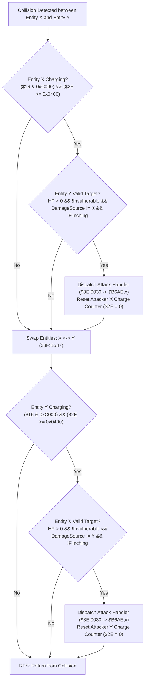

# Contact Damage & Mutual Charging Body Collision Subsystem

- **ROM Locations**:
  - `contact_damage_charging_body`: `$8F:B52C` – `$8F:B5E5`
- **CPU State**: 16-bit A/X (`REP #$30`), Data Bank `$7E` / `$8F`
- **WRAM Core Addresses**:
  - Entity Record Fields:
    - `+$10`: Entity state flags (bit 1 `0x0002`: non-colliding/passive, bit `0x5022`: status immunities/sleep).
    - `+$14`: Entity animation/state flags (mask `0x070D`: invulnerable/intangible state bits).
    - `+$16`: Entity collision & movement mode (bits `0xC000`: charging body active; mask `0x0021`: collision exempt).
    - `+$2A`: Current hit points (HP).
    - `+$2E`: Charging stamina / collision momentum counter (`>= 0x0400` enables attack).
    - `+$36`: Last damage source entity pointer (prevents repeat frame hits from same attacker).
    - `+$60`: Attacker weapon / contact damage type index.
    - `+$76`: Entity `last_damage` received (non-zero indicates active flinch/invulnerability).
  - ROM Master Tables:
    - `$8E:0030,x`: Contact attack action ID lookup table.
    - `$8F:B6AE,x`: Contact damage dispatch routine function pointers.
  - Direct Page `$4C`: Current active entity pointer in combat calculations.

---

## 1. Architectural Role & Charging Physics

When entities move in Secret of Evermore, charging enemies or player weapons build up momentum stored in stamina counter `+$2E`. When two entity collision boxes overlap, the engine executes `$8F:B52C` to evaluate mutual contact impacts:

### Key Principles of Contact Collisions
1. **Charge Threshold Requirement**:
   - Contact damage only triggers if the attacker has accumulated at least `0x0400` (1,024 units) of stamina/momentum in `+$2E`.
   - Once the hit connects, the charge meter is instantly zeroed (`STZ $002E,x`), preventing multi-hit machine gun damage from a single charge.
2. **Victim Eligibility Checks**:
   - `+$16 & 0x0021`: Bit 0 or 5 set means invulnerable/exempt.
   - `+$10 & 0x5022`: Certain active states (death, petrification, sleep) suppress contact damage.
   - `+$14 & 0x070D`: Additional invulnerability frames.
   - `+$76 != 0`: Entity is currently in its post-damage invincibility flash.
   - `+$2A == 0`: Zero HP (dead entity).
   - `+$36 == X`: Entity was already damaged by this exact attacker in the current engagement frame.
3. **Full Symmetry**:
   - The routine runs identically in both directions: first Entity X against Entity Y, then swaps pointers (`TXA; TYX; TAY`) and runs Entity Y against Entity X. If two charging enemies or players collide, both can deal damage to each other simultaneously.

---

## 2. Disassembly & Annotations

> **Interactive 65816 Assembly**:
> Centralized comments infused at runtime.
> [View in VFS: soe://rom/code/8FB52C](soe://rom/code/8FB52C?asm=1&c=0)

---

## 3. Clean C Decompilation

> **Reconstructed C Decompilation**:
> Source moved to [`reconstructed-c/8F/8FB52C_contact_damage.c`](../../../reconstructed-c/8F/8FB52C_contact_damage.c).
> [View in VFS: soe://rom/code/8FB52C](soe://rom/code/8FB52C?c=1&asm=0)

