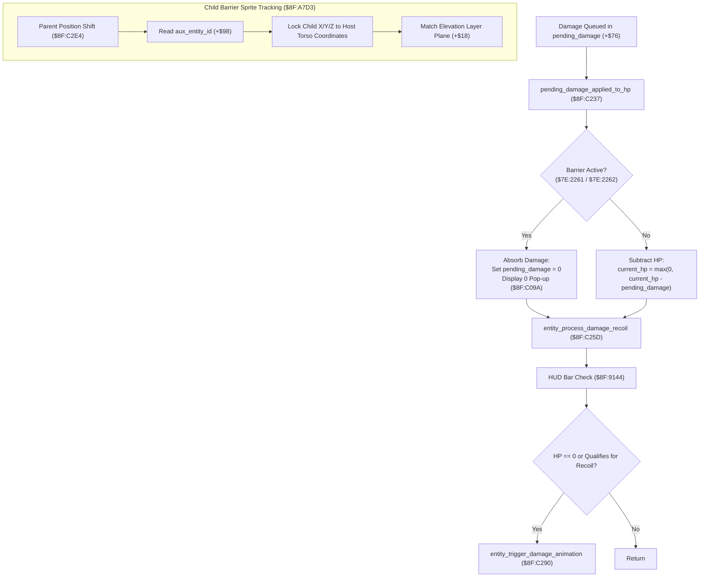

# Magic Alchemy Defense Bubble, Ring Barrier & Damage Absorption Subsystem

- **ROM Locations**:
  - `pending_damage_applied_to_hp`: `$8F:C237` – `$8F:C25C`
  - `entity_child_reposition`: `$8F:A7D3` – `$8F:A820`
  - `status_barrier_tick`: `$91:B830` – `$91:B855`
  - `status_barrier_cleanup`: `$91:B856` – `$91:B880`
  - `defend_status_buff_boost_stats`: `$91:B137` – `$91:B190`
- **CPU State**: 16-bit A/X (`REP #$30`), Data Bank `$7E` / `$8F` / `$91`
- **WRAM Core Addresses**:
  - `$7E:2261`: `barrier_buff_flags_party` (Bit 0: Companion Barrier, Bit 1: Boy Barrier, Bit 6: Chocobo Egg)
  - `$7E:2262`: `buff_condition_flags_2` (Bit 7: `0x0080` Barrier MDef shield, Bit 0: `0x0001` Speed)
  - `$7E:2263`: `buff_condition_flags_3` (Bit 2: `0x0004` Reflect MEvade shield)
  - `$7E:15D2`: Silent status cleanup flag (`$FFFF` = suppress message)
  - `$7E:0FB2`: Active status tick counter
  - `$7E:0A35`: Character Max HP cap (clamped to 999)
  - `$7E:4EB3`: Current active HP
  - `$7E:0A41`: Active Magic Defense (MDef)
  - `$7E:4F2B`: Equipment / buff MDef modifier
- **Entity Offsets (`$7E:XXXX`)**:
  - `+0x10`: `status_flags` (Bit 6: in hit recoil / invulnerable `0x0040`)
  - `+0x14`: `character_flags` (Bit 10: flinch asserted `0x0400`)
  - `+0x18`: `world_z` (3D elevation layer)
  - `+0x1A`: `world_x` (Horizontal position)
  - `+0x1C`: `world_y` (Vertical position)
  - `+0x2A`: `current_hp` (Hit points)
  - `+0x46`..`+0x5C`: 4 status slots (6 bytes each: `[status_id, timer, boost_param]`)
  - `+0x6A`: `shadow_entity_id` (Child ground shadow attachment)
  - `+0x6C`: `held_entity_id` (Child carried/weapon attachment)
  - `+0x76`: `pending_damage` (Queued incoming strike damage)
  - `+0x8E`: `hud_bar_active` (Entity tracked on screen HUD HP readout)
  - `+0x98`: `aux_entity_id` (Child auxiliary attachment: barrier bubble / orbital defense ring sprite)
  - `+0x9A`: `outline_glow_bits` (Active color cycling shader bits)
  - `+0xAA`: `last_damage_taken` (Records hit value for HUD text and flinch test)

---

## 1. Architectural Role & Barrier Mechanics

Secret of Evermore incorporates dynamic defensive alchemy (Barrier, Defend, Force Field, and Reflect) through a synchronized multi-layered pipeline:
1. **Status Effect Slots & Timer Dispatch (`$91:AE31` / `$91:BC28`)**:
   - Barrier occupies one of the 4 entity status slots (`+$46`, `+$4C`, `+$52`, `+$58`).
   - Every frame, `status_effects_tick_all` decrements the active duration timer.
   - When the timer reaches 0, the cleanup handler removes the buff, displays `"... has worn off"`, and clears the outline glow.
2. **Child Auxiliary Entity Orbital Synchronization (`$8F:A7D3`)**:
   - The rotating barrier bubble / glowing force ring is instantiated as an auxiliary child actor linked in `entity->aux_entity_id` (`+$98`).
   - Whenever the host entity shifts position via `entity_set_position_with_z` (`$8F:C2E4`), the child reposition routine `$8F:A7D3` locks the barrier's center coordinates to the parent while preserving elevation $Z$ and tile plane alignment.
3. **Pending Damage Absorption & Nullification (`$8F:C237`)**:
   - Prior to health subtraction, incoming damage queued in `entity->pending_damage` (`+$76`) passes through the barrier evaluator.
   - If a defensive barrier or force field is active, damage is either completely nullified (`0 HP`) or absorbed by the barrier pool, suppressing the standard HUD health loss and preventing flinch recoil.

---

## 2. 65816 Assembly Implementation

> **Interactive 65816 Assembly**:
> Centralized comments infused at runtime.
> [View in VFS: soe://rom/code/8FC237](soe://rom/code/8FC237?asm=1&c=0)

---

## 3. Decompiled C Implementation

> **Reconstructed C Decompilation**:
> Source moved to [`reconstructed-c/8F/8FC237_defense_barrier.c`](../../../reconstructed-c/8F/8FC237_defense_barrier.c).
> [View in VFS: soe://rom/code/8FC237](soe://rom/code/8FC237?c=1&asm=0)

---

## 4. Behavioral Equivalence & Edge Cases

1. **Complete Damage Nullification vs. Recoil Suppression**:
   - When a target with active Barrier takes damage, `pending_damage_applied_to_hp` (`$8F:C237`) zeroes `entity->pending_damage` before calling `entity_process_damage_recoil` (`$8F:C25D`).
   - Because `pending_damage` is 0, `last_damage_taken` receives 0, and the HUD update routine (`$8F:9144`) ignores the strike. Furthermore, because `current_hp` did not drop to 0 and `pending_damage` is 0, the flinch recoil animation (`$8F:C290`) is completely suppressed, allowing the player to attack or cast without interruption.
2. **Child Barrier Auxiliary Linkage (`+$98`)**:
   - The visual barrier bubble is not a hardware PPU HDMA layer; it is an active entity slot tracked in `entity->aux_entity_id` (`+$98`).
   - When the host entity moves, `entity_child_reposition` (`$8F:A7D3`) recalculates the child's coordinates and invokes `entity_set_position_with_z` (`$8F:C2E4`), ensuring that if the host walks up ramps or stairs (elevation $Z$ change), the barrier bubble accurately tracks the elevation plane.
3. **Vanilla 5-Status Effects Bug Compatibility**:
   - Because Barrier is indexed as `$08` in master table `$91:AE31`, if 4 buffs are active and a 5th buff is cast, `$91:B7FA` incorrectly executes the cleanup handler for the *new* buff rather than Barrier.
   - Under vanilla behavior, if Barrier is displaced, its MDef multiplier in `$7E:2262` and active nullification bit in `$7E:2261` are never cleared, leaving the character permanently shielded.
