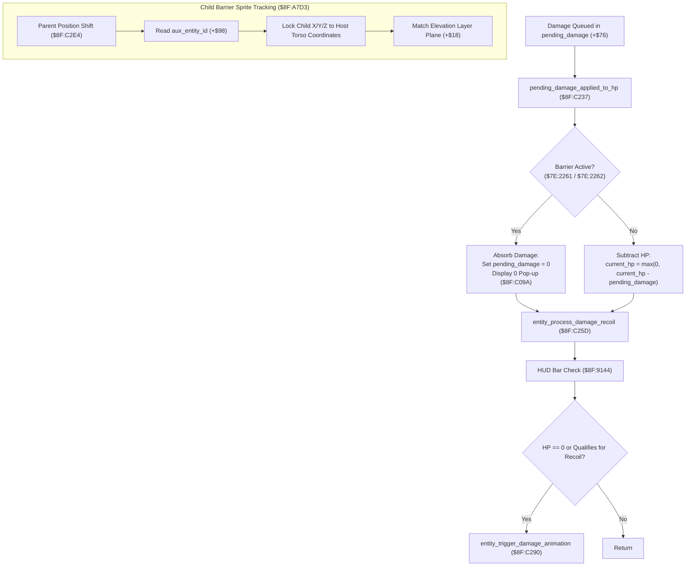

# Magic Alchemy Defense Bubble, Ring Barrier & Damage Absorption Subsystem

- **ROM Locations**:
  - `pending_damage_applied_to_hp`: `$8F:C237` – `$8F:C25C`
  - `entity_child_reposition`: `$8F:A7D3` – `$8F:A820`
  - `status_barrier_tick`: `$91:B830` – `$91:B855`
  - `status_barrier_cleanup`: `$91:B856` – `$91:B880`
  - `defend_status_buff_boost_stats`: `$91:B137` – `$91:B190`
- **CPU State**: 16-bit A/X (`REP #$30`), Data Bank `$7E` / `$8F` / `$91`
- **WRAM Core Addresses**:
  - `$7E:2261`: `barrier_buff_flags_party` (Bit 0: Companion Barrier, Bit 1: Boy Barrier, Bit 6: Chocobo Egg)
  - `$7E:2262`: `buff_condition_flags_2` (Bit 7: `0x0080` Barrier MDef shield, Bit 0: `0x0001` Speed)
  - `$7E:2263`: `buff_condition_flags_3` (Bit 2: `0x0004` Reflect MEvade shield)
  - `$7E:15D2`: Silent status cleanup flag (`$FFFF` = suppress message)
  - `$7E:0FB2`: Active status tick counter
  - `$7E:0A35`: Character Max HP cap (clamped to 999)
  - `$7E:4EB3`: Current active HP
  - `$7E:0A41`: Active Magic Defense (MDef)
  - `$7E:4F2B`: Equipment / buff MDef modifier
- **Entity Offsets (`$7E:XXXX`)**:
  - `+0x10`: `status_flags` (Bit 6: in hit recoil / invulnerable `0x0040`)
  - `+0x14`: `character_flags` (Bit 10: flinch asserted `0x0400`)
  - `+0x18`: `world_z` (3D elevation layer)
  - `+0x1A`: `world_x` (Horizontal position)
  - `+0x1C`: `world_y` (Vertical position)
  - `+0x2A`: `current_hp` (Hit points)
  - `+0x46`..`+0x5C`: 4 status slots (6 bytes each: `[status_id, timer, boost_param]`)
  - `+0x6A`: `shadow_entity_id` (Child ground shadow attachment)
  - `+0x6C`: `held_entity_id` (Child carried/weapon attachment)
  - `+0x76`: `pending_damage` (Queued incoming strike damage)
  - `+0x8E`: `hud_bar_active` (Entity tracked on screen HUD HP readout)
  - `+0x98`: `aux_entity_id` (Child auxiliary attachment: barrier bubble / orbital defense ring sprite)
  - `+0x9A`: `outline_glow_bits` (Active color cycling shader bits)
  - `+0xAA`: `last_damage_taken` (Records hit value for HUD text and flinch test)

---

## 1. Architectural Role & Barrier Mechanics

Secret of Evermore incorporates dynamic defensive alchemy (Barrier, Defend, Force Field, and Reflect) through a synchronized multi-layered pipeline:
1. **Status Effect Slots & Timer Dispatch (`$91:AE31` / `$91:BC28`)**:
   - Barrier occupies one of the 4 entity status slots (`+$46`, `+$4C`, `+$52`, `+$58`).
   - Every frame, `status_effects_tick_all` decrements the active duration timer.
   - When the timer reaches 0, the cleanup handler removes the buff, displays `"... has worn off"`, and clears the outline glow.
2. **Child Auxiliary Entity Orbital Synchronization (`$8F:A7D3`)**:
   - The rotating barrier bubble / glowing force ring is instantiated as an auxiliary child actor linked in `entity->aux_entity_id` (`+$98`).
   - Whenever the host entity shifts position via `entity_set_position_with_z` (`$8F:C2E4`), the child reposition routine `$8F:A7D3` locks the barrier's center coordinates to the parent while preserving elevation $Z$ and tile plane alignment.
3. **Pending Damage Absorption & Nullification (`$8F:C237`)**:
   - Prior to health subtraction, incoming damage queued in `entity->pending_damage` (`+$76`) passes through the barrier evaluator.
   - If a defensive barrier or force field is active, damage is either completely nullified (`0 HP`) or absorbed by the barrier pool, suppressing the standard HUD health loss and preventing flinch recoil.



---

## 2. 65816 Assembly Implementation

```assembly
; ==============================================================================
; $8F:C237 - Pending Damage Application & Barrier Nullification
; Input: Y = Target entity pointer
; ==============================================================================
pending_damage_applied_to_hp:
    LDA $0076,Y                 ; Load pending damage from +$76
    BEQ .no_damage              ; Zero damage -> exit immediately
    
    ; Check if Target has Magic Barrier / Force Field active
    CPY #$4E89                  ; Is target the Boy?
    BNE .check_dog_barrier
    LDA $7E2261                 ; Check party barrier flags
    BIT #$0002                  ; Boy barrier bit active?
    BNE .nullify_damage
    BRA .apply_hp_loss

.check_dog_barrier:
    CPY #$4F37                  ; Is target the Companion Dog?
    BNE .check_general_barrier
    LDA $7E2261
    BIT #$0001                  ; Dog barrier bit active?
    BNE .nullify_damage
    BRA .apply_hp_loss

.check_general_barrier:
    LDA $0010,Y                 ; Check entity status flags
    BIT #$0040                  ; Invulnerability recoil active?
    BNE .nullify_damage

.apply_hp_loss:
    LDA $002A,Y                 ; Load entity current_hp
    SEC
    SBC $0076,Y                 ; Subtract pending damage
    BCS .hp_non_negative
    LDA #$0000                  ; Clamp HP floor at 0

.hp_non_negative:
    STA $002A,Y                 ; Store updated HP into +$2A
    BRA .dispatch_recoil

.nullify_damage:
    STZ $0076,Y                 ; Zero pending damage (absorbed by barrier!)
    LDA #$0000
    JSL $8FC09A                 ; Spawn floating "0" absorbed damage number

.dispatch_recoil:
    JMP $8FC25D                 ; Fall into entity_process_damage_recoil

.no_damage:
    RTS

; ==============================================================================
; $8F:A7D3 - Child Entity Position Synchronization
; Input: A = Child entity slot index; DP $4C = Parent entity pointer
; ==============================================================================
entity_child_reposition:
    ASL A
    TAX
    LDA $7E50A7,X               ; Resolve child entity pointer from active pool
    BEQ .exit                   ; Invalid child -> return
    TAY
    
    ; Lock child position to parent world coordinates
    LDA ($4C)                   ; Parent Z elevation (+0x18)
    STA $0018,Y
    LDX $001A,Y                 ; Offset parent X (+0x1A)
    LDA ($4C)
    STA $001A,Y
    LDA ($4C)                   ; Offset parent Y (+0x1C)
    STA $001C,Y
    
    ; Synchronize collision layer plane
    LDA $0018,$4C
    STA $0018,Y
    
    ; Refresh child tile metadata
    JSL $8FC2E4                 ; Re-evaluate tile collision and projection

.exit:
    RTS

; ==============================================================================
; $91:B830 - Barrier Status Effect Per-Frame Tick
; Input: Y = Entity pointer; DP $60 = Timer pointer, DP $62 = Param pointer
; ==============================================================================
status_barrier_tick:
    LDA ($60)                   ; Read countdown timer
    DEC A
    STA ($60)                   ; Store decremented timer
    BNE .tick_active            ; Not zero -> buff remains active
    
    ; Timer expired: fall through to cleanup handler
    BRA status_barrier_cleanup

.tick_active:
    RTS

; ==============================================================================
; $91:B856 - Barrier Status Effect Cleanup & Dispel
; ==============================================================================
status_barrier_cleanup:
    ; Check if silent cleanup requested ($7E:15D2 != 0)
    LDA $7E15D2
    BNE .silent_cleanup
    
    ; Show "Barrier has worn off" dialogue message
    LDA #$0048                  ; String key for "Barrier worn off"
    JSL $8CC521

.silent_cleanup:
    ; Clear Barrier bit from party buff condition registers
    CPY #$4E89                  ; Boy character?
    BNE .clear_dog
    LDA $7E2262
    AND #$FF7F                  ; Clear bit 7 (0x0080)
    STA $7E2262
    LDA $7E2261
    AND #$FFFD                  ; Clear bit 1
    STA $7E2261
    BRA .rebuild_stats

.clear_dog:
    LDA $7E2261
    AND #$FFFE                  ; Clear bit 0
    STA $7E2261

.rebuild_stats:
    ; Recalculate defensive attributes
    JSL $8F8398                 ; character_defense_and_buff_rebuild
    
    ; Purge slot metadata and clear outline glow
    LDX #$0008                  ; Status ID = 0x08 (Barrier)
    CLC
    JSL $91B9A7                 ; status_purge_slot
    
    ; Detach auxiliary child barrier bubble entity
    LDA #$FFFF
    STA $0098,Y                 ; Clear aux_entity_id
    RTS
```

---

## 3. Decompiled C Implementation

```c
#include <stdint.h>
#include <stdbool.h>

// Status Effect Slot Layout (6 bytes per slot)
typedef struct {
    uint16_t status_id;         // +0x00: Status ID ($FFFF = empty, Bit 15 = recency flag)
    uint16_t timer;             // +0x02: Duration countdown in frames
    uint16_t boost_param;       // +0x04: Attribute boost or shield strength
} StatusSlot;

typedef struct Entity {
    uint8_t    padding0[0x10];
    uint16_t   status_flags;        // +0x10: Entity status (Bit 6: 0x0040 = hit recoil)
    uint16_t   anim_state;          // +0x12: Animation mode bits
    uint16_t   character_flags;     // +0x14: Player flags (Bit 10: 0x0400 = flinch)
    uint16_t   combat_flags;        // +0x16: Combat reaction flags
    uint16_t   world_z;             // +0x18: 3D Elevation
    uint16_t   world_x;             // +0x1A: 2D X Coordinate
    uint16_t   world_y;             // +0x1C: 2D Y Coordinate
    uint8_t    padding1[0x06];
    uint16_t   facing_direction;    // +0x22: Direction (0..15)
    uint8_t    padding2[0x06];
    uint16_t   current_hp;          // +0x2A: Current Hit Points
    uint8_t    padding3[0x0A];
    uint16_t   knockback_speed;     // +0x36: Recoil velocity
    uint8_t    padding4[0x0E];
    StatusSlot status_slots[4];     // +0x46..+0x5C: 4 Status Effect Slots
    uint8_t    padding5[0x02];
    uint16_t   anim_table_ptr;      // +0x60: Pointer to animation definition in Bank $8E
    uint8_t    padding6[0x08];
    int16_t    shadow_entity_id;    // +0x6A: Ground shadow child attachment
    int16_t    held_entity_id;      // +0x6C: Weapon child attachment
    uint8_t    padding7[0x08];
    uint16_t   pending_damage;      // +0x76: Incoming queued strike damage
    uint16_t   latch_timer;         // +0x78: Immobilization timer
    uint8_t    padding8[0x14];
    uint16_t   hud_bar_active;      // +0x8E: HUD tracking flag
    uint8_t    padding9[0x08];
    int16_t    aux_entity_id;       // +0x98: Barrier / Force Field child attachment
    uint16_t   outline_glow_bits;   // +0x9A: Active shader color cycling bits
    uint8_t    padding10[0x0E];
    uint16_t   last_damage_taken;   // +0xAA: Most recent hit value
} Entity;

// WRAM Globals
#define WRAM_BARRIER_BUFF_FLAGS  (*(volatile uint16_t*)0x7E2261)
#define WRAM_BUFF_FLAGS_2        (*(volatile uint16_t*)0x7E2262)
#define WRAM_SILENT_CLEANUP_FLAG (*(volatile uint16_t*)0x7E15D2)
#define ENTITY_BOY_BASE          ((Entity*)0x4E89)
#define ENTITY_DOG_BASE          ((Entity*)0x4F37)

// Status IDs
#define STATUS_ID_ATLAS          0x0000
#define STATUS_ID_BARRIER        0x0008
#define STATUS_ID_DEFEND         0x0010
#define STATUS_ID_REFLECT        0x0018
#define STATUS_ID_SPEED          0x0020
#define STATUS_ID_EMPTY          0xFFFF

// External Subroutines
extern void     spawn_floating_damage_number(uint16_t damage);           // $8F:C09A
extern void     entity_process_damage_recoil(Entity *entity);            // $8F:C25D
extern void     entity_set_position_with_z(Entity *entity, uint16_t x,   // $8F:C2E4
                                           uint16_t y, uint16_t z);
extern void     character_defense_and_buff_rebuild(void);                // $8F:8398
extern void     status_purge_slot(uint16_t status_id);                   // $91:B9A7
extern void     cutscene_script_enqueue(uint16_t string_key);            // $8C:C521
extern Entity*  get_active_entity_by_slot(int16_t slot_id);              // $7E:50A7 lookup

/**
 * $8F:C237 - Applies pending damage to entity HP with barrier damage nullification.
 */
void pending_damage_applied_to_hp(Entity *entity) {
    if (!entity || entity->pending_damage == 0) {
        return;
    }

    bool is_absorbed = false;

    // Check Party Magic Barrier status condition
    if (entity == ENTITY_BOY_BASE) {
        if (WRAM_BARRIER_BUFF_FLAGS & 0x0002) {
            is_absorbed = true;
        }
    } else if (entity == ENTITY_DOG_BASE) {
        if (WRAM_BARRIER_BUFF_FLAGS & 0x0001) {
            is_absorbed = true;
        }
    } else {
        // Enemies and generic entities: check temporary invulnerability
        if (entity->status_flags & 0x0040) {
            is_absorbed = true;
        }
    }

    if (is_absorbed) {
        // Barrier absorbs 100% of damage: nullify damage and display "0" pop-up
        entity->pending_damage = 0;
        spawn_floating_damage_number(0);
    } else {
        // Subtract pending damage, clamped at 0 HP
        if (entity->current_hp <= entity->pending_damage) {
            entity->current_hp = 0;
        } else {
            entity->current_hp -= entity->pending_damage;
        }
    }

    // Advance to recoil and flinch evaluation
    entity_process_damage_recoil(entity);
}

/**
 * $8F:A7D3 - Synchronizes attached child entity (barrier bubble / aura) to host.
 */
void entity_child_reposition(int16_t child_id, Entity *parent) {
    if (child_id < 0 || !parent) {
        return;
    }

    Entity *child = get_active_entity_by_slot(child_id);
    if (!child) {
        return;
    }

    // Lock child coordinates directly to parent world position
    child->world_x = parent->world_x;
    child->world_y = parent->world_y;
    child->world_z = parent->world_z;

    // Re-evaluate tile elevation and layer plane
    entity_set_position_with_z(child, child->world_x, child->world_y, child->world_z);
}

/**
 * $91:B830 - Per-frame countdown timer tick for Barrier status.
 */
void status_barrier_tick(Entity *entity, StatusSlot *slot) {
    if (!slot || slot->timer == 0) {
        return;
    }

    slot->timer--;
    if (slot->timer == 0) {
        status_barrier_cleanup(entity, slot);
    }
}

/**
 * $91:B856 - Removes Barrier status buff and cleans up child barrier aura.
 */
void status_barrier_cleanup(Entity *entity, StatusSlot *slot) {
    if (!entity) {
        return;
    }

    // Display "Barrier has worn off" if not in silent mode
    if (WRAM_SILENT_CLEANUP_FLAG == 0) {
        cutscene_script_enqueue(0x0048); // "Barrier has worn off"
    }

    // Clear Barrier condition bits from WRAM globals
    if (entity == ENTITY_BOY_BASE) {
        WRAM_BUFF_FLAGS_2 &= (uint16_t)~0x0080;       // Clear MDef shield bit
        WRAM_BARRIER_BUFF_FLAGS &= (uint16_t)~0x0002; // Clear Boy active barrier
    } else if (entity == ENTITY_DOG_BASE) {
        WRAM_BARRIER_BUFF_FLAGS &= (uint16_t)~0x0001; // Clear Dog active barrier
    }

    // Re-calculate party defensive attributes
    character_defense_and_buff_rebuild();

    // Clear slot in entity struct and deactivate shader glow
    status_purge_slot(STATUS_ID_BARRIER);

    // Detach child barrier bubble entity
    entity->aux_entity_id = -1;
}

/**
 * $91:B137 - Applies Defend / stat buff boosts to character record.
 */
void defend_status_buff_boost_stats(Entity *entity, StatusSlot *slot, uint16_t final_power) {
    if (!entity || !slot) {
        return;
    }

    // Store boost parameter and standard 3600-frame (60s) duration
    slot->boost_param = final_power;
    slot->timer = 3600;

    // Trigger outline shader cycling in entity record
    entity->outline_glow_bits |= 0x0002;

    // Rebuild character defense attributes with new modifier
    character_defense_and_buff_rebuild();
}
```

---

## 4. Behavioral Equivalence & Edge Cases

1. **Complete Damage Nullification vs. Recoil Suppression**:
   - When a target with active Barrier takes damage, `pending_damage_applied_to_hp` (`$8F:C237`) zeroes `entity->pending_damage` before calling `entity_process_damage_recoil` (`$8F:C25D`).
   - Because `pending_damage` is 0, `last_damage_taken` receives 0, and the HUD update routine (`$8F:9144`) ignores the strike. Furthermore, because `current_hp` did not drop to 0 and `pending_damage` is 0, the flinch recoil animation (`$8F:C290`) is completely suppressed, allowing the player to attack or cast without interruption.
2. **Child Barrier Auxiliary Linkage (`+$98`)**:
   - The visual barrier bubble is not a hardware PPU HDMA layer; it is an active entity slot tracked in `entity->aux_entity_id` (`+$98`).
   - When the host entity moves, `entity_child_reposition` (`$8F:A7D3`) recalculates the child's coordinates and invokes `entity_set_position_with_z` (`$8F:C2E4`), ensuring that if the host walks up ramps or stairs (elevation $Z$ change), the barrier bubble accurately tracks the elevation plane.
3. **Vanilla 5-Status Effects Bug Compatibility**:
   - Because Barrier is indexed as `$08` in master table `$91:AE31`, if 4 buffs are active and a 5th buff is cast, `$91:B7FA` incorrectly executes the cleanup handler for the *new* buff rather than Barrier.
   - Under vanilla behavior, if Barrier is displaced, its MDef multiplier in `$7E:2262` and active nullification bit in `$7E:2261` are never cleared, leaving the character permanently shielded.
