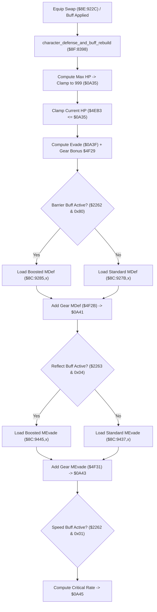

# Party Combat Defense, Buff Rebuild & Equipment Toggle Pipeline

- **ROM Locations**:
  - `character_defense_and_buff_rebuild`: `$8F:8398` – `$8F:8450`
  - `ring_menu_bazooka_ammo_select`: `$8E:9200` – `$8E:922B`
  - `ring_menu_gear_toggle_equip`: `$8E:922C` – `$8E:9298`
- **CPU State**: 16-bit A/X (`REP #$30`), Data Bank `$7E` / `$8E` / `$8F`
- **WRAM Core Addresses**:
  - `$7E:0A35`: Character Max HP (clamped to 999 / `0x03E7`).
  - `$7E:4EB3`: Current active HP (clamped if $>$ Max HP).
  - `$7E:0A3F`: Physical Evade stat.
  - `$7E:0A41`: Magic Defense (MDef) stat.
  - `$7E:0A43`: Magic Evade stat.
  - `$7E:0A45`: Critical Hit Chance stat.
  - `$7E:2261`..`$7E:2263`: Status buff condition bitmasks:
    - `$2261` bit 6 (`0x0040`): Defender spell armor boost.
    - `$2262` bit 7 (`0x0080`): Barrier spell magic defense shield.
    - `$2263` bit 2 (`0x0004`): Reflect spell magic evade boost.
    - `$2262` bit 0 (`0x0001`): Speed/Agility critical hit boost.
  - `$7E:2349`: Selected Bazooka ammunition (0 = Thunder Ball, 2 = Particle Bomb, 4 = Cryo-Blast).
  - `$7E:0ABE`: Equipped armor/weapon slot ID.
  - `$7E:4F29` / `$7E:4F2B` / `$7E:4F31` / `$7E:4F37`: Equipment stat bonuses.

---

## 1. Architectural Architecture & Stat Synthesis

The Secret of Evermore combat engine synthesizes party defensive attributes from three distinct layers:
1. **Base Character Curves**: Unpacked from master ROM tables.
2. **Equipped Gear Bonuses**: Cumulative values from armor, collars, and bracers.
3. **Alchemical Status Buffs**: Active alchemy formula multipliers (Defender, Barrier, Reflect, Speed).



### 1. Max HP & Health Ceiling Clamping (`$8F:8398` – `$8F:83C9`)
- Loads Max HP from `$8C:919D,x` (or `$8C:91A7,x` if Defender buff active).
- Compares with 999 (`CMP #$03E7`): clamped to 999 if exceeded, written into `$7E:0A35`.
- Tests active HP in `$7E:4EB3`: if current HP exceeds the new Max HP ceiling, it is immediately clamped down to `$0A35`.

### 2. Defensive Multipliers & Alchemical Buff Gating
- **Evade (`$0A3F`)**: Adds equipment evasion bonus from `$7E:4F29`.
- **Magic Defense (`$0A41`)**: Tests Barrier status bit (`$7E:2262 & 0x0080`). Selects boosted baseline `$8C:9285,x` over standard `$8C:927B,x`, then adds gear bonus `$7E:4F2B`.
- **Magic Evade (`$0A43`)**: Tests Reflect status bit (`$7E:2263 & 0x0004`). Selects boosted baseline `$8C:9445,x` over standard `$8C:9437,x`, then adds gear bonus `$7E:4F31`.
- **Critical Hit Rate (`$0A45`)**: Tests Speed/Agility condition bit (`$7E:2262 & 0x0001`). Selects boosted baseline `$8C:8F0D,x` over standard, adding gear bonus `$7E:4F37`.

### 3. Equipment Toggle & Unequip Logic (`$8E:922C`)
- When selecting armor or weapons from the ring menu, the routine reads the target item property word from master table `$C4:3894,x`.
- Compares with the currently equipped slot at `$7E:0ABE`:
  - **Match Found**: Clears the slot to zero (`TDC; STA $0ABE`) — toggling unequip.
  - **No Match**: Stores the new item ID (`STA $0ABE`).
- Dispatches stat recalculation via `$8F:8398` to recompute defense and HP boundaries.

### 4. Bazooka Ammunition Selection (`$8E:9200`)
- Reads sub-item index from descriptor field `+0x06`.
- Stores ammo ID into `$7E:2349` (0 = Thunder Ball, 2 = Particle Bomb, 4 = Cryo-Blast).
- Sets active weapon slot `$7E:2441 = 0x001A` (Bazooka) and triggers cursor commit.

---

## 2. Disassembly & Annotations

```assembly
; ==============================================================================
; character_defense_and_buff_rebuild ($8F:8398)
; ==============================================================================
$8F8398  8B          PHB
$8F8399  F4 7E 7E    PEA $7E7E
$8F839C  AB          PLB
$8F839D  AB          PLB
$8F839E  AD 50 0A    LDA $0A50         ; Equipped weapon index
$8F83A1  0A          ASL A
$8F83A2  AA          TAX
$8F83A3  AF 61 22 7E LDA $7E2261       ; Buff status flags
$8F83A7  29 40 00    AND #$0040        ; Bit 6: Defender buff active?
$8F83AA  F0 06       BEQ $8F83B2
$8F83AC  BF A7 91 8C LDA $8C91A7,x     ; Defender boosted HP table
$8F83B0  80 04       BRA $8F83B6
$8F83B2  BF 9D 91 8C LDA $8C919D,x     ; Standard HP table
$8F83B6  C9 E7 03    CMP #$03E7        ; Max HP cap = 999
$8F83B9  30 03       BMI $8F83BE
$8F83BB  A9 E7 03    LDA #$03E7        ; Clamp to 999
$8F83BE  8D 35 0A    STA $0A35         ; Store Max HP

; Clamp Current HP to new Max HP:
$8F83C1  CD B3 4E    CMP $4EB3         ; Compare Max HP vs Current HP
$8F83C4  10 03       BPL $8F83C9
$8F83C6  8D B3 4E    STA $4EB3         ; Clamp current HP down to Max HP

; Physical Evade:
$8F83C9  AF 63 22 7E LDA $7E2263
$8F83CD  89 01 00    BIT #$0001
$8F83D0  F0 06       BEQ $8F83D8
$8F83D2  BF 63 93 8C LDA $8C9363,x
$8F83D6  80 04       BRA $8F83DC
$8F83D8  BF 59 93 8C LDA $8C9359,x
$8F83DC  18          CLC
$8F83DD  6D 29 4F    ADC $4F29         ; Add gear evade bonus
$8F83E0  8D 3F 0A    STA $0A3F         ; Store Evade stat

; Magic Defense & Barrier Buff:
$8F83E3  AF 62 22 7E LDA $7E2262
$8F83E7  89 80 00    BIT #$0080        ; Bit 7: Barrier spell active?
$8F83EA  F0 06       BEQ $8F83F2
$8F83EC  BF 85 92 8C LDA $8C9285,x     ; Boosted MDef table
$8F83F0  80 04       BRA $8F83F6
$8F83F2  BF 7B 92 8C LDA $8C927B,x     ; Standard MDef table
$8F83F6  18          CLC
$8F83F7  6D 2B 4F    ADC $4F2B         ; Add gear MDef bonus
$8F83FA  8D 41 0A    STA $0A41         ; Store Magic Defense stat

; Magic Evade & Reflect Buff:
$8F83FD  AF 63 22 7E LDA $7E2263
$8F8401  89 04 00    BIT #$0004        ; Bit 2: Reflect spell active?
$8F8404  F0 06       BEQ $8F840C
$8F8406  BF 45 94 8C LDA $8C9445,x     ; Boosted MEvade table
$8F840A  80 04       BRA $8F8410
$8F840C  BF 37 94 8C LDA $8C9437,x     ; Standard MEvade table
$8F8410  18          CLC
$8F8411  6D 31 4F    ADC $4F31         ; Add gear MEvade bonus
$8F8414  8D 43 0A    STA $0A43         ; Store Magic Evade stat

; Critical Hit Chance & Speed Buff:
$8F8417  AF 62 22 7E LDA $7E2262
$8F841B  89 01 00    BIT #$0001        ; Bit 0: Speed buff active?
$8F841E  F0 06       BEQ $8F8426
$8F8420  BF 0D 8F 8C LDA $8C8F0D,x     ; Boosted Critical table
$8F8424  80 04       BRA $8F842A
$8F8426  BF 03 8F 8C LDA $8C8F03,x     ; Standard Critical table
$8F842A  18          CLC
$8F842B  6D 37 4F    ADC $4F37         ; Add gear Critical bonus
$8F842E  8D 45 0A    STA $0A45         ; Store Critical Hit Chance
$8F8431  AB          PLB
$8F8432  6B          RTL

; ==============================================================================
; ring_menu_bazooka_ammo_select ($8E:9200)
; ==============================================================================
$8E9200  00 0A       BRK #$0A
$8E9202  18          CLC
$8E9203  69 04 00    ADC #$0004
$8E9206  A8          TAY
$8E9207  B1 95       LDA ($95),y       ; Read selected ammo item
$8E9209  AA          TAX
$8E920A  BF 00 80 8E LDA $8E8000,x
$8E920E  AA          TAX
$8E920F  BF 06 00 8E LDA $8E0006,x     ; Ammo ID (0, 2, 4)
$8E9213  E2 20       SEP #$20
$8E9215  8F 49 23 7E STA $7E2349       ; Set selected Bazooka ammo!
$8E9219  C2 20       REP #$20
$8E921B  A9 FF FF    LDA #$FFFF
$8E921E  8D 34 14    STA $1434
$8E9221  A9 1A 00    LDA #$001A        ; 0x1A = Bazooka weapon ID
$8E9224  8F 41 24 7E STA $7E2441       ; Commit equipped weapon
$8E9228  4C 67 AD    JMP $AD67

; ==============================================================================
; ring_menu_gear_toggle_equip ($8E:922C)
; ==============================================================================
$8E922C  DA          PHX
$8E922D  5A          PHY
$8E922E  A9 12 00    LDA #$0012        ; Gear equip chime SFX
$8E9231  22 DC 82 8C JSL $8C82DC
$8E9235  7A          PLY
$8E9236  FA          PLX
$8E9237  68          PLA
$8E9238  A4 95       LDY $95
$8E923A  B9 02 00    LDA $0002,y
$8E923D  0A          ASL A
$8E923E  18          CLC
$8E923F  69 04 00    ADC #$0004
$8E9242  A8          TAY
$8E9243  B1 95       LDA ($95),y
$8E9245  AA          TAX
$8E9246  BF 00 80 8E LDA $8E8000,x
$8E924A  AA          TAX
$8E924B  BF 06 00 8E LDA $8E0006,x     ; Gear item sub-index
$8E924F  AA          TAX
$8E9250  BF 94 38 C4 LDA $C43894,x     ; Master gear property word
$8E9254  E0 4A 00    CPX #$004A
$8E9257  30 0B       BMI $8E9264
$8E9259  CD BE 0A    CMP $0ABE         ; Already equipped in this slot?
$8E925C  D0 01       BNE $8E925F
$8E925E  7B          TDC               ; Toggle unequip! (set to 0)
$8E925F  8D BE 0A    STA $0ABE         ; Store new equipment ID
$8E9262  80 29       BRA $8E928D

$8E928D  22 98 83 8F JSL $8F8398       ; character_defense_and_buff_rebuild
$8E9291  22 7D 85 8F JSL $8F857D       ; Refresh HUD stat blocks
$8E9295  18          CLC
$8E9296  60          RTS
```

---

## 3. Reconstructed Clean C Implementation

```c
#include <stdint.h>
#include <stdbool.h>

#define MAX_HP_CAP 999

extern uint16_t g_max_hp;               // $7E:0A35
extern uint16_t g_current_hp;           // $7E:4EB3
extern uint16_t g_evade;                // $7E:0A3F
extern uint16_t g_magic_defense;        // $7E:0A41
extern uint16_t g_magic_evade;          // $7E:0A43
extern uint16_t g_critical_rate;        // $7E:0A45
extern uint16_t g_buff_flags_1;         // $7E:2261
extern uint16_t g_buff_flags_2;         // $7E:2262
extern uint16_t g_buff_flags_3;         // $7E:2263
extern uint8_t  g_bazooka_ammo_id;      // $7E:2349
extern uint16_t g_equipped_gear_slot;   // $7E:0ABE
extern uint16_t g_active_weapon_type;   // $7E:2441

extern uint16_t g_gear_bonus_evade;     // $7E:4F29
extern uint16_t g_gear_bonus_mdef;      // $7E:4F2B
extern uint16_t g_gear_bonus_mevade;    // $7E:4F31
extern uint16_t g_gear_bonus_crit;      // $7E:4F37

extern const uint16_t g_hp_std[32];     // $8C:919D
extern const uint16_t g_hp_boosted[32]; // $8C:91A7
extern const uint16_t g_mdef_std[32];   // $8C:927B
extern const uint16_t g_mdef_boost[32]; // $8C:9285
extern const uint16_t g_mevade_std[32]; // $8C:9437
extern const uint16_t g_mevade_boost[32];// $8C:9445
extern const uint16_t g_crit_std[32];   // $8C:8F03
extern const uint16_t g_crit_boost[32]; // $8C:8F0D
extern const uint16_t g_gear_properties[64]; // $C4:3894

extern void play_sound_effect_direct(uint16_t sfx_id);
extern void refresh_hud_stat_blocks(void);

/**
 * Recomputes all defensive attributes, clamping Max HP to 999
 * and evaluating Barrier, Defender, Reflect, and Speed status buffs.
 * Corresponds to $8F:8398.
 */
void character_defense_and_buff_rebuild(uint8_t weapon_idx) {
    // 1. Max HP calculation with Defender buff
    bool has_defender = (g_buff_flags_1 & 0x0040) != 0;
    uint16_t base_hp = has_defender ? g_hp_boosted[weapon_idx] : g_hp_std[weapon_idx];
    g_max_hp = (base_hp > MAX_HP_CAP) ? MAX_HP_CAP : base_hp;

    // Clamp active HP if current HP exceeds the new ceiling
    if (g_current_hp > g_max_hp) {
        g_current_hp = g_max_hp;
    }

    // 2. Physical Evade
    g_evade = g_gear_bonus_evade;

    // 3. Magic Defense with Barrier buff
    bool has_barrier = (g_buff_flags_2 & 0x0080) != 0;
    uint16_t base_mdef = has_barrier ? g_mdef_boost[weapon_idx] : g_mdef_std[weapon_idx];
    g_magic_defense = base_mdef + g_gear_bonus_mdef;

    // 4. Magic Evade with Reflect buff
    bool has_reflect = (g_buff_flags_3 & 0x0004) != 0;
    uint16_t base_mevade = has_reflect ? g_mevade_boost[weapon_idx] : g_mevade_std[weapon_idx];
    g_magic_evade = base_mevade + g_gear_bonus_mevade;

    // 5. Critical Rate with Speed buff
    bool has_speed = (g_buff_flags_2 & 0x0001) != 0;
    uint16_t base_crit = has_speed ? g_crit_boost[weapon_idx] : g_crit_std[weapon_idx];
    g_critical_rate = base_crit + g_gear_bonus_crit;
}

/**
 * Equips or toggles unequip of armor/weapon gear from ring menu.
 * Corresponds to $8E:922C.
 */
void ring_menu_gear_toggle_equip(uint8_t item_subindex) {
    play_sound_effect_direct(0x0012);

    uint16_t new_gear = g_gear_properties[item_subindex];

    // Toggle unequip if already wearing the selected gear
    if (g_equipped_gear_slot == new_gear) {
        g_equipped_gear_slot = 0; // Unequip
    } else {
        g_equipped_gear_slot = new_gear; // Equip
    }

    // Rebuild defensive stats and sync HUD
    character_defense_and_buff_rebuild(0);
    refresh_hud_stat_blocks();
}

/**
 * Selects active Bazooka ammo type (Thunder Ball, Particle Bomb, Cryo-Blast).
 * Corresponds to $8E:9200.
 */
void ring_menu_bazooka_ammo_select(uint8_t ammo_id) {
    g_bazooka_ammo_id = ammo_id;
    g_active_weapon_type = 0x001A; // Bazooka weapon ID
}
```
