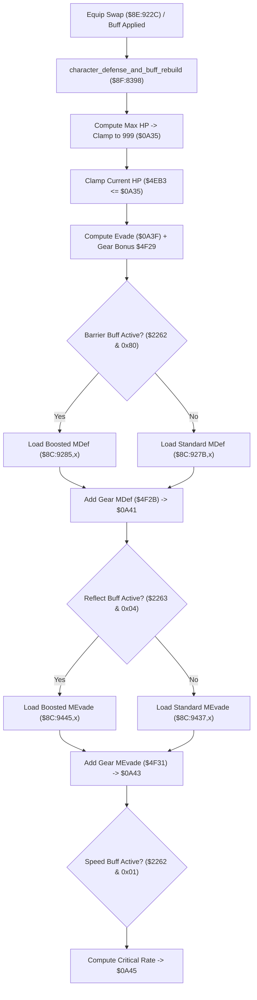

# Party Combat Defense, Buff Rebuild & Equipment Toggle Pipeline

- **ROM Locations**:
  - `character_defense_and_buff_rebuild`: `$8F:8398` – `$8F:8450`
  - `ring_menu_bazooka_ammo_select`: `$8E:9200` – `$8E:922B`
  - `ring_menu_gear_toggle_equip`: `$8E:922C` – `$8E:9298`
- **CPU State**: 16-bit A/X (`REP #$30`), Data Bank `$7E` / `$8E` / `$8F`
- **WRAM Core Addresses**:
  - `$7E:0A35`: Character Max HP (clamped to 999 / `0x03E7`).
  - `$7E:4EB3`: Current active HP (clamped if $>$ Max HP).
  - `$7E:0A3F`: Physical Evade stat.
  - `$7E:0A41`: Magic Defense (MDef) stat.
  - `$7E:0A43`: Magic Evade stat.
  - `$7E:0A45`: Critical Hit Chance stat.
  - `$7E:2261`..`$7E:2263`: Status buff condition bitmasks:
    - `$2261` bit 6 (`0x0040`): Defender spell armor boost.
    - `$2262` bit 7 (`0x0080`): Barrier spell magic defense shield.
    - `$2263` bit 2 (`0x0004`): Reflect spell magic evade boost.
    - `$2262` bit 0 (`0x0001`): Speed/Agility critical hit boost.
  - `$7E:2349`: Selected Bazooka ammunition (0 = Thunder Ball, 2 = Particle Bomb, 4 = Cryo-Blast).
  - `$7E:0ABE`: Equipped armor/weapon slot ID.
  - `$7E:4F29` / `$7E:4F2B` / `$7E:4F31` / `$7E:4F37`: Equipment stat bonuses.

---

## 1. Architectural Architecture & Stat Synthesis

The Secret of Evermore combat engine synthesizes party defensive attributes from three distinct layers:
1. **Base Character Curves**: Unpacked from master ROM tables.
2. **Equipped Gear Bonuses**: Cumulative values from armor, collars, and bracers.
3. **Alchemical Status Buffs**: Active alchemy formula multipliers (Defender, Barrier, Reflect, Speed).

### 1. Max HP & Health Ceiling Clamping (`$8F:8398` – `$8F:83C9`)
- Loads Max HP from `$8C:919D,x` (or `$8C:91A7,x` if Defender buff active).
- Compares with 999 (`CMP #$03E7`): clamped to 999 if exceeded, written into `$7E:0A35`.
- Tests active HP in `$7E:4EB3`: if current HP exceeds the new Max HP ceiling, it is immediately clamped down to `$0A35`.

### 2. Defensive Multipliers & Alchemical Buff Gating
- **Evade (`$0A3F`)**: Adds equipment evasion bonus from `$7E:4F29`.
- **Magic Defense (`$0A41`)**: Tests Barrier status bit (`$7E:2262 & 0x0080`). Selects boosted baseline `$8C:9285,x` over standard `$8C:927B,x`, then adds gear bonus `$7E:4F2B`.
- **Magic Evade (`$0A43`)**: Tests Reflect status bit (`$7E:2263 & 0x0004`). Selects boosted baseline `$8C:9445,x` over standard `$8C:9437,x`, then adds gear bonus `$7E:4F31`.
- **Critical Hit Rate (`$0A45`)**: Tests Speed/Agility condition bit (`$7E:2262 & 0x0001`). Selects boosted baseline `$8C:8F0D,x` over standard, adding gear bonus `$7E:4F37`.

### 3. Equipment Toggle & Unequip Logic (`$8E:922C`)
- When selecting armor or weapons from the ring menu, the routine reads the target item property word from master table `$C4:3894,x`.
- Compares with the currently equipped slot at `$7E:0ABE`:
  - **Match Found**: Clears the slot to zero (`TDC; STA $0ABE`) — toggling unequip.
  - **No Match**: Stores the new item ID (`STA $0ABE`).
- Dispatches stat recalculation via `$8F:8398` to recompute defense and HP boundaries.

### 4. Bazooka Ammunition Selection (`$8E:9200`)
- Reads sub-item index from descriptor field `+0x06`.
- Stores ammo ID into `$7E:2349` (0 = Thunder Ball, 2 = Particle Bomb, 4 = Cryo-Blast).
- Sets active weapon slot `$7E:2441 = 0x001A` (Bazooka) and triggers cursor commit.

---

## 2. Disassembly & Annotations

> **Interactive 65816 Assembly**:
> Centralized comments infused at runtime.
> [View in VFS: soe://rom/code/8F8398](soe://rom/code/8F8398?asm=1&c=0)

---

## 3. Reconstructed Clean C Implementation

> **Reconstructed C Decompilation**:
> Source moved to [`reconstructed-c/8F/8F8398_defense_buffs.c`](../../../reconstructed-c/8F/8F8398_defense_buffs.c).
> [View in VFS: soe://rom/code/8F8398](soe://rom/code/8F8398?c=1&asm=0)

