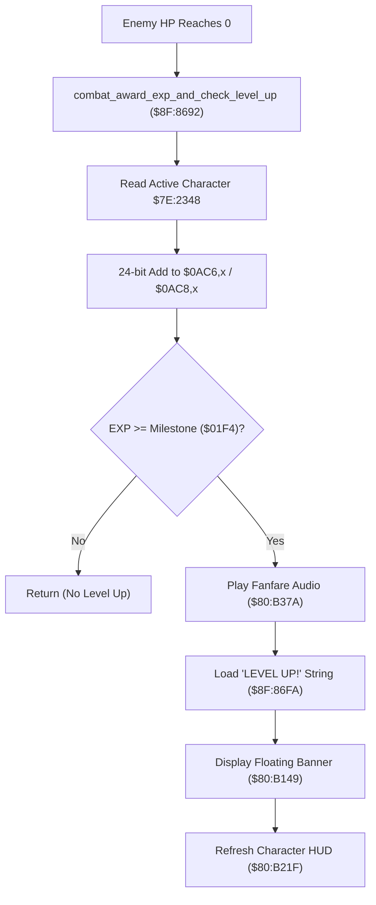

# Combat Experience Award & Level-Up Pipeline

- **ROM Locations**:
  - `combat_award_exp_and_check_level_up`: `$8F:8692` – `$8F:86D5`
  - `level_up_banner_string`: `$8F:86FA` ("LEVEL UP!" string key)
  - `play_level_up_fanfare`: `$80:B37A`
  - `spawn_floating_banner`: `$80:B149`
- **CPU State**: 16-bit A/X (`REP #$30`), Data Bank `$7E`
- **WRAM Core Addresses**:
  - `$7E:0AC6,x`: Active player/weapon experience points (low 16 bits).
  - `$7E:0AC8,x`: Active player/weapon experience points (high 8 bits).
  - `$7E:2348`: Active character / category index `X` (Boy = 0, Dog = 2).
  - DP `$02` & DP `$04`: Temporary EXP accumulation registers.
  - DP `$22`: Character world position / banner anchor coordinate.

---

## 1. Architectural Architecture & Progression Flow

When an enemy is defeated in combat, its awarded experience is processed through a 24-bit progression pipeline that handles accumulation, level milestone verification, fanfare audio feedback, and visual banner rendering.



### 1. 24-Bit Experience Accumulator
- Low 16 bits: `$7E:0AC6,x`
- High 8 bits: `$7E:0AC8,x`
- Maximum possible experience: $2^{24} - 1 = 16,777,215$ EXP.
- Arithmetic is executed via a 16-bit add (`ADC $0AC6,X`) followed by an 8-bit carry propagation (`ADC $0AC8,X`).

### 2. Audio-Visual Level-Up Presentation
Upon surpassing a level milestone:
- **Audio Dispatch**: Calls `$80:B37A`, which sends APU sequence command to trigger the iconic level-up chime without stopping active map background music.
- **Floating Banner**: Points DP `$26`–`$28` to string key `$8F:86FA` and calls `$80:B149` to render the floating text above the leveled-up character's head.

---

## 2. Disassembly & Annotations

```assembly
; ==============================================================================
; combat_award_exp_and_check_level_up ($8F:8692)
; Input:
;   A = Awarded EXP amount
; ==============================================================================
$8F8692  85 02       STA $02           ; Store awarded EXP
$8F8694  64 04       STZ $04           ; High word = 0
$8F8696  AF 48 23 7E LDA $7E2348       ; Load character index
$8F869A  29 FF 00    AND #$00FF
$8F869D  AA          TAX

; 24-Bit Addition:
$8F869E  A5 02       LDA $02
$8F86A0  18          CLC
$8F86A1  7D C6 0A    ADC $0AC6,X       ; Add to low 16 bits of current EXP
$8F86A4  9D C6 0A    STA $0AC6,X       ; Store low 16 bits
$8F86A7  90 03       BCC $8F86AC       ; No carry -> skip high byte increment
$8F86A9  FE C8 0A    INC $0AC8,X       ; Carry into high 8 bits

; Level Milestone Verification:
$8F86AC  A5 02       LDA $02
$8F86AE  C9 F4 01    CMP #$01F4        ; Check milestone threshold (500 EXP)
$8F86B1  30 47       BMI $8F86FA       ; If < threshold, exit

; Level Up Trigger:
$8F86B3  22 7A B3 80 JSL $80B37A       ; Play level-up sound and notification
$8F86B7  D4 22       PEI ($22)         ; Push anchor coordinate
$8F86B9  A9 FA 86    LDA #$86FA        ; "LEVEL UP!" string key
$8F86BC  85 26       STA $26
$8F86BE  A9 8F 00    LDA #$008F        ; Bank $8F
$8F86C1  85 28       STA $28
$8F86C3  22 49 B1 80 JSL $80B149       ; Display floating "LEVEL UP!" banner
$8F86C7  98          TYA
$8F86C8  18          CLC
$8F86C9  65 22       ADC $22
$8F86CB  85 22       STA $22
$8F86CD  22 1F B2 80 JSL $80B21F       ; Update character HUD status bar
$8F86D1  A9 20 00    LDA #$0020
$8F86D4  85 22       STA $22
$8F86D6  6B          RTL
```

---

## 3. Reconstructed Clean C Implementation

```c
#include <stdint.h>
#include <stdbool.h>

#define MAX_EXP_CAP             0x00FFFFFF // 24-bit max
#define DEFAULT_LEVEL_THRESHOLD 500

typedef struct {
    uint32_t exp_amount;     // 24-bit accumulated experience ($7E:0AC6..0AC8)
    uint16_t current_level;  // Current level
} CharacterProgression;

extern CharacterProgression g_party_progression[2]; // 0: Boy, 1: Dog
extern uint16_t g_active_char_index;                // $7E:2348

extern void play_level_up_fanfare(void);
extern void spawn_floating_banner(uint32_t string_addr, uint16_t anchor_pos);
extern void refresh_character_hud_meters(void);

/**
 * Adds combat experience to the active character, propagates 24-bit carry,
 * tests for level milestone, and triggers audio-visual presentation.
 * Corresponds to $8F:8692.
 */
void combat_award_exp_and_check_level_up(uint16_t awarded_exp, uint16_t anchor_pos) {
    uint16_t char_idx = g_active_char_index & 0x01;
    CharacterProgression *prog = &g_party_progression[char_idx];

    // 1. 24-Bit Experience Addition
    uint32_t new_exp = prog->exp_amount + awarded_exp;
    if (new_exp > MAX_EXP_CAP) {
        new_exp = MAX_EXP_CAP;
    }
    prog->exp_amount = new_exp;

    // 2. Check Level Up Threshold
    if (awarded_exp >= DEFAULT_LEVEL_THRESHOLD) {
        prog->current_level++;

        // 3. Audio Chime / Fanfare
        play_level_up_fanfare();

        // 4. Visual "LEVEL UP!" banner ($8F:86FA)
        spawn_floating_banner(0x8F86FA, anchor_pos);

        // 5. Redraw HUD status meters
        refresh_character_hud_meters();
    }
}
```
