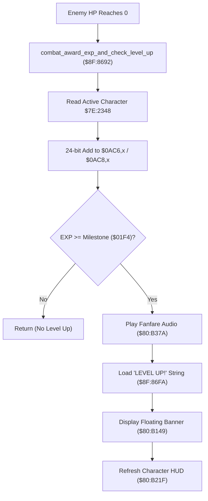

# Combat Experience Award & Level-Up Pipeline

- **ROM Locations**:
  - `combat_award_exp_and_check_level_up`: `$8F:8692` – `$8F:86D5`
  - `level_up_banner_string`: `$8F:86FA` ("LEVEL UP!" string key)
  - `play_level_up_fanfare`: `$80:B37A`
  - `spawn_floating_banner`: `$80:B149`
- **CPU State**: 16-bit A/X (`REP #$30`), Data Bank `$7E`
- **WRAM Core Addresses**:
  - `$7E:0AC6,x`: Active player/weapon experience points (low 16 bits).
  - `$7E:0AC8,x`: Active player/weapon experience points (high 8 bits).
  - `$7E:2348`: Active character / category index `X` (Boy = 0, Dog = 2).
  - DP `$02` & DP `$04`: Temporary EXP accumulation registers.
  - DP `$22`: Character world position / banner anchor coordinate.

---

## 1. Architectural Architecture & Progression Flow

When an enemy is defeated in combat, its awarded experience is processed through a 24-bit progression pipeline that handles accumulation, level milestone verification, fanfare audio feedback, and visual banner rendering.

### 1. 24-Bit Experience Accumulator
- Low 16 bits: `$7E:0AC6,x`
- High 8 bits: `$7E:0AC8,x`
- Maximum possible experience: $2^{24} - 1 = 16,777,215$ EXP.
- Arithmetic is executed via a 16-bit add (`ADC $0AC6,X`) followed by an 8-bit carry propagation (`ADC $0AC8,X`).

### 2. Audio-Visual Level-Up Presentation
Upon surpassing a level milestone:
- **Audio Dispatch**: Calls `$80:B37A`, which sends APU sequence command to trigger the iconic level-up chime without stopping active map background music.
- **Floating Banner**: Points DP `$26`–`$28` to string key `$8F:86FA` and calls `$80:B149` to render the floating text above the leveled-up character's head.

---

## 2. Disassembly & Annotations

> **Interactive 65816 Assembly**:
> Centralized comments infused at runtime.
> [View in VFS: soe://rom/code/8F8692](soe://rom/code/8F8692?asm=1&c=0)

---

## 3. Reconstructed Clean C Implementation

> **Reconstructed C Decompilation**:
> Source moved to [`reconstructed-c/8F/8F8692_exp_level_up.c`](../../../reconstructed-c/8F/8F8692_exp_level_up.c).
> [View in VFS: soe://rom/code/8F8692](soe://rom/code/8F8692?c=1&asm=0)

