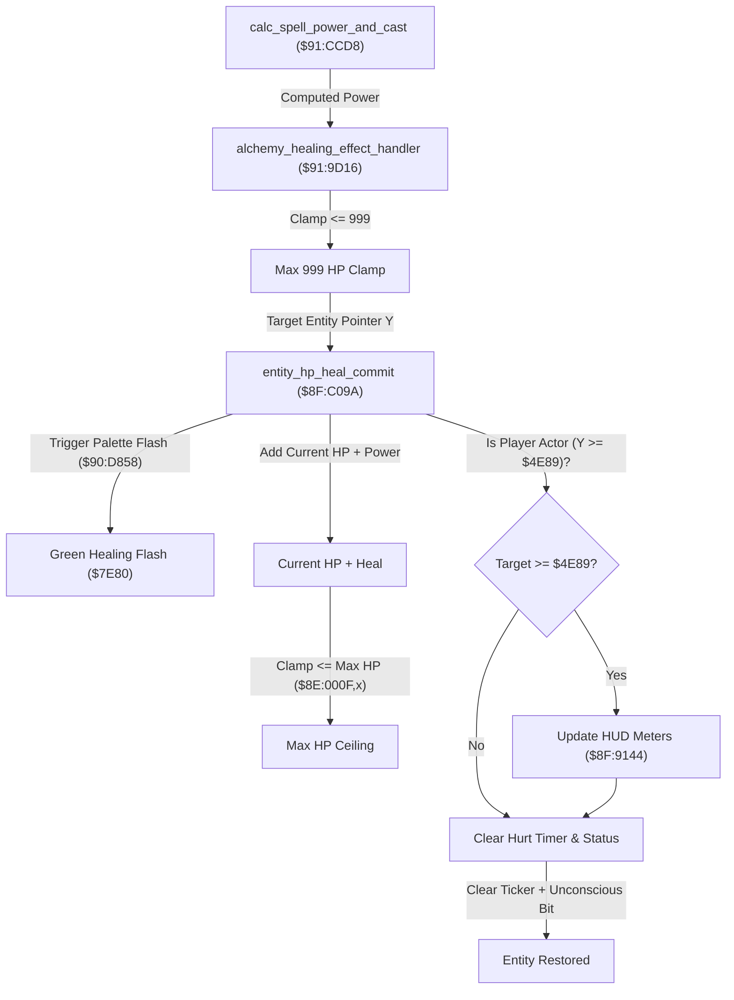

# Alchemy Healing Spells & Entity HP Restoration Pipeline

- **ROM Locations**:
  - `alchemy_healing_effect_handler`: `$91:9D16` – `$91:9D29`
  - `entity_hp_heal_commit`: `$8F:C09A` – `$8F:C0D2`
- **CPU State**: 16-bit A/X (`REP #$30`), Data Bank `$7E`
- **WRAM Core Addresses**:
  - `$7E:002A,y`: Entity current HP (in entity struct).
  - `$7E:0012,y`: Entity state bitflags (bit 0x0400 = unconscious/dying).
  - `$7E:0076,y`: Entity status affliction damage interval / hurt countdown timer.
  - `$7E:0060,y`: Entity monster/character base stat index `x`.
  - `$8E:000F,x`: Target entity maximum HP master stat table.
  - `$7E:4E89`: Boy character slot base address.
  - `$7E:4F37`: Dog character slot base address.

---

## 1. Architectural Architecture & Healing Flow

In Secret of Evermore, healing formulas (such as *Heal*, *Cure*, and *Miracle*) operate through a specialized pipeline that handles HP restoration, visual palette flashing, HUD synchronization, and status effect clearing.

### 1. Max HP Ceiling
Healing is strictly bounded by two caps:
1. **Raw Spell Power Cap**: Clamped to 999 HP (`0x03E7`) before dispatching to the target.
2. **Stat Cap**: Clamped against the actor's maximum HP (`$8E:000F,x`). Healing can never exceed the target's stat pool.

### 2. Player HUD Meter Synchronization (`$8F:9144`)
If the healed entity is the Boy (`$4E89`) or the Dog (`$4F37`), `$8F:C09A` explicitly invokes `$8F:9144` to redraw the HUD gauge bar and numeric HP counter in VRAM. For monsters and NPCs, this step is bypassed.

### 3. State Sanitization & Ticker Clearing
Upon receiving healing:
- The affliction hurt timer at `entity + 0x76` is zeroed (`STZ $0076,y`).
- The unconscious/dying bit flag (`0x0400`) and hurt bits (`AND #$FB87`) in `entity + 0x12` are cleared, reviving an actor from near-death.

---

## 2. Disassembly & Annotations

### Part 1: Healing Effect Dispatcher (`$91:9D16`)
> **Interactive 65816 Assembly**:
> Centralized comments infused at runtime.
> [View in VFS: soe://rom/code/919D16](soe://rom/code/919D16?asm=1&c=0)

### Part 2: HP Restoration & HUD Commit (`$8F:C09A`)
> **Interactive 65816 Assembly**:
> Centralized comments infused at runtime.
> [View in VFS: soe://rom/code/919D16](soe://rom/code/919D16?asm=1&c=0)

---

## 3. Reconstructed Clean C Implementation

> **Reconstructed C Decompilation**:
> Source moved to [`reconstructed-c/91/919D16_healing_spells.c`](../../../reconstructed-c/91/919D16_healing_spells.c).
> [View in VFS: soe://rom/code/919D16](soe://rom/code/919D16?c=1&asm=0)

