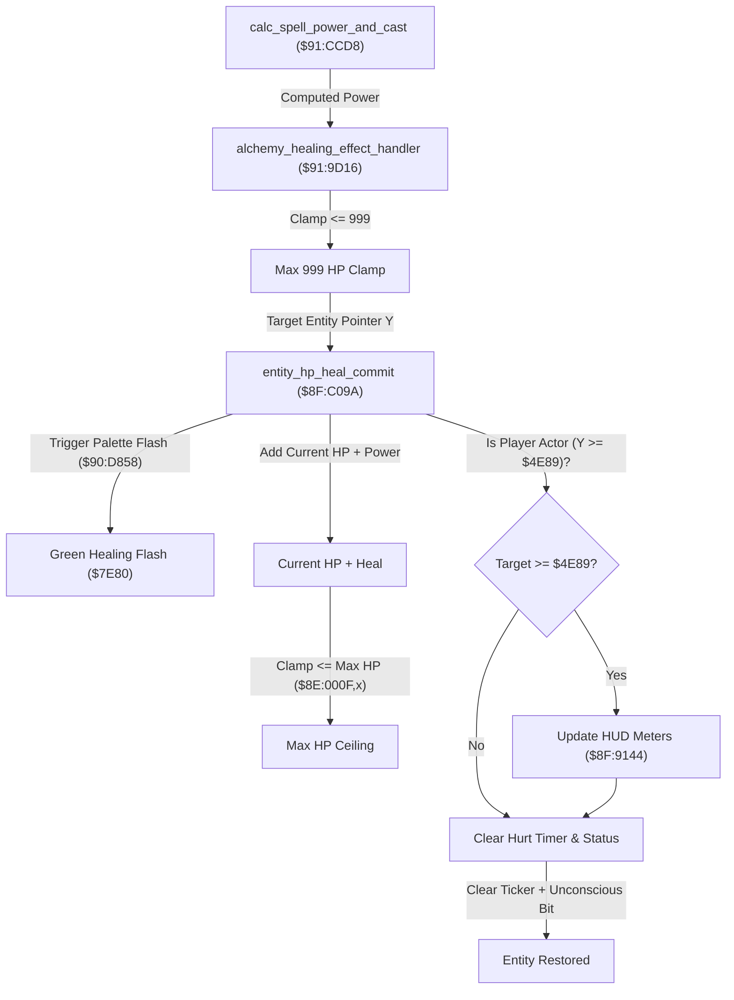

# Alchemy Healing Spells & Entity HP Restoration Pipeline

- **ROM Locations**:
  - `alchemy_healing_effect_handler`: `$91:9D16` – `$91:9D29`
  - `entity_hp_heal_commit`: `$8F:C09A` – `$8F:C0D2`
- **CPU State**: 16-bit A/X (`REP #$30`), Data Bank `$7E`
- **WRAM Core Addresses**:
  - `$7E:002A,y`: Entity current HP (in entity struct).
  - `$7E:0012,y`: Entity state bitflags (bit 0x0400 = unconscious/dying).
  - `$7E:0076,y`: Entity status affliction damage interval / hurt countdown timer.
  - `$7E:0060,y`: Entity monster/character base stat index `x`.
  - `$8E:000F,x`: Target entity maximum HP master stat table.
  - `$7E:4E89`: Boy character slot base address.
  - `$7E:4F37`: Dog character slot base address.

---

## 1. Architectural Architecture & Healing Flow

In Secret of Evermore, healing formulas (such as *Heal*, *Cure*, and *Miracle*) operate through a specialized pipeline that handles HP restoration, visual palette flashing, HUD synchronization, and status effect clearing.



### 1. Max HP Ceiling
Healing is strictly bounded by two caps:
1. **Raw Spell Power Cap**: Clamped to 999 HP (`0x03E7`) before dispatching to the target.
2. **Stat Cap**: Clamped against the actor's maximum HP (`$8E:000F,x`). Healing can never exceed the target's stat pool.

### 2. Player HUD Meter Synchronization (`$8F:9144`)
If the healed entity is the Boy (`$4E89`) or the Dog (`$4F37`), `$8F:C09A` explicitly invokes `$8F:9144` to redraw the HUD gauge bar and numeric HP counter in VRAM. For monsters and NPCs, this step is bypassed.

### 3. State Sanitization & Ticker Clearing
Upon receiving healing:
- The affliction hurt timer at `entity + 0x76` is zeroed (`STZ $0076,y`).
- The unconscious/dying bit flag (`0x0400`) and hurt bits (`AND #$FB87`) in `entity + 0x12` are cleared, reviving an actor from near-death.

---

## 2. Disassembly & Annotations

### Part 1: Healing Effect Dispatcher (`$91:9D16`)
```assembly
; ==============================================================================
; alchemy_healing_effect_handler ($91:9D16)
; Input:
;   Y = Active spell slot pointer ($7E:3364+)
;   $4C = Target / caster entity pointer
; ==============================================================================
$919D16  B9 2A 00    LDA $002A,Y       ; Load computed spell power from slot +0x2A
$919D19  A4 4C       LDY $4C           ; Load target entity pointer
$919D1B  C9 E7 03    CMP #$03E7        ; Exceeds 999 HP cap?
$919D1E  30 03       BMI $919D23
$919D20  A9 E7 03    LDA #$03E7        ; Clamp to 999 HP
$919D23  22 9A C0 8F JSL $8FC09A       ; Commit HP heal to entity
$919D27  7A          PLY
$919D28  38          SEC
$919D29  6B          RTL
```

### Part 2: HP Restoration & HUD Commit (`$8F:C09A`)
```assembly
; ==============================================================================
; entity_hp_heal_commit ($8F:C09A)
; Input:
;   A = Heal amount
;   Y = Target entity pointer
; ==============================================================================
$8FC09A  5A          PHY               ; Preserve target pointer
$8FC09B  48          PHA               ; Preserve heal amount
$8FC09C  A2 80 7E    LDX #$7E80        ; Green healing palette effect ID
$8FC09F  22 58 D8 90 JSL $90D858       ; Trigger visual palette flash
$8FC0A3  68          PLA               ; Restore heal amount
$8FC0A4  7A          PLY               ; Restore target pointer

$8FC0A5  BE 60 00    LDX $0060,Y       ; X = entity base stat index
$8FC0A8  18          CLC
$8FC0A9  79 2A 00    ADC $002A,Y       ; Add to current HP
$8FC0AC  DF 0F 00 8E CMP $8E000F,X     ; Exceeds maximum HP?
$8FC0B0  30 04       BMI $8FC0B6       ; If < max HP, accept value
$8FC0B2  BF 0F 00 8E LDA $8E000F,X     ; Clamp to maximum HP

$8FC0B6  99 2A 00    STA $002A,Y       ; Write back updated current HP

; Check if Player (Boy or Dog):
$8FC0B9  C0 89 4E    CPY #$4E89        ; Target >= $4E89 (Boy base)?
$8FC0BC  90 07       BCC $8FC0C5       ; If enemy, skip HUD update
$8FC0BE  DA          PHX
$8FC0BF  5A          PHY
$8FC0C0  22 44 91 8F JSL $8F9144       ; Redraw player HP HUD meters
$8FC0C4  7A          PLY
$8FC0C5  7B          TDC               ; A = 0
$8FC0C6  99 76 00    STA $0076,Y       ; Clear damage/poison interval ticker
$8FC0C9  B9 12 00    LDA $0012,Y       ; Load entity state flags
$8FC0CC  29 87 FB    AND #$FB87        ; Clear unconscious/downed flags
$8FC0CF  99 12 00    STA $0012,Y
$8FC0D2  6B          RTL
```

---

## 3. Reconstructed Clean C Implementation

```c
#include <stdint.h>
#include <stdbool.h>

#define HEALING_CAP_HP      999
#define BOY_ENTITY_BASE     0x4E89
#define STATUS_UNCONSCIOUS  0x0400
#define STATUS_HURT_MASK    0x0478

typedef struct {
    uint8_t  pad0[0x12];
    uint16_t state_flags;    // +0x12: Entity state bits
    uint8_t  pad1[0x16];
    uint16_t current_hp;     // +0x2A: Entity current health
    uint8_t  pad2[0x34];
    uint16_t stat_index;     // +0x60: Master stat table index
    uint8_t  pad3[0x14];
    uint16_t hurt_timer;     // +0x76: Affliction ticker countdown
} EntityRecord;

typedef struct {
    uint8_t  pad0[0x2A];
    uint16_t spell_power;    // +0x2A: Computed formula power
} SpellSlotRecord;

extern const uint16_t g_master_max_hp[]; // ROM table $8E:000F

extern void trigger_palette_flash(uint16_t effect_id);
extern void update_player_hud_meters(EntityRecord *player);

/**
 * Commits HP healing to an entity: triggers green flash, caps at max HP,
 * synchronizes player HUD, and clears unconsciousness / hurt flags.
 * Corresponds to $8F:C09A.
 */
void entity_hp_heal_commit(EntityRecord *target, uint16_t heal_amount) {
    // 1. Trigger green healing visual palette flash
    trigger_palette_flash(0x7E80);

    // 2. Add healing to current HP, clamped to entity Max HP
    uint16_t max_hp = g_master_max_hp[target->stat_index];
    uint16_t new_hp = target->current_hp + heal_amount;
    if (new_hp > max_hp) {
        new_hp = max_hp;
    }
    target->current_hp = new_hp;

    // 3. If target is player character (Boy or Dog), synchronize HUD display
    if ((uintptr_t)target >= BOY_ENTITY_BASE) {
        update_player_hud_meters(target);
    }

    // 4. Reset poison/damage ticker and clear unconscious state
    target->hurt_timer = 0;
    target->state_flags &= ~STATUS_HURT_MASK;
}

/**
 * Top-level alchemy healing effect dispatcher.
 * Corresponds to $91:9D16.
 */
void alchemy_healing_effect_handler(SpellSlotRecord *slot, EntityRecord *target) {
    uint16_t power = slot->spell_power;
    if (power > HEALING_CAP_HP) {
        power = HEALING_CAP_HP;
    }

    entity_hp_heal_commit(target, power);
}
```
