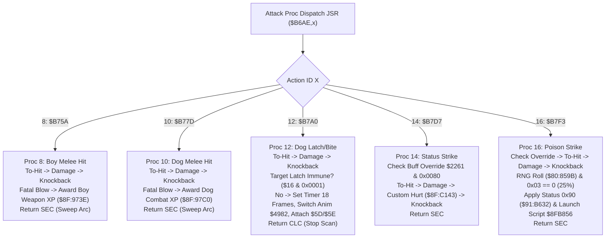

# Special Attack Procs: Kill XP, Companion Latch & Status Effects ($8F:B75A – $8F:B82C)

- **ROM Locations**:
  - `attack_proc_melee_boy_kill_xp`: `$8F:B75A` – `$8F:B77C` (Proc 8: Boy melee kill XP)
  - `attack_proc_melee_dog_kill_xp`: `$8F:B77D` – `$8F:B79F` (Proc 10: Dog melee kill XP)
  - `attack_proc_dog_latch_bite`: `$8F:B7A0` – `$8F:B7D6` (Proc 12: Dog latch bite attack)
  - `attack_proc_status_strike`: `$8F:B7D7` – `$8F:B7F2` (Proc 14: Special status attack)
  - `attack_proc_poison_strike`: `$8F:B7F3` – `$8F:B72C` (Proc 16: 25% chance status inflictor)
- **CPU State**: 16-bit A/X (`REP #$30`), Data Bank `$7E` / `$8F`
- **WRAM Core Addresses**:
  - `$7E:2261`: Global player status/buff flags (bit 7 `0x0080`: attack override/suppression).
  - `$7E:0EA0`: Net damage dealt to target.
  - DP `$4C`: Attacker entity pointer.
  - DP `$5D` / `$5E`: Latch target attachment coordinates.
  - Target Entity `Y`:
    - `+$16`: Collision & immunity word (bit 0 `0x0001`: latch immune).
    - `+$2A`: Current hit points (HP).
  - Attacker Entity `+$78`: Latch duration timer (18 frames / ticks).
- **Downstream Engine Routines**:
  - `$8F:BA06`: To-hit roll and invulnerability check.
  - `$8F:C067`: Calculate melee damage amount.
  - `$8F:C0D3`: Apply damage & trigger standard hurt reaction.
  - `$8F:C143`: Apply damage with custom status sound/animation.
  - `$8F:C17F`: Apply knockback recoil.
  - `$8F:973E`: Award Boy weapon skill XP on fatal blow.
  - `$8F:97C0`: Award Dog combat XP on fatal blow.
  - `$90:8124`: Switch entity animation state (switches Dog to latch/bite animation `$4982`).
  - `$91:B632`: Apply status effect (`status_effect_apply`, effect ID `0x0090`).
  - `$8C:C521`: Launch status effect script thread (`$8F:B856`).

---

## 1. Architectural Role & Specialized Attack Behaviors

These specialized procs extend the core dispatch table at `$8F:B6AE`:



---

## 2. Disassembly & Annotations

### Dog Latch / Bite Attack Proc (`$8F:B7A0` – `$8F:B7D6`)
```asm
; ==============================================================================
; attack_proc_dog_latch_bite ($8F:B7A0)
; ==============================================================================
$8FB7A0  22 06 ba 8f    jsl $8FBA06        ; To-hit roll and invulnerability check
$8FB7A4  90 2f          bcc $8FB7D5        ; If miss: exit with Carry Set
$8FB7A6  22 67 c0 8f    jsl $8FC067        ; Calculate melee damage
$8FB7AA  22 d3 c0 8f    jsl $8FC0D3        ; Apply damage to target
$8FB7AE  22 7f c1 8f    jsl $8FC17F        ; Apply knockback physics

; Test target latch immunity (bit 0 of collision word +0x16)
$8FB7B2  b9 16 00       lda $0016,y        ; Target collision mode word
$8FB7B5  89 01 00       bit #$0001         ; Is target latch-immune?
$8FB7B8  d0 1b          bne $8FB7D5        ; If immune: exit with Carry Set

; Attach Dog to target
$8FB7BA  a4 4c          ldy $4C            ; Y = Attacker entity pointer (Dog)
$8FB7BC  a9 12 00       lda #$0012         ; Latch duration = 18 ticks
$8FB7BF  99 78 00       sta $0078,y        ; Store into Dog latch timer (+0x78)
$8FB7C2  a2 82 49       ldx #$4982         ; Dog biting/clinging animation ID
$8FB7C5  22 24 81 90    jsl $908124        ; Switch Dog animation state
$8FB7C9  b9 00 00       lda $0000,y        ; Read target world X
$8FB7CC  85 5d          sta $5D            ; Store attachment coordinate X
$8FB7CE  b9 01 00       lda $0001,y        ; Read target world Y
$8FB7D1  85 5e          sta $5E            ; Store attachment coordinate Y
$8FB7D3  18             clc                ; Return Carry Clear (stop hit scan)
$8FB7D4  60             rts

$8FB7D5  38             sec                ; Return Carry Set (continue scan)
$8FB7D6  60             rts
```

### 25% Chance Status Inflicting Strike (`$8F:B7F3` – `$8F:B82C`)
```asm
; ==============================================================================
; attack_proc_poison_strike ($8F:B7F3)
; ==============================================================================
$8FB7F3  ad 61 22       lda $2261          ; Check global status suppression flag
$8FB7F6  89 80 00       bit #$0080
$8FB7F9  d0 30          bne $8FB82B        ; If bit 7 asserted: bypass attack
$8FB7FB  22 06 ba 8f    jsl $8FBA06        ; To-hit roll
$8FB7FF  90 2a          bcc $8FB82B
$8FB801  22 67 c0 8f    jsl $8FC067        ; Damage calculation
$8FB805  22 d3 c0 8f    jsl $8FC0D3        ; Apply damage
$8FB809  22 7f c1 8f    jsl $8FC17F        ; Apply knockback

; Roll 25% chance for status infliction
$8FB80D  22 9b 85 80    jsl $80859B        ; Call RNG generator
$8FB811  29 03 00       and #$0003         ; Mask lower 2 bits (0..3)
$8FB814  d0 15          bne $8FB82B        ; If != 0 (75%): no status effect

; Apply Status Effect ID 0x0090 (Poison)
$8FB816  a2 90 00       ldx #$0090         ; Effect ID
$8FB819  22 32 b6 91    jsl $91B632        ; status_effect_apply
$8FB81D  a9 56 b8       lda #$B856         ; Address of status bubble animation
$8FB820  85 22          sta $22
$8FB822  a9 8f 00       lda #$008F         ; Bank $8F
$8FB825  85 24          sta $24
$8FB827  22 21 c5 8c    jsl $8CC521        ; Launch status animation thread
$8FB82B  38             sec                ; Return Carry Set (sweep arc)
$8FB82C  60             rts
```

---

## 3. Clean C Decompilation

```c
#include <stdint.h>
#include <stdbool.h>

typedef struct EntityRecord {
    uint8_t  _pad0[22];
    uint16_t collision_mode;   // +0x16: Bit 0x0001 = latch-immune
    uint8_t  _pad1[18];
    uint16_t hp;               // +0x2A: Current HP
    uint8_t  _pad2[76];
    uint16_t latch_timer;      // +0x78: Latch duration countdown timer
} EntityRecord;

// Global engine state
extern EntityRecord *g_attacker_entity;     // DP $4C
extern uint16_t      g_damage_dealt;        // $7E:0EA0
extern uint16_t      g_global_buff_flags;   // $7E:2261
extern uint16_t      g_latch_anchor_x;      // DP $5D
extern uint16_t      g_latch_anchor_y;      // DP $5E

// Downstream engine subroutines
extern bool to_hit_check_melee(EntityRecord *target);                       // $8F:BA06
extern void calc_damage_melee(EntityRecord *target);                        // $8F:C067
extern void apply_damage_and_reaction(EntityRecord *target);                 // $8F:C0D3
extern void apply_damage_custom_reaction(EntityRecord *target);              // $8F:C143
extern void apply_knockback_physics(EntityRecord *target);                  // $8F:C17F
extern void award_boy_weapon_xp(EntityRecord *target);                      // $8F:973E
extern void award_dog_combat_xp(EntityRecord *target);                      // $8F:97C0
extern void entity_set_animation(EntityRecord *entity, uint16_t anim_id);   // $90:8124
extern uint16_t rng_next_word(void);                                        // $80:859B
extern void status_effect_apply(EntityRecord *target, uint16_t effect_id);  // $91:B632
extern void launch_script_thread(uint32_t far_script_addr);                 // $8C:C521

/**
 * attack_proc_melee_boy_kill_xp ($8F:B75A) - Proc 8
 * Melee attack that directly awards Boy weapon skill XP if fatal.
 */
bool attack_proc_melee_boy_kill_xp(EntityRecord *target) {
    if (!to_hit_check_melee(target)) {
        return true;
    }

    calc_damage_melee(target);
    apply_damage_and_reaction(target);
    apply_knockback_physics(target);

    if (g_damage_dealt != 0 && g_damage_dealt >= target->hp) {
        award_boy_weapon_xp(target);
    }

    return true; // Carry Set: sweep arc
}

/**
 * attack_proc_melee_dog_kill_xp ($8F:B77D) - Proc 10
 * Melee attack that directly awards Dog combat XP if fatal.
 */
bool attack_proc_melee_dog_kill_xp(EntityRecord *target) {
    if (!to_hit_check_melee(target)) {
        return true;
    }

    calc_damage_melee(target);
    apply_damage_and_reaction(target);
    apply_knockback_physics(target);

    if (g_damage_dealt != 0 && g_damage_dealt >= target->hp) {
        award_dog_combat_xp(target);
    }

    return true; // Carry Set: sweep arc
}

/**
 * attack_proc_dog_latch_bite ($8F:B7A0) - Proc 12
 * Companion Dog latch-and-bite attack. Deals damage and latches Dog onto the victim
 * for 18 frames unless target is latch-immune.
 */
bool attack_proc_dog_latch_bite(EntityRecord *target) {
    if (!to_hit_check_melee(target)) {
        return true;
    }

    calc_damage_melee(target);
    apply_damage_and_reaction(target);
    apply_knockback_physics(target);

    // If target has latch immunity (bit 0x0001), do not cling
    if (target->collision_mode & 0x0001) {
        return true;
    }

    // Attach Dog to target
    EntityRecord *dog = g_attacker_entity;
    if (dog != NULL) {
        dog->latch_timer = 18; // 18 frames latch duration
        entity_set_animation(dog, 0x4982); // Clinging / biting animation

        g_latch_anchor_x = (uint16_t)(uintptr_t)target;
        g_latch_anchor_y = (uint16_t)((uintptr_t)target >> 8);
    }

    // Terminate hit scan (Dog is now latched onto this single entity)
    return false;
}

/**
 * attack_proc_status_strike ($8F:B7D7) - Proc 14
 * Specialized strike that plays custom status hit reaction ($8F:C143).
 */
bool attack_proc_status_strike(EntityRecord *target) {
    if (g_global_buff_flags & 0x0080) {
        return true;
    }

    if (!to_hit_check_melee(target)) {
        return true;
    }

    calc_damage_melee(target);
    apply_damage_custom_reaction(target);
    apply_knockback_physics(target);

    return true;
}

/**
 * attack_proc_poison_strike ($8F:B7F3) - Proc 16
 * Weapon strike that inflicts status effect 0x0090 with a 25% RNG probability.
 */
bool attack_proc_poison_strike(EntityRecord *target) {
    if (g_global_buff_flags & 0x0080) {
        return true;
    }

    if (!to_hit_check_melee(target)) {
        return true;
    }

    calc_damage_melee(target);
    apply_damage_and_reaction(target);
    apply_knockback_physics(target);

    // 25% chance (lower 2 bits of RNG roll == 0)
    if ((rng_next_word() & 0x0003) == 0) {
        status_effect_apply(target, 0x0090);
        launch_script_thread(0x8FB856);
    }

    return true;
}
```
