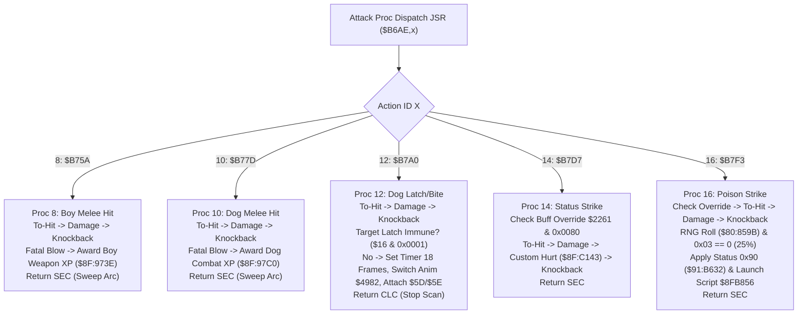

# Special Attack Procs: Kill XP, Companion Latch & Status Effects ($8F:B75A – $8F:B82C)

- **ROM Locations**:
  - `attack_proc_melee_boy_kill_xp`: `$8F:B75A` – `$8F:B77C` (Proc 8: Boy melee kill XP)
  - `attack_proc_melee_dog_kill_xp`: `$8F:B77D` – `$8F:B79F` (Proc 10: Dog melee kill XP)
  - `attack_proc_dog_latch_bite`: `$8F:B7A0` – `$8F:B7D6` (Proc 12: Dog latch bite attack)
  - `attack_proc_status_strike`: `$8F:B7D7` – `$8F:B7F2` (Proc 14: Special status attack)
  - `attack_proc_poison_strike`: `$8F:B7F3` – `$8F:B72C` (Proc 16: 25% chance status inflictor)
- **CPU State**: 16-bit A/X (`REP #$30`), Data Bank `$7E` / `$8F`
- **WRAM Core Addresses**:
  - `$7E:2261`: Global player status/buff flags (bit 7 `0x0080`: attack override/suppression).
  - `$7E:0EA0`: Net damage dealt to target.
  - DP `$4C`: Attacker entity pointer.
  - DP `$5D` / `$5E`: Latch target attachment coordinates.
  - Target Entity `Y`:
    - `+$16`: Collision & immunity word (bit 0 `0x0001`: latch immune).
    - `+$2A`: Current hit points (HP).
  - Attacker Entity `+$78`: Latch duration timer (18 frames / ticks).
- **Downstream Engine Routines**:
  - `$8F:BA06`: To-hit roll and invulnerability check.
  - `$8F:C067`: Calculate melee damage amount.
  - `$8F:C0D3`: Apply damage & trigger standard hurt reaction.
  - `$8F:C143`: Apply damage with custom status sound/animation.
  - `$8F:C17F`: Apply knockback recoil.
  - `$8F:973E`: Award Boy weapon skill XP on fatal blow.
  - `$8F:97C0`: Award Dog combat XP on fatal blow.
  - `$90:8124`: Switch entity animation state (switches Dog to latch/bite animation `$4982`).
  - `$91:B632`: Apply status effect (`status_effect_apply`, effect ID `0x0090`).
  - `$8C:C521`: Launch status effect script thread (`$8F:B856`).

---

## 1. Architectural Role & Specialized Attack Behaviors

These specialized procs extend the core dispatch table at `$8F:B6AE`:

---

## 2. Disassembly & Annotations

### Dog Latch / Bite Attack Proc (`$8F:B7A0` – `$8F:B7D6`)
> **Interactive 65816 Assembly**:
> Centralized comments infused at runtime.
> [View in VFS: soe://rom/code/8FB75A](soe://rom/code/8FB75A?asm=1&c=0)

### 25% Chance Status Inflicting Strike (`$8F:B7F3` – `$8F:B82C`)
> **Interactive 65816 Assembly**:
> Centralized comments infused at runtime.
> [View in VFS: soe://rom/code/8FB75A](soe://rom/code/8FB75A?asm=1&c=0)

---

## 3. Clean C Decompilation

> **Reconstructed C Decompilation**:
> Source moved to [`reconstructed-c/8F/8FB75A_special_attack_procs.c`](../../../reconstructed-c/8F/8FB75A_special_attack_procs.c).
> [View in VFS: soe://rom/code/8FB75A](soe://rom/code/8FB75A?c=1&asm=0)

