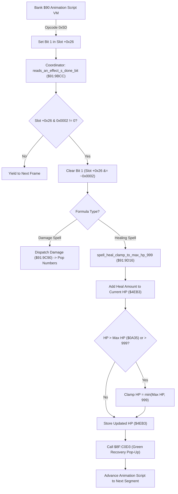

# Alchemy Spell Animation Coordination, Targeting & Healing Clamp Pipeline

- **ROM Locations**:
  - `reads_an_effect_s_done_bit_set_by_animation_opco`: `$91:9BCC` – `$91:9BE8`
  - `spell_heal_clamp_to_max_hp_999`: `$91:9D16` – `$91:9D2D`
  - `reads_an_effect_s_done_bit`: `$91:9D2E` – `$91:9D45`
- **CPU State**: 16-bit A/X (`REP #$30`), Data Bank `$7E` / `$91`
- **WRAM Core Addresses**:
  - Entity slot offset `+0x26`: Animation VM control & phase sync word (bit 1 = `0x0002` signals effect done).
  - Entity slot offset `+0x28`: Active spell formula ID.
  - Entity slot offset `+0x2A`: Cumulative damage / heal value output.
  - Entity slot offset `+0x2E`: Target entity array pointer.
  - `$7E:0A35`: Party Max HP (clamped ceiling 999).
  - `$7E:4EB3`: Target current active HP.

---

## 1. Architectural Architecture & Animation Synchronization

Alchemy formulas in Secret of Evermore bridge two separate execution environments:
1. **The Bank `$90` Animation Script VM**: Plays visual particle effects, projectile flight, impact explosions, and sound cues. Opcode `0x5D` (`effect_done`) flags when an animation sequence finishes.
2. **The Bank `$91` Combat & Damage Engine**: Polls effect status bits, coordinates multi-target damage, applies defensive reductions, clamps healing to 999, and advances the animation script to subsequent phases (e.g., Part A buildup to Part B explosion).

### 1. Effect Done Bit Synchronization (`$91:9BCC` / `$91:9D2E`)
- Inspects bit 1 (`0x0002`) of entity slot field `+0x26`.
- If bit 1 is set, the animation script phase is complete:
  - Clears bit 1 via `AND #$FFFD`.
  - Returns Carry Clear (`CLC`) to notify the caller that combat resolution can proceed.
- If bit 1 is zero, the animation is still playing:
  - Returns Carry Set (`SEC`) to yield execution until the next frame.

### 2. Healing Clamping & Max HP Boundary (`$91:9D16`)
- Adds calculated formula restoration power to target HP (`$7E:4EB3`).
- Performs strict two-level boundary enforcement:
  1. Compares with hard 999 ceiling (`CMP #$03E7`).
  2. Compares with character Max HP (`CMP $0A35`).
- Stores the bounded value back into `$7E:4EB3` and invokes `$8F:C0D3` to display green restoration numbers.

---

## 2. Disassembly & Annotations

> **Interactive 65816 Assembly**:
> Centralized comments infused at runtime.
> [View in VFS: soe://rom/code/919BCC](soe://rom/code/919BCC?asm=1&c=0)

---

## 3. Reconstructed Clean C Implementation

> **Reconstructed C Decompilation**:
> Source moved to [`reconstructed-c/91/919BCC_spell_targeting.c`](../../../reconstructed-c/91/919BCC_spell_targeting.c).
> [View in VFS: soe://rom/code/919BCC](soe://rom/code/919BCC?c=1&asm=0)

---

## 4. Who can be targeted, and the "invisible entities"

Players have long reported invisible things that spells can target, sometimes with odd results.
The code explains what they are and why they can be picked.

**What can be picked.** The list builders (`$8C:8719`–`$8C:87EC`) walk the whole live entity list
from `$3DDF` through `+$5E`: party, enemies, NPCs and every actor a script spawned. Each one goes
through `target_candidate_filter` (`$8C:8658`), which checks position (on screen ±8 px), the flags
at `+$10`, HP and the request mask `$05AD`. It never looks at the sprite. An entity that is on screen
with ordinary flags (no friendly bit `$0002`, no `$4000`) and HP above 0 is a valid offensive target,
drawn or not. "All enemies" keeps the first 8 in list order, so invisible candidates take places
from visible enemies.

**What a hit does.** A script can arm an entity with `attach_script` (opcode `0x3F`): an event mask
at `+$68` and a trigger id at `+$66`. Damage with mask bit `$0100` starts the trigger's script with
reason `$0100` (`$8F:C205`). HP reaching 0 with bit `$0200` starts it with reason `$0200`
(`$90:83CE`, `$90:84BF`). The script reads the reason from its slot's `+$09` (`$8C:CE4D`). So a spell
on an armed invisible actor runs that actor's story script, at a time its author never planned for.

**Mungola (room `0x77`).** At the start of the last phase the enter script spawns Mungola
(character 115, flags 0, 5000 HP) at (30, 9), behind the stage, and arms him with mask `$0300`,
trigger `0x1A85` → `$9A:8791`. The two puppets are armed the same way with `0x1A82` → `$9A:8674`.
Mungola is targetable there by design of the filter, not by mistake. Each event script is harmless on
its own. On a hit, `$9A:8791` flashes the curtain objects and freezes the puppets for 20 frames
(guarded by the lock bit `$2834.0`). On death it sets `$22DC` bit 3 and freezes the party.
`$9A:8674` respawns the puppets once both are down.

**Why it can crash (open).** Players report it does not happen after teleporting straight to
Mungola; it needs state left over from earlier play. That rules out the fight alone as the
cause. What the code shows so far:

- *A weak spot.* Every hit on every armed entity starts a new thread, even when the lock makes
  it end at once. The slot allocator `$8C:CF18` has no "pool full" case: past the 20th slot it
  runs into the run list `$2F28` and the WRAM after it, writes a slot there and queues it.
  Overflowing it would fit a crash or an unrelated script running (the save screen).
- *Not stale, so ruled out.* Spawning sets `+$66 = $FFFF` and `+$68 = 0` (`$8F:B0E5`,
  `$8F:B11C`), so an entity never inherits a hook. Room init clears room hook 1 (`$8F:B1E0`).
  Map loads free all 20 thread slots and empty the run list (`$8C:CEE9`, called from `$8C:DB75`
  and `$8C:DBBD`).
- *Stale, so still candidates.* Spawn ORs the record's flags into `+$10` instead of overwriting
  it (`$8F:B0BE`–`$8F:B0C7`), so flag bits from the entity that last used that memory survive.
  Spawn also leaves several fields untouched, among them `+$84`–`+$AD` and part of `+$26`–`+$2E`,
  which the spell engine uses. Save-area and other per-game WRAM is not reset at all.

To settle it: record a run that crashes, then trace the cast in room `0x77`. Watch for
`$8C:CF18` returning an X at or above `$2F28`, and diff the Mungola and puppet entities against the
same entities after a teleport.

Side note: room hook 1 is the loot hook. A dying enemy that rolls a drop copies `$0EA2`/`$0EAC`
into its own `+$68`/`+$66` (`$90:857B`).

**Using it.**
- *Finding the actors.* List every entity that passes `$8C:8658` for an offensive mask, with its
  `+$66`/`+$68` hook, and mark the ones that draw nothing. This is the map of targets per screen.
- *Sequence breaks.* An armed actor's death hook can run early by killing it with a spell. Which
  rooms arm invisible actors with `$0200` is the list to check first.
- *Routing.* Invisible candidates use up the 8 places of an all-target spell and move the cursor
  order. Both can be predicted from the entity list.
