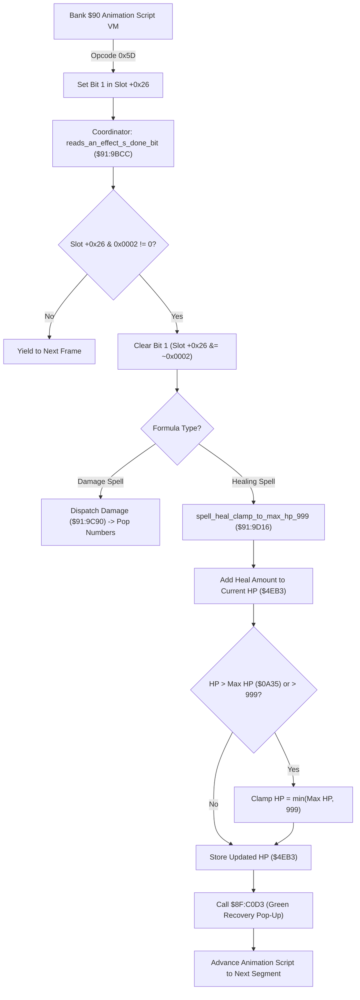

# Alchemy Spell Animation Coordination, Targeting & Healing Clamp Pipeline

- **ROM Locations**:
  - `reads_an_effect_s_done_bit_set_by_animation_opco`: `$91:9BCC` – `$91:9BE8`
  - `spell_heal_clamp_to_max_hp_999`: `$91:9D16` – `$91:9D2D`
  - `reads_an_effect_s_done_bit`: `$91:9D2E` – `$91:9D45`
- **CPU State**: 16-bit A/X (`REP #$30`), Data Bank `$7E` / `$91`
- **WRAM Core Addresses**:
  - Entity slot offset `+0x26`: Animation VM control & phase sync word (bit 1 = `0x0002` signals effect done).
  - Entity slot offset `+0x28`: Active spell formula ID.
  - Entity slot offset `+0x2A`: Cumulative damage / heal value output.
  - Entity slot offset `+0x2E`: Target entity array pointer.
  - `$7E:0A35`: Party Max HP (clamped ceiling 999).
  - `$7E:4EB3`: Target current active HP.

---

## 1. Architectural Architecture & Animation Synchronization

Alchemy formulas in Secret of Evermore bridge two separate execution environments:
1. **The Bank `$90` Animation Script VM**: Plays visual particle effects, projectile flight, impact explosions, and sound cues. Opcode `0x5D` (`effect_done`) flags when an animation sequence finishes.
2. **The Bank `$91` Combat & Damage Engine**: Polls effect status bits, coordinates multi-target damage, applies defensive reductions, clamps healing to 999, and advances the animation script to subsequent phases (e.g., Part A buildup to Part B explosion).

### 1. Effect Done Bit Synchronization (`$91:9BCC` / `$91:9D2E`)
- Inspects bit 1 (`0x0002`) of entity slot field `+0x26`.
- If bit 1 is set, the animation script phase is complete:
  - Clears bit 1 via `AND #$FFFD`.
  - Returns Carry Clear (`CLC`) to notify the caller that combat resolution can proceed.
- If bit 1 is zero, the animation is still playing:
  - Returns Carry Set (`SEC`) to yield execution until the next frame.

### 2. Healing Clamping & Max HP Boundary (`$91:9D16`)
- Adds calculated formula restoration power to target HP (`$7E:4EB3`).
- Performs strict two-level boundary enforcement:
  1. Compares with hard 999 ceiling (`CMP #$03E7`).
  2. Compares with character Max HP (`CMP $0A35`).
- Stores the bounded value back into `$7E:4EB3` and invokes `$8F:C0D3` to display green restoration numbers.

---

## 2. Disassembly & Annotations

> **Interactive 65816 Assembly**:
> Centralized comments infused at runtime.
> [View in VFS: soe://rom/code/919BCC](soe://rom/code/919BCC?asm=1&c=0)

---

## 3. Reconstructed Clean C Implementation

> **Reconstructed C Decompilation**:
> Source moved to [`reconstructed-c/91/919BCC_spell_targeting.c`](../../../reconstructed-c/91/919BCC_spell_targeting.c).
> [View in VFS: soe://rom/code/919BCC](soe://rom/code/919BCC?c=1&asm=0)

