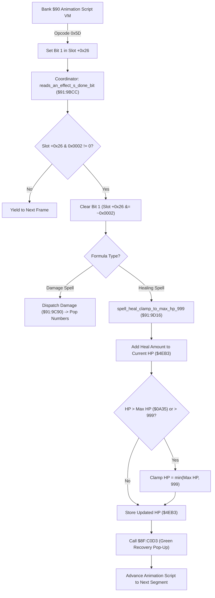

# Alchemy Spell Animation Coordination, Targeting & Healing Clamp Pipeline

- **ROM Locations**:
  - `reads_an_effect_s_done_bit_set_by_animation_opco`: `$91:9BCC` – `$91:9BE8`
  - `spell_heal_clamp_to_max_hp_999`: `$91:9D16` – `$91:9D2D`
  - `reads_an_effect_s_done_bit`: `$91:9D2E` – `$91:9D45`
- **CPU State**: 16-bit A/X (`REP #$30`), Data Bank `$7E` / `$91`
- **WRAM Core Addresses**:
  - Entity slot offset `+0x26`: Animation VM control & phase sync word (bit 1 = `0x0002` signals effect done).
  - Entity slot offset `+0x28`: Active spell formula ID.
  - Entity slot offset `+0x2A`: Cumulative damage / heal value output.
  - Entity slot offset `+0x2E`: Target entity array pointer.
  - `$7E:0A35`: Party Max HP (clamped ceiling 999).
  - `$7E:4EB3`: Target current active HP.

---

## 1. Architectural Architecture & Animation Synchronization

Alchemy formulas in Secret of Evermore bridge two separate execution environments:
1. **The Bank `$90` Animation Script VM**: Plays visual particle effects, projectile flight, impact explosions, and sound cues. Opcode `0x5D` (`effect_done`) flags when an animation sequence finishes.
2. **The Bank `$91` Combat & Damage Engine**: Polls effect status bits, coordinates multi-target damage, applies defensive reductions, clamps healing to 999, and advances the animation script to subsequent phases (e.g., Part A buildup to Part B explosion).



### 1. Effect Done Bit Synchronization (`$91:9BCC` / `$91:9D2E`)
- Inspects bit 1 (`0x0002`) of entity slot field `+0x26`.
- If bit 1 is set, the animation script phase is complete:
  - Clears bit 1 via `AND #$FFFD`.
  - Returns Carry Clear (`CLC`) to notify the caller that combat resolution can proceed.
- If bit 1 is zero, the animation is still playing:
  - Returns Carry Set (`SEC`) to yield execution until the next frame.

### 2. Healing Clamping & Max HP Boundary (`$91:9D16`)
- Adds calculated formula restoration power to target HP (`$7E:4EB3`).
- Performs strict two-level boundary enforcement:
  1. Compares with hard 999 ceiling (`CMP #$03E7`).
  2. Compares with character Max HP (`CMP $0A35`).
- Stores the bounded value back into `$7E:4EB3` and invokes `$8F:C0D3` to display green restoration numbers.

---

## 2. Disassembly & Annotations

```assembly
; ==============================================================================
; reads_an_effect_s_done_bit_set_by_animation_opco ($91:9BCC)
; ==============================================================================
$919BCC  A4 26       LDY $26           ; Load animation VM flags from slot +0x26
$919BCE  89 02 00    BIT #$0002        ; Test bit 1 (effect_done from opcode 0x5D)
$919BD1  F0 10       BEQ $919BE3       ; If 0, animation still playing -> yield
$919BD3  98          TYA
$919BD4  29 FD FF    AND #$FFFD        ; Clear done bit
$919BD7  85 26       STA $26
$919BD9  18          CLC               ; Signal success / phase finished
$919BDA  6B          RTL

$919BE3  38          SEC               ; Signal still busy
$919BE4  6B          RTL

; ==============================================================================
; spell_heal_clamp_to_max_hp_999 ($91:9D16)
; ==============================================================================
$919D16  18          CLC
$919D17  6D B3 4E    ADC $4EB3         ; Add current target HP
$919D1A  CD 35 0A    CMP $0A35         ; Compare against Max HP ($7E:0A35)
$919D1D  90 03       BCC $919D22
$919D1F  AD 35 0A    LDA $0A35         ; Clamp to Max HP
$919D22  C9 E7 03    CMP #$03E7        ; Enforce absolute 999 ceiling
$919D25  90 03       BCC $919D2A
$919D27  A9 E7 03    LDA #$03E7        ; Clamp to 999
$919D2A  8D B3 4E    STA $4EB3         ; Store final HP
$919D2D  6B          RTL

; ==============================================================================
; reads_an_effect_s_done_bit ($91:9D2E)
; ==============================================================================
$919D2E  A4 26       LDY $26           ; Restorative effect phase completion
$919D30  89 02 00    BIT #$0002
$919D33  F0 0B       BEQ $919D40
$919D35  98          TYA
$919D36  29 FD FF    AND #$FFFD
$919D39  85 26       STA $26
$919D3B  18          CLC
$919D3C  6B          RTL

$919D40  38          SEC
$919D41  6B          RTL
```

---

## 3. Reconstructed Clean C Implementation

```c
#include <stdint.h>
#include <stdbool.h>

#define MAX_HP_CAP 999
#define EFFECT_DONE_BIT 0x0002

typedef struct {
    uint16_t x;
    uint16_t y;
    uint16_t flags_26;      // +0x26: VM synchronization flags
    uint16_t formula_id;    // +0x28
    uint16_t output_value;  // +0x2A
    uint16_t *target_list;  // +0x2E
} SpellEffectSlot;

extern uint16_t g_max_hp;       // $7E:0A35
extern uint16_t g_target_hp;    // $7E:4EB3

/**
 * Checks if the animation script has signaled phase completion (opcode 0x5D).
 * Corresponds to $91:9BCC and $91:9D2E.
 * Returns true if done, false if still animating.
 */
bool reads_an_effect_done_bit(SpellEffectSlot *slot) {
    if ((slot->flags_26 & EFFECT_DONE_BIT) != 0) {
        slot->flags_26 &= ~EFFECT_DONE_BIT; // Acknowledge and clear
        return true;                        // Phase done, proceed with combat resolution
    }
    return false; // Still animating, yield
}

/**
 * Applies healing value to target, clamping to Max HP and the hard 999 ceiling.
 * Corresponds to $91:9D16.
 */
void spell_heal_clamp_to_max_hp_999(uint16_t heal_amount) {
    uint16_t new_hp = g_target_hp + heal_amount;

    // 1. Clamp to target Max HP
    if (new_hp > g_max_hp) {
        new_hp = g_max_hp;
    }

    // 2. Enforce hard 999 ceiling
    if (new_hp > MAX_HP_CAP) {
        new_hp = MAX_HP_CAP;
    }

    g_target_hp = new_hp;
}
```
