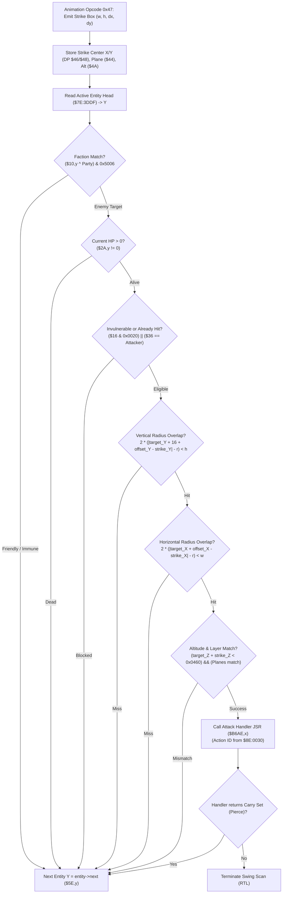

# Weapon Strike Hit Test & Active Entity Hurtbox Scan

- **ROM Locations**:
  - `strike_hit_test_entity_loop`: `$8F:B5E6` – `$8F:B6AD`
  - `strike_hit_test_entry_points`: `$8F:B5E6` (Melee weapon strike), `$8F:B5F2` (Projectile / general strike)
  - `attack_proc_dispatch`: `$8F:B6A5` – `$8F:B6AD`
- **CPU State**: 16-bit A/X (`REP #$30`), Data Bank `$7E` / `$8F`
- **WRAM Core Addresses**:
  - `$7E:3DDF`: Active entity linked list head node pointer.
  - `$7E:4E89`: Boy player character base record pointer in WRAM.
  - `$7E:0E9A`: Current attack action ID.
  - Direct Page Registers (prepared by animation bytecode opcode `0x47` via `$90:87BA`):
    - DP `$3E`: Strike bounding box width ($w$).
    - DP `$40`: Strike bounding box height ($h$).
    - DP `$44`: Attacker layer plane (`$0018`) and transparency flag (`0x0040`).
    - DP `$46`: Strike center coordinate X ($cx + dx$).
    - DP `$48`: Strike center coordinate Y ($cy + dy$).
    - DP `$4A`: Attacker Z height / altitude.
    - DP `$4C`: Attacker entity record pointer.
  - Entity Record Fields (indexed by candidate entity pointer `Y`):
    - `+$10`: Entity state flags (bit 2 `0x0004`: friendly/enemy faction, status bits `0x5006`).
    - `+$14`: Entity animation/state flags (mask `0x070D`: dying/invulnerable state).
    - `+$16`: Collision mode word (bit 5 `0x0020`: invulnerability flash).
    - `+$18`: Current layer plane.
    - `+$1A`: World position X.
    - `+$1C`: World position Y.
    - `+$1E`: World position Z (height/elevation).
    - `+$2A`: Current hit points (HP).
    - `+$36`: Damage source pointer (last attacker).
    - `+$42`: Hurtbox center offset X (default 0).
    - `+$44`: Hurtbox center offset Y (default `-16`, cancelled by `+16` standing offset).
    - `+$5E`: Linked list next entity pointer.
    - `+$60`: Contact weapon type / character archetype index.
  - ROM Master Tables:
    - `$8E:000D,x`: Entity body hurtbox radius ($r$).
    - `$8E:0030,x`: Contact attack action ID table.
    - `$8F:B6AE,x`: Attack resolution handler function pointers.

---

## 1. Architectural Role & Hitbox Geometry

When a weapon swing or projectile emits a strike box via animation opcode `0x47`, the engine executes `$8F:B5E6` to evaluate which candidates in the active entity pool are struck:



### The Hurtbox Equation
Unlike movement collisions which use an oblate $2r \times r$ ground footprint, weapon strikes compare against a square $2r \times 2r$ hurtbox centered on the entity's standing torso:

$$\Delta y = (target\_Y + 16 + offset\_Y) - strike\_Y$$

$$2 \times (|\Delta y| - r) < h$$

$$\Delta x = (target\_X + offset\_X) - strike\_X$$

$$2 \times (|\Delta x| - r) < w$$

Where:
- $r$ is the entity radius looked up from master table `$8E:000D,x`.
- `+16` anchors the hurtbox vertically up from the feet coordinate $(cx, cy)$ towards the torso/chest.
- $(offset\_X, offset\_Y)$ at `+$42`/`+$44` allow animated sprites to lean their hurtbox during attack or dodge frames.

---

## 2. Disassembly & Annotations

```asm
; ==============================================================================
; strike_hit_test_entity_loop ($8F:B5E6)
; Inputs: DP $3E = width, DP $40 = height, DP $44 = plane, DP $46 = X, DP $48 = Y
; ==============================================================================
$8FB5E6  a4 4c          ldy $4C            ; Y = Attacker entity pointer
$8FB5E8  be 60 00       ldx $0060,y        ; Attacker contact weapon index
$8FB5EB  bf 30 00 8e    lda $8E0030,x      ; Action ID lookup
$8FB5EF  8d 9a 0e       sta $0E9A          ; Save action ID to $7E:0E9A

; Projectile / strike hit test entry point ($8F:B5F2)
$8FB5F2  a6 4c          ldx $4C            ; X = Attacker pointer
$8FB5F4  a9 80 02       lda #$0280
$8FB5F7  38             sec
$8FB5F8  e5 4a          sbc $4A            ; Altitude calculation
$8FB5FA  85 4a          sta $4A

$8FB5FC  bd 10 00       lda $0010,x        ; Attacker party / status mask
$8FB5FF  49 04 00       eor #$0004
$8FB602  29 04 00       and #$0004
$8FB605  48             pha                ; Push party comparison bit

$8FB606  a9 06 50       lda #$5006         ; Status filter mask
$8FB609  e0 89 4e       cpx #$4E89         ; Is attacker the Boy player?
$8FB60C  b0 03          bcs $8FB611
$8FB60E  09 20 00       ora #$0020         ; Include extra flags for NPC/enemies
$8FB611  48             pha

$8FB612  ac df 3d       ldy $3DDF          ; Y = Active entity linked list head

; ------------------------------------------------------------------------------
; Entity Candidate Verification Loop
; ------------------------------------------------------------------------------
$8FB615  b9 10 00       lda $0010,y        ; Candidate status flags
$8FB618  43 03          eor $03,s          ; Compare party bit with attacker
$8FB61A  23 01          and $01,s          ; Test status mask ($5006)
$8FB61C  d0 74          bne $8FB692        ; If teammate or immune: next candidate

$8FB61E  b9 2a 00       lda $002A,y        ; Candidate HP
$8FB621  f0 6f          beq $8FB692        ; Dead entity: next candidate

$8FB623  b9 16 00       lda $0016,y        ; Collision flags
$8FB626  89 20 00       bit #$0020         ; Invulnerability flash bit
$8FB629  d0 67          bne $8FB692        ; Invulnerable: next candidate

$8FB62B  b9 36 00       lda $0036,y        ; Last damage source
$8FB62E  c5 4c          cmp $4C            ; Was candidate already hit by this attacker?
$8FB630  f0 60          beq $8FB692        ; Repeat hit blocked: next candidate

$8FB632  b9 14 00       lda $0014,y        ; Animation / death state
$8FB635  89 0d 07       bit #$070D
$8FB638  d0 58          bne $8FB692        ; Closed / dying: next candidate

$8FB63A  be 60 00       ldx $0060,y        ; Candidate archetype index
$8FB63D  b9 1c 00       lda $001C,y        ; Candidate Y
$8FB640  18             clc
$8FB641  69 10 00       adc #$0010         ; +16 standing torso vertical offset
$8FB644  79 44 00       adc $0044,y        ; + animated Y offset
$8FB647  38             sec
$8FB648  e5 48          sbc $48            ; - Strike center Y
$8FB64A  10 04          bpl $8FB650
$8FB64C  3a             dec a              ; Negative: calculate absolute |dy|
$8FB64D  49 ff ff       eor #$FFFF
$8FB650  38             sec
$8FB651  ff 0d 00 8e    sbc $8E000D,x      ; - candidate hurtbox radius
$8FB655  0a             asl a              ; Double difference: 2 * (|dy| - r)
$8FB656  c5 40          cmp $40            ; Compare against strike height h
$8FB658  10 38          bpl $8FB692        ; If >= h: out of vertical reach

$8FB65A  b9 1a 00       lda $001A,y        ; Candidate X
$8FB65D  18             clc
$8FB65E  79 42 00       adc $0042,y        ; + animated X offset
$8FB661  38             sec
$8FB662  e5 46          sbc $46            ; - Strike center X
$8FB664  10 04          bpl $8FB66A
$8FB666  3a             dec a              ; Absolute |dx|
$8FB667  49 ff ff       eor #$FFFF
$8FB66A  38             sec
$8FB66B  ff 0d 00 8e    sbc $8E000D,x      ; - candidate hurtbox radius
$8FB66F  0a             asl a              ; Double difference: 2 * (|dx| - r)
$8FB670  c5 3e          cmp $3E            ; Compare against strike width w
$8FB672  10 1e          bpl $8FB692        ; If >= w: out of horizontal reach

; 3D Altitude and Layer Plane Checks
$8FB674  b9 1e 00       lda $001E,y        ; Candidate elevation Z
$8FB677  18             clc
$8FB678  65 4a          adc $4A
$8FB67A  c9 60 04       cmp #$0460         ; Maximum altitude gap threshold
$8FB67D  b0 13          bcs $8FB692

$8FB67F  a5 44          lda $44            ; Attacker plane flags
$8FB681  89 40 00       bit #$0040         ; Attacker plane transparent?
$8FB684  d0 1b          bne $8FB6A1
$8FB686  b9 18 00       lda $0018,y        ; Candidate plane flags
$8FB689  89 40 00       bit #$0040         ; Candidate plane transparent?
$8FB68C  d0 13          bne $8FB6A1
$8FB68E  c5 44          cmp $44            ; Planes must match
$8FB690  f0 0f          beq $8FB6A1

; Advance to Next Candidate Entity
$8FB692  b9 5e 00       lda $005E,y        ; Next linked entity pointer
$8FB695  a8             tay
$8FB696  f0 03          beq $8FB69B        ; If 0: reached tail of list
$8FB698  4c 15 b6       jmp $8FB615        ; Loop to test next candidate

$8FB69B  68             pla
$8FB69C  68             pla                ; Clean stack
$8FB69D  6b             rtl

; ------------------------------------------------------------------------------
; Dispatch Weapon Attack Handler
; ------------------------------------------------------------------------------
$8FB6A1  5a             phy                ; Preserve candidate pointer
$8FB6A2  ae 9a 0e       ldx $0E9A          ; X = Attack action ID
$8FB6A5  fc ae b6       jsr ($B6AE,x)      ; Execute attack proc handler
$8FB6A8  b0 f4          bcs $8FB69E        ; Carry Set = pierced/continue; Carry Clear = end
$8FB6AA  7a             ply
$8FB6AB  68             pla
$8FB6AC  68             pla
$8FB6AD  6b             rtl
```

---

## 3. Clean C Decompilation

```c
#include <stdint.h>
#include <stdbool.h>
#include <stdlib.h>

#define MAX_ALTITUDE_DIFF 0x0460

typedef struct EntityNode {
    uint8_t  _pad0[16];
    uint16_t status_flags_10;   // +0x10: Party and suppression bits
    uint8_t  _pad1[2];
    uint16_t state_flags_14;    // +0x14: Invulnerability / dying state
    uint16_t collision_mode_16; // +0x16: Bit 0x0020 = invulnerability flash
    uint16_t plane_18;          // +0x18: Layer plane & transparency flag (0x0040)
    uint16_t pos_x;             // +0x1A: World coordinate X
    uint16_t pos_y;             // +0x1C: World coordinate Y
    uint16_t pos_z;             // +0x1E: World coordinate Z (altitude)
    uint8_t  _pad2[10];
    uint16_t hp;                // +0x2A: Current HP
    uint8_t  _pad3[10];
    uint16_t last_damage_source;// +0x36: Entity pointer of last attacker
    uint8_t  _pad4[10];
    int16_t  offset_x;          // +0x42: Animated hurtbox offset X
    int16_t  offset_y;          // +0x44: Animated hurtbox offset Y
    uint8_t  _pad5[24];
    struct EntityNode *next;    // +0x5E: Next entity in active linked list
    uint16_t archetype_id;      // +0x60: Character type / hurtbox index
} EntityNode;

typedef bool (*AttackProcHandler)(EntityNode *target, uint16_t action_id);

// Master ROM tables
extern const uint16_t g_entity_radii[];             // $8E:000D
extern const uint16_t g_contact_actions[];          // $8E:0030
extern const AttackProcHandler g_attack_procs[];    // $8F:B6AE

// WRAM references
extern EntityNode *g_active_entity_head;            // $7E:3DDF
extern uint16_t    g_current_action_id;             // $7E:0E9A

/**
 * strike_hit_test_entity_loop ($8F:B5E6)
 * Sweeps candidate entity hurtboxes against a weapon or projectile strike box.
 * 
 * @param attacker Pointer to the entity delivering the strike.
 * @param strike_w Strike bounding box width.
 * @param strike_h Strike bounding box height.
 * @param strike_x Strike center world X coordinate.
 * @param strike_y Strike center world Y coordinate.
 * @param strike_z Attacker elevation altitude.
 * @param strike_plane Attacker layer plane and flags.
 */
void strike_hit_test_entity_loop(
    EntityNode *attacker,
    uint16_t strike_w,
    uint16_t strike_h,
    uint16_t strike_x,
    uint16_t strike_y,
    uint16_t strike_z,
    uint16_t strike_plane
) {
    // 1. Resolve attack action ID from attacker archetype
    uint16_t action_id = g_contact_actions[attacker->archetype_id];
    g_current_action_id = action_id;

    // 2. Setup party and status filter masks
    uint16_t attacker_party = attacker->status_flags_10 & 0x0004;
    uint16_t status_filter = 0x5006;
    if ((uintptr_t)attacker < 0x4E89) {
        status_filter |= 0x0020;
    }

    uint16_t altitude_base = 0x0280 - strike_z;

    // 3. Walk active entities linked list
    for (EntityNode *target = g_active_entity_head; target != NULL; target = target->next) {
        // Faction filter: skip allies and immune targets
        if (((target->status_flags_10 ^ attacker_party) & status_filter) != 0) {
            continue;
        }

        // Living check: target must have HP > 0
        if (target->hp == 0) {
            continue;
        }

        // Invulnerability flash check (bit 0x0020)
        if (target->collision_mode_16 & 0x0020) {
            continue;
        }

        // Prevent repeat hits from same attacker in current swing
        if (target->last_damage_source == (uint16_t)(uintptr_t)attacker) {
            continue;
        }

        // Closed or dying animation state check
        if (target->state_flags_14 & 0x070D) {
            continue;
        }

        // 4. Geometry overlap tests
        uint16_t radius = g_entity_radii[target->archetype_id];

        // Vertical torso hurtbox test (anchored +16 px above feet origin)
        int32_t torso_y = (int32_t)target->pos_y + 16 + target->offset_y;
        int32_t dy = abs(torso_y - (int32_t)strike_y);
        int32_t vert_dist = (dy - (int32_t)radius) * 2;
        if (vert_dist >= (int32_t)strike_h) {
            continue;
        }

        // Horizontal torso hurtbox test
        int32_t torso_x = (int32_t)target->pos_x + target->offset_x;
        int32_t dx = abs(torso_x - (int32_t)strike_x);
        int32_t horiz_dist = (dx - (int32_t)radius) * 2;
        if (horiz_dist >= (int32_t)strike_w) {
            continue;
        }

        // Altitude tolerance test
        if ((target->pos_z + altitude_base) >= MAX_ALTITUDE_DIFF) {
            continue;
        }

        // Layer plane alignment test (unless either entity is plane-transparent)
        if (!(strike_plane & 0x0040) && !(target->plane_18 & 0x0040)) {
            if (target->plane_18 != strike_plane) {
                continue;
            }
        }

        // 5. Successful hit: Dispatch weapon attack proc handler
        AttackProcHandler handler = g_attack_procs[action_id];
        if (handler) {
            bool pierce = handler(target, action_id);
            if (!pierce) {
                // Non-piercing weapon terminates swing upon connecting with first target
                break;
            }
        }
    }
}
```
