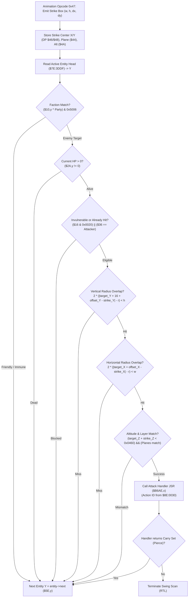

# Weapon Strike Hit Test & Active Entity Hurtbox Scan

- **ROM Locations**:
  - `strike_hit_test_entity_loop`: `$8F:B5E6` – `$8F:B6AD`
  - `strike_hit_test_entry_points`: `$8F:B5E6` (Melee weapon strike), `$8F:B5F2` (Projectile / general strike)
  - `attack_proc_dispatch`: `$8F:B6A5` – `$8F:B6AD`
- **CPU State**: 16-bit A/X (`REP #$30`), Data Bank `$7E` / `$8F`
- **WRAM Core Addresses**:
  - `$7E:3DDF`: Active entity linked list head node pointer.
  - `$7E:4E89`: Boy player character base record pointer in WRAM.
  - `$7E:0E9A`: Current attack action ID.
  - Direct Page Registers (prepared by animation bytecode opcode `0x47` via `$90:87BA`):
    - DP `$3E`: Strike bounding box width ($w$).
    - DP `$40`: Strike bounding box height ($h$).
    - DP `$44`: Attacker layer plane (`$0018`) and transparency flag (`0x0040`).
    - DP `$46`: Strike center coordinate X ($cx + dx$).
    - DP `$48`: Strike center coordinate Y ($cy + dy$).
    - DP `$4A`: Attacker Z height / altitude.
    - DP `$4C`: Attacker entity record pointer.
  - Entity Record Fields (indexed by candidate entity pointer `Y`):
    - `+$10`: Entity state flags (bit 2 `0x0004`: friendly/enemy faction, status bits `0x5006`).
    - `+$14`: Entity animation/state flags (mask `0x070D`: dying/invulnerable state).
    - `+$16`: Collision mode word (bit 5 `0x0020`: invulnerability flash).
    - `+$18`: Current layer plane.
    - `+$1A`: World position X.
    - `+$1C`: World position Y.
    - `+$1E`: World position Z (height/elevation).
    - `+$2A`: Current hit points (HP).
    - `+$36`: Damage source pointer (last attacker).
    - `+$42`: Hurtbox center offset X (default 0).
    - `+$44`: Hurtbox center offset Y (default `-16`, cancelled by `+16` standing offset).
    - `+$5E`: Linked list next entity pointer.
    - `+$60`: Contact weapon type / character archetype index.
  - ROM Master Tables:
    - `$8E:000D,x`: Entity body hurtbox radius ($r$).
    - `$8E:0030,x`: Contact attack action ID table.
    - `$8F:B6AE,x`: Attack resolution handler function pointers.

---

## 1. Architectural Role & Hitbox Geometry

When a weapon swing or projectile emits a strike box via animation opcode `0x47`, the engine executes `$8F:B5E6` to evaluate which candidates in the active entity pool are struck:

### The Hurtbox Equation
Unlike movement collisions which use an oblate $2r \times r$ ground footprint, weapon strikes compare against a square $2r \times 2r$ hurtbox centered on the entity's standing torso:

$$\Delta y = (target\_Y + 16 + offset\_Y) - strike\_Y$$

$$2 \times (|\Delta y| - r) < h$$

$$\Delta x = (target\_X + offset\_X) - strike\_X$$

$$2 \times (|\Delta x| - r) < w$$

Where:
- $r$ is the entity radius looked up from master table `$8E:000D,x`.
- `+16` anchors the hurtbox vertically up from the feet coordinate $(cx, cy)$ towards the torso/chest.
- $(offset\_X, offset\_Y)$ at `+$42`/`+$44` allow animated sprites to lean their hurtbox during attack or dodge frames.

---

## 2. Disassembly & Annotations

> **Interactive 65816 Assembly**:
> Centralized comments infused at runtime.
> [View in VFS: soe://rom/code/8FB5E6](soe://rom/code/8FB5E6?asm=1&c=0)

---

## 3. Clean C Decompilation

> **Reconstructed C Decompilation**:
> Source moved to [`reconstructed-c/8F/8FB5E6_strike_hittest.c`](../../../reconstructed-c/8F/8FB5E6_strike_hittest.c).
> [View in VFS: soe://rom/code/8FB5E6](soe://rom/code/8FB5E6?c=1&asm=0)

