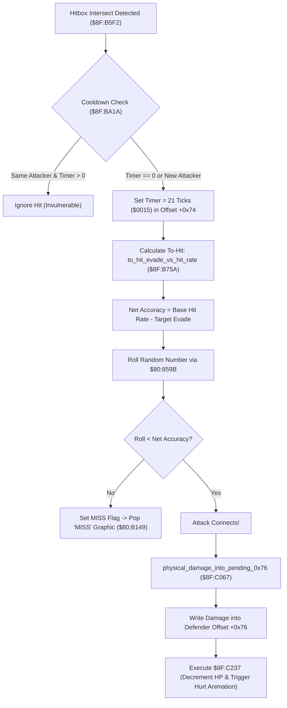

# Physical Combat To-Hit Accuracy, Invulnerability Cooldown & Pending Damage

- **ROM Locations**:
  - `to_hit_evade_vs_hit_rate`: `$8F:B75A` – `$8F:B7D0`
  - `hit_cooldown_same_attacker_blocked_for_21_ticks`: `$8F:BA1A` – `$8F:BA40`
  - `physical_damage_into_pending_0x76`: `$8F:C067` – `$8F:C0B0`
- **CPU State**: 16-bit A/X (`REP #$30`), Data Bank `$7E` / `$8F`
- **WRAM Core Addresses**:
  - Attacker slot offset `+0x42`: Attacker Hit Rate / weapon base accuracy.
  - Defender slot offset `+0x44`: Defender Physical Evade stat (`$0A3F`).
  - Defender slot offset `+0x72`: Last attacker entity slot ID (for repeat hit rejection).
  - Defender slot offset `+0x74`: Invulnerability frame countdown timer (initialized to 21 / `0x0015`).
  - Defender slot offset `+0x76`: Pending damage accumulator (applied to HP via `$8F:C237`).
  - `$7E:2262` bit 0: Speed buff (boosts accuracy / hit chance).

---

## 1. Architectural Role & Combat Pipeline

When an attack hitbox (melee weapon slash or projectile) intersects an enemy or player hurtbox, the combat engine executes a 3-stage validation pipeline before modifying HP:

### 1. 21-Frame Invulnerability Cooldown (`$8F:BA1A`)
- Prevents multiple damage ticks during a single attack animation swing.
- Tests defender offset `+0x72` (last attacker slot ID) and `+0x74` (cooldown frames remaining):
  - If the attacker slot matches and `+0x74 > 0`, the hit is rejected without damage.
  - Otherwise, records the new attacker slot in `+0x72` and resets the timer in `+0x74` to **21 frames** (`0x0015`).

### 2. To-Hit Accuracy & Evade Verification (`$8F:B75A`)
- Reads attacker Hit Rate from slot `+0x42` (typically 80%–95% depending on weapon).
- Subtracts target Physical Evade from slot `+0x44` (`$7E:0A3F`).
- Pulls a 16-bit pseudo-random value from `$80:859B`, scaled to $0..99$:
  - If `RNG < Net Accuracy`, the attack hits.
  - If `RNG >= Net Accuracy`, the attack misses: carry is cleared and the routine triggers the floating `"MISS"` sprite popup.

### 3. Pending Damage Accumulation (`$8F:C067`)
- Computes gross weapon attack power, applies stamina scaling (from `$8F:86C0`), and subtracts armor defense.
- Clamps the minimum physical damage to 1 HP.
- Writes the result into defender field `+0x76`.
- Routine `$8F:C237` subsequently deducts `+0x76` from target HP and invokes knockback physics.

---

## 2. Disassembly & Annotations

> **Interactive 65816 Assembly**:
> Centralized comments infused at runtime.
> [View in VFS: soe://rom/code/8FB75A](soe://rom/code/8FB75A?asm=1&c=0)

---

## 3. Reconstructed Clean C Implementation

> **Reconstructed C Decompilation**:
> Source moved to [`reconstructed-c/8F/8FB75A_to_hit_accuracy.c`](../../../reconstructed-c/8F/8FB75A_to_hit_accuracy.c).
> [View in VFS: soe://rom/code/8FB75A](soe://rom/code/8FB75A?c=1&asm=0)

