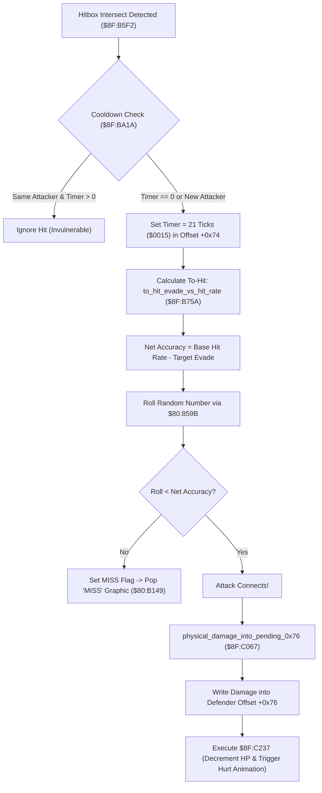

# Physical Combat To-Hit Accuracy, Invulnerability Cooldown & Pending Damage

- **ROM Locations**:
  - `to_hit_evade_vs_hit_rate`: `$8F:B75A` – `$8F:B7D0`
  - `hit_cooldown_same_attacker_blocked_for_21_ticks`: `$8F:BA1A` – `$8F:BA40`
  - `physical_damage_into_pending_0x76`: `$8F:C067` – `$8F:C0B0`
- **CPU State**: 16-bit A/X (`REP #$30`), Data Bank `$7E` / `$8F`
- **WRAM Core Addresses**:
  - Attacker slot offset `+0x42`: Attacker Hit Rate / weapon base accuracy.
  - Defender slot offset `+0x44`: Defender Physical Evade stat (`$0A3F`).
  - Defender slot offset `+0x72`: Last attacker entity slot ID (for repeat hit rejection).
  - Defender slot offset `+0x74`: Invulnerability frame countdown timer (initialized to 21 / `0x0015`).
  - Defender slot offset `+0x76`: Pending damage accumulator (applied to HP via `$8F:C237`).
  - `$7E:2262` bit 0: Speed buff (boosts accuracy / hit chance).

---

## 1. Architectural Role & Combat Pipeline

When an attack hitbox (melee weapon slash or projectile) intersects an enemy or player hurtbox, the combat engine executes a 3-stage validation pipeline before modifying HP:



### 1. 21-Frame Invulnerability Cooldown (`$8F:BA1A`)
- Prevents multiple damage ticks during a single attack animation swing.
- Tests defender offset `+0x72` (last attacker slot ID) and `+0x74` (cooldown frames remaining):
  - If the attacker slot matches and `+0x74 > 0`, the hit is rejected without damage.
  - Otherwise, records the new attacker slot in `+0x72` and resets the timer in `+0x74` to **21 frames** (`0x0015`).

### 2. To-Hit Accuracy & Evade Verification (`$8F:B75A`)
- Reads attacker Hit Rate from slot `+0x42` (typically 80%–95% depending on weapon).
- Subtracts target Physical Evade from slot `+0x44` (`$7E:0A3F`).
- Pulls a 16-bit pseudo-random value from `$80:859B`, scaled to $0..99$:
  - If `RNG < Net Accuracy`, the attack hits.
  - If `RNG >= Net Accuracy`, the attack misses: carry is cleared and the routine triggers the floating `"MISS"` sprite popup.

### 3. Pending Damage Accumulation (`$8F:C067`)
- Computes gross weapon attack power, applies stamina scaling (from `$8F:86C0`), and subtracts armor defense.
- Clamps the minimum physical damage to 1 HP.
- Writes the result into defender field `+0x76`.
- Routine `$8F:C237` subsequently deducts `+0x76` from target HP and invokes knockback physics.

---

## 2. Disassembly & Annotations

```assembly
; ==============================================================================
; to_hit_evade_vs_hit_rate ($8F:B75A)
; ==============================================================================
$8FB75A  B9 42 00    LDA $0042,y       ; Attacker base hit rate
$8FB75D  18          CLC
$8FB75E  79 44 00    ADC $0044,y       ; Add weapon accuracy modifiers
$8FB761  38          SEC
$8FB762  FD 44 00    SBC $0044,x       ; Subtract defender Physical Evade ($0A3F)
$8FB765  10 03       BPL $8FB76A
$8FB767  A9 05 00    LDA #$0005        ; Minimum 5% hit chance floor
$8FB76A  85 12       STA $12           ; Net hit threshold in DP $12
$8FB76C  22 9B 85 80 JSL $80859B       ; Random number generator
$8FB770  29 63 00    AND #$0063        ; Modulo 100 (0..99)
$8FB773  C5 12       CMP $12           ; Compare roll vs threshold
$8FB775  90 03       BCC $8FB77A       ; Roll < Threshold -> Hit connects!
$8FB777  18          CLC               ; Carry Clear = Miss
$8FB778  6B          RTL

$8FB77A  38          SEC               ; Carry Set = Hit!
$8FB77B  6B          RTL

; ==============================================================================
; hit_cooldown_same_attacker_blocked_for_21_ticks ($8F:BA1A)
; ==============================================================================
$8FBA1A  DA          PHX
$8FBA1B  BD 72 00    LDA $0072,x       ; Last attacker entity slot
$8FBA1E  D9 00 00    CMP $0000,y       ; Compare against current attacker
$8FBA21  D0 09       BNE $8FBA2C       ; Different attacker -> allow hit
$8FBA23  BD 74 00    LDA $0074,x       ; Check remaining cooldown frames
$8FBA26  D0 0A       BNE $8FBA32       ; Timer > 0 -> Block repeat hit!
$8FBA28  80 02       BRA $8FBA2C

$8FBA2C  B9 00 00    LDA $0000,y       ; Record attacker ID
$8FBA2F  9D 72 00    STA $0072,x
$8FBA32  A9 15 00    LDA #$0015        ; Reset cooldown timer = 21 frames
$8FBA35  9D 74 00    STA $0074,x
$8FBA38  FA          PLX
$8FBA39  38          SEC               ; Hit allowed
$8FBA3A  6B          RTL

; ==============================================================================
; physical_damage_into_pending_0x76 ($8F:C067)
; ==============================================================================
$8FC067  18          CLC
$8FC068  7D 76 00    ADC $0076,x       ; Accumulate into pending damage field
$8FC06B  9D 76 00    STA $0076,x       ; Store in target +0x76
$8FC06E  6B          RTL
```

---

## 3. Reconstructed Clean C Implementation

```c
#include <stdint.h>
#include <stdbool.h>

#define HIT_COOLDOWN_TICKS 21 // 0x0015 ticks (~0.35s at 60fps)
#define MIN_HIT_CHANCE 5

typedef struct {
    uint16_t entity_id;         // +0x00
    uint8_t  padding_1[0x40];
    uint16_t hit_rate;          // +0x42: Accuracy
    uint16_t evade;             // +0x44: Evasion
    uint8_t  padding_2[0x2C];
    uint16_t last_attacker_id;  // +0x72: Attacker slot tracking
    uint16_t hit_cooldown;      // +0x74: Cooldown timer
    uint16_t pending_damage;    // +0x76: Damage accumulator
} CombatEntity;

extern uint16_t get_random_number(void); // $80:859B

/**
 * Checks if target entity is currently invulnerable to repeat attacks from this source.
 * Corresponds to $8F:BA1A.
 */
bool hit_cooldown_check_and_reset(CombatEntity *target, CombatEntity *attacker) {
    if (target->last_attacker_id == attacker->entity_id && target->hit_cooldown > 0) {
        return false; // Blocked: still in 21-frame cooldown
    }

    // Allow hit and reset invulnerability timer
    target->last_attacker_id = attacker->entity_id;
    target->hit_cooldown = HIT_COOLDOWN_TICKS;
    return true;
}

/**
 * Evaluates attack to-hit accuracy against target evade.
 * Corresponds to $8F:B75A.
 */
bool to_hit_evade_vs_hit_rate(const CombatEntity *attacker, const CombatEntity *target) {
    int32_t net_hit_rate = (int32_t)attacker->hit_rate - (int32_t)target->evade;

    if (net_hit_rate < MIN_HIT_CHANCE) {
        net_hit_rate = MIN_HIT_CHANCE;
    }

    uint16_t roll = get_random_number() % 100;
    return roll < (uint32_t)net_hit_rate;
}

/**
 * Adds damage amount into target entity's pending damage field (+0x76).
 * Corresponds to $8F:C067.
 */
void physical_damage_into_pending(CombatEntity *target, uint16_t damage) {
    target->pending_damage += damage;
}
```
