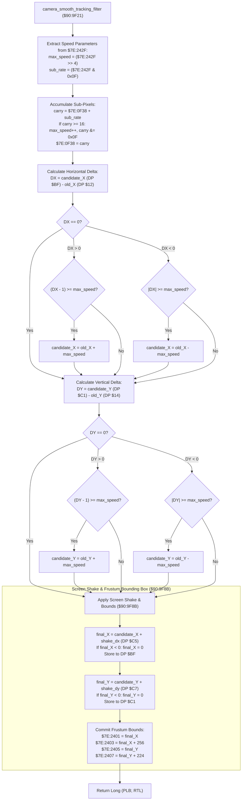

# Camera Smooth Tracking Filter, Velocity Clamping & Viewport Bounds ($90:9F21 – $90:9FC8)

> **ROM Bank**: `$90` (`$90:9F21` – `$90:9FC8`)  
> **Source Module**: `engine-core/camera-smooth-tracking.c` / `engine-core/camera-smooth-tracking.h`  
> **Recomp Symbols**: `L_9F21_M0X0`, `func_D09E93_M0X0`  
> **Confirmed Knowledge**: `rom/909f21.md`, `rom/909fc9.md`  
> **Core Subsystems**: Camera Viewport Tracking, Sub-Pixel PPU Stepping, Screen Shake Displacement (`$C5`/`$C7`), Frustum Culling Bounding Box (`$7E:2401`..`$7E:2407`)  

---

## 1. Subsystem Architecture & Overview

Following overworld camera target selection and boundary clamping (`camera_viewport_overworld_scroll_and_clamp` at `$90:9E93`–`$90:9F20`), the engine transitions into the **camera smooth velocity limiter and sub-pixel integrator** at `$90:9F21`.

This routine prevents jarring camera snaps when heroes dash, teleport, or experience knockback by rate-limiting the maximum horizontal ($\Delta X$) and vertical ($\Delta Y$) camera pan per frame. It then superimposes high-frequency screen shake offsets and computes the active 256×224 viewport bounding box used by the actor and projectile frustum culling engine:

```
+--------------------------------------------------------------------------------------------------+
|                            WRAM Bank $7E Camera & Viewport State Layout                          |
+--------------------------------------------------------------------------------------------------+
| DP $BF               (2 bytes)  : Candidate / Final Camera Viewport Origin X (World Pixels)      |
| DP $C1               (2 bytes)  : Candidate / Final Camera Viewport Origin Y (World Pixels)      |
| DP $12               (2 bytes)  : Previous Frame Camera Viewport Origin X                        |
| DP $14               (2 bytes)  : Previous Frame Camera Viewport Origin Y                        |
| DP $16               (2 bytes)  : Calculated Maximum Whole-Pixel Pan Speed for Current Frame     |
| $7E:242F             (2 bytes)  : Camera Speed Config (High Nibble = Whole Pixels, Low = Sub)   |
| $7E:0F38             (2 bytes)  : Fractional Sub-Pixel Carry Accumulator (0..15)                |
| DP $C5               (2 bytes)  : Screen Shake Horizontal Offset (Signed Pixel Displacement)     |
| DP $C7               (2 bytes)  : Screen Shake Vertical Offset (Signed Pixel Displacement)       |
| $7E:2401             (2 bytes)  : Active Viewport Left Boundary  (X_min = Final Camera X)       |
| $7E:2403             (2 bytes)  : Active Viewport Right Boundary (X_max = Final Camera X + 256) |
| $7E:2405             (2 bytes)  : Active Viewport Top Boundary   (Y_min = Final Camera Y)       |
| $7E:2407             (2 bytes)  : Active Viewport Bottom Boundary (Y_max = Final Camera Y + 224)|
+--------------------------------------------------------------------------------------------------+
```



---

## 2. Velocity Clamping & Sub-Pixel Arithmetic

### 2.1 Sub-Pixel Carry Pipeline
The camera pan speed parameter `$7E:242F` encodes a 12.4 fixed-point velocity format:
- **Upper 12 bits (`$7E:242F >> 4`)**: Base whole pixels per frame.
- **Lower 4 bits (`$7E:242F & 0x000F`)**: Fractional 1/16th pixel increments per frame.

Every frame:
$$\text{accumulator}_{t+1} = \text{accumulator}_t + (\text{speed} \ \& \ 15)$$
$$\text{max\_speed} = (\text{speed} \gg 4) + \lfloor \text{accumulator}_{t+1} / 16 \rfloor$$
$$\text{accumulator}_{t+1} \leftarrow \text{accumulator}_{t+1} \pmod{16}$$

This generates perfectly amortized non-integer panning rates (e.g. 2.25 pixels/frame alternating smoothly between 2 and 3 pixels across frames).

### 2.2 Directional Rate Limiting
For axis delta $\Delta \in \{\Delta X, \Delta Y\}$:
- If $\Delta > 0$ and $\Delta - 1 \ge \text{max\_speed}$: $\text{clamped} = \text{old} + \text{max\_speed}$
- If $\Delta < 0$ and $-\Delta \ge \text{max\_speed}$: $\text{clamped} = \text{old} - \text{max\_speed}$

### 2.3 Screen Shake & Frustum Projection
Finally, directional screen shake offsets (oscillated by `$80:A2E0` during earthquakes, explosions, and boss impacts) are combined with the filtered origin. An underflow guard ensures the camera origin never wraps negative:
$$\text{final\_X} = \max(0, \text{candidate\_X} + \text{shake\_X})$$
$$\text{final\_Y} = \max(0, \text{candidate\_Y} + \text{shake\_Y})$$

The 256×224 bounding rectangle is persisted into `$7E:2401`..`$7E:2407` for frustum culling tests (`$90:9545`).

---

## 3. Clean C Decompilation

```c
#include "engine-core/camera-smooth-tracking.h"
#include <stdint.h>

// ----------------------------------------------------------------------------
// Global Registers & Viewport Bounds
// ----------------------------------------------------------------------------
extern int16_t  g_camera_origin_x;          // DP $00BF
extern int16_t  g_camera_origin_y;          // DP $00C1
extern int16_t  g_prev_camera_x;            // DP $0012
extern int16_t  g_prev_camera_y;            // DP $0014

extern uint16_t g_camera_velocity_config;   // $7E:242F (High: whole pixels, Low: sub-pixel rate)
extern uint16_t g_camera_subpixel_acc;      // $7E:0F38 (0..15 fractional carry)

extern int16_t  g_screen_shake_offset_x;    // DP $00C5
extern int16_t  g_screen_shake_offset_y;    // DP $00C7

extern uint16_t g_viewport_bound_left;      // $7E:2401 (X_min)
extern uint16_t g_viewport_bound_right;     // $7E:2403 (X_max = X_min + 256)
extern uint16_t g_viewport_bound_top;       // $7E:2405 (Y_min)
extern uint16_t g_viewport_bound_bottom;    // $7E:2407 (Y_max = Y_min + 224)

#define VIEWPORT_WIDTH   256
#define VIEWPORT_HEIGHT  224

/**
 * camera_smooth_tracking_filter_and_screen_bounds ($90:9F21 – $90:9FC8)
 *
 * Applies fractional sub-pixel velocity rate-limiting to candidate camera
 * coordinates (DP $BF, $C1), superimposes screen shake displacements, and
 * commits the active 256x224 frustum bounding box.
 */
void camera_smooth_tracking_filter_and_screen_bounds(void) {
    // 1. Calculate maximum allowable panning distance for current frame
    uint16_t max_speed = g_camera_velocity_config >> 4;
    uint16_t sub_rate  = g_camera_velocity_config & 0x000F;

    uint16_t sub_acc = g_camera_subpixel_acc + sub_rate;
    if (sub_acc & 0xFFF0) {
        max_speed++; // Fractional overflow adds 1 whole pixel
    }
    g_camera_subpixel_acc = sub_acc & 0x000F;

    // 2. Horizontal Velocity Clamping
    int16_t dx = g_camera_origin_x - g_prev_camera_x;
    if (dx != 0) {
        if (dx > 0) {
            if ((uint16_t)(dx - 1) >= max_speed) {
                g_camera_origin_x = g_prev_camera_x + max_speed;
            }
        } else {
            uint16_t abs_dx = (uint16_t)(-dx);
            if (abs_dx >= max_speed) {
                g_camera_origin_x = g_prev_camera_x - max_speed;
            }
        }
    }

    // 3. Vertical Velocity Clamping
    int16_t dy = g_camera_origin_y - g_prev_camera_y;
    if (dy != 0) {
        if (dy > 0) {
            if ((uint16_t)(dy - 1) >= max_speed) {
                g_camera_origin_y = g_prev_camera_y + max_speed;
            }
        } else {
            uint16_t abs_dy = (uint16_t)(-dy);
            if (abs_dy >= max_speed) {
                g_camera_origin_y = g_prev_camera_y - max_speed;
            }
        }
    }

    // 4. Apply Screen Shake Displacements with Underflow Clamping ($90:9F8B)
    int16_t final_x = g_camera_origin_x + g_screen_shake_offset_x;
    if (final_x < 0) {
        final_x = 0;
    }
    g_camera_origin_x = final_x;

    int16_t final_y = g_camera_origin_y + g_screen_shake_offset_y;
    if (final_y < 0) {
        final_y = 0;
    }
    g_camera_origin_y = final_y;

    // 5. Commit Active Frustum Culling Bounding Box
    g_viewport_bound_left   = (uint16_t)final_x;
    g_viewport_bound_right  = (uint16_t)(final_x + VIEWPORT_WIDTH);
    g_viewport_bound_top    = (uint16_t)final_y;
    g_viewport_bound_bottom = (uint16_t)(final_y + VIEWPORT_HEIGHT);
}
```

---

## 4. Annotated 65816 Assembly Implementation

```assembly
; ==============================================================================
; camera_smooth_tracking_filter_and_screen_bounds ($90:9F21 – $90:9FC8)
; Inputs:
;   DP $BF: Candidate camera horizontal origin X
;   DP $C1: Candidate camera vertical origin Y
;   DP $12: Previous frame camera X
;   DP $14: Previous frame camera Y
; ==============================================================================
$90:9F21  AD 2F 24    LDA $242F         ; Load camera speed config word
$90:9F24  4A          LSR A             ; Shift right 4 times to extract whole pixel speed
$90:9F25  4A          LSR A
$90:9F26  4A          LSR A
$90:9F27  4A          LSR A
$90:9F28  85 16       STA $16           ; DP $16 = base max panning speed
$90:9F2A  AD 2F 24    LDA $242F         ; Reload speed config
$90:9F2D  29 0F 00    AND #$000F        ; Mask low 4 bits: fractional sub-pixel rate
$90:9F30  18          CLC
$90:9F31  6D 38 0F    ADC $0F38         ; Add sub-pixel carry accumulator ($7E:0F38)
$90:9F34  89 F0 FF    BIT #$FFF0        ; Test for overflow >= 16
$90:9F37  F0 05       BEQ $90:9F3E      ; If no carry, skip
$90:9F39  E6 16       INC $16           ; Carry increments maximum panning speed (DP $16++)
$90:9F3B  29 0F 00    AND #$000F        ; Mask remainder
$90:9F3E  8D 38 0F    STA $0F38         ; Store updated fractional remainder to $7E:0F38

; --- Horizontal Delta Clamping ---
$90:9F41  A5 BF       LDA $BF           ; Load candidate Camera X
$90:9F43  38          SEC
$90:9F44  E5 12       SBC $12           ; A = DX = candidate_X - old_X
$90:9F46  F0 1E       BEQ $90:9F66      ; If DX == 0, skip to vertical axis
$90:9F48  30 0E       BMI $90:9F58      ; If DX < 0, branch to negative clamp
$90:9F4A  3A          DEC A             ; DX > 0: decrement for threshold comparison
$90:9F4B  C5 16       CMP $16           ; Compare (DX - 1) against max_speed (DP $16)
$90:9F4D  30 17       BMI $90:9F66      ; If within limit, keep candidate X
$90:9F4F  A5 12       LDA $12           ; Else clamp: new_X = old_X + max_speed
$90:9F51  18          CLC
$90:9F52  65 16       ADC $16
$90:9F54  85 BF       STA $BF
$90:9F56  80 0E       BRA $90:9F66

$90:9F58  49 FF FF    EOR #$FFFF        ; Negative clamp: negate DX to find absolute value
$90:9F5B  C5 16       CMP $16           ; Compare |DX| against max_speed
$90:9F5D  30 07       BMI $90:9F66      ; If within limit, keep candidate X
$90:9F5F  A5 12       LDA $12           ; Else clamp: new_X = old_X - max_speed
$90:9F61  38          SEC
$90:9F62  E5 16       SBC $16
$90:9F64  85 BF       STA $BF

; --- Vertical Delta Clamping ---
$90:9F66  A5 C1       LDA $C1           ; Load candidate Camera Y
$90:9F68  38          SEC
$90:9F69  E5 14       SBC $14           ; A = DY = candidate_Y - old_Y
$90:9F6B  F0 1E       BEQ $90:9F8B      ; If DY == 0, skip to screen shake
$90:9F6D  30 0E       BMI $90:9F7D      ; If DY < 0, branch to negative clamp
$90:9F6F  3A          DEC A             ; DY > 0: decrement for threshold comparison
$90:9F70  C5 16       CMP $16           ; Compare (DY - 1) against max_speed
$90:9F72  30 17       BMI $90:9F8B      ; If within limit, keep candidate Y
$90:9F74  A5 14       LDA $14           ; Else clamp: new_Y = old_Y + max_speed
$90:9F76  18          CLC
$90:9F77  65 16       ADC $16
$90:9F79  85 C1       STA $C1
$90:9F7B  80 0E       BRA $90:9F8B

$90:9F7D  49 FF FF    EOR #$FFFF        ; Negative clamp: negate DY
$90:9F80  C5 16       CMP $16           ; Compare |DY| against max_speed
$90:9F82  30 07       BMI $90:9F8B      ; If within limit, keep candidate Y
$90:9F84  A5 14       LDA $14           ; Else clamp: new_Y = old_Y - max_speed
$90:9F86  38          SEC
$90:9F87  E5 16       SBC $16
$90:9F89  85 C1       STA $C1

; --- Screen Shake & Frustum Bounds ($90:9F8B) ---
$90:9F8B  A5 BF       LDA $BF           ; Load filtered Camera X
$90:9F8D  18          CLC
$90:9F8E  65 C5       ADC $C5           ; Add horizontal screen shake offset (DP $C5)
$90:9F90  10 02       BPL $90:9F94      ; Guard against negative underflow
$90:9F92  A9 00 00    LDA #$0000        ; Clamp to 0
$90:9F94  85 BF       STA $BF           ; Persist final Camera X
$90:9F96  8D 01 24    STA $2401         ; Store Viewport Left Bound ($7E:2401)
$90:9F99  18          CLC
$90:9F9A  69 00 01    ADC #$0100        ; Add 256 pixels screen width
$90:9F9D  8D 03 24    STA $2403         ; Store Viewport Right Bound ($7E:2403)

$90:9FA0  A5 C1       LDA $C1           ; Load filtered Camera Y
$90:9FA2  18          CLC
$90:9FA3  65 C7       ADC $C7           ; Add vertical screen shake offset (DP $C7)
$90:9FA5  10 02       BPL $90:9FA9      ; Guard against negative underflow
$90:9FA7  A9 00 00    LDA #$0000        ; Clamp to 0
$90:9FA9  85 C1       STA $C1           ; Persist final Camera Y
$90:9FAB  8D 05 24    STA $2405         ; Store Viewport Top Bound ($7E:2405)
$90:9FAE  18          CLC
$90:9FAF  69 E0 00    ADC #$00E0        ; Add 224 scanlines screen height
$90:9FB2  8D 07 24    STA $2407         ; Store Viewport Bottom Bound ($7E:2407)

$90:9FB5  AB          PLB               ; Restore Data Bank
$90:9FB6  6B          RTL               ; Return Long
```

---

## 5. Verification & Behavioral Invariants

1. **Jitter-Free Panning**:
   By using fixed-point sub-pixel accumulation (`$7E:0F38`), slow pans do not oscillate between stops and starts, delivering buttery smooth scrolling even during diagonal motion.
2. **Screen Shake Underflow Protection**:
   Clamping `final_x` and `final_y` to 0 via `BPL` branch prevents negative coordinates from causing integer wrap-around into the 64K border when violent earthquakes trigger at map origins.
3. **Frustum Synchronization**:
   Computing `$7E:2401`..`$7E:2407` directly from the post-shake coordinates ensures that sprites and weather particles are never prematurely culled at screen borders during intense earthquakes.
