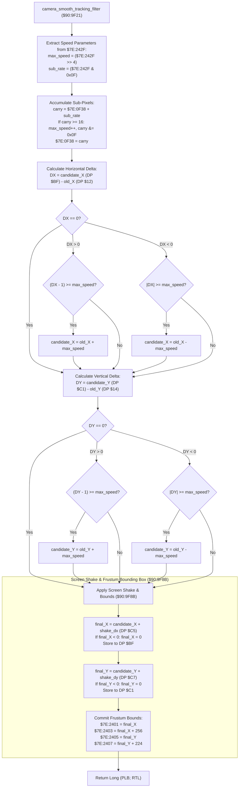

# Camera Smooth Tracking Filter, Velocity Clamping & Viewport Bounds ($90:9F21 – $90:9FC8)

> **ROM Bank**: `$90` (`$90:9F21` – `$90:9FC8`)  
> **Source Module**: `engine-core/camera-smooth-tracking.c` / `engine-core/camera-smooth-tracking.h`  
> **Recomp Symbols**: `L_9F21_M0X0`, `func_D09E93_M0X0`  
> **Confirmed Knowledge**: `rom/909f21.md`, `rom/909fc9.md`  
> **Core Subsystems**: Camera Viewport Tracking, Sub-Pixel PPU Stepping, Screen Shake Displacement (`$C5`/`$C7`), Frustum Culling Bounding Box (`$7E:2401`..`$7E:2407`)  

---

## 1. Subsystem Architecture & Overview

Following overworld camera target selection and boundary clamping (`camera_viewport_overworld_scroll_and_clamp` at `$90:9E93`–`$90:9F20`), the engine transitions into the **camera smooth velocity limiter and sub-pixel integrator** at `$90:9F21`.

This routine prevents jarring camera snaps when heroes dash, teleport, or experience knockback by rate-limiting the maximum horizontal ($\Delta X$) and vertical ($\Delta Y$) camera pan per frame. It then superimposes high-frequency screen shake offsets and computes the active 256×224 viewport bounding box used by the actor and projectile frustum culling engine:

```
+--------------------------------------------------------------------------------------------------+
|                            WRAM Bank $7E Camera & Viewport State Layout                          |
+--------------------------------------------------------------------------------------------------+
| DP $BF               (2 bytes)  : Candidate / Final Camera Viewport Origin X (World Pixels)      |
| DP $C1               (2 bytes)  : Candidate / Final Camera Viewport Origin Y (World Pixels)      |
| DP $12               (2 bytes)  : Previous Frame Camera Viewport Origin X                        |
| DP $14               (2 bytes)  : Previous Frame Camera Viewport Origin Y                        |
| DP $16               (2 bytes)  : Calculated Maximum Whole-Pixel Pan Speed for Current Frame     |
| $7E:242F             (2 bytes)  : Camera Speed Config (High Nibble = Whole Pixels, Low = Sub)   |
| $7E:0F38             (2 bytes)  : Fractional Sub-Pixel Carry Accumulator (0..15)                |
| DP $C5               (2 bytes)  : Screen Shake Horizontal Offset (Signed Pixel Displacement)     |
| DP $C7               (2 bytes)  : Screen Shake Vertical Offset (Signed Pixel Displacement)       |
| $7E:2401             (2 bytes)  : Active Viewport Left Boundary  (X_min = Final Camera X)       |
| $7E:2403             (2 bytes)  : Active Viewport Right Boundary (X_max = Final Camera X + 256) |
| $7E:2405             (2 bytes)  : Active Viewport Top Boundary   (Y_min = Final Camera Y)       |
| $7E:2407             (2 bytes)  : Active Viewport Bottom Boundary (Y_max = Final Camera Y + 224)|
+--------------------------------------------------------------------------------------------------+
```



---

## 2. Velocity Clamping & Sub-Pixel Arithmetic

### 2.1 Sub-Pixel Carry Pipeline
The camera pan speed parameter `$7E:242F` encodes a 12.4 fixed-point velocity format:
- **Upper 12 bits (`$7E:242F >> 4`)**: Base whole pixels per frame.
- **Lower 4 bits (`$7E:242F & 0x000F`)**: Fractional 1/16th pixel increments per frame.

Every frame:
$$\text{accumulator}_{t+1} = \text{accumulator}_t + (\text{speed} \ \& \ 15)$$
$$\text{max\_speed} = (\text{speed} \gg 4) + \lfloor \text{accumulator}_{t+1} / 16 \rfloor$$
$$\text{accumulator}_{t+1} \leftarrow \text{accumulator}_{t+1} \pmod{16}$$

This generates perfectly amortized non-integer panning rates (e.g. 2.25 pixels/frame alternating smoothly between 2 and 3 pixels across frames).

### 2.2 Directional Rate Limiting
For axis delta $\Delta \in \{\Delta X, \Delta Y\}$:
- If $\Delta > 0$ and $\Delta - 1 \ge \text{max\_speed}$: $\text{clamped} = \text{old} + \text{max\_speed}$
- If $\Delta < 0$ and $-\Delta \ge \text{max\_speed}$: $\text{clamped} = \text{old} - \text{max\_speed}$

### 2.3 Screen Shake & Frustum Projection
Finally, directional screen shake offsets (oscillated by `$80:A2E0` during earthquakes, explosions, and boss impacts) are combined with the filtered origin. An underflow guard ensures the camera origin never wraps negative:
$$\text{final\_X} = \max(0, \text{candidate\_X} + \text{shake\_X})$$
$$\text{final\_Y} = \max(0, \text{candidate\_Y} + \text{shake\_Y})$$

The 256×224 bounding rectangle is persisted into `$7E:2401`..`$7E:2407` for frustum culling tests (`$90:9545`).

---

## 3. Clean C Decompilation

> **Reconstructed C Decompilation**:
> Source moved to [`reconstructed-c/90/909F21_camera_smooth_tracking.c`](../../../reconstructed-c/90/909F21_camera_smooth_tracking.c).
> [View in VFS: soe://rom/code/909F21](soe://rom/code/909F21?c=1&asm=0)


---

## 4. Annotated 65816 Assembly Implementation

> **Interactive 65816 Assembly**:
> Centralized comments infused at runtime.
> [View in VFS: soe://rom/code/909F21](soe://rom/code/909F21?asm=1&c=0)


---

## 5. Verification & Behavioral Invariants

1. **Jitter-Free Panning**:
   By using fixed-point sub-pixel accumulation (`$7E:0F38`), slow pans do not oscillate between stops and starts, delivering buttery smooth scrolling even during diagonal motion.
2. **Screen Shake Underflow Protection**:
   Clamping `final_x` and `final_y` to 0 via `BPL` branch prevents negative coordinates from causing integer wrap-around into the 64K border when violent earthquakes trigger at map origins.
3. **Frustum Synchronization**:
   Computing `$7E:2401`..`$7E:2407` directly from the post-shake coordinates ensures that sprites and weather particles are never prematurely culled at screen borders during intense earthquakes.
