# Overworld Viewport Scroll, Dual-Player Midpoint Tracking & Deadzone Filter

- **ROM Locations**:
  - `camera_viewport_overworld_scroll_and_clamp`: `$90:9E93` – `$90:9F20`
  - `camera_ppu_scroll_subpixel_stepper`: `$90:9F21` – `$90:9FC8`
  - `camera_deadzone_window_filter`: `$90:9FC9` – `$90:A000`
- **CPU State**: 16-bit A/X (`REP #$30`), Data Bank `$7E` / `$90`
- **WRAM Core Addresses**:
  - `$7E:0617`: Vehicle flight altitude (Mode 7 flight system).
  - `$7E:0F42`: Primary player entity pointer (Boy `$4E89` or Dog `$4F37`).
  - `$7E:0F84`: Room header flags word (bit 14 `0x4000`: Flight horizon perspective bias enabled).
  - `$7E:143A`: Secondary companion / 2-player entity pointer (if active, triggers midpoint tracking).
  - `$7E:23E9`: Room horizontal minimum bound ($X_{\text{min}}$).
  - `$7E:23EB`: Room vertical minimum bound ($Y_{\text{min}}$).
  - `$7E:23ED`: Room horizontal maximum bound ($X_{\text{max}} + 256$).
  - `$7E:23EF`: Room vertical maximum bound ($Y_{\text{max}} + 224$).
  - `$7E:240F`: Camera horizontal deadzone left margin ($D_L$).
  - `$7E:2411`: Camera horizontal deadzone right margin ($D_R$).
  - `$7E:2413`: Camera vertical deadzone top margin ($D_T$).
  - `$7E:2415`: Camera vertical deadzone bottom margin ($D_B$).
  - `$7E:242B`: Stationary cutscene camera target X (`0xFFFF` = follow entities).
  - `$7E:242D`: Stationary cutscene camera target Y (`0xFFFF` = follow entities).
  - DP `$BF`: Viewport camera horizontal origin $X$ (world pixel coordinates).
  - DP `$C1`: Viewport camera vertical origin $Y$ (world pixel coordinates).
  - DP `$12`: Previous frame viewport horizontal origin $X$.
  - DP `$14`: Previous frame viewport vertical origin $Y$.

---

## 1. Architectural Architecture & Tracking Pipeline

While simple rooms center the camera directly on the player, overworld exploration and multi-character gameplay require sophisticated dynamic camera tracking:

```mermaid
flowchart TD
    subgraph Viewport_Scroll["Overworld Scroll & Clamp ($90:9E93)"]
        SaveOld["Save Old Camera (BF, C1) -> (DP $12, DP $14)"] --> CheckCutscene{"Cutscene Anchor<br/>$7E:242B >= 0?"}
        CheckCutscene -->|"Yes (Stationary)"| SetFixed["BF = $242B<br/>C1 = $242D"] --> ClampView
        CheckCutscene -->|"No (Follow Mode)"| TrackPrimary["Load Primary Entity $0F42<br/>JSR $9FC9 (Filter Deadzone)"]
        TrackPrimary --> CheckSecondary{"Secondary Entity $143A Active?"}
        CheckSecondary -->|"Yes (2-Player / Companion)"| TrackSecondary["Load Secondary Entity $143A<br/>JSR $9FC9 (Midpoint Lead Filter)"] --> CheckFlight
        CheckSecondary -->|"No"| CheckFlight{"Header Flag $0F84<br/>Bit 14 (0x4000) Set?"}
        CheckFlight -->|"Yes (Mode 7 Flight)"| ApplyHorizonBias["Altitude Bias: C1 = min(C1, Alt - 96)"] --> ClampView
        CheckFlight -->|"No"| ClampView
        ClampView["Clamp BF between $23E9 and ($23ED - 256)<br/>Clamp C1 between $23EB and ($23EF - 224)"] --> PpuSubpixel["JMP $9F21 (PPU Subpixel Stepper)"]
    end

    subgraph Deadzone_Filter["Deadzone Bounding Box Filter ($90:9FC9)"]
        TestLeft{"X - $240F < BF?"}
        TestLeft -->|"Yes"| UpdateLeft["BF = X - $240F"] --> TestTop
        TestLeft -->|"No"| TestRight{"X + $2411 - 256 > BF?"}
        TestRight -->|"Yes"| UpdateRight["BF = X + $2411 - 256"] --> TestTop
        TestRight -->|"No"| TestTop
        TestTop{"Y - $2413 < C1?"}
        TestTop -->|"Yes"| UpdateTop["C1 = Y - $2413"] --> DoneFilter
        TestTop -->|"No"| TestBottom{"Y + $2415 - 224 > C1?"}
        TestBottom -->|"Yes"| UpdateBottom["C1 = Y + $2415 - 224"] --> DoneFilter
        TestBottom -->|"No"| DoneFilter["RTS"]
    end
```

### 1.1 Four-Way Asymmetric Deadzone Box
The deadzone allows the player to turn or take minor adjustments without causing jarring screen jitter:
- **Left Margin ($D_L = \$7E:240F$)**: When entity $X < \text{Origin}_X + D_L$, camera shifts left.
- **Right Margin ($D_R = \$7E:2411$)**: When entity $X > \text{Origin}_X + 256 - D_R$, camera shifts right.
- **Top Margin ($D_T = \$7E:2413$)**: When entity $Y < \text{Origin}_Y + D_T$, camera shifts up.
- **Bottom Margin ($D_B = \$7E:2415$)**: When entity $Y > \text{Origin}_Y + 224 - D_B$, camera shifts down.

### 1.2 Dual-Entity Midpoint Tracking
When companion or 2-player mode is active (`$7E:143A != 0`), the camera first applies the deadzone filter to Player 1, and then immediately feeds Player 2's position into the same deadzone filter. If the characters move apart, the viewport smoothly pans to accommodate both within the screen bounds.

### 1.3 Mode 7 Horizon Pitch Bias (`Header Flag 0x4000`)
When exploring overworld Mode 7 maps, perspective projection causes ground tiles to foreshorten toward the horizon. If room header word `$0F84` has bit 14 (`0x4000`) set:
$$\text{Origin}_Y = \min(\text{Origin}_Y, \text{Altitude} - 96)$$
This lowers the camera view origin as vehicle altitude `$0617` drops, locking the horizon in realistic perspective against the Mode 7 horizon line.

---

## 2. Annotated 65816 Disassembly

> **Interactive 65816 Assembly**:
> Centralized comments infused at runtime.
> [View in VFS: soe://rom/code/909E93](soe://rom/code/909E93?asm=1&c=0)

---

## 3. Clean C Implementation

> **Reconstructed C Decompilation**:
> Source moved to [`reconstructed-c/90/909E93_camera_viewport_scroll.c`](../../../reconstructed-c/90/909E93_camera_viewport_scroll.c).
> [View in VFS: soe://rom/code/909E93](soe://rom/code/909E93?c=1&asm=0)

---

## 4. Verification & Behavioral Equivalence

| Test Condition | Observed Engine Trace | C Implementation Output | Status |
|---|---|---|---|
| **Fixed Target Override** | If `$242B >= 0`, overrides camera directly to fixed anchor. | `fixed_target_x >= 0` branches to immediate assignment. | ✅ Verified |
| **Deadzone Filtering** | Uses `$7E:240F` (L), `$2411` (R), `$2413` (T), `$2415` (B). | Identical bounding margin comparisons. | ✅ Verified |
| **Dual-Entity Midpoint** | Successively filters Player 1 (`$0F42`) then Player 2 (`$143A`). | Runs filter for `primary_entity` then `secondary_entity`. | ✅ Verified |
| **Flight Horizon Bias** | Room flag `0x4000` set -> `Origin_Y = min(Origin_Y, Alt - 96)`. | `biased_y = flight_altitude - 96; camera_y = min(camera_y, biased_y)`. | ✅ Verified |
| **Margin Clamping** | Clamps between `min_x` and `max_x - 256`, `min_y` and `max_y - 224`. | Clamps against `min_x`, `max_x - SCREEN_WIDTH`, `min_y`, `max_y - SCREEN_HEIGHT`. | ✅ Verified |
