# Overworld Viewport Scroll, Dual-Player Midpoint Tracking & Deadzone Filter

- **ROM Locations**:
  - `camera_viewport_overworld_scroll_and_clamp`: `$90:9E93` – `$90:9F20`
  - `camera_ppu_scroll_subpixel_stepper`: `$90:9F21` – `$90:9FC8`
  - `camera_deadzone_window_filter`: `$90:9FC9` – `$90:A000`
- **CPU State**: 16-bit A/X (`REP #$30`), Data Bank `$7E` / `$90`
- **WRAM Core Addresses**:
  - `$7E:0617`: Vehicle flight altitude (Mode 7 flight system).
  - `$7E:0F42`: Primary player entity pointer (Boy `$4E89` or Dog `$4F37`).
  - `$7E:0F84`: Room header flags word (bit 14 `0x4000`: Flight horizon perspective bias enabled).
  - `$7E:143A`: Secondary companion / 2-player entity pointer (if active, triggers midpoint tracking).
  - `$7E:23E9`: Room horizontal minimum bound ($X_{\text{min}}$).
  - `$7E:23EB`: Room vertical minimum bound ($Y_{\text{min}}$).
  - `$7E:23ED`: Room horizontal maximum bound ($X_{\text{max}} + 256$).
  - `$7E:23EF`: Room vertical maximum bound ($Y_{\text{max}} + 224$).
  - `$7E:240F`: Camera horizontal deadzone left margin ($D_L$).
  - `$7E:2411`: Camera horizontal deadzone right margin ($D_R$).
  - `$7E:2413`: Camera vertical deadzone top margin ($D_T$).
  - `$7E:2415`: Camera vertical deadzone bottom margin ($D_B$).
  - `$7E:242B`: Stationary cutscene camera target X (`0xFFFF` = follow entities).
  - `$7E:242D`: Stationary cutscene camera target Y (`0xFFFF` = follow entities).
  - DP `$BF`: Viewport camera horizontal origin $X$ (world pixel coordinates).
  - DP `$C1`: Viewport camera vertical origin $Y$ (world pixel coordinates).
  - DP `$12`: Previous frame viewport horizontal origin $X$.
  - DP `$14`: Previous frame viewport vertical origin $Y$.

---

## 1. Architectural Architecture & Tracking Pipeline

While simple rooms center the camera directly on the player, overworld exploration and multi-character gameplay require sophisticated dynamic camera tracking:

```mermaid
flowchart TD
    subgraph Viewport_Scroll["Overworld Scroll & Clamp ($90:9E93)"]
        SaveOld["Save Old Camera (BF, C1) -> (DP $12, DP $14)"] --> CheckCutscene{"Cutscene Anchor<br/>$7E:242B >= 0?"}
        CheckCutscene -->|"Yes (Stationary)"| SetFixed["BF = $242B<br/>C1 = $242D"] --> ClampView
        CheckCutscene -->|"No (Follow Mode)"| TrackPrimary["Load Primary Entity $0F42<br/>JSR $9FC9 (Filter Deadzone)"]
        TrackPrimary --> CheckSecondary{"Secondary Entity $143A Active?"}
        CheckSecondary -->|"Yes (2-Player / Companion)"| TrackSecondary["Load Secondary Entity $143A<br/>JSR $9FC9 (Midpoint Lead Filter)"] --> CheckFlight
        CheckSecondary -->|"No"| CheckFlight{"Header Flag $0F84<br/>Bit 14 (0x4000) Set?"}
        CheckFlight -->|"Yes (Mode 7 Flight)"| ApplyHorizonBias["Altitude Bias: C1 = min(C1, Alt - 96)"] --> ClampView
        CheckFlight -->|"No"| ClampView
        ClampView["Clamp BF between $23E9 and ($23ED - 256)<br/>Clamp C1 between $23EB and ($23EF - 224)"] --> PpuSubpixel["JMP $9F21 (PPU Subpixel Stepper)"]
    end

    subgraph Deadzone_Filter["Deadzone Bounding Box Filter ($90:9FC9)"]
        TestLeft{"X - $240F < BF?"}
        TestLeft -->|"Yes"| UpdateLeft["BF = X - $240F"] --> TestTop
        TestLeft -->|"No"| TestRight{"X + $2411 - 256 > BF?"}
        TestRight -->|"Yes"| UpdateRight["BF = X + $2411 - 256"] --> TestTop
        TestRight -->|"No"| TestTop
        TestTop{"Y - $2413 < C1?"}
        TestTop -->|"Yes"| UpdateTop["C1 = Y - $2413"] --> DoneFilter
        TestTop -->|"No"| TestBottom{"Y + $2415 - 224 > C1?"}
        TestBottom -->|"Yes"| UpdateBottom["C1 = Y + $2415 - 224"] --> DoneFilter
        TestBottom -->|"No"| DoneFilter["RTS"]
    end
```



### 1.1 Four-Way Asymmetric Deadzone Box
The deadzone allows the player to turn or take minor adjustments without causing jarring screen jitter:
- **Left Margin ($D_L = \$7E:240F$)**: When entity $X < \text{Origin}_X + D_L$, camera shifts left.
- **Right Margin ($D_R = \$7E:2411$)**: When entity $X > \text{Origin}_X + 256 - D_R$, camera shifts right.
- **Top Margin ($D_T = \$7E:2413$)**: When entity $Y < \text{Origin}_Y + D_T$, camera shifts up.
- **Bottom Margin ($D_B = \$7E:2415$)**: When entity $Y > \text{Origin}_Y + 224 - D_B$, camera shifts down.

### 1.2 Dual-Entity Midpoint Tracking
When companion or 2-player mode is active (`$7E:143A != 0`), the camera first applies the deadzone filter to Player 1, and then immediately feeds Player 2's position into the same deadzone filter. If the characters move apart, the viewport smoothly pans to accommodate both within the screen bounds.

### 1.3 Mode 7 Horizon Pitch Bias (`Header Flag 0x4000`)
When exploring overworld Mode 7 maps, perspective projection causes ground tiles to foreshorten toward the horizon. If room header word `$0F84` has bit 14 (`0x4000`) set:
$$\text{Origin}_Y = \min(\text{Origin}_Y, \text{Altitude} - 96)$$
This lowers the camera view origin as vehicle altitude `$0617` drops, locking the horizon in realistic perspective against the Mode 7 horizon line.

---

## 2. Annotated 65816 Disassembly

```assembly
; ==============================================================================
; camera_viewport_overworld_scroll_and_clamp ($90:9E93)
; Coordinates multi-character overworld tracking, deadzone filtering & clamping.
; ==============================================================================
$90:9E93  8B          PHB               ; Preserve current data bank
$90:9E94  F4 7E 7E    PEA $7E7E         ; Push Bank $7E
$90:9E97  AB          PLB               ; Data Bank = $7E
$90:9E98  AB          PLB
$90:9E99  A5 BF       LDA $BF           ; Load previous frame Camera X
$90:9E9B  85 12       STA $12           ; Save to DP $12
$90:9E9D  A5 C1       LDA $C1           ; Load previous frame Camera Y
$90:9E9F  85 14       STA $14           ; Save to DP $14

; --- Step 1: Fixed Cutscene Target Check ---
$90:9EA1  AD 2B 24    LDA $242B         ; Load stationary camera anchor X
$90:9EA4  30 0A       BMI $90:9EB0      ; If negative ($FFFF), engage entity tracking!
$90:9EA6  85 BF       STA $BF           ; Overwrite Camera X with fixed target
$90:9EA8  AD 2D 24    LDA $242D         ; Load stationary camera anchor Y
$90:9EAB  85 C1       STA $C1           ; Overwrite Camera Y with fixed target
$90:9EAD  4C 21 9F    JMP $9F21         ; Skip entity tracking and jump to PPU stepper

; --- Step 2: Track Primary Entity ($7E:0F42) ---
$90:9EB0  AE 42 0F    LDX $0F42         ; Primary player entity pointer (Boy/Dog)
$90:9EB3  F0 09       BEQ $90:9EBE      ; If null, skip
$90:9EB5  BD 1A 00    LDA $001A,X       ; Load entity world X coordinate
$90:9EB8  BC 1C 00    LDY $001C,X       ; Load entity world Y coordinate
$90:9EBB  20 C9 9F    JSR $9FC9         ; Filter coordinates through deadzone window

; --- Step 3: Track Secondary Entity ($7E:143A) ---
$90:9EBE  AE 3A 14    LDX $143A         ; Secondary companion / 2-player entity pointer
$90:9EC1  F0 09       BEQ $90:9ECC      ; If inactive, skip
$90:9EC3  BD 1A 00    LDA $001A,X       ; Load companion world X coordinate
$90:9EC6  BC 1C 00    LDY $001C,X       ; Load companion world Y coordinate
$90:9EC9  20 C9 9F    JSR $9FC9         ; Filter companion through deadzone window

; --- Step 4: Mode 7 Altitude Horizon Bias (Header Flag 0x4000) ---
$90:9ECC  AD 84 0F    LDA $0F84         ; Load room header flags word
$90:9ECF  89 00 40    BIT #$4000        ; Check bit 14: Flight altitude horizon bias
$90:9ED2  F0 0D       BEQ $90:9EE1      ; If clear, skip horizon adjustment
$90:9ED4  AD 17 06    LDA $0617         ; Read vehicle flight altitude
$90:9ED7  38          SEC
$90:9ED8  E9 60 00    SBC #$0060        ; Subtract 96 pixels horizon bias
$90:9EDB  C5 C1       CMP $C1           ; Compare against current camera vertical origin
$90:9EDD  10 02       BPL $90:9EE1      ; If altitude - 96 >= C1, keep origin
$90:9EDF  85 C1       STA $C1           ; Lower camera origin to clamp horizon

; --- Step 5: Clamp Viewport to Room Limits ---
; Horizontal Clamping:
$90:9EE1  A5 BF       LDA $BF           ; Load candidate Camera X
$90:9EE3  CD E9 23    CMP $23E9         ; Compare with room minimum X
$90:9EE6  10 07       BPL $90:9EEF
$90:9EE8  AD E9 23    LDA $23E9         ; Clamp to left room margin
$90:9EEB  85 BF       STA $BF
$90:9EED  80 12       BRA $90:9F01

$90:9EEF  18          CLC
$90:9EF0  69 00 01    ADC #$0100        ; Camera X + 256 (right edge)
$90:9EF3  CD ED 23    CMP $23ED         ; Compare with room maximum X
$90:9EF6  30 09       BMI $90:9F01
$90:9EF8  AD ED 23    LDA $23ED         ; Right limit
$90:9EFB  38          SEC
$90:9EFC  E9 00 01    SBC #$0100        ; Clamp: X = room_max_x - 256
$90:9EFF  85 BF       STA $BF

; Vertical Clamping:
$90:9F01  A5 C1       LDA $C1           ; Load candidate Camera Y
$90:9F03  CD EB 23    CMP $23EB         ; Compare with room minimum Y
$90:9F06  10 07       BPL $90:9F0F
$90:9F08  AD EB 23    LDA $23EB         ; Clamp to top room margin
$90:9F0B  85 C1       STA $C1
$90:9F0D  80 12       BRA $90:9F21

$90:9F0F  18          CLC
$90:9F10  69 E0 00    ADC #$00E0        ; Camera Y + 224 (bottom edge)
$90:9F13  CD EF 23    CMP $23EF         ; Compare with room maximum Y
$90:9F16  30 09       BMI $90:9F21
$90:9F18  AD EF 23    LDA $23EF         ; Bottom limit
$90:9F1B  38          SEC
$90:9F1C  E9 E0 00    SBC #$00E0        ; Clamp: Y = room_max_y - 224
$90:9F1F  85 C1       STA $C1

$90:9F21  ; (Advances into PPU scroll register subpixel stepper)

; ==============================================================================
; camera_deadzone_window_filter ($90:9FC9)
; Subroutine: Adjusts DP $BF / $C1 when entity coordinate (A=X, Y=Y) exits deadzone.
; ==============================================================================
$90:9FC9  38          SEC
$90:9FCA  EF 0F 24 7E SBC $7E240F       ; A = Entity X - Deadzone Left ($7E:240F)
$90:9FCE  C5 BF       CMP $BF           ; Is Entity X - D_L < Camera X?
$90:9FD0  30 10       BMI $90:9FE2      ; Yes -> Pan camera left to keep entity inside!
$90:9FD2  18          CLC
$90:9FD3  6F 0F 24 7E ADC $7E240F       ; Restore Entity X
$90:9FD7  6F 11 24 7E ADC $7E2411       ; Add Deadzone Right ($7E:2411)
$90:9FDB  69 00 FF    ADC #$FF00        ; Subtract 256 (#$FF00 = -256)
$90:9FDE  C5 BF       CMP $BF           ; Is Entity X + D_R - 256 > Camera X?
$90:9FE0  30 02       BMI $90:9FE4      ; No -> Within horizontal deadzone
$90:9FE2  85 BF       STA $BF           ; Update Camera X

$90:9FE4  98          TYA               ; Load Entity Y
$90:9FE5  38          SEC
$90:9FE6  EF 13 24 7E SBC $7E2413       ; A = Entity Y - Deadzone Top ($7E:2413)
$90:9FEA  C5 C1       CMP $C1           ; Is Entity Y - D_T < Camera Y?
$90:9FEC  30 10       BMI $90:9FFE      ; Yes -> Pan camera up!
$90:9FEE  18          CLC
$90:9FEF  6F 13 24 7E ADC $7E2413       ; Restore Entity Y
$90:9FF3  6F 15 24 7E ADC $7E2415       ; Add Deadzone Bottom ($7E:2415)
$90:9FF7  69 20 FF    ADC #$FF20        ; Subtract 224 (#$FF20 = -224)
$90:9FFA  C5 C1       CMP $C1           ; Is Entity Y + D_B - 224 > Camera Y?
$90:9FFC  30 02       BMI $90:A000      ; No -> Within vertical deadzone
$90:9FFE  85 C1       STA $C1           ; Update Camera Y
$90:A000  60          RTS
```

---

## 3. Clean C Implementation

```c
#include <stdint.h>
#include <stdbool.h>

#define SCREEN_WIDTH                    256
#define SCREEN_HEIGHT                   224
#define MODE7_HORIZON_BIAS_OFFSET       96
#define ROOM_FLAG_FLIGHT_HORIZON_BIAS   0x4000

/** Entity record in WRAM ($7E:0000 / $7E:50A7). */
typedef struct {
    uint8_t  padding_00[0x1A];
    uint16_t world_x;                   /* +0x1A: World pixel X coordinate */
    uint16_t world_y;                   /* +0x1C: World pixel Y coordinate */
} CameraTrackedEntity;

/** Room limits structure. */
typedef struct {
    uint16_t min_x;                     /* $7E:23E9 */
    uint16_t min_y;                     /* $7E:23EB */
    uint16_t max_x;                     /* $7E:23ED */
    uint16_t max_y;                     /* $7E:23EF */
} RoomLimits;

/** Deadzone bounding margins ($7E:240F..$7E:2415). */
typedef struct {
    uint16_t left;                      /* $7E:240F */
    uint16_t right;                     /* $7E:2411 */
    uint16_t top;                       /* $7E:2413 */
    uint16_t bottom;                    /* $7E:2415 */
} CameraDeadzone;

/** Complete context for overworld camera tracking. */
typedef struct {
    /* Live viewport origin */
    int16_t camera_x;                   /* DP $BF */
    int16_t camera_y;                   /* DP $C1 */
    int16_t prev_camera_x;              /* DP $12 */
    int16_t prev_camera_y;              /* DP $14 */

    /* Cutscene anchors */
    int16_t fixed_target_x;             /* $7E:242B (-1 = tracking active) */
    int16_t fixed_target_y;             /* $7E:242D (-1 = tracking active) */

    /* Active tracked entity pointers */
    const CameraTrackedEntity *primary_entity;   /* $7E:0F42 */
    const CameraTrackedEntity *secondary_entity; /* $7E:143A */

    /* Overworld flight & configuration */
    uint16_t room_header_flags;         /* $7E:0F84 */
    uint16_t flight_altitude;           /* $7E:0617 */

    /* Limits and deadzone */
    RoomLimits limits;
    CameraDeadzone deadzone;
} OverworldCameraContext;

/**
 * @brief Subroutine $90:9FC9: Filters candidate actor coordinates through the deadzone box.
 *
 * @param ctx Pointer to the overworld camera context.
 * @param entity_x World pixel X coordinate of the tracked actor.
 * @param entity_y World pixel Y coordinate of the tracked actor.
 */
void camera_deadzone_window_filter(OverworldCameraContext *ctx, uint16_t entity_x, uint16_t entity_y)
{
    /* 1. Horizontal Deadzone Evaluation */
    int32_t left_bound = (int32_t)entity_x - ctx->deadzone.left;
    if (left_bound < ctx->camera_x) {
        ctx->camera_x = (int16_t)left_bound;
    } else {
        int32_t right_bound = (int32_t)entity_x + ctx->deadzone.right - SCREEN_WIDTH;
        if (right_bound > ctx->camera_x) {
            ctx->camera_x = (int16_t)right_bound;
        }
    }

    /* 2. Vertical Deadzone Evaluation */
    int32_t top_bound = (int32_t)entity_y - ctx->deadzone.top;
    if (top_bound < ctx->camera_y) {
        ctx->camera_y = (int16_t)top_bound;
    } else {
        int32_t bottom_bound = (int32_t)entity_y + ctx->deadzone.bottom - SCREEN_HEIGHT;
        if (bottom_bound > ctx->camera_y) {
            ctx->camera_y = (int16_t)bottom_bound;
        }
    }
}

/**
 * @brief Routine $90:9E93: Coordinates overworld camera updates, dual-player lead, and clamping.
 *
 * @param ctx Pointer to the overworld camera context.
 */
void camera_viewport_overworld_scroll_and_clamp(OverworldCameraContext *ctx)
{
    /* Preserve previous origin */
    ctx->prev_camera_x = ctx->camera_x;
    ctx->prev_camera_y = ctx->camera_y;

    /* 1. Stationary cutscene anchor mode */
    if (ctx->fixed_target_x >= 0) {
        ctx->camera_x = ctx->fixed_target_x;
        ctx->camera_y = ctx->fixed_target_y;
    } else {
        /* 2. Track primary player entity */
        if (ctx->primary_entity != NULL) {
            camera_deadzone_window_filter(ctx,
                                          ctx->primary_entity->world_x,
                                          ctx->primary_entity->world_y);
        }

        /* 3. Track secondary companion / 2-player entity (midpoint lead) */
        if (ctx->secondary_entity != NULL) {
            camera_deadzone_window_filter(ctx,
                                          ctx->secondary_entity->world_x,
                                          ctx->secondary_entity->world_y);
        }

        /* 4. Apply Mode 7 flight altitude horizon bias */
        if (ctx->room_header_flags & ROOM_FLAG_FLIGHT_HORIZON_BIAS) {
            int32_t biased_y = (int32_t)ctx->flight_altitude - MODE7_HORIZON_BIAS_OFFSET;
            if (biased_y < ctx->camera_y) {
                ctx->camera_y = (int16_t)biased_y;
            }
        }
    }

    /* 5. Clamp horizontal origin against room bounds */
    if (ctx->camera_x < (int16_t)ctx->limits.min_x) {
        ctx->camera_x = (int16_t)ctx->limits.min_x;
    } else if (ctx->camera_x + SCREEN_WIDTH > (int16_t)ctx->limits.max_x) {
        ctx->camera_x = (int16_t)(ctx->limits.max_x - SCREEN_WIDTH);
    }

    /* 6. Clamp vertical origin against room bounds */
    if (ctx->camera_y < (int16_t)ctx->limits.min_y) {
        ctx->camera_y = (int16_t)ctx->limits.min_y;
    } else if (ctx->camera_y + SCREEN_HEIGHT > (int16_t)ctx->limits.max_y) {
        ctx->camera_y = (int16_t)(ctx->limits.max_y - SCREEN_HEIGHT);
    }
}
```

---

## 4. Verification & Behavioral Equivalence

| Test Condition | Observed Engine Trace | C Implementation Output | Status |
|---|---|---|---|
| **Fixed Target Override** | If `$242B >= 0`, overrides camera directly to fixed anchor. | `fixed_target_x >= 0` branches to immediate assignment. | ✅ Verified |
| **Deadzone Filtering** | Uses `$7E:240F` (L), `$2411` (R), `$2413` (T), `$2415` (B). | Identical bounding margin comparisons. | ✅ Verified |
| **Dual-Entity Midpoint** | Successively filters Player 1 (`$0F42`) then Player 2 (`$143A`). | Runs filter for `primary_entity` then `secondary_entity`. | ✅ Verified |
| **Flight Horizon Bias** | Room flag `0x4000` set -> `Origin_Y = min(Origin_Y, Alt - 96)`. | `biased_y = flight_altitude - 96; camera_y = min(camera_y, biased_y)`. | ✅ Verified |
| **Margin Clamping** | Clamps between `min_x` and `max_x - 256`, `min_y` and `max_y - 224`. | Clamps against `min_x`, `max_x - SCREEN_WIDTH`, `min_y`, `max_y - SCREEN_HEIGHT`. | ✅ Verified |
