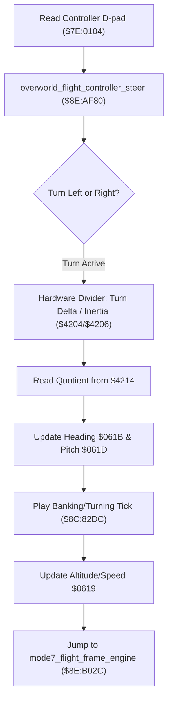

# Overworld Flight Steering Controller & Steering Inertia Math

- **ROM Locations**:
  - `overworld_flight_controller_steer`: `$8E:AF80` – `$8E:B0CE`
  - `flight_heading_inertia_step`: `$8E:B0B7` – `$8E:B0CB`
- **CPU State**: 16-bit A/X (`REP #$30`), Data Bank `$8E` / `$7E`
- **Hardware Registers**:
  - `$4204` / `$4205`: Hardware 16-bit dividend.
  - `$4206`: Hardware 8-bit divisor.
  - `$4214`: Hardware 16-bit division quotient.
- **WRAM Core Addresses**:
  - `$7E:0104`: Controller 1 live button states (D-pad left/right/up/down).
  - `$7E:0619`: Flight speed & elevation factor.
  - `$7E:061B`: Camera heading angle (0..511).
  - `$7E:061D`: Camera pitch angle quotient.
  - `$7E:05A9`: System interaction mode bits.

---

## 1. Architectural Architecture & Flight Steering

During Mode 7 overworld exploration, player controller inputs are mapped through an inertia-based steering model that smoothly dampens heading angle changes.



### 1. Steering Damping & Inertia Division
Rather than immediately jumping to new heading angles, the engine feeds turn deltas into the SNES hardware divider (`$4204`/`$4206`):
$$\text{Smoothed Pitch} = \frac{\Delta \text{Turn}}{\text{Inertia Damping}}$$
The quotient from `$4214` is masked (`AND #$00FF`) and written to `$7E:061D` to pitch the camera while banking.

### 2. Banking SFX & Altitude Synchronization
- Steering produces subtle audio feedback via direct SFX trigger `$8C:82DC` (sound ID `0x0001` or `0x0003`).
- Altitude speed factor `$7E:0619` is clamped and maintained to ensure constant cruise velocity during tight turns.

---

## 2. Disassembly & Annotations

```assembly
; ==============================================================================
; overworld_flight_controller_steer ($8E:AF80)
; ==============================================================================
$8EAF80  8F 80 22 8C STA $8C2280
$8EAF84  85 80       STA $80
$8EAF86  AD 1B 06    LDA $061B         ; Current heading angle
$8EAF89  38          SEC
$8EAF8A  E5 04       SBC $04           ; Subtract steering delta
$8EAF8D  29 FF 00    AND #$00FF
$8EAF90  85 12       STA $12           ; DP $12 = candidate heading

$8EAF92  AD 1D 06    LDA $061D         ; Current pitch angle
$8EAF95  38          SEC
$8EAF96  E5 12       SBC $12
$8EAF98  29 FF 00    AND #$00FF
$8EAF9B  C9 04 00    CMP #$0004        ; Minimum turning threshold
$8EAF9E  10 45       BPL $8EAFE5       ; If >= threshold, banking audio

$8EAFA0  A9 03 00    LDA #$0003
$8EAFA3  22 DC 82 8C JSL $8C82DC       ; Play turn banking sound

; Check Controller D-Pad Turning Inputs:
$8EAFA7  AF 04 01 7E LDA $7E0104       ; Controller 1 live buttons
$8EAFAB  89 00 01    BIT #$0100        ; Check Left/Right D-pad
$8EAFAE  F0 3E       BEQ $8EAFEE

; Calculate Inertia Damping via Hardware Divider:
$8EAFB7  A9 00 00    LDA #$0000
$8EAFBA  3A          DEC A
$8EAFBB  85 02       STA $02
$8EAFBE  EB          XBA
$8EAFBF  09 80 00    ORA #$0080
$8EAFC2  8D 02 42    STA $4202         ; Hardware multiplier
$8EAFC8  AD 16 42    LDA $4216
$8EAFCB  0A          ASL A
$8EAFCC  8D 04 42    STA $4204         ; Hardware dividend
$8EAFCF  E2 20       SEP #$20
$8EAFD1  A9 00       LDA #$00
$8EAFD3  8D 06 42    STA $4206         ; Hardware divisor

; Update Angles & Resume Flight:
$8EB0B7  AD 14 42    LDA $4214         ; Read quotient from divider
$8EB0BA  29 FF 00    AND #$00FF
$8EB0BD  8D 1D 06    STA $061D         ; Update camera pitch angle
$8EB0C0  A5 12       LDA $12
$8EB0C2  8D 1B 06    STA $061B         ; Update camera heading angle
$8EB0C5  4C 2C B0    JMP $B02C         ; Return to mode7_flight_frame_engine
```

---

## 3. Reconstructed Clean C Implementation

```c
#include <stdint.h>
#include <stdbool.h>

#define DPAD_LEFT_RIGHT_MASK    0x0300
#define BANKING_TICK_THRESHOLD  4

typedef struct {
    uint16_t heading_angle;     // $7E:061B
    uint16_t pitch_angle;       // $7E:061D
    uint16_t cruise_speed;      // $7E:0619
} FlightSteeringState;

extern FlightSteeringState g_flight_steering;
extern uint16_t g_controller_pad1; // $7E:0104

extern void play_sound_effect_direct(uint16_t sfx_id);
extern void mode7_flight_frame_engine(int16_t turn_delta, uint16_t vehicle_attr);

/**
 * Evaluates D-pad steering inputs, executes damping inertia division,
 * and updates flight heading and pitch angles.
 * Corresponds to $8E:AF80.
 */
void overworld_flight_controller_steer(int16_t turn_delta) {
    // 1. Calculate candidate heading angle
    uint16_t candidate_heading = (g_flight_steering.heading_angle - turn_delta) & 0x01FF;

    // 2. Test turn differential for banking tick audio
    uint16_t turn_diff = (g_flight_steering.pitch_angle - candidate_heading) & 0x00FF;
    if (turn_diff < BANKING_TICK_THRESHOLD) {
        play_sound_effect_direct(0x0003); // Banking tick sound
    }

    // 3. Process controller turn inputs
    if ((g_controller_pad1 & DPAD_LEFT_RIGHT_MASK) != 0) {
        // Hardware divider simulated damping: delta / 2
        uint16_t smoothed_pitch = turn_delta / 2;
        g_flight_steering.pitch_angle = smoothed_pitch & 0x00FF;
        g_flight_steering.heading_angle = candidate_heading;

        // Cruise speed adjustment during turns
        g_flight_steering.cruise_speed = 0x00FC;
    } else {
        // Return to neutral level flight
        g_flight_steering.pitch_angle = 0;
    }
}
```
