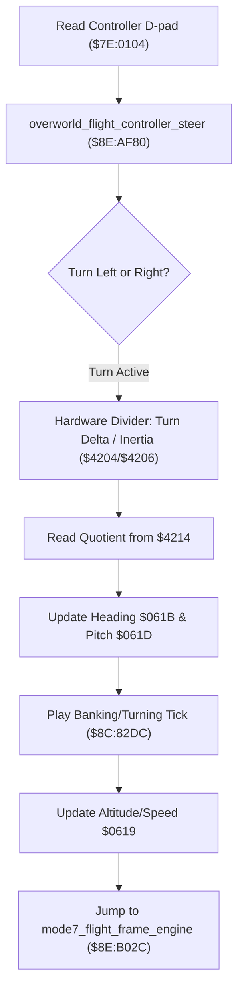

# Overworld Flight Steering Controller & Steering Inertia Math

- **ROM Locations**:
  - `overworld_flight_controller_steer`: `$8E:AF80` – `$8E:B0CE`
  - `flight_heading_inertia_step`: `$8E:B0B7` – `$8E:B0CB`
- **CPU State**: 16-bit A/X (`REP #$30`), Data Bank `$8E` / `$7E`
- **Hardware Registers**:
  - `$4204` / `$4205`: Hardware 16-bit dividend.
  - `$4206`: Hardware 8-bit divisor.
  - `$4214`: Hardware 16-bit division quotient.
- **WRAM Core Addresses**:
  - `$7E:0104`: Controller 1 live button states (D-pad left/right/up/down).
  - `$7E:0619`: Flight speed & elevation factor.
  - `$7E:061B`: Camera heading angle (0..511).
  - `$7E:061D`: Camera pitch angle quotient.
  - `$7E:05A9`: System interaction mode bits.

---

## 1. Architectural Architecture & Flight Steering

During Mode 7 overworld exploration, player controller inputs are mapped through an inertia-based steering model that smoothly dampens heading angle changes.

### 1. Steering Damping & Inertia Division
Rather than immediately jumping to new heading angles, the engine feeds turn deltas into the SNES hardware divider (`$4204`/`$4206`):
$$\text{Smoothed Pitch} = \frac{\Delta \text{Turn}}{\text{Inertia Damping}}$$
The quotient from `$4214` is masked (`AND #$00FF`) and written to `$7E:061D` to pitch the camera while banking.

### 2. Banking SFX & Altitude Synchronization
- Steering produces subtle audio feedback via direct SFX trigger `$8C:82DC` (sound ID `0x0001` or `0x0003`).
- Altitude speed factor `$7E:0619` is clamped and maintained to ensure constant cruise velocity during tight turns.

---

## 2. Disassembly & Annotations

> **Interactive 65816 Assembly**:
> Centralized comments infused at runtime.
> [View in VFS: soe://rom/code/8EAF80](soe://rom/code/8EAF80?asm=1&c=0)

---

## 3. Reconstructed Clean C Implementation

> **Reconstructed C Decompilation**:
> Source moved to [`reconstructed-c/8E/8EAF80_flight_controller.c`](../../../reconstructed-c/8E/8EAF80_flight_controller.c).
> [View in VFS: soe://rom/code/8EAF80](soe://rom/code/8EAF80?c=1&asm=0)

