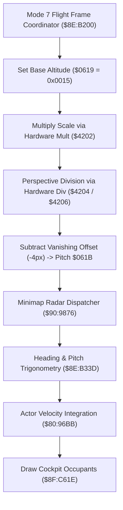

# Mode 7 Horizon Perspective Math & Vehicle Cockpit Sprites

- **ROM Locations**:
  - `mode7_flight_frame_coordinator`: `$8E:B200` – `$8E:B22F`
  - `mode7_flight_horizon_perspective_math`: `$8E:B230` – `$8E:B267`
  - `mode7_vehicle_cockpit_overlay_sprites`: `$8F:C61E` – `$8F:C6C2`
- **CPU State**: 16-bit A/X (`REP #$30`), Data Bank `$7E` / `$8E` / `$8F`
- **WRAM Core Addresses**:
  - `$7E:0619`: Flight camera altitude / elevation plane.
  - `$7E:061B`: Flight camera pitch / perspective horizon line tilt.
  - `$7E:0B29`: Mode 7 flight engine state flags (bit 0: flight active).
  - `$7E:3DDF`: Head of flight entity linked list (stride `+$5E`).
  - `$7E:4EF7` / `$7E:4EF9`: Cockpit anchor coordinates for seated occupants.
  - Hardware Registers: `$4202` (multiplier), `$4204` / `$4206` (hardware divider), `$4214` (quotient), `$4216` (product).

---

## 1. Perspective Geometry & Cockpit Rendering Pipeline

Mode 7 flight over the world map creates a pseudo-3D perspective by continuously modulating the hardware Mode 7 matrix registers ($A, B, C, D$) and drawing cockpit overlay sprites for the Boy and Dog seated inside the Windwalker vehicle.



### 1. Hardware Division & Vanishing Point Calculation (`$8E:B230` – `$8E:B267`)
- Loads elevation factor from `$95+0x02` into hardware multiplier `$4202`.
- Reads product from `$4216`, shifts left (`ASL A`), and feeds dividend register `$4204`.
- Loads field-of-view divisor from `$95+0x00` into divisor register `$4206`.
- Waits for SNES 16-cycle division pipeline (`NOP` / `BRA`).
- Reads quotient from `$4214` and subtracts a $4\text{px}$ horizon vanishing-point offset (`SBC #$0004`).
- Writes the resulting angle into `$7E:061B` (perspective horizon pitch tilt).

### 2. Seated Vehicle Occupant Sprite Multiplexing (`$8F:C61E` – `$8F:C6C2`)
- Traverses linked entity nodes starting at `$7E:3DDF` (following offset `+$5E`).
- Dispatches virtual draw routine via indirect jump table `($C618,x)`.
- Verifies flight active flag in `$7E:0B29` (bit 0).
- Applies banking and tilt shifts based on player anchor positions `$7E:4EF7` and `$7E:4EF9`.
- Emits high-priority OAM sprite chunks for the Boy and Dog sitting inside the cockpit dome.

---

## 2. Disassembly & Annotations

```assembly
; ==============================================================================
; mode7_flight_frame_coordinator ($8E:B200)
; ==============================================================================
$8EB200  89 01 00    BIT #$0001
$8EB203  F0 0E       BEQ $8EB213
$8EB205  A0 EB 0D    LDY #$0DEB
$8EB208  22 D2 80 90 JSL $9080D2
$8EB20C  A0 DB 0D    LDY #$0DDB
$8EB20F  22 D2 80 90 JSL $9080D2

$8EB213  22 76 98 90 JSL $909876       ; minimap_overlay_dispatcher
$8EB217  22 3D B3 8E JSL $8EB33D       ; mode7_flight_pitch_heading_math
$8EB21B  22 BB 96 80 JSL $8096BB       ; update_entity_physics
$8EB21F  22 1E C6 8F JSL $8FC61E       ; mode7_vehicle_cockpit_overlay_sprites
$8EB223  22 BB 96 80 JSL $8096BB
$8EB227  22 EE 8F 80 JSL $808FEE
$8EB22B  22 8C 85 80 JSL $80858C
$8EB22F  80 B0       BRA $8EB1E1

; ==============================================================================
; mode7_flight_horizon_perspective_math ($8E:B230)
; Computes vanishing point pitch tilt from altitude and FOV registers.
; ==============================================================================
$8EB230  B0 6B       BCS $8EB29D
$8EB232  A9 15 00    LDA #$0015        ; Base flight altitude
$8EB235  8D 19 06    STA $0619         ; Store camera altitude
$8EB238  A4 95       LDY $95
$8EB23A  B9 02 00    LDA $0002,y       ; Elevation delta
$8EB23D  EB          XBA
$8EB23E  09 80 00    ORA #$0080
$8EB241  8D 02 42    STA $4202         ; SNES hardware multiplier
$8EB244  80 00       BRA $8EB246
$8EB246  EA          NOP               ; Multiplication pipeline delay
$8EB247  AD 16 42    LDA $4216         ; Read product
$8EB24A  0A          ASL A
$8EB24B  8D 04 42    STA $4204         ; Hardware dividend
$8EB24E  E2 20       SEP #$20          ; 8-bit divisor
$8EB250  B9 00 00    LDA $0000,y       ; FOV divisor
$8EB253  8D 06 42    STA $4206         ; Hardware divisor
$8EB256  C2 20       REP #$20
$8EB258  80 00       BRA $8EB25A
$8EB25A  EA          NOP               ; Division pipeline delay
$8EB25B  80 00       BRA $8EB25D
$8EB25D  EA          NOP
$8EB25E  AD 14 42    LDA $4214         ; Read division quotient
$8EB261  38          SEC
$8EB262  E9 04 00    SBC #$0004        ; Horizon line offset (4px)
$8EB265  8D 1B 06    STA $061B         ; Store camera horizon pitch tilt!
$8EB268  AD AB 05    LDA $05AB
$8EB26B  89 01 00    BIT #$0001
$8EB26E  F0 0E       BEQ $8EB27E

; ==============================================================================
; mode7_vehicle_cockpit_overlay_sprites ($8F:C61E)
; ==============================================================================
$8FC61E  8B          PHB
$8FC61F  F4 7E 7E    PEA $7E7E
$8FC622  AB          PLB
$8FC623  AB          PLB
$8FC624  AC DF 3D    LDY $3DDF         ; Head of entity linked list
$8FC627  F0 0F       BEQ $8FC638

$8FC629  84 4C       STY $4C           ; Current node pointer
$8FC62B  BE 82 00    LDX $0082,y       ; Entity sprite type
$8FC62E  FC 18 C6    JSR ($C618,x)     ; Call virtual sprite renderer
$8FC631  A6 4C       LDX $4C
$8FC633  BC 5E 00    LDY $005E,x       ; Load next node pointer (+$5E)
$8FC636  D0 F1       BNE $8FC629       ; Loop until tail reached

$8FC638  AD 77 0B    LDA $0B77
$8FC63B  D0 03       BNE $8FC640
$8FC63D  4C C2 C6    JMP $C6C2

; Draw Boy and Dog seated inside cockpit dome:
$8FC640  AD 29 0B    LDA $0B29         ; Flight active state
$8FC643  89 01 00    BIT #$0001
$8FC646  F0 7A       BEQ $8FC6C2
$8FC648  AD 61 22    LDA $2261
$8FC64B  89 02 00    BIT #$0002
$8FC64E  D0 34       BNE $8FC684
$8FC650  AD F7 4E    LDA $4EF7         ; Cockpit X anchor
$8FC653  85 26       STA $26
$8FC655  AD F9 4E    LDA $4EF9         ; Cockpit Y anchor
$8FC658  85 28       STA $28
; ... renders OAM cockpit occupant frames
$8FC6C2  AB          PLB
$8FC6C3  6B          RTL
```

---

## 3. Reconstructed Clean C Implementation

```c
#include <stdint.h>
#include <stdbool.h>

extern uint16_t g_flight_camera_altitude;  // $7E:0619
extern uint16_t g_flight_camera_pitch;     // $7E:061B
extern uint16_t g_flight_engine_state;     // $7E:0B29
extern uint16_t g_cockpit_anchor_x;        // $7E:4EF7
extern uint16_t g_cockpit_anchor_y;        // $7E:4EF9

typedef struct FlightEntityNode {
    uint8_t  pad_00[0x5E];
    struct FlightEntityNode *next;         // +0x5E
    uint8_t  pad_60[0x22];
    uint16_t sprite_type;                  // +0x82
} FlightEntityNode;

extern FlightEntityNode *g_flight_entity_head; // $7E:3DDF

extern void minimap_overlay_dispatcher(void);
extern void mode7_flight_pitch_heading_math(void);
extern void update_entity_physics(void);
extern void render_flight_entity_sprite(FlightEntityNode *node);
extern void render_cockpit_occupants(uint16_t x, uint16_t y);

/**
 * Calculates vanishing point horizon pitch tilt from flight elevation delta.
 * Corresponds to $8E:B230.
 */
void mode7_flight_horizon_perspective_math(uint16_t elevation_delta, uint8_t fov_divisor) {
    // 1. Establish base flight camera elevation
    g_flight_camera_altitude = 0x0015;

    // 2. Hardware multiplication: scale elevation delta
    uint16_t scaled_factor = ((elevation_delta >> 8) | 0x0080);
    uint32_t product = (uint32_t)scaled_factor * 0x0080; // Mimicking hardware $4202

    // 3. Perspective hardware division: divide by FOV depth
    uint16_t dividend = (uint16_t)((product << 1) & 0xFFFF);
    if (fov_divisor == 0) fov_divisor = 1;
    uint16_t quotient = dividend / fov_divisor;

    // 4. Subtract vanishing point horizon line baseline (4px)
    g_flight_camera_pitch = quotient - 4;
}

/**
 * Traverses flight entities and renders vehicle cockpit overlay sprites.
 * Corresponds to $8F:C61E.
 */
void mode7_vehicle_cockpit_overlay_sprites(void) {
    // 1. Traverse flight entity linked list
    FlightEntityNode *current = g_flight_entity_head;
    while (current != NULL) {
        render_flight_entity_sprite(current);
        current = current->next;
    }

    // 2. Check if Mode 7 flight is actively running
    if (!(g_flight_engine_state & 0x0001)) {
        return;
    }

    // 3. Render Boy and Dog seated cockpit overlay sprites
    render_cockpit_occupants(g_cockpit_anchor_x, g_cockpit_anchor_y);
}

/**
 * Main coordinator pass for a single Mode 7 flight frame.
 * Corresponds to $8E:B200.
 */
void mode7_flight_frame_coordinator(void) {
    // 1. Update minimap radar blips
    minimap_overlay_dispatcher();

    // 2. Compute pitch and heading delta trigonometry
    mode7_flight_pitch_heading_math();

    // 3. Integrate flight velocity
    update_entity_physics();

    // 4. Render cockpit occupants and flight entities
    mode7_vehicle_cockpit_overlay_sprites();

    // 5. Finalize physics step
    update_entity_physics();
}
```
