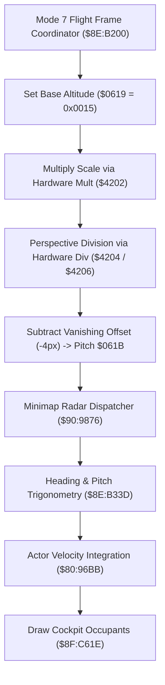

# Mode 7 Horizon Perspective Math & Vehicle Cockpit Sprites

- **ROM Locations**:
  - `mode7_flight_frame_coordinator`: `$8E:B200` – `$8E:B22F`
  - `mode7_flight_horizon_perspective_math`: `$8E:B230` – `$8E:B267`
  - `mode7_vehicle_cockpit_overlay_sprites`: `$8F:C61E` – `$8F:C6C2`
- **CPU State**: 16-bit A/X (`REP #$30`), Data Bank `$7E` / `$8E` / `$8F`
- **WRAM Core Addresses**:
  - `$7E:0619`: Flight camera altitude / elevation plane.
  - `$7E:061B`: Flight camera pitch / perspective horizon line tilt.
  - `$7E:0B29`: Mode 7 flight engine state flags (bit 0: flight active).
  - `$7E:3DDF`: Head of flight entity linked list (stride `+$5E`).
  - `$7E:4EF7` / `$7E:4EF9`: Cockpit anchor coordinates for seated occupants.
  - Hardware Registers: `$4202` (multiplier), `$4204` / `$4206` (hardware divider), `$4214` (quotient), `$4216` (product).

---

## 1. Perspective Geometry & Cockpit Rendering Pipeline

Mode 7 flight over the world map creates a pseudo-3D perspective by continuously modulating the hardware Mode 7 matrix registers ($A, B, C, D$) and drawing cockpit overlay sprites for the Boy and Dog seated inside the Windwalker vehicle.

### 1. Hardware Division & Vanishing Point Calculation (`$8E:B230` – `$8E:B267`)
- Loads elevation factor from `$95+0x02` into hardware multiplier `$4202`.
- Reads product from `$4216`, shifts left (`ASL A`), and feeds dividend register `$4204`.
- Loads field-of-view divisor from `$95+0x00` into divisor register `$4206`.
- Waits for SNES 16-cycle division pipeline (`NOP` / `BRA`).
- Reads quotient from `$4214` and subtracts a $4\text{px}$ horizon vanishing-point offset (`SBC #$0004`).
- Writes the resulting angle into `$7E:061B` (perspective horizon pitch tilt).

### 2. Seated Vehicle Occupant Sprite Multiplexing (`$8F:C61E` – `$8F:C6C2`)
- Traverses linked entity nodes starting at `$7E:3DDF` (following offset `+$5E`).
- Dispatches virtual draw routine via indirect jump table `($C618,x)`.
- Verifies flight active flag in `$7E:0B29` (bit 0).
- Applies banking and tilt shifts based on player anchor positions `$7E:4EF7` and `$7E:4EF9`.
- Emits high-priority OAM sprite chunks for the Boy and Dog sitting inside the cockpit dome.

---

## 2. Disassembly & Annotations

> **Interactive 65816 Assembly**:
> Centralized comments infused at runtime.
> [View in VFS: soe://rom/code/8EB200](soe://rom/code/8EB200?asm=1&c=0)

---

## 3. Reconstructed Clean C Implementation

> **Reconstructed C Decompilation**:
> Source moved to [`reconstructed-c/8E/8EB200_flight_horizon.c`](../../../reconstructed-c/8E/8EB200_flight_horizon.c).
> [View in VFS: soe://rom/code/8EB200](soe://rom/code/8EB200?c=1&asm=0)

