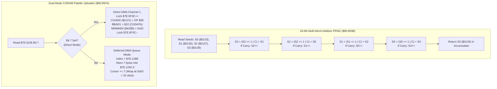

# Core Hardware Utilities: 64-Bit PRNG, Joypad Acknowledge & Dual-Mode CGRAM DMA ($80:8597 – $80:864F)

> **ROM Bank**: `$80` (`$80:8597` – `$80:864F`)  
> **Source Module**: `engine-core/hardware-dma-and-prng.c` / `engine-core/hardware-dma-and-prng.h`  
> **Recomp Symbols**: `func_C08597_M0X0`, `random_number_generator_M0X0`, `func_C085D8_M0X0`, `func_C085FA_M0X0`  
> **Confirmed Knowledge**: `rom/808597.md`, `rom/80859b.md`, `rom/8085d8.md`, `rom/8085fa.md`, `rom/808650.md`  
> **Core Subsystems**: 64-Bit Multi-Word Fibonacci/Galois PRNG, Controller Button Edge Clear (`TRB $0104`), Dual-Mode CGRAM Palette Transfer (Direct PPU vs 32-Slot Deferred DMA Queue)  

---

## 1. Subsystem Architecture & Overview

Bank `$80` contains the central engine dispatcher and hardware coordination primitives that bridge CPU gameplay logic with SNES PPU / DMA hardware:

```
+--------------------------------------------------------------------------------------------------+
|                            WRAM Bank $7E Hardware State & Queue Layout                           |
+--------------------------------------------------------------------------------------------------+
| $7E:0104             (2 bytes)  : Controller 1 Edge Buttons (Newly pressed on current frame)     |
| $7E:0106             (2 bytes)  : Input Filter & DMA Dispatch Mode Flags (Bit 7 = Direct DMA)    |
| $7E:0128             (3 bytes)  : NMI Dispatch Vector Address (24-bit pointer to frame hook)     |
| $7E:0133             (2 bytes)  : Master PRNG Seed Word 0 (Primary output returned in Acc)       |
| $7E:0135             (2 bytes)  : Master PRNG Seed Word 1                                        |
| $7E:0137             (2 bytes)  : Master PRNG Seed Word 2                                        |
| $7E:0139             (2 bytes)  : Master PRNG Seed Word 3                                        |
| $7E:0F3A             (2 bytes)  : VRAM DMA Lock / Active Transfer Counter                        |
| $7E:0F3C             (2 bytes)  : CGRAM DMA Lock / Active Transfer Counter                       |
| $7E:128E             (2 bytes)  : CGRAM DMA Deferred Queue Cursor (Stride 7, wraps at 0x00E0)   |
| $7E:1292..$7E:1371   (224 bytes): CGRAM DMA 32-Slot Deferred Queue (7 bytes per transfer entry) |
+--------------------------------------------------------------------------------------------------+
```



---

## 2. Disassembly & Instruction-Level Walkthrough

### Part 1: Joypad Button Edge Clear (`$80:8597` – `$80:859A`)
> **Interactive 65816 Assembly**:
> Centralized comments infused at runtime.
> [View in VFS: soe://rom/code/808597](soe://rom/code/808597?asm=1&c=0)


### Part 2: Master 64-Bit PRNG Engine (`$80:859B` – `$80:85D7`)
> **Interactive 65816 Assembly**:
> Centralized comments infused at runtime.
> [View in VFS: soe://rom/code/808597](soe://rom/code/808597?asm=1&c=0)


### Part 3: Synchronized Frame Wait & Input Setup (`$80:85D8` – `$80:85EC`)
> **Interactive 65816 Assembly**:
> Centralized comments infused at runtime.
> [View in VFS: soe://rom/code/808597](soe://rom/code/808597?asm=1&c=0)


### Part 4: Dual-Mode CGRAM Palette Uploader (`$80:85FA` – `$80:864F`)
> **Interactive 65816 Assembly**:
> Centralized comments infused at runtime.
> [View in VFS: soe://rom/code/808597](soe://rom/code/808597?asm=1&c=0)


---

## 3. Clean C Decompilation

> **Reconstructed C Decompilation**:
> Source moved to [`reconstructed-c/80/808597_hardware_dma_and_prng.c`](../../../reconstructed-c/80/808597_hardware_dma_and_prng.c).
> [View in VFS: soe://rom/code/808597](soe://rom/code/808597?c=1&asm=0)


---

## 4. Architectural Analysis & Implications

1. **Deterministic Pseudo-Random Sequence**:
   Because the PRNG mixes all four 16-bit words sequentially with cross-word carries, small variations in hardware timing or player input lead to rapid entropy diffusion across the entire 64-bit state space.
2. **Dual-Mode DMA Safety**:
   Palette transfers can occur either synchronously during setup (when `$0106` bit 7 is set) or safely amortized across VBLANK intervals via the 32-entry queue at `$7E:1292`. This prevents tearing or PPU bus contention during active raster scan.
