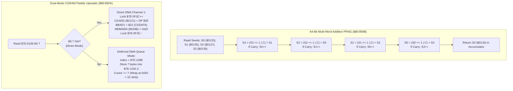

# Core Hardware Utilities: 64-Bit PRNG, Joypad Acknowledge & Dual-Mode CGRAM DMA ($80:8597 – $80:864F)

> **ROM Bank**: `$80` (`$80:8597` – `$80:864F`)  
> **Source Module**: `engine-core/hardware-dma-and-prng.c` / `engine-core/hardware-dma-and-prng.h`  
> **Recomp Symbols**: `func_C08597_M0X0`, `random_number_generator_M0X0`, `func_C085D8_M0X0`, `func_C085FA_M0X0`  
> **Confirmed Knowledge**: `rom/808597.md`, `rom/80859b.md`, `rom/8085d8.md`, `rom/8085fa.md`, `rom/808650.md`  
> **Core Subsystems**: 64-Bit Multi-Word Fibonacci/Galois PRNG, Controller Button Edge Clear (`TRB $0104`), Dual-Mode CGRAM Palette Transfer (Direct PPU vs 32-Slot Deferred DMA Queue)  

---

## 1. Subsystem Architecture & Overview

Bank `$80` contains the central engine dispatcher and hardware coordination primitives that bridge CPU gameplay logic with SNES PPU / DMA hardware:

```
+--------------------------------------------------------------------------------------------------+
|                            WRAM Bank $7E Hardware State & Queue Layout                           |
+--------------------------------------------------------------------------------------------------+
| $7E:0104             (2 bytes)  : Controller 1 Edge Buttons (Newly pressed on current frame)     |
| $7E:0106             (2 bytes)  : Input Filter & DMA Dispatch Mode Flags (Bit 7 = Direct DMA)    |
| $7E:0128             (3 bytes)  : NMI Dispatch Vector Address (24-bit pointer to frame hook)     |
| $7E:0133             (2 bytes)  : Master PRNG Seed Word 0 (Primary output returned in Acc)       |
| $7E:0135             (2 bytes)  : Master PRNG Seed Word 1                                        |
| $7E:0137             (2 bytes)  : Master PRNG Seed Word 2                                        |
| $7E:0139             (2 bytes)  : Master PRNG Seed Word 3                                        |
| $7E:0F3A             (2 bytes)  : VRAM DMA Lock / Active Transfer Counter                        |
| $7E:0F3C             (2 bytes)  : CGRAM DMA Lock / Active Transfer Counter                       |
| $7E:128E             (2 bytes)  : CGRAM DMA Deferred Queue Cursor (Stride 7, wraps at 0x00E0)   |
| $7E:1292..$7E:1371   (224 bytes): CGRAM DMA 32-Slot Deferred Queue (7 bytes per transfer entry) |
+--------------------------------------------------------------------------------------------------+
```



---

## 2. Disassembly & Instruction-Level Walkthrough

### Part 1: Joypad Button Edge Clear (`$80:8597` – `$80:859A`)
```assembly
; ==============================================================================
; joypad_acknowledge_or_clear_buttons ($80:8597 - $80:859A)
; Atomically tests and resets specified button bits in $7E:0104.
; ==============================================================================
$80:8597 1C 04 01    TRB $0104       ; Test and Reset Bits in $7E:0104 against Accumulator
$80:859A 6B          RTL             ; Return long (Z flag set if all tested bits were 0)
```

### Part 2: Master 64-Bit PRNG Engine (`$80:859B` – `$80:85D7`)
```assembly
; ==============================================================================
; random_number_generator ($80:859B - $80:85D7)
; 64-bit multi-word Galois/Fibonacci additive shift PRNG.
; ==============================================================================
$80:859B AD 39 01    LDA $0139       ; Load Seed Word 3
$80:859E 2A          ROL A           ; Rotate left into Carry
$80:859F 90 03       BCC $85A4       ; If no overflow, skip compensation
$80:85A1 EE 37 01    INC $0137       ; Cross-seed feedback: Increment Seed Word 2
$80:85A4 6D 35 01    ADC $0135       ; Add Seed Word 1 with Carry
$80:85A7 8D 39 01    STA $0139       ; Store updated Seed Word 3

$80:85AA AD 37 01    LDA $0137       ; Load Seed Word 2
$80:85AD 2A          ROL A           ; Rotate left into Carry
$80:85AE 90 03       BCC $85B3
$80:85B0 EE 35 01    INC $0135       ; Cross-seed feedback: Increment Seed Word 1
$80:85B3 6D 33 01    ADC $0133       ; Add Seed Word 0 with Carry
$80:85B6 8D 37 01    STA $0137       ; Store updated Seed Word 2

$80:85B9 AD 35 01    LDA $0135       ; Load Seed Word 1
$80:85BC 2A          ROL A           ; Rotate left into Carry
$80:85BD 90 03       BCC $85C2
$80:85BF EE 33 01    INC $0133       ; Cross-seed feedback: Increment Seed Word 0
$80:85C2 6D 37 01    ADC $0137       ; Add Seed Word 2 with Carry
$80:85C5 8D 35 01    STA $0135       ; Store updated Seed Word 1

$80:85C8 AD 33 01    LDA $0133       ; Load Seed Word 0
$80:85CB 2A          ROL A           ; Rotate left into Carry
$80:85CC 90 03       BCC $85D1
$80:85CE EE 39 01    INC $0139       ; Cross-seed feedback: Increment Seed Word 3
$80:85D1 6D 39 01    ADC $0139       ; Add Seed Word 3 with Carry
$80:85D4 8D 33 01    STA $0133       ; Store updated Seed Word 0
$80:85D7 6B          RTL             ; Return random 16-bit integer in Accumulator
```

### Part 3: Synchronized Frame Wait & Input Setup (`$80:85D8` – `$80:85EC`)
```assembly
; ==============================================================================
; wait_for_frame_and_prep_input_filter ($80:85D8 - $80:85EC)
; Suspends execution across 2 frames to cleanly engage input filtering.
; ==============================================================================
$80:85D8 22 8C 85 80 JSL $80858C     ; Frame wait 1: spin until NMI advances $0100
$80:85DC 22 7F 85 80 JSL $80857F     ; Initialize NMI vector at $0128
$80:85E0 A9 8F 00    LDA #$008F      ; Standard input enable mask
$80:85E3 8D 06 01    STA $0106       ; Store input filter mask into $7E:0106
$80:85E6 22 8C 85 80 JSL $80858C     ; Frame wait 2: spin until next VBLANK
$80:85EA 64 72       STZ $72         ; Clear scratch counter DP $72
$80:85EC 6B          RTL             ; Return to caller
```

### Part 4: Dual-Mode CGRAM Palette Uploader (`$80:85FA` – `$80:864F`)
```assembly
; ==============================================================================
; cgram_palette_dma_enqueue_or_immediate ($80:85FA - $80:864F)
; Uploads palette data directly via DMA1 or enqueues it for deferred VBLANK.
; ==============================================================================
$80:85FA E2 20       SEP #$20        ; 8-bit Accumulator
$80:85FC AD 06 01    LDA $0106       ; Test DMA control flag
$80:85FF 10 26       BPL $8627       ; If bit 7 clear, branch to deferred queue mode

; Direct DMA Upload:
$80:8601 EE 3C 0F    INC $0F3C       ; Acquire CGRAM lock $7E:0F3C
$80:8604 A5 2E       LDA $2E         ; CGRAM start color index
$80:8606 8D 21 21    STA $2121       ; Write PPU CGADD ($2121)
$80:8609 8E 15 43    STX $4315       ; Set DMA1 byte count from X
$80:860C A6 26       LDX $26         ; DMA1 source address lower 16 bits
$80:860E 8E 12 43    STX $4312       ; Set DMA1 source address (A1T1)
$80:8611 A5 28       LDA $28         ; DMA1 source bank
$80:8613 8D 14 43    STA $4314       ; Set DMA1 source bank (A1B1)
$80:8616 A2 00 22    LDX #$2200      ; DMAP1 = 0x00, BBAD1 = 0x22 (CGDATA $2122)
$80:8619 8E 10 43    STX $4310       ; Set DMA1 mode and destination
$80:861C A9 02       LDA #$02        ; Bit 1 = DMA Channel 1
$80:861E 8D 0B 42    STA $420B       ; Trigger hardware DMA via MDMAEN
$80:8621 CE 3C 0F    DEC $0F3C       ; Release CGRAM lock $7E:0F3C
$80:8624 C2 30       REP #$30        ; Restore 16-bit Accumulator/Index
$80:8626 6B          RTL

; Deferred Queue Mode:
$80:8627 86 12       STX $12         ; Save byte count into scratch DP $12
$80:8629 AE 8E 12    LDX $128E       ; Load current queue cursor
$80:862C A5 28       LDA $28         ; Source bank
$80:862E 9D 94 12    STA $1294,X     ; Write to queue entry +$02
$80:8631 C2 31       REP #$31        ; 16-bit A/X, Carry clear
$80:8633 A5 2E       LDA $2E         ; Destination CGRAM address
$80:8635 9D 95 12    STA $1295,X     ; Write to queue entry +$03
$80:8638 A5 26       LDA $26         ; Source address
$80:863A 9D 92 12    STA $1292,X     ; Write to queue entry +$00
$80:863D A5 12       LDA $12         ; Byte count
$80:863F 9D 97 12    STA $1297,X     ; Write to queue entry +$05
$80:8642 8A          TXA             ; Advance queue cursor
$80:8643 69 07 00    ADC #$0007      ; Stride = 7 bytes
$80:8646 C9 E0 00    CMP #$00E0      ; Queue limit: 32 entries * 7 = 224 bytes
$80:8649 30 01       BMI $864C       ; If within capacity, keep cursor
$80:864B 0B          TCD             ; Reset cursor to 0
$80:864C 8D 8E 12    STA $128E       ; Update queue cursor $7E:128E
$80:864F 6B          RTL
```

---

## 3. Clean C Decompilation

```c
#include <stdint.h>
#include <stdbool.h>

#define CGRAM_QUEUE_CAPACITY 32
#define CGRAM_ENTRY_STRIDE   7
#define CGRAM_QUEUE_BYTES    (CGRAM_QUEUE_CAPACITY * CGRAM_ENTRY_STRIDE)

/**
 * Packed 7-byte deferred CGRAM transfer descriptor.
 */
typedef struct __attribute__((packed)) {
    uint16_t src_addr;    /* +$00: 16-bit source address in bank */
    uint8_t  src_bank;    /* +$02: 8-bit source bank */
    uint16_t cgram_dest;  /* +$03: Target CGRAM color index (CGADD) */
    uint16_t byte_count;  /* +$05: Number of bytes to transfer */
} CgramQueueEntry;

typedef struct {
    uint16_t joypad_edge_buttons;  /* $7E:0104 */
    uint16_t joypad_filter_flags;  /* $7E:0106 */
    uint16_t prng_seeds[4];        /* $7E:0133, $7E:0135, $7E:0137, $7E:0139 */
    uint16_t cgram_lock;           /* $7E:0F3C */
    uint16_t cgram_queue_cursor;   /* $7E:128E */
    uint8_t  cgram_queue[CGRAM_QUEUE_BYTES]; /* $7E:1292..$7E:1371 */
} HardwareState;

extern HardwareState g_hw;

/**
 * PPU / DMA mock hardware registers.
 */
extern void snes_write_cgadd(uint8_t color_index);
extern void snes_dma_channel1_cgram(uint32_t src_addr24, uint16_t count);
extern void wait_for_frame(void);
extern void setup_nmi_vector(void);

/**
 * Atomically tests and acknowledges newly pressed joypad buttons.
 */
uint16_t joypad_acknowledge_or_clear_buttons(uint16_t mask) {
    uint16_t previous = g_hw.joypad_edge_buttons;
    g_hw.joypad_edge_buttons &= ~mask;
    return (previous & mask);
}

/**
 * Master Secret of Evermore 64-bit Pseudo-Random Number Generator.
 *
 * Employs a 4-word cross-coupled Fibonacci / Galois additive feedback shift
 * register. Returns the updated Seed 0 word in the Accumulator.
 */
uint16_t random_number_generator(void) {
    uint32_t acc;
    uint8_t carry = 0;

    /* Step 1: Rotate Seed 3 and add Seed 1 */
    carry = (g_hw.prng_seeds[3] & 0x8000) != 0;
    acc = ((uint32_t)g_hw.prng_seeds[3] << 1) & 0xFFFF;
    if (carry) {
        g_hw.prng_seeds[2]++;
    }
    acc += g_hw.prng_seeds[1] + carry;
    carry = (acc > 0xFFFF);
    g_hw.prng_seeds[3] = (uint16_t)acc;

    /* Step 2: Rotate Seed 2 and add Seed 0 */
    carry = (g_hw.prng_seeds[2] & 0x8000) != 0;
    acc = ((uint32_t)g_hw.prng_seeds[2] << 1) & 0xFFFF;
    if (carry) {
        g_hw.prng_seeds[1]++;
    }
    acc += g_hw.prng_seeds[0] + carry;
    carry = (acc > 0xFFFF);
    g_hw.prng_seeds[2] = (uint16_t)acc;

    /* Step 3: Rotate Seed 1 and add Seed 2 */
    carry = (g_hw.prng_seeds[1] & 0x8000) != 0;
    acc = ((uint32_t)g_hw.prng_seeds[1] << 1) & 0xFFFF;
    if (carry) {
        g_hw.prng_seeds[0]++;
    }
    acc += g_hw.prng_seeds[2] + carry;
    carry = (acc > 0xFFFF);
    g_hw.prng_seeds[1] = (uint16_t)acc;

    /* Step 4: Rotate Seed 0 and add Seed 3 */
    carry = (g_hw.prng_seeds[0] & 0x8000) != 0;
    acc = ((uint32_t)g_hw.prng_seeds[0] << 1) & 0xFFFF;
    if (carry) {
        g_hw.prng_seeds[3]++;
    }
    acc += g_hw.prng_seeds[3] + carry;
    carry = (acc > 0xFFFF);
    g_hw.prng_seeds[0] = (uint16_t)acc;

    return g_hw.prng_seeds[0];
}

/**
 * Suspends thread across two vertical blanking intervals to cleanly apply
 * joypad input filter configuration.
 */
void wait_for_frame_and_prep_input_filter(void) {
    wait_for_frame();
    setup_nmi_vector();
    g_hw.joypad_filter_flags = 0x008F;
    wait_for_frame();
}

/**
 * Uploads a palette block to CGRAM via direct DMA Channel 1, or queues it
 * into the 32-slot deferred ring buffer for execution during VBLANK.
 */
void cgram_palette_dma_enqueue_or_immediate(uint16_t src_addr, uint8_t src_bank,
                                            uint16_t cgram_dest, uint16_t byte_count) {
    if (g_hw.joypad_filter_flags & 0x0080) {
        /* Direct PPU DMA Channel 1 Transfer */
        g_hw.cgram_lock++;
        snes_write_cgadd((uint8_t)cgram_dest);
        snes_dma_channel1_cgram(((uint32_t)src_bank << 16) | src_addr, byte_count);
        g_hw.cgram_lock--;
    } else {
        /* Deferred Queue Mode */
        uint16_t cursor = g_hw.cgram_queue_cursor;
        CgramQueueEntry *entry = (CgramQueueEntry *)&g_hw.cgram_queue[cursor];

        entry->src_addr = src_addr;
        entry->src_bank = src_bank;
        entry->cgram_dest = cgram_dest;
        entry->byte_count = byte_count;

        cursor += CGRAM_ENTRY_STRIDE;
        if (cursor >= CGRAM_QUEUE_BYTES) {
            cursor = 0;
        }
        g_hw.cgram_queue_cursor = cursor;
    }
}
```

---

## 4. Architectural Analysis & Implications

1. **Deterministic Pseudo-Random Sequence**:
   Because the PRNG mixes all four 16-bit words sequentially with cross-word carries, small variations in hardware timing or player input lead to rapid entropy diffusion across the entire 64-bit state space.
2. **Dual-Mode DMA Safety**:
   Palette transfers can occur either synchronously during setup (when `$0106` bit 7 is set) or safely amortized across VBLANK intervals via the 32-entry queue at `$7E:1292`. This prevents tearing or PPU bus contention during active raster scan.
