# Hardware Utilities: Typematic Auto-Repeat, Hardware Integer-to-Decimal & VMAIN DMA

> **ROM Bank**: `$80` (`$80:86B2` – `$80:885D`)  
> **Source Module**: `engine-core/hardware-utilities.c` / `engine-core/hardware-utilities.h`  
> **Recomp Symbols**: `func_C086B2`, `func_C0870C`, `func_C08838`  
> **Confirmed Knowledge**: `rom/8086b2.md`, `rom/80870c.md`, `rom/808838.md`  
> **Hardware Systems**: SNES PPU VMAIN (`$2115`), VMADD (`$2116`), Hardware 16/8 Divider (`$4204`/`$4206`), DMA Channel 1 (`$4310`–`$4315`, `$420B`)  

---

## 1. Subsystem Architecture & Overview

Bank `$80` houses the Secret of Evermore engine's fundamental hardware bridge utilities:

1. **VMAIN-Configured VRAM DMA Uploader (`$80:86B2` – `$80:86E2`)**:
   An extended variant of `vram_dma_upload_tile_block` (`$80:8650`) that explicitly sets the PPU Video Port Control Register `VMAIN` (`$2115`) from register `Y`, enabling vertical tile streaming or custom address increment steps during DMA Channel 1 transfers while tracking VRAM locking via `$7E:0F3A`.

2. **Hardware 16-Bit Integer-to-Decimal ASCII / Digit Formatter (`$80:870C` – `$80:8756`)**:
   High-efficiency binary-to-decimal digit extractor utilizing the SNES hardware math coprocessor (`$4204`/`$4206`/`$4214`/`$4216`). It determines the exact magnitude of integer $A$ ($< 10$, $< 100$, $< 1{,}000$, $< 10{,}000$, or up to $65{,}535$), performs successive modulo/division steps by 10, and writes the resulting decimal digit stream into Direct Page `$02,X` terminated with `$FF`. Used across damage popups, item quantities, gold balances, and menu stat cards.

3. **Joypad Button Typematic Auto-Repeat Engine (`$80:8838` – `$80:885D`)**:
   Universal input auto-repeat processor for ring menus, shop item lists, and text box scrolling. Enforces an initial hold threshold (e.g., 24 frames / 400 ms) before switching to rapid sustained repeating (e.g., every 6 frames / 100 ms).

```mermaid
flowchart TD
    subgraph Typematic["Joypad Button Typematic Auto-Repeat ($80:8838)"]
        InButtons["Input Button Word A"] --> ZeroCheck{"A == 0?"}
        ZeroCheck -->|"Yes"| ResetInit["Reset to Initial Delay ($7E:0347)\nSave Mask to $7E:0345"]
        ZeroCheck -->|"No"| MatchCheck{"A & $7E:0345 == A?"}
        MatchCheck -->|"No (New Buttons)"| ResetInit
        MatchCheck -->|"Yes (Same Buttons Held)"| DecTimer["Decrement Delay Timer ($7E:0343)"]
        DecTimer --> TimerZero{"Timer == 0?"}
        TimerZero -->|"No"| Suppress["Return 0 (Suppress Repeat)"]
        TimerZero -->|"Yes"| ReloadSustained["Reload Sustained Rate ($7E:0349)\nReturn Button Word A (Fire Action)"]
    end

    subgraph Formatter["Hardware 16-Bit Integer-to-Decimal ($80:870C)"]
        NumIn["Input 16-bit Integer A"] --> MagCheck{"Determine Magnitude:\n< 10, < 100, < 1000, < 10000"}
        MagCheck --> AllocDigits["Set Digit Count X in [1..5]\nWrite Sentinel $FF at End"]
        AllocDigits --> DivLoop["Write Dividend to $4204\nWrite Divisor 10 to $4206"]
        DivLoop --> Extract["Read Remainder ($4216) -> Store in DP $02,X\nRead Quotient ($4214) -> Next Dividend"]
        Extract --> LoopTest{"More Digits?"}
        LoopTest -->|"Yes"| DivLoop
        LoopTest -->|"No"| ReturnDigits["Return Digits in DP $02"]
    end
```

---

## 2. Clean C Decompilation

> **Reconstructed C Decompilation**:
> Source moved to [`reconstructed-c/80/8086B2_hardware_utilities.c`](../../../reconstructed-c/80/8086B2_hardware_utilities.c).
> [View in VFS: soe://rom/code/8086B2](soe://rom/code/8086B2?c=1&asm=0)

---

## 3. Annotated 65c816 Assembly

> **Interactive 65816 Assembly**:
> Centralized comments infused at runtime.
> [View in VFS: soe://rom/code/8086B2](soe://rom/code/8086B2?asm=1&c=0)

---

## 4. Architectural Invariants & Verification

1. **Hardware Math Latency Precision**: In `format_16bit_integer_to_decimal_digits`, the 4 consecutive `NOP` instructions ($4 \times 2 = 8$ cycles) combined with instruction fetching ($8$ cycles) precisely fulfill the 16 master cycle latency requirement of the SNES 65c816 hardware divider (`$4204`/`$4206`) before reading quotient `$4214` and remainder `$4216`.
2. **Reentrancy & Buffer Safety**: The digit buffer in Direct Page `$02` is isolated per call frame. The sentinel `$FF` allows string renderers like `dialogue_format_and_append_line` and HUD stat printers to iterate without fixed-width string allocations.
3. **Smooth Typematic Response**: The separation of `$7E:0347` (initial delay, typically 24 frames / 400 ms) and `$7E:0349` (sustained speed, typically 6 frames / 100 ms) delivers standard UI cursor responsiveness across the Ring Menu and Shop catalogs.
