# Hardware Utilities: Typematic Auto-Repeat, Hardware Integer-to-Decimal & VMAIN DMA

> **ROM Bank**: `$80` (`$80:86B2` – `$80:885D`)  
> **Source Module**: `engine-core/hardware-utilities.c` / `engine-core/hardware-utilities.h`  
> **Recomp Symbols**: `func_C086B2`, `func_C0870C`, `func_C08838`  
> **Confirmed Knowledge**: `rom/8086b2.md`, `rom/80870c.md`, `rom/808838.md`  
> **Hardware Systems**: SNES PPU VMAIN (`$2115`), VMADD (`$2116`), Hardware 16/8 Divider (`$4204`/`$4206`), DMA Channel 1 (`$4310`–`$4315`, `$420B`)  

---

## 1. Subsystem Architecture & Overview

Bank `$80` houses the Secret of Evermore engine's fundamental hardware bridge utilities:

1. **VMAIN-Configured VRAM DMA Uploader (`$80:86B2` – `$80:86E2`)**:
   An extended variant of `vram_dma_upload_tile_block` (`$80:8650`) that explicitly sets the PPU Video Port Control Register `VMAIN` (`$2115`) from register `Y`, enabling vertical tile streaming or custom address increment steps during DMA Channel 1 transfers while tracking VRAM locking via `$7E:0F3A`.

2. **Hardware 16-Bit Integer-to-Decimal ASCII / Digit Formatter (`$80:870C` – `$80:8756`)**:
   High-efficiency binary-to-decimal digit extractor utilizing the SNES hardware math coprocessor (`$4204`/`$4206`/`$4214`/`$4216`). It determines the exact magnitude of integer $A$ ($< 10$, $< 100$, $< 1{,}000$, $< 10{,}000$, or up to $65{,}535$), performs successive modulo/division steps by 10, and writes the resulting decimal digit stream into Direct Page `$02,X` terminated with `$FF`. Used across damage popups, item quantities, gold balances, and menu stat cards.

3. **Joypad Button Typematic Auto-Repeat Engine (`$80:8838` – `$80:885D`)**:
   Universal input auto-repeat processor for ring menus, shop item lists, and text box scrolling. Enforces an initial hold threshold (e.g., 24 frames / 400 ms) before switching to rapid sustained repeating (e.g., every 6 frames / 100 ms).

```mermaid
flowchart TD
    subgraph Typematic["Joypad Button Typematic Auto-Repeat ($80:8838)"]
        InButtons["Input Button Word A"] --> ZeroCheck{"A == 0?"}
        ZeroCheck -->|"Yes"| ResetInit["Reset to Initial Delay ($7E:0347)\nSave Mask to $7E:0345"]
        ZeroCheck -->|"No"| MatchCheck{"A & $7E:0345 == A?"}
        MatchCheck -->|"No (New Buttons)"| ResetInit
        MatchCheck -->|"Yes (Same Buttons Held)"| DecTimer["Decrement Delay Timer ($7E:0343)"]
        DecTimer --> TimerZero{"Timer == 0?"}
        TimerZero -->|"No"| Suppress["Return 0 (Suppress Repeat)"]
        TimerZero -->|"Yes"| ReloadSustained["Reload Sustained Rate ($7E:0349)\nReturn Button Word A (Fire Action)"]
    end

    subgraph Formatter["Hardware 16-Bit Integer-to-Decimal ($80:870C)"]
        NumIn["Input 16-bit Integer A"] --> MagCheck{"Determine Magnitude:\n< 10, < 100, < 1000, < 10000"}
        MagCheck --> AllocDigits["Set Digit Count X in [1..5]\nWrite Sentinel $FF at End"]
        AllocDigits --> DivLoop["Write Dividend to $4204\nWrite Divisor 10 to $4206"]
        DivLoop --> Extract["Read Remainder ($4216) -> Store in DP $02,X\nRead Quotient ($4214) -> Next Dividend"]
        Extract --> LoopTest{"More Digits?"}
        LoopTest -->|"Yes"| DivLoop
        LoopTest -->|"No"| ReturnDigits["Return Digits in DP $02"]
    end
```



---

## 2. Clean C Decompilation

```c
#include "engine-core/hardware-utilities.h"
#include "engine-core/vram-dma.h"

// ----------------------------------------------------------------------------
// WRAM Global State & Hardware Registers
// ----------------------------------------------------------------------------
extern uint8_t  g_vram_lock_counter;            // $7E:0F3A (VRAM DMA in progress)
extern uint8_t  g_input_filter_flags;           // $7E:0106 (Gating & input enable)

// Typematic auto-repeat state
extern uint16_t g_joypad_repeat_timer;          // $7E:0343 (Remaining frames)
extern uint16_t g_joypad_held_mask;             // $7E:0345 (Currently held buttons)
extern uint16_t g_joypad_initial_repeat_delay;  // $7E:0347 (Default initial hold, e.g. 24)
extern uint16_t g_joypad_sustained_repeat_rate; // $7E:0349 (Sustained repeat rate, e.g. 6)

// ----------------------------------------------------------------------------
// vram_dma_upload_tile_block_with_vmain ($80:86B2)
// Streams a data block to VRAM with custom VMAIN increment mode
// ----------------------------------------------------------------------------
void vram_dma_upload_tile_block_with_vmain(const uint8_t *source_data, 
                                           uint16_t vram_word_addr, 
                                           uint16_t byte_count, 
                                           uint8_t vmain_mode) {
    // If input / video updating is gated ($7E:0106 bit 7), perform full stack backup
    // Otherwise configure VMAIN and fire DMA Channel 1
    g_vram_lock_counter++;

    // Set VMAIN address increment mode ($2115)
    snes_write_reg(0x2115, vmain_mode);

    // Set destination VRAM word address ($2116)
    snes_write_reg16(0x2116, vram_word_addr);

    // Configure DMA Channel 1 ($4310)
    // 0x1801 = 2-register write (PPU $2118 / $2119 VRAM Data)
    snes_write_reg16(0x4310, 0x1801);
    snes_write_reg24(0x4312, (uint32_t)source_data);
    snes_write_reg16(0x4315, byte_count);

    // Trigger DMA Channel 1 ($420B bit 1)
    snes_write_reg(0x420B, 0x02);

    g_vram_lock_counter--;
}

// ----------------------------------------------------------------------------
// format_16bit_integer_to_decimal_digits ($80:870C)
// Decomposes a 16-bit integer into individual BCD digits using SNES divider
// Output written to out_digits array, terminated with 0xFF
// ----------------------------------------------------------------------------
uint8_t format_16bit_integer_to_decimal_digits(uint16_t value, uint8_t *out_digits) {
    uint8_t digit_count;

    // Determine magnitude
    if (value < 10) {
        digit_count = 1;
    } else if (value < 100) {
        digit_count = 2;
    } else if (value < 1000) {
        digit_count = 3;
    } else if (value < 10000) {
        digit_count = 4;
    } else {
        digit_count = 5;
    }

    // Write end-of-string sentinel (0xFF)
    out_digits[digit_count] = 0xFF;

    // Extract digits in reverse order using hardware divider ($4204 / $4206)
    int8_t idx = digit_count - 1;
    uint16_t quotient = value;

    while (idx >= 0) {
        // SNES hardware divider: 16-bit dividend / 8-bit divisor
        uint8_t remainder = quotient % 10;
        quotient = quotient / 10;

        out_digits[idx] = remainder;
        idx--;
    }

    return digit_count;
}

// ----------------------------------------------------------------------------
// joypad_button_typematic_repeat ($80:8838)
// Processes joypad buttons with typematic initial delay and repeat frequency
// Returns button mask to execute on this frame, or 0 if suppressed
// ----------------------------------------------------------------------------
uint16_t joypad_button_typematic_repeat(uint16_t current_buttons) {
    // If no buttons held, reset repeat state
    if (current_buttons == 0) {
        g_joypad_held_mask = 0;
        g_joypad_repeat_timer = g_joypad_initial_repeat_delay;
        return 0;
    }

    // Check if exactly the same buttons are held as previous frame
    if ((current_buttons & g_joypad_held_mask) != 0) {
        // Same buttons held: decrement repeat countdown
        g_joypad_repeat_timer--;
        if (g_joypad_repeat_timer == 0) {
            // Repeat timer triggered: reload sustained repeat rate
            g_joypad_repeat_timer = g_joypad_sustained_repeat_rate;
            return current_buttons; // Fire repeat event!
        }

        // Timer still running: suppress action
        return 0;
    }

    // New button press: latch held mask and set initial repeat delay
    g_joypad_held_mask = current_buttons;
    g_joypad_repeat_timer = g_joypad_initial_repeat_delay;

    return current_buttons; // Fire immediate press event!
}
```

---

## 3. Annotated 65c816 Assembly

```assembly
; ==============================================================================
; vram_dma_upload_tile_block_with_vmain ($80:86B2)
; Uploads memory block to VRAM with specified VMAIN mode
; Arguments: A = DP $2E (VRAM dest), X = length, Y = VMAIN mode
; ==============================================================================
$80:86B2  E2 20       SEP #$20          ; 8-bit A
$80:86B4  AD 06 01    LDA $0106         ; Check gating / filter flag ($7E:0106)
$80:86B7  10 2A       BPL L_86E3        ; If bit 7 clear, take slow path with stack frame
$80:86B9  EE 3A 0F    INC $0F3A         ; Increment VRAM lock counter ($7E:0F3A)
$80:86BC  98          TYA               ; A = VMAIN mode
$80:86BD  8D 15 21    STA $2115         ; PPU VMAIN = mode
$80:86C0  8E 15 43    STX $4315         ; DMA Channel 1 size = X
$80:86C3  A6 2E       LDX $2E           ; X = destination VRAM word address
$80:86C5  8E 16 21    STX $2116         ; PPU VMADD = X
$80:86C8  A6 26       LDX $26           ; X = source pointer low word
$80:86CA  8E 12 43    STX $4312         ; DMA Channel 1 source addr = X
$80:86CD  A5 28       LDA $28           ; A = source pointer bank
$80:86CF  8D 14 43    STA $4314         ; DMA Channel 1 source bank = A
$80:86D2  A2 01 18    LDX #$1801        ; DMA mode: 2 registers, PPU $2118/$2119
$80:86D5  8E 10 43    STX $4310
$80:86D8  A9 02       LDA #$02          ; Trigger Channel 1
$80:86DA  8D 0B 42    STA $420B         ; MDMAEN = 0x02
$80:86DD  CE 3A 0F    DEC $0F3A         ; Decrement VRAM lock counter
$80:86E0  C2 30       REP #$30          ; 16-bit A, X, Y
$80:86E2  6B          RTL

; ==============================================================================
; format_16bit_integer_to_decimal_digits ($80:870C)
; Arguments: A = 16-bit unsigned number
; Output: DP $02..$07 = BCD digits, terminated by $FF
; ==============================================================================
$80:870C  E2 10       SEP #$10          ; 8-bit X, Y
$80:870E  8B          PHB
$80:870F  A2 80       LDX #$80
$80:8711  DA          PHX
$80:8712  AB          PLB               ; DB = $80
$80:8713  A2 01       LDX #$01          ; X = 1 digit default
$80:8715  C9 0A 00    CMP #$000A
$80:8718  90 13       BCC L_872D        ; A < 10 -> 1 digit
$80:871A  E8          INX               ; X = 2
$80:871B  C9 64 00    CMP #$0064
$80:871E  90 0D       BCC L_872D        ; A < 100 -> 2 digits
$80:8720  E8          INX               ; X = 3
$80:8721  C9 E8 03    CMP #$03E8
$80:8724  90 07       BCC L_872D        ; A < 1000 -> 3 digits
$80:8726  E8          INX               ; X = 4
$80:8727  C9 10 27    CMP #$2710
$80:872A  90 01       BCC L_872D        ; A < 10000 -> 4 digits
$80:872C  E8          INX               ; X = 5 digits
L_872D:
$80:872D  DA          PHX               ; Push digit count
$80:872E  48          PHA               ; Push input number
$80:872F  A0 FF       LDY #$FF
$80:8731  94 02       STY $02,X         ; Write $FF terminator at end of digit buffer
$80:8733  CA          DEX               ; Move cursor to last digit slot

; Division extraction loop
L_8734:
$80:8734  68          PLA               ; A = current dividend
$80:8735  8D 04 42    STA $4204         ; Hardware WRDIVL = dividend
$80:8738  A0 0A       LDY #$0A
$80:873A  8C 06 42    STY $4206         ; Hardware WRDIVB = 10 (Divisor)
$80:873D  EA          NOP
$80:873E  EA          NOP
$80:873F  EA          NOP
$80:8740  EA          NOP               ; Wait 16 machine cycles for division pipeline
$80:8741  AD 14 42    LDA $4214         ; A = Quotient (new dividend)
$80:8744  48          PHA               ; Save quotient on stack
$80:8745  AC 16 42    LDY $4216         ; Y = Remainder (Modulo 10)
$80:8748  94 02       STY $02,X         ; Store digit in DP $02,X
$80:874A  CA          DEX               ; Move to previous digit
$80:874B  10 E7       BPL L_8734        ; Repeat until all digits extracted

$80:874D  68          PLA               ; Pop remaining quotient
$80:874E  FA          PLX               ; Restore digit count in X
$80:874F  C2 10       REP #$10          ; 16-bit X, Y
$80:8751  AB          PLB               ; Restore Data Bank
$80:8752  6B          RTL

; ==============================================================================
; joypad_button_typematic_repeat ($80:8838)
; Arguments: A = current joypad button mask
; Returns: A = button mask to execute, or 0 if suppressed
; ==============================================================================
$80:8838  F0 17       BEQ L_8851        ; If A == 0, reset typematic timer
$80:883A  2D 45 03    AND $0345         ; Compare against held buttons ($7E:0345)
$80:883D  F0 12       BEQ L_8851        ; If mismatch, reset repeat timer
$80:883F  CE 43 03    DEC $0343         ; Decrement repeat countdown timer ($7E:0343)
$80:8842  F0 04       BEQ L_8848        ; Expired -> fire typematic repeat!
$80:8844  A9 00 00    LDA #$0000        ; Suppress repeat this frame
$80:8847  6B          RTL

L_8848:
$80:8848  48          PHA               ; Preserve button mask
$80:8849  AD 49 03    LDA $0349         ; Load sustained repeat rate ($7E:0349)
$80:884C  8D 43 03    STA $0343         ; Reload repeat timer
$80:884F  68          PLA               ; Return button mask
$80:8850  6B          RTL

L_8851:
$80:8851  8D 45 03    STA $0345         ; Latch new button mask into $7E:0345
$80:8854  AD 47 03    LDA $0347         ; Load initial hold delay ($7E:0347)
$80:8857  8D 43 03    STA $0343         ; Initialize countdown timer
$80:885A  AD 45 03    LDA $0345         ; Return button mask
$80:885D  6B          RTL
```

---

## 4. Architectural Invariants & Verification

1. **Hardware Math Latency Precision**: In `format_16bit_integer_to_decimal_digits`, the 4 consecutive `NOP` instructions ($4 \times 2 = 8$ cycles) combined with instruction fetching ($8$ cycles) precisely fulfill the 16 master cycle latency requirement of the SNES 65c816 hardware divider (`$4204`/`$4206`) before reading quotient `$4214` and remainder `$4216`.
2. **Reentrancy & Buffer Safety**: The digit buffer in Direct Page `$02` is isolated per call frame. The sentinel `$FF` allows string renderers like `dialogue_format_and_append_line` and HUD stat printers to iterate without fixed-width string allocations.
3. **Smooth Typematic Response**: The separation of `$7E:0347` (initial delay, typically 24 frames / 400 ms) and `$7E:0349` (sustained speed, typically 6 frames / 100 ms) delivers standard UI cursor responsiveness across the Ring Menu and Shop catalogs.
