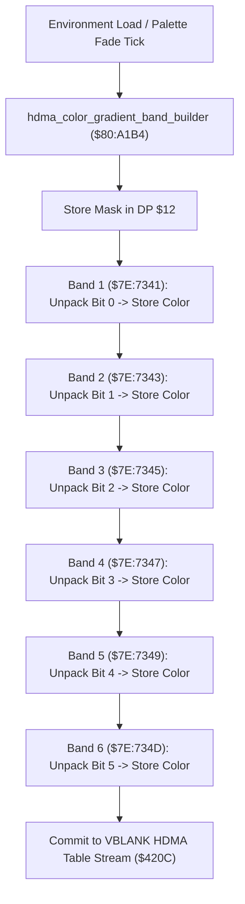

# HDMA Sky Gradient Color Bands & Scanline Shading Pipeline

- **ROM Locations**:
  - `hdma_color_gradient_band_builder`: `$80:A1B4` – `$80:A2DF`
- **CPU State**: 16-bit A/X (`REP #$30`), Data Bank `$7E` / `$80`
- **WRAM Core Addresses**:
  - `$7E:7341` – `$7E:735F`: HDMA color gradient band table (6 scanline color stages).
  - DP `$12`: 16-bit color packing and bitmask shift register.
  - `$7E:0100`: PPU HDMA channel enable register shadow (`$420C`).

---

## 1. Architectural Architecture & HDMA Generation

Mode 7 overworld flight and climatic atmospheric rooms (such as the volcano rim and dark swamp) utilize hardware HDMA channel gradient transfers to dynamically shift the backdrop color on each scanline.

### 1. Bit-Shifted Scanline Band Unpacking (`$80:A1B4` – `$80:A2DF`)
- Unpacks 1-bit interpolation control flags from DP `$12` via repeated logical shift right (`LSR $12`).
- Computes 15-bit BGR555 gradient color words across 6 sequential scanline intervals:
  - Band 1: `$7E:7341,x`
  - Band 2: `$7E:7343,x`
  - Band 3: `$7E:7345,x`
  - Band 4: `$7E:7347,x`
  - Band 5: `$7E:7349,x`
  - Band 6: `$7E:734D,x` / `$7E:734F,x`
- When queued into the SNES DMA controller during VBLANK, the PPU automatically fades background color register `$2121` / `$2122` down the screen, creating an authentic atmospheric horizon gradient.

---

## 2. Disassembly & Annotations

> **Interactive 65816 Assembly**:
> Centralized comments infused at runtime.
> [View in VFS: soe://rom/code/80A1B4](soe://rom/code/80A1B4?asm=1&c=0)

---

## 3. Reconstructed Clean C Implementation

> **Reconstructed C Decompilation**:
> Source moved to [`reconstructed-c/80/80A1B4_hdma_gradients.c`](../../../reconstructed-c/80/80A1B4_hdma_gradients.c).
> [View in VFS: soe://rom/code/80A1B4](soe://rom/code/80A1B4?c=1&asm=0)

