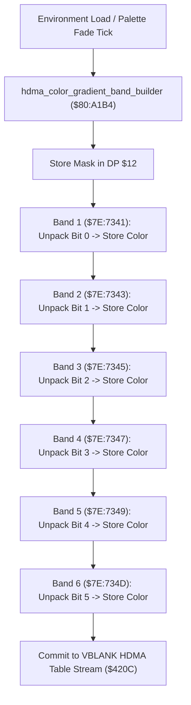

# HDMA Sky Gradient Color Bands & Scanline Shading Pipeline

- **ROM Locations**:
  - `hdma_color_gradient_band_builder`: `$80:A1B4` – `$80:A2DF`
- **CPU State**: 16-bit A/X (`REP #$30`), Data Bank `$7E` / `$80`
- **WRAM Core Addresses**:
  - `$7E:7341` – `$7E:735F`: HDMA color gradient band table (6 scanline color stages).
  - DP `$12`: 16-bit color packing and bitmask shift register.
  - `$7E:0100`: PPU HDMA channel enable register shadow (`$420C`).

---

## 1. Architectural Architecture & HDMA Generation

Mode 7 overworld flight and climatic atmospheric rooms (such as the volcano rim and dark swamp) utilize hardware HDMA channel gradient transfers to dynamically shift the backdrop color on each scanline.



### 1. Bit-Shifted Scanline Band Unpacking (`$80:A1B4` – `$80:A2DF`)
- Unpacks 1-bit interpolation control flags from DP `$12` via repeated logical shift right (`LSR $12`).
- Computes 15-bit BGR555 gradient color words across 6 sequential scanline intervals:
  - Band 1: `$7E:7341,x`
  - Band 2: `$7E:7343,x`
  - Band 3: `$7E:7345,x`
  - Band 4: `$7E:7347,x`
  - Band 5: `$7E:7349,x`
  - Band 6: `$7E:734D,x` / `$7E:734F,x`
- When queued into the SNES DMA controller during VBLANK, the PPU automatically fades background color register `$2121` / `$2122` down the screen, creating an authentic atmospheric horizon gradient.

---

## 2. Disassembly & Annotations

```assembly
; ==============================================================================
; hdma_color_gradient_band_builder ($80:A1B4)
; ==============================================================================
$80A1B4  85 12       STA $12           ; Store gradient control word in DP $12
$80A1B6  46 12       LSR $12           ; Unpack bit 0
$80A1B8  90 0F       BCC $80A1C9
$80A1BA  46 12       LSR $12           ; Unpack bit 1
$80A1BC  90 1F       BCC $80A1DD
$80A1BE  7B          TDC               ; Clear color
$80A1BF  9F 41 73 7E STA $7E7341,x     ; Write Band 1 color word
$80A1C3  9F 43 73 7E STA $7E7343,x     ; Write Band 2 color word
$80A1C7  80 37       BRA $80A200

; Band 3 & 4:
$80A200  46 12       LSR $12           ; Unpack bit 2
$80A202  90 0F       BCC $80A213
$80A204  46 12       LSR $12           ; Unpack bit 3
$80A206  90 1F       BCC $80A227
$80A208  7B          TDC
$80A209  9F 45 73 7E STA $7E7345,x     ; Write Band 3 color word
$80A20D  9F 47 73 7E STA $7E7347,x     ; Write Band 4 color word
$80A211  80 37       BRA $80A24A

; Band 5 & 6:
$80A24A  46 12       LSR $12           ; Unpack bit 4
$80A24C  90 0F       BCC $80A25D
$80A24E  46 12       LSR $12           ; Unpack bit 5
$80A250  90 1F       BCC $80A271
$80A252  7B          TDC
$80A253  9F 49 73 7E STA $7E7349,x     ; Write Band 5 color word
$80A257  9F 4B 73 7E STA $7E734B,x
$80A25B  80 37       BRA $80A294

$80A294  46 12       LSR $12           ; Unpack final segment bits
$80A296  90 0F       BCC $80A2A7
$80A298  46 12       LSR $12
$80A29A  90 1F       BCC $80A2BB
$80A29C  7B          TDC
$80A29D  9F 4D 73 7E STA $7E734D,x     ; Write Band 6 color word
$80A2A1  9F 4F 73 7E STA $7E734F,x
$80A2A5  80 37       BRA $80A2DE

$80A2DE  AB          PLB
$80A2DF  60          RTS
```

---

## 3. Reconstructed Clean C Implementation

```c
#include <stdint.h>
#include <stdbool.h>

extern uint16_t g_hdma_gradient_table[8]; // $7E:7341..$7E:734F

/**
 * Builds the 6-band HDMA sky gradient color table in WRAM.
 * Corresponds to $80:A1B4.
 */
void hdma_color_gradient_band_builder(uint16_t gradient_mask, uint16_t base_color) {
    uint16_t mask = gradient_mask;

    // Process 4 dual-band color segments:
    for (int i = 0; i < 4; i++) {
        bool bit0 = (mask & 0x0001) != 0;
        mask >>= 1;
        bool bit1 = (mask & 0x0001) != 0;
        mask >>= 1;

        uint16_t band_color = 0;
        if (!bit0 && !bit1) {
            band_color = 0x0000; // Black horizon baseline
        } else if (bit0 && !bit1) {
            band_color = base_color >> 1; // 50% shaded gradient
        } else {
            band_color = base_color;      // Full sky illumination
        }

        g_hdma_gradient_table[i * 2]     = band_color;
        g_hdma_gradient_table[i * 2 + 1] = band_color;
    }
}
```
