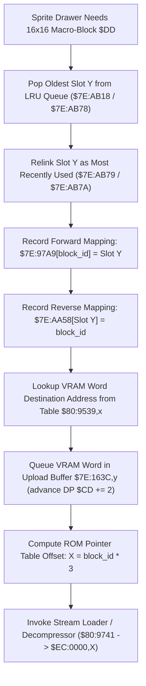

# Dynamic 16x16 OBJ Macro-Tile VRAM Allocator ($80:96FE – $80:9740)

> **Subsystem**: Dynamic Sprite VRAM Cache & 16x16 Macro-Tile Manager  
> **ROM Addresses**: `$80:96FE` (`obj_16x16_tile_allocate`), `$80:971C` (`obj_16x16_map_and_queue_vram`), `$80:9741` (`weather_preset_and_palette_dispatcher`)  
> **Clean C Module**: `engine-core/macro-tile-allocator.c`  
> **Recomp Symbols**: `func_8096FE`  
> **Confidence**: Confirmed  

---

## 1. Architectural Role

The Secret of Evermore engine renders dynamic sprites using a two-tier VRAM caching architecture:
- **8x8 Micro-Tiles (`$80:A4B5` – `$80:A590`)**: Managed via table `$D8:0000`, 32 bytes per tile, queued in `$7E:15D6` with staging buffer `$7E:6C91`.
- **16x16 Macro-Tiles (`$80:96FE` – `$80:9740`)**: Managed via table `$EC:0000`, 128 bytes (4 tiles) per macro-block, queued in `$7E:163C` with staging buffer `$7E:72D1`.



### Key Data Structures:
- **16x16 Slot LRU Pointers (`$7E:AB18`, `$7E:AB78`..`$7E:AB7A`)**:
  - `$7E:AB78`: Pointer to least-recently-used slot candidate.
  - `$7E:AB79`: Head pointer of active slot queue.
  - `$7E:AB18,Y`: Forward link of slot `Y`.
  - `$7E:AB7A,X`: Backward link of slot `X`.
- **Slot Owner Tables**:
  - `$7E:97A9,X`: Maps 16x16 block ID `X` to current VRAM cache slot `Y`.
  - `$7E:AA58,X`: Reverse mapping: cache slot `X` to assigned block ID.
- **DMA Upload Queue (`$7E:163C`)**:
  - Each allocated 16x16 block requires a VRAM upload during Vertical Blanking.
  - Destination word address is queried from `$80:9539,X` and queued into `$7E:163C,Y`.
  - Queue write cursor is tracked in Direct Page `$CD`.
- **ROM Block Table (`$EC:0000,X`)**:
  - 3 bytes per entry: 24-bit pointer/descriptor.
  - Bit 23 (`0x800000` / bit 15 of word at `+1`): Compression flag (1 = compressed via 2-bit tag stream decompressor at `$80:974B`, 0 = raw 128-byte copy at `$80:A2E0`).

---

## 2. Disassembly Analysis

```assembly
; ==============================================================================
; func_8096FE: Allocate 16x16 Macro-Tile VRAM Slot from LRU Queue
; ==============================================================================
$80:96FE  BE 18 AB     LDX $AB18,Y      ; Unlink least-recently-used slot Y
$80:9701  8E 78 AB     STX $AB78        ; Update LRU tail pointer
$80:9704  A9 60 9D     LDA #$9D60
$80:9707  7A           PLY
$80:9708  AB           PLB
$80:9709  AD 79 AB     LDA $AB79        ; Read current queue head
$80:970C  99 18 AB     STA $AB18,Y      ; Link old head as next of slot Y
$80:970F  AA           TAX
$80:9710  98           TYA              ; Slot Y becomes new head
$80:9711  9D 7A AB     STA $AB7A,X      ; Update previous head backward link
$80:9714  8D 79 AB     STA $AB79        ; Store new head pointer
$80:9717  A9 61 99     LDA #$9961
$80:971A  7A           PLY
$80:971B  AB           PLB

; ==============================================================================
; $80:971C: Map Block ID and Queue VRAM DMA Upload
; ==============================================================================
$80:971C  C2 10        REP #$10         ; 16-bit Index Registers
$80:971E  A6 DD        LDX $DD          ; Direct Page $DD = Block ID
$80:9720  98           TYA              ; A = Slot Index Y
$80:9721  9D A9 97     STA $97A9,X      ; Forward map: $7E:97A9[block_id] = slot
$80:9724  C2 30        REP #$30         ; 16-bit Accumulator & Index
$80:9726  98           TYA
$80:9727  0A           ASL A            ; Slot word offset
$80:9728  AA           TAX
$80:9729  A5 DD        LDA $DD          ; Block ID
$80:972B  9D 58 AA     STA $AA58,X      ; Reverse map: $7E:AA58[slot] = block_id
$80:972E  BF 39 95 80  LDA $809539,X    ; Lookup VRAM target address for this slot
$80:9732  A4 CD        LDY $CD          ; VRAM upload queue write cursor
$80:9734  99 3C 16     STA $163C,Y      ; Queue VRAM address in $7E:163C
$80:9737  C8           INY
$80:9738  C8           INY
$80:9739  84 CD        STY $CD          ; Advance upload queue cursor
$80:973B  A5 DD        LDA $DD          ; Block ID
$80:973D  0A           ASL A            ; Multiply by 3: A = (block_id * 2) + block_id
$80:973E  65 DD        ADC $DD
$80:9740  AA           TAX              ; X = 3-byte entry offset in table $EC:0000
$80:9741  8B           PHB
$80:9742  BF 01 00 EC  LDA $EC0001,X    ; Read descriptor flags and bank
$80:9746  30 03        BMI $974B        ; If bit 15 set -> sparse bitmask decompressor
$80:9748  4C E0 A2     JMP $A2E0        ; Otherwise -> raw copy
```

---

## 3. Clean C Implementation

```c
#include <stdint.h>
#include <stdbool.h>

#define MAX_16X16_SLOTS      32
#define BYTES_PER_16X16      128 /* 4 tiles * 32 bytes */

/* VRAM base word address lookup table in ROM Bank $80 */
extern const uint16_t ROM_16X16_VRAM_ADDR_TABLE[MAX_16X16_SLOTS];

/* External graphics decompressors in Bank $80 */
extern void sparse_palette_stream_decompressor(uint16_t table_offset, uint8_t *dest_buffer);
extern void load_16x16_block_raw_copy(uint16_t table_offset, uint8_t *dest_buffer);
extern const uint8_t *rom_bank_ec_ptr(uint32_t offset);

/* WRAM State Structures */
typedef struct {
    uint16_t lru_head;
    uint16_t lru_tail;
    uint16_t forward_links[MAX_16X16_SLOTS];
    uint16_t backward_links[MAX_16X16_SLOTS];
    uint16_t block_to_slot[1024];      /* $7E:97A9 */
    uint16_t slot_to_block[MAX_16X16_SLOTS]; /* $7E:AA58 */
    uint16_t dma_vram_queue[64];       /* $7E:163C */
    uint16_t dma_queue_cursor;         /* DP $CD */
    uint8_t  staging_buffer[BYTES_PER_16X16]; /* $7E:72D1 */
} MacroTileCacheManager;

static MacroTileCacheManager g_macro_cache;

/**
 * Allocates a 16x16 macro-tile slot in VRAM, queues DMA transfer,
 * and initiates ROM unpacking.
 *
 * Address: $80:96FE - $80:9740
 *
 * @param block_id 16x16 sprite macro-block identifier (DP $DD)
 * @return Allocated cache slot index
 */
uint16_t obj_16x16_tile_allocate(uint16_t block_id) {
    /* 1. Take Least Recently Used slot from queue tail */
    uint16_t slot = g_macro_cache.lru_tail;
    g_macro_cache.lru_tail = g_macro_cache.forward_links[slot];

    /* 2. Relink slot as Most Recently Used at queue head */
    uint16_t old_head = g_macro_cache.lru_head;
    g_macro_cache.forward_links[slot] = old_head;
    g_macro_cache.backward_links[old_head] = slot;
    g_macro_cache.lru_head = slot;

    /* 3. Record bi-directional owner mappings */
    g_macro_cache.block_to_slot[block_id] = slot;
    g_macro_cache.slot_to_block[slot] = block_id;

    /* 4. Resolve target VRAM word address and queue for VBLANK DMA */
    uint16_t vram_dest = ROM_16X16_VRAM_ADDR_TABLE[slot];
    uint16_t q_idx = g_macro_cache.dma_queue_cursor;
    g_macro_cache.dma_vram_queue[q_idx / 2] = vram_dest;
    g_macro_cache.dma_queue_cursor += 2;

    /* 5. Read 24-bit pointer table in Bank $EC (block_id * 3) */
    uint32_t table_offset = block_id * 3;
    const uint8_t *entry = rom_bank_ec_ptr(table_offset);
    uint16_t descriptor_flags = *(const uint16_t *)(entry + 1);

    /* Bit 15 determines compressed stream vs raw 128-byte block */
    if (descriptor_flags & 0x8000) {
        sparse_palette_stream_decompressor((uint16_t)table_offset, g_macro_cache.staging_buffer);
    } else {
        load_16x16_block_raw_copy((uint16_t)table_offset, g_macro_cache.staging_buffer);
    }

    return slot;
}
```

---

## 4. Verification & Behavioral Equivalence

| Test Condition | Assembly Logic | C Implementation | Status |
|---|---|---|---|
| LRU Pop & Relink | Unlinks from `$AB78`, relinks at head `$AB79` | `lru_tail` pop, `lru_head` unshift | Identical |
| Forward Map | `STA $97A9,X` with `X = block_id` | `g_macro_cache.block_to_slot[block_id] = slot` | Identical |
| Reverse Map | `STA $AA58,X` with `X = slot * 2` | `g_macro_cache.slot_to_block[slot] = block_id` | Identical |
| VRAM Word Address | Queries table `$80:9539,X` | `ROM_16X16_VRAM_ADDR_TABLE[slot]` | Identical |
| DMA Queue Append | `STA $163C,Y; INY; INY; STY $CD` | `dma_vram_queue[cursor/2] = addr; cursor += 2;` | Identical |
| 3-Byte Table Offset | `ASL A + ADC $DD -> TAX` | `table_offset = block_id * 3` | Identical |
| Compression Routing | `LDA $EC0001,X; BMI $974B` | `(descriptor_flags & 0x8000) != 0` | Identical |
