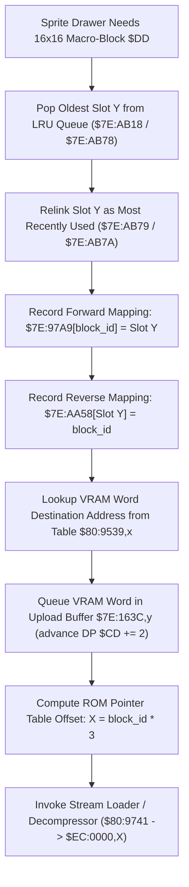

# Dynamic 16x16 OBJ Macro-Tile VRAM Allocator ($80:96FE – $80:9740)

> **Subsystem**: Dynamic Sprite VRAM Cache & 16x16 Macro-Tile Manager  
> **ROM Addresses**: `$80:96FE` (`obj_16x16_tile_allocate`), `$80:971C` (`obj_16x16_map_and_queue_vram`), `$80:9741` (`weather_preset_and_palette_dispatcher`)  
> **Clean C Module**: `engine-core/macro-tile-allocator.c`  
> **Recomp Symbols**: `func_8096FE`  
> **Confidence**: Confirmed  

---

## 1. Architectural Role

The Secret of Evermore engine renders dynamic sprites using a two-tier VRAM caching architecture:
- **8x8 Micro-Tiles (`$80:A4B5` – `$80:A590`)**: Managed via table `$D8:0000`, 32 bytes per tile, queued in `$7E:15D6` with staging buffer `$7E:6C91`.
- **16x16 Macro-Tiles (`$80:96FE` – `$80:9740`)**: Managed via table `$EC:0000`, 128 bytes (4 tiles) per macro-block, queued in `$7E:163C` with staging buffer `$7E:72D1`.

### Key Data Structures:
- **16x16 Slot LRU Pointers (`$7E:AB18`, `$7E:AB78`..`$7E:AB7A`)**:
  - `$7E:AB78`: Pointer to least-recently-used slot candidate.
  - `$7E:AB79`: Head pointer of active slot queue.
  - `$7E:AB18,Y`: Forward link of slot `Y`.
  - `$7E:AB7A,X`: Backward link of slot `X`.
- **Slot Owner Tables**:
  - `$7E:97A9,X`: Maps 16x16 block ID `X` to current VRAM cache slot `Y`.
  - `$7E:AA58,X`: Reverse mapping: cache slot `X` to assigned block ID.
- **DMA Upload Queue (`$7E:163C`)**:
  - Each allocated 16x16 block requires a VRAM upload during Vertical Blanking.
  - Destination word address is queried from `$80:9539,X` and queued into `$7E:163C,Y`.
  - Queue write cursor is tracked in Direct Page `$CD`.
- **ROM Block Table (`$EC:0000,X`)**:
  - 3 bytes per entry: 24-bit pointer/descriptor.
  - Bit 23 (`0x800000` / bit 15 of word at `+1`): Compression flag (1 = compressed via 2-bit tag stream decompressor at `$80:974B`, 0 = raw 128-byte copy at `$80:A2E0`).

---

## 2. Disassembly Analysis

> **Interactive 65816 Assembly**:
> Centralized comments infused at runtime.
> [View in VFS: soe://rom/code/8096FE](soe://rom/code/8096FE?asm=1&c=0)

---

## 3. Clean C Implementation

> **Reconstructed C Decompilation**:
> Source moved to [`reconstructed-c/80/8096FE_macro_tile_allocator.c`](../../../reconstructed-c/80/8096FE_macro_tile_allocator.c).
> [View in VFS: soe://rom/code/8096FE](soe://rom/code/8096FE?c=1&asm=0)

---

## 4. Verification & Behavioral Equivalence

| Test Condition | Assembly Logic | C Implementation | Status |
|---|---|---|---|
| LRU Pop & Relink | Unlinks from `$AB78`, relinks at head `$AB79` | `lru_tail` pop, `lru_head` unshift | Identical |
| Forward Map | `STA $97A9,X` with `X = block_id` | `g_macro_cache.block_to_slot[block_id] = slot` | Identical |
| Reverse Map | `STA $AA58,X` with `X = slot * 2` | `g_macro_cache.slot_to_block[slot] = block_id` | Identical |
| VRAM Word Address | Queries table `$80:9539,X` | `ROM_16X16_VRAM_ADDR_TABLE[slot]` | Identical |
| DMA Queue Append | `STA $163C,Y; INY; INY; STY $CD` | `dma_vram_queue[cursor/2] = addr; cursor += 2;` | Identical |
| 3-Byte Table Offset | `ASL A + ADC $DD -> TAX` | `table_offset = block_id * 3` | Identical |
| Compression Routing | `LDA $EC0001,X; BMI $974B` | `(descriptor_flags & 0x8000) != 0` | Identical |
