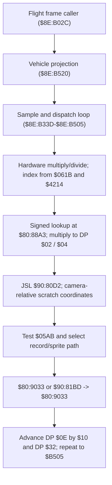

# Mode 7 Overworld Flight Engine & Sprite Dispatch

- **ROM Locations**:
  - `mode7_flight_frame_engine`: `$8E:B02C` – `$8E:B05A`
  - `mode7_flight_sample_and_sprite_dispatch` (host-side translation): `$8E:B33D` – `$8E:B505`
  - `mode7_flight_sprite_render`: `$8E:B520` – `$8E:B559`
  - `$8E:B506` – `$8E:B51F`: indexed data read by `$8E:B4AA` and `$8E:B4C0`; not code
  - `$8E:B55A` begins the enemy-index word table; not code
  - `trig_sine_table`: `$80:88A3` (320 signed words; 256 table entries per turn)
- **CPU State**: 16-bit A/X (`REP #$30`), Data Bank `$8E` / `$7E`
- **Hardware Registers**:
  - `$4202` / `$4203`: Hardware 8-bit $\times$ 8-bit multiplier inputs.
  - `$4216`: Hardware 16-bit multiplication product.
  - `$4204` / `$4205`: Hardware 16-bit dividend.
  - `$4206`: Hardware 8-bit divisor.
  - `$4214`: Hardware 16-bit division quotient.
- **WRAM Core Addresses**:
  - `$7E:0615`: Read as the X base value in the `$8E:B33D` sample calculation.
  - `$7E:0617`: Read as the Y base value in the `$8E:B33D` sample calculation.
  - `$7E:0619`: Combined into the hardware-multiplier input in the signed sample paths.
  - `$7E:061B`: Read to form the table index; `$8E:B33D` does not store a new heading here.
  - `$7E:05AB`: Overworld vehicle flight status flag.
  - DP `$59` & DP `$5B`: Base camera coordinate shadows.
  - DP `$02` & DP `$04`: Relative screen coordinates for vehicle sprite.

## Address Audit: Batch 71

The nominated `$8E:B350` – `$8E:B559` span is not one routine. `$8E:B350` is inside the entry at `$8E:B33D`, whose vanilla control flow reaches `RTL` at `$8E:B505`. The routine initializes a count and per-entry offset from direct-page state, calculates table indices using the division quotient at `$4214`, reads signed samples from `$80:88A3`, and uses sign-dependent hardware multiplication to produce DP `$02` and `$04`. It then calls `$90:80D2`, adjusts those scratch coordinates using the camera-shadow and `$0BFB`/`$0BFD` values, tests `$05AB`, and dispatches sprite work through `$80:9033` and `$90:81BD`. It reads `$0615` and `$0617`; it does not store updated world coordinates there. The previous C model's unsupported sine/velocity integration has been replaced by an explicit host-side control-flow reconstruction.

The separate `$8E:B520` – `$8E:B559` entry computes DP `$02` from `$0615 - $59`; writes `$0619` through `XBA` and `ORA #$0003` to `$4202` as a 16-bit store; reads the 8-bit product at `$4216`, shifts it right twice into DP `$12`; computes DP `$04` from `$0617 - $12 - $5B`; sets DP `$06`, `$26`, and `$28` to `$003C`, `$32C9`, and `$00CC`; calls `$80:9033`; then returns. The `$B506` – `$B51F` indexed data and `$B55A` table are outside those routine bodies.

---

## 1. Flight Routine Flow

The `$8E:B33D` entry is a repeated sample-and-sprite-dispatch routine, not a per-frame world-velocity integrator. Its caller at `$8E:B02C` calls `$8E:B520` first, then `$8E:B33D`.

### 1. Table Index and Signed Samples

The table at `$80:88A3` contains 320 signed 16-bit words; one full turn uses 256 entries. `$8E:B33D` forms a byte offset by doubling the value derived from `$061B` and `$4214`, then masks it with `$01FF`. The second sample is selected by adding `$0080` bytes, which is 64 words, before masking. Each sample's sign chooses a different sequence of shifts, byte swaps, hardware-multiplier inputs, and addition/subtraction. The resulting values are written to DP `$02` and DP `$04`; this routine reads `$0615` and `$0617` as bases but does not update them.

### 2. Record and Sprite Dispatch

The routine initializes DP `$32` to zero and DP `$0E` to `$06A3`, then repeats until the loaded count in DP `$0A` is reached. For each pass it calls `$90:80D2`, applies the camera-shadow offsets and the values at `$0BFB`/`$0BFD`, and tests masks `$007C`, `$0040`, and `$0008` in `$05AB`. The selected path reads indexed record/table data, sets DP `$26`/`$27`/`$06`, and calls `$80:9033` directly or through `$90:81BD`. DP `$0E` advances by `$0010` and DP `$32` increments before the loop repeats. The routine returns at `$8E:B505`.

---

## 2. Disassembly & Annotations

### Part 1: Flight Frame Loop (`$8E:B02C`)
> **Interactive 65816 Assembly**:
> Centralized comments infused at runtime.
> [View in VFS: soe://rom/code/8EB02C](soe://rom/code/8EB02C?asm=1&c=0)

### Part 2: Flight Sample and Entity Dispatch (`$8E:B33D`)
The clean vanilla VFS disassembly was read across `$8E:B33D-$8E:B505`; its assembly endpoint is windowed, so the range was followed in address-aligned chunks. The full raw range is [available in the VFS](soe://rom/0eb33d%5B1c9%5D.bin?rom=vanilla). The entry's `RTL` is at `$8E:B505`.

### Part 3: Vehicle Sprite Screen Projection (`$8E:B520`)
> **Interactive 65816 Assembly**:
> Centralized comments infused at runtime.
> [View in VFS: soe://rom/code/8EB02C](soe://rom/code/8EB02C?asm=1&c=0)

---

## 3. Host-Side Reconstruction Status

The C function is a host-side control-flow reconstruction of the observed ROM loop. Its memory reads, hardware multiply/divide operations, and calls to `$90:80D2`, `$80:9033`, and `$90:81BD` are explicit interfaces; those helpers' internals and the meanings of several indexed records remain outside this model. `$8E:B33D` does not write `$0615` or `$0617`; the older velocity-integration interpretation was disproved by the disassembly. The separate frame caller's `turn_delta` parameter is retained for compatibility, but the ROM entry is invoked without an argument.

Source: [`reconstructed-c/8E/8EB02C_mode7_flight.c`](../../../reconstructed-c/8E/8EB02C_mode7_flight.c).

