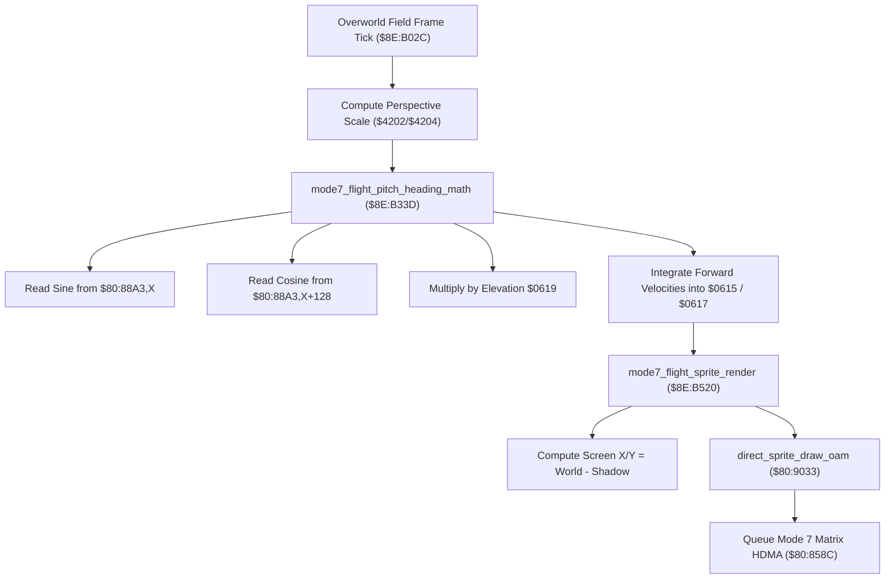

# Mode 7 Overworld Flight Engine & Perspective Trigonometry

- **ROM Locations**:
  - `mode7_flight_frame_engine`: `$8E:B02C` – `$8E:B05A`
  - `mode7_flight_pitch_heading_math`: `$8E:B33D` – `$8E:B3CD`
  - `mode7_flight_sprite_render`: `$8E:B520` – `$8E:B559`
  - `trig_sine_table`: `$80:88A3` (512-entry 16-bit sine lookup)
- **CPU State**: 16-bit A/X (`REP #$30`), Data Bank `$8E` / `$7E`
- **Hardware Registers**:
  - `$4202` / `$4203`: Hardware 8-bit $\times$ 8-bit multiplier inputs.
  - `$4216`: Hardware 16-bit multiplication product.
  - `$4204` / `$4205`: Hardware 16-bit dividend.
  - `$4206`: Hardware 8-bit divisor.
  - `$4214`: Hardware 16-bit division quotient.
- **WRAM Core Addresses**:
  - `$7E:0615`: Flight camera world position X.
  - `$7E:0617`: Flight camera world position Y.
  - `$7E:0619`: Flight camera height / elevation speed factor.
  - `$7E:061B`: Flight camera azimuth heading / yaw angle (0..511 steps $= 360^\circ$).
  - `$7E:061D`: Perspective scaling quotient.
  - `$7E:05AB`: Overworld vehicle flight status flag.
  - DP `$59` & DP `$5B`: Base camera coordinate shadows.
  - DP `$02` & DP `$04`: Relative screen coordinates for vehicle sprite.

---

## 1. Architectural Architecture & Flight Pipeline

When flying across the overworld on the Windwalker companion, the engine switches to the SNES Mode 7 affine projection renderer.

### 1. 512-Step Trigonometric Circle (`$80:88A3`)
- The full circle is divided into 512 discrete angle steps ($0 \dots 511$, where $512 \equiv 360^\circ$).
- Quadrant offsets:
  - $0^\circ = 0$
  - $90^\circ = 128$
  - $180^\circ = 256$
  - $270^\circ = 384$
- **Cosine Identity**: $\cos(\theta) = \sin(\theta + 128)$.
  The engine reads the cosine directly by adding an offset of $+128$ to the sine table index (`AND #$01FF`).

### 2. Velocity Integration
- Forward velocity vector:
  $$\Delta X = \frac{\sin(\theta) \times \text{Speed}}{256}, \quad \Delta Y = \frac{\cos(\theta) \times \text{Speed}}{256}$$
- Flight coordinates `$0615` (X) and `$0617` (Y) are updated each frame tick by subtracting/adding the projected delta components.

---

## 2. Disassembly & Annotations

### Part 1: Flight Frame Loop (`$8E:B02C`)
> **Interactive 65816 Assembly**:
> Centralized comments infused at runtime.
> [View in VFS: soe://rom/code/8EB02C](soe://rom/code/8EB02C?asm=1&c=0)

### Part 2: Flight Trigonometry & Heading Math (`$8E:B33D`)
> **Interactive 65816 Assembly**:
> Centralized comments infused at runtime.
> [View in VFS: soe://rom/code/8EB02C](soe://rom/code/8EB02C?asm=1&c=0)

### Part 3: Vehicle Sprite Screen Projection (`$8E:B520`)
> **Interactive 65816 Assembly**:
> Centralized comments infused at runtime.
> [View in VFS: soe://rom/code/8EB02C](soe://rom/code/8EB02C?asm=1&c=0)

---

## 3. Reconstructed Clean C Implementation

> **Reconstructed C Decompilation**:
> Source moved to [`reconstructed-c/8E/8EB02C_mode7_flight.c`](../../../reconstructed-c/8E/8EB02C_mode7_flight.c).
> [View in VFS: soe://rom/code/8EB02C](soe://rom/code/8EB02C?c=1&asm=0)

