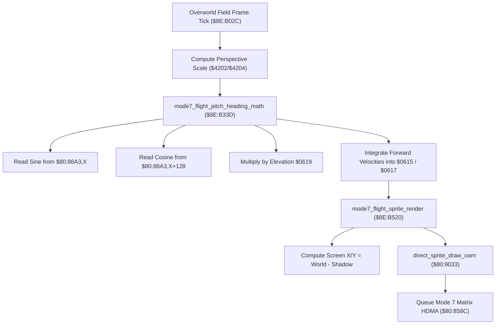

# Mode 7 Overworld Flight Engine & Perspective Trigonometry

- **ROM Locations**:
  - `mode7_flight_frame_engine`: `$8E:B02C` – `$8E:B05A`
  - `mode7_flight_pitch_heading_math`: `$8E:B33D` – `$8E:B3CD`
  - `mode7_flight_sprite_render`: `$8E:B520` – `$8E:B559`
  - `trig_sine_table`: `$80:88A3` (512-entry 16-bit sine lookup)
- **CPU State**: 16-bit A/X (`REP #$30`), Data Bank `$8E` / `$7E`
- **Hardware Registers**:
  - `$4202` / `$4203`: Hardware 8-bit $\times$ 8-bit multiplier inputs.
  - `$4216`: Hardware 16-bit multiplication product.
  - `$4204` / `$4205`: Hardware 16-bit dividend.
  - `$4206`: Hardware 8-bit divisor.
  - `$4214`: Hardware 16-bit division quotient.
- **WRAM Core Addresses**:
  - `$7E:0615`: Flight camera world position X.
  - `$7E:0617`: Flight camera world position Y.
  - `$7E:0619`: Flight camera height / elevation speed factor.
  - `$7E:061B`: Flight camera azimuth heading / yaw angle (0..511 steps $= 360^\circ$).
  - `$7E:061D`: Perspective scaling quotient.
  - `$7E:05AB`: Overworld vehicle flight status flag.
  - DP `$59` & DP `$5B`: Base camera coordinate shadows.
  - DP `$02` & DP `$04`: Relative screen coordinates for vehicle sprite.

---

## 1. Architectural Architecture & Flight Pipeline

When flying across the overworld on the Windwalker companion, the engine switches to the SNES Mode 7 affine projection renderer.



### 1. 512-Step Trigonometric Circle (`$80:88A3`)
- The full circle is divided into 512 discrete angle steps ($0 \dots 511$, where $512 \equiv 360^\circ$).
- Quadrant offsets:
  - $0^\circ = 0$
  - $90^\circ = 128$
  - $180^\circ = 256$
  - $270^\circ = 384$
- **Cosine Identity**: $\cos(\theta) = \sin(\theta + 128)$.
  The engine reads the cosine directly by adding an offset of $+128$ to the sine table index (`AND #$01FF`).

### 2. Velocity Integration
- Forward velocity vector:
  $$\Delta X = \frac{\sin(\theta) \times \text{Speed}}{256}, \quad \Delta Y = \frac{\cos(\theta) \times \text{Speed}}{256}$$
- Flight coordinates `$0615` (X) and `$0617` (Y) are updated each frame tick by subtracting/adding the projected delta components.

---

## 2. Disassembly & Annotations

### Part 1: Flight Frame Loop (`$8E:B02C`)
```assembly
; ==============================================================================
; mode7_flight_frame_engine ($8E:B02C)
; ==============================================================================
$8EB02C  AD AB 05    LDA $05AB         ; Flight status flags
$8EB02F  89 01 00    BIT #$0001
$8EB032  F0 0E       BEQ $8EB042
$8EB034  A0 EB 0D    LDY #$0DEB         ; Dog companion entity
$8EB037  22 D2 80 90 JSL $9080D2
$8EB03B  A0 DB 0D    LDY #$0DDB         ; Boy character entity
$8EB03E  22 D2 80 90 JSL $9080D2

$8EB042  22 20 B5 8E JSL $8EB520       ; Project vehicle sprite on screen
$8EB046  22 3D B3 8E JSL $8EB33D       ; Execute heading & velocity trigonometry
$8EB04A  22 BB 96 80 JSL $8096BB       ; Entity physics update
$8EB04E  22 1E C6 8F JSL $8FC61E       ; Shadow projection
$8EB052  22 BB 96 80 JSL $8096BB
$8EB056  22 EE 8F 80 JSL $808FEE       ; Palette fade updates
$8EB05A  22 8C 85 80 JSL $80858C       ; Mode 7 HDMA gradient setup
```

### Part 2: Flight Trigonometry & Heading Math (`$8E:B33D`)
```assembly
; ==============================================================================
; mode7_flight_pitch_heading_math ($8E:B33D)
; ==============================================================================
$8EB36D  AD 1B 06    LDA $061B         ; Load current heading angle (0..511)
$8EB370  38          SEC
$8EB371  ED 14 42    SBC $4214         ; Subtract steering turning delta
$8EB374  0A          ASL A             ; 2 bytes per table entry
$8EB375  29 FF 01    AND #$01FF        ; Wrap angle to 512-step circle
$8EB378  AA          TAX               ; X = Sine Table offset

$8EB379  BF A3 88 80 LDA $8088A3,X     ; READ SINE from table $80:88A3
$8EB37D  30 25       BMI $8EB3A4       ; Negative quadrant handling
$8EB37F  4A          LSR A
$8EB380  EB          XBA
$8EB381  0D 19 06    ORA $0619         ; Multiply with elevation speed $0619
$8EB384  8D 02 42    STA $4202         ; Hardware multiplication

$8EB387  8A          TXA               ; A = Sine angle offset
$8EB388  18          CLC
$8EB389  69 80 00    ADC #$0080        ; Add 128 (90 degrees shift for COSINE)
$8EB38C  29 FF 01    AND #$01FF        ; Wrap to circle
$8EB38F  AA          TAX               ; X = Cosine Table offset

$8EB390  AD 16 42    LDA $4216         ; Read multiplied sine product
$8EB393  0A          ASL A
$8EB394  EB          XBA
$8EB395  29 FF 01    AND #$01FF
$8EB398  85 02       STA $02           ; DP $02 = Delta X velocity

$8EB39A  AD 15 06    LDA $0615         ; Flight world X position
$8EB39D  38          SEC
$8EB39E  E5 02       SBC $02           ; Integrate X velocity
$8EB3A0  8D 15 06    STA $0615         ; Store updated flight X
```

### Part 3: Vehicle Sprite Screen Projection (`$8E:B520`)
```assembly
; ==============================================================================
; mode7_flight_sprite_render ($8E:B520)
; ==============================================================================
$8EB520  AD 15 06    LDA $0615         ; Flight world X
$8EB523  38          SEC
$8EB524  E5 59       SBC $59           ; Subtract camera origin shadow X
$8EB526  85 02       STA $02           ; DP $02 = Sprite Screen X

$8EB528  AD 19 06    LDA $0619         ; Flight elevation
$8EB52B  EB          XBA
$8EB52C  09 03 00    ORA #$0003
$8EB52F  8D 02 42    STA $4202         ; Multiply elevation perspective tilt
$8EB532  80 00       BRA $8EB534
$8EB534  EA          NOP
$8EB535  AD 16 42    LDA $4216         ; Scaled elevation
$8EB538  4A          LSR A
$8EB539  4A          LSR A             ; >> 2
$8EB53A  85 12       STA $12

$8EB53C  AD 17 06    LDA $0617         ; Flight world Y
$8EB53F  38          SEC
$8EB540  E5 12       SBC $12           ; Elevation tilt offset
$8EB542  E5 5B       SBC $5B           ; Subtract camera origin shadow Y
$8EB544  85 04       STA $04           ; DP $04 = Sprite Screen Y

$8EB546  A5 3C       LDA $3C           ; Azimuth orientation attribute
$8EB549  85 06       STA $06
$8EB54B  A9 C9 32    LDA #$32C9        ; Sprite descriptor address
$8EB54E  85 26       STA $26
$8EB550  A9 CC 00    LDA #$00CC        ; Sprite descriptor bank $CC
$8EB553  85 28       STA $28
$8EB555  22 33 90 80 JSL $809033       ; Draw vehicle sprite via direct_sprite_draw_oam
$8EB559  6B          RTL
```

---

## 3. Reconstructed Clean C Implementation

```c
#include <stdint.h>
#include <stdbool.h>

#define ANGLE_STEPS         512
#define ANGLE_MASK          (ANGLE_STEPS - 1)
#define COSINE_OFFSET       128 // 90 degrees in 512-step circle

typedef struct {
    int16_t  world_x;        // $7E:0615
    int16_t  world_y;        // $7E:0617
    uint16_t elevation;      // $7E:0619 (speed & altitude factor)
    uint16_t heading_angle;  // $7E:061B (0..511 steps)
    uint16_t quotient;       // $7E:061D
    uint16_t flags;          // $7E:05AB
} Mode7FlightState;

extern Mode7FlightState g_flight_state;
extern int16_t g_camera_shadow_x;  // DP $59
extern int16_t g_camera_shadow_y;  // DP $5B

// 512-entry signed 16-bit sine lookup table ($80:88A3)
extern const int16_t g_sine_table[ANGLE_STEPS];

extern void direct_sprite_draw_oam(int16_t screen_x, int16_t screen_y, uint16_t attr, uint32_t sprite_record);
extern void update_entity_physics(void);
extern void setup_mode7_hdma(void);

/**
 * Calculates forward flight motion using 512-step sine/cosine trigonometry.
 * Corresponds to $8E:B33D.
 */
void mode7_flight_pitch_heading_math(int16_t turn_delta) {
    // 1. Update and wrap heading angle (0..511)
    uint16_t angle = (g_flight_state.heading_angle - turn_delta) & ANGLE_MASK;
    g_flight_state.heading_angle = angle;

    // 2. Read sine and cosine from trigonometric table
    int16_t sin_val = g_sine_table[angle];
    int16_t cos_val = g_sine_table[(angle + COSINE_OFFSET) & ANGLE_MASK];

    // 3. Scale velocity by altitude / speed factor
    uint32_t speed = g_flight_state.elevation;
    int16_t delta_x = (int16_t)(((int32_t)sin_val * speed) >> 8);
    int16_t delta_y = (int16_t)(((int32_t)cos_val * speed) >> 8);

    // 4. Integrate flight world position
    g_flight_state.world_x -= delta_x;
    g_flight_state.world_y += delta_y;
}

/**
 * Projects the vehicle sprite onto the Mode 7 perspective viewport.
 * Corresponds to $8E:B520.
 */
void mode7_flight_sprite_render(uint16_t vehicle_attr) {
    // Screen X = World X - Camera Shadow X
    int16_t screen_x = g_flight_state.world_x - g_camera_shadow_x;

    // Perspective elevation vertical tilt adjustment: (elevation * 3) >> 2
    int16_t elev_tilt = (int16_t)((g_flight_state.elevation * 3) >> 2);

    // Screen Y = World Y - Elevation Tilt - Camera Shadow Y
    int16_t screen_y = g_flight_state.world_y - elev_tilt - g_camera_shadow_y;

    // Render vehicle sprite (descriptor at $CC:32C9)
    direct_sprite_draw_oam(screen_x, screen_y, vehicle_attr, 0xCC32C9);
}

/**
 * Executes one frame of overworld Mode 7 flight simulation.
 * Corresponds to $8E:B02C.
 */
void mode7_flight_frame_engine(int16_t turn_delta, uint16_t vehicle_attr) {
    // 1. Project Windwalker sprite
    mode7_flight_sprite_render(vehicle_attr);

    // 2. Trigonometric heading & velocity integration
    mode7_flight_pitch_heading_math(turn_delta);

    // 3. Subsystem physics and HDMA gradient refresh
    update_entity_physics();
    setup_mode7_hdma();
}
```
