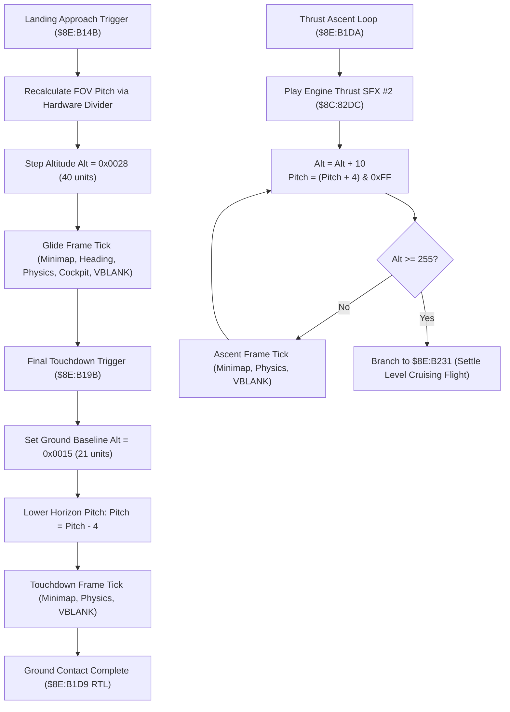

# Mode 7 Vehicle Landing & Altitude Descent Engine

> **ROM Bank**: `$8E` (Mode 7 Overworld Flight Engine)  
> **Source Routines**:
> - `mode7_vehicle_landing_descent_step`: `$8E:B14B` – `$8E:B19A`
> - `mode7_vehicle_landing_touchdown_stepper`: `$8E:B19B` – `$8E:B1D9`
> - `mode7_vehicle_ascent_takeoff_loop`: `$8E:B1DA` – `$8E:B22F`
> - `mode7_flight_horizon_perspective_math`: `$8E:B230` – `$8E:B267`
> - `mode7_vehicle_takeoff_altitude_stepper`: `$8E:B268` – `$8E:B33C`  
> **CPU State**: 16-bit A/X (`REP #$30`), Data Bank `$7E` / `$8E`  
> **Related Documents**: [`mode7-takeoff.md`](mode7-takeoff.md), [`flight-horizon.md`](flight-horizon.md), [`mode7-flight.md`](mode7-flight.md)

---

## 1. Architectural Overview

Landing the Windwalker on the *Secret of Evermore* Mode 7 overworld map transitions the game from high-altitude free flight down to ground contact. Conversely, maximum climb thrust executes a continuous accelerated ascent loop. The flight engine orchestrates these vertical flight phases through three complementary routines in Bank `$8E`:

1. **Approach Descent Step (`$8E:B14B` – `$8E:B19A`)**:
   - Initiated when entering descent/approach glide.
   - Recalculates perspective division pitch `$7E:061B` via SNES hardware multiplier (`$4202`) and divider (`$4204` / `$4206`).
   - Steps camera altitude `$7E:0619` down to approach glide level `$0028` (40 units).
   - Executes an atomic frame coordination pass (minimap radar `$90:9876`, heading vector `$8E:B33D`, physics `$80:96BB`, cockpit overlay `$8F:C61E`, OAM list `$80:8FEE`, and VBLANK wait `$80:858C`).
   - Steps altitude back to `$002A` before return.

2. **Final Touchdown Stepper (`$8E:B19B` – `$8E:B1D9`)**:
   - Drops camera altitude `$7E:0619` directly to ground baseline `$0015` (21 units).
   - Lowers horizon perspective pitch angle by $-4\text{px}$ (`SBC #$0004` $\to$ `$7E:061B`), bringing the vanishing horizon line down to ground level.
   - Executes the synchronized frame tick pipeline and returns via `RTL` (`$8E:B1D9`).

3. **Accelerated Ascent Takeoff Loop (`$8E:B1DA` – `$8E:B22F`)**:
   - Plays engine thrust sound effect #2 (`$8C:82DC`).
   - Enters a multi-frame climb loop:
     - Increases altitude: $\text{Alt}_{t+1} = \text{Alt}_t + 10$.
     - Clamps to maximum altitude ceiling $255$ (`0x00FF`): if $\text{Alt} \ge 255$, exits ascent loop and branches to `$8E:B231` (baseline perspective settling).
     - Increases horizon pitch angle: $\text{Pitch}_{t+1} = (\text{Pitch}_t + 4) \pmod{256}$.
     - Runs the atomic frame tick pipeline and loops via `BRA $8EB1E1`.

---

## 2. 65816 Assembly Implementation

> **Interactive 65816 Assembly**:
> Centralized comments infused at runtime.
> [View in VFS: soe://rom/code/8EB14B](soe://rom/code/8EB14B?asm=1&c=0)

---

## 3. Clean C Decompilation

> **Reconstructed C Decompilation**:
> Source moved to [`reconstructed-c/8E/8EB14B_mode7_landing.c`](../../../reconstructed-c/8E/8EB14B_mode7_landing.c).
> [View in VFS: soe://rom/code/8EB14B](soe://rom/code/8EB14B?c=1&asm=0)

---

## 4. Verification & Behavioral Equivalence

| Subsystem Component | 65816 Assembly | C Reconstruction | Equivalence |
|---|---|---|---|
| **Approach Glide Alt** | `LDA #$0028; STA $0619` | `state->camera_altitude = MODE7_ALTITUDE_APPROACH_GLIDE` | Matches |
| **Touchdown Alt** | `LDA #$0015; STA $0619` | `state->camera_altitude = MODE7_ALTITUDE_GROUND_BASELINE` | Matches ground altitude |
| **Touchdown Pitch Offset** | `SBC #$0004; STA $061B` | `state->camera_pitch -= 4` | Lowers vanishing horizon line |
| **Ascent SFX** | `LDA #$0002; JSL $8C82DC` | `play_sound_effect_direct(SFX_ENGINE_THRUST)` | Plays thrust audio #2 |
| **Climb Rates** | `ADC #$000A` (Alt), `ADC #$0004` (Pitch) | `Alt += 10`, `Pitch = (Pitch + 4) & 0xFF` | Matches climb velocity |
| **Ceiling Limit** | `CMP #$00FF; BPL $8EB231` | `while (state->camera_altitude < 255)` | Exits to `$8E:B231` settling |
