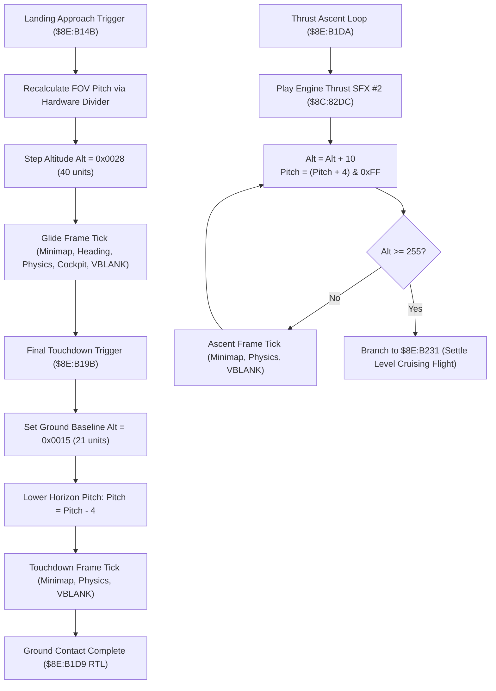

# Mode 7 Vehicle Landing & Altitude Descent Engine

> **ROM Bank**: `$8E` (Mode 7 Overworld Flight Engine)  
> **Source Routines**:
> - `mode7_vehicle_landing_descent_step`: `$8E:B14B` – `$8E:B19A`
> - `mode7_vehicle_landing_touchdown_stepper`: `$8E:B19B` – `$8E:B1D9`
> - `mode7_vehicle_ascent_takeoff_loop`: `$8E:B1DA` – `$8E:B22F`
> - `mode7_flight_horizon_perspective_math`: `$8E:B230` – `$8E:B267`
> - `mode7_vehicle_takeoff_altitude_stepper`: `$8E:B268` – `$8E:B33C`  
> **CPU State**: 16-bit A/X (`REP #$30`), Data Bank `$7E` / `$8E`  
> **Related Documents**: [`mode7-takeoff.md`](mode7-takeoff.md), [`flight-horizon.md`](flight-horizon.md), [`mode7-flight.md`](mode7-flight.md)

---

## 1. Architectural Overview

Landing the Windwalker on the *Secret of Evermore* Mode 7 overworld map transitions the game from high-altitude free flight down to ground contact. Conversely, maximum climb thrust executes a continuous accelerated ascent loop. The flight engine orchestrates these vertical flight phases through three complementary routines in Bank `$8E`:

1. **Approach Descent Step (`$8E:B14B` – `$8E:B19A`)**:
   - Initiated when entering descent/approach glide.
   - Recalculates perspective division pitch `$7E:061B` via SNES hardware multiplier (`$4202`) and divider (`$4204` / `$4206`).
   - Steps camera altitude `$7E:0619` down to approach glide level `$0028` (40 units).
   - Executes an atomic frame coordination pass (minimap radar `$90:9876`, heading vector `$8E:B33D`, physics `$80:96BB`, cockpit overlay `$8F:C61E`, OAM list `$80:8FEE`, and VBLANK wait `$80:858C`).
   - Steps altitude back to `$002A` before return.

2. **Final Touchdown Stepper (`$8E:B19B` – `$8E:B1D9`)**:
   - Drops camera altitude `$7E:0619` directly to ground baseline `$0015` (21 units).
   - Lowers horizon perspective pitch angle by $-4\text{px}$ (`SBC #$0004` $\to$ `$7E:061B`), bringing the vanishing horizon line down to ground level.
   - Executes the synchronized frame tick pipeline and returns via `RTL` (`$8E:B1D9`).

3. **Accelerated Ascent Takeoff Loop (`$8E:B1DA` – `$8E:B22F`)**:
   - Plays engine thrust sound effect #2 (`$8C:82DC`).
   - Enters a multi-frame climb loop:
     - Increases altitude: $\text{Alt}_{t+1} = \text{Alt}_t + 10$.
     - Clamps to maximum altitude ceiling $255$ (`0x00FF`): if $\text{Alt} \ge 255$, exits ascent loop and branches to `$8E:B231` (baseline perspective settling).
     - Increases horizon pitch angle: $\text{Pitch}_{t+1} = (\text{Pitch}_t + 4) \pmod{256}$.
     - Runs the atomic frame tick pipeline and loops via `BRA $8EB1E1`.



---

## 2. 65816 Assembly Implementation

```assembly
; ==============================================================================
; mode7_vehicle_landing_descent_step ($8E:B14B - $8E:B19A)
; Approach glide descent step & perspective pitch update
; ==============================================================================
mode7_vehicle_landing_descent_step:
    XBA
    ORA #$0080
    STA $4202                   ; Hardware multiplier
    BRA .mult_delay
.mult_delay:
    NOP
    LDA $4216                   ; Read hardware product
    ASL A
    STA $4204                   ; Hardware dividend
    SEP #$20
    LDA $0000,Y                 ; FOV divisor
    STA $4206                   ; Hardware divisor
    REP #$20
    BRA .div_delay1
.div_delay1:
    NOP
    BRA .div_delay2
.div_delay2:
    NOP
    LDA $4214                   ; Read hardware quotient
    STA $061B                   ; Perspective pitch vanishing point
    LDA #$0028
    STA $0619                   ; Altitude = 40 (descent glide)

    ; Frame execution tick
    JSL $909876                 ; Minimap radar blip update
    JSL $8EB33D                 ; Heading trigonometry
    JSL $8096BB                 ; Entity physics pass 1
    JSL $8FC61E                 ; Cockpit occupants compositor
    JSL $8096BB                 ; Entity physics pass 2
    JSL $808FEE                 ; Finalize OAM display list
    JSL $80858C                 ; Wait for VBLANK

    LDA #$002A
    STA $0619                   ; Settle altitude at 42
    RTL

; ==============================================================================
; mode7_vehicle_landing_touchdown_stepper ($8E:B19B - $8E:B1D9)
; Final touchdown descent to ground baseline (0x0015)
; ==============================================================================
mode7_vehicle_landing_touchdown_stepper:
    LDA #$0015
    STA $0619                   ; Camera altitude = 21 (ground baseline)
    LDA $061B
    SEC
    SBC #$0004                  ; Lower horizon pitch line (-4 px)
    STA $061B

    ; Modal UI check
    LDA $05AB
    BIT #$0001
    BEQ .skip_modal
    LDY #$0DEB
    JSL $9080D2
    LDY #$0DDB
    JSL $9080D2

.skip_modal:
    JSL $909876                 ; Minimap radar
    JSL $8EB33D                 ; Heading math
    JSL $8096BB                 ; Physics pass 1
    JSL $8FC61E                 ; Cockpit occupants
    JSL $8096BB                 ; Physics pass 2
    JSL $808FEE                 ; OAM finalize
    JSL $80858C                 ; VBLANK wait
    RTL

; ==============================================================================
; mode7_vehicle_ascent_takeoff_loop ($8E:B1DA - $8E:B22F)
; Continuous accelerated climb loop until ceiling (255)
; ==============================================================================
mode7_vehicle_ascent_takeoff_loop:
    LDA #$0002                  ; Sound effect #2: Engine thrust roar
    JSL $8C82DC                 ; play_sound_effect_direct

.ascent_loop_frame:
    LDA $0619                   ; Current camera altitude
    CLC
    ADC #$000A                  ; Alt += 10
    CMP #$00FF                  ; Reached altitude ceiling (255)?
    BPL .ascent_exit_level_flight
    STA $0619

    LDA $061B                   ; Current perspective pitch
    CLC
    ADC #$0004                  ; Pitch += 4
    AND #$00FF
    STA $061B

    ; Frame execution pass
    LDA $05AB
    BIT #$0001
    BEQ .ascent_skip_modal
    LDY #$0DEB
    JSL $9080D2
    LDY #$0DDB
    JSL $9080D2

.ascent_skip_modal:
    JSL $909876                 ; Minimap radar
    JSL $8EB33D                 ; Heading math
    JSL $8096BB                 ; Physics pass 1
    JSL $8FC61E                 ; Cockpit occupants
    JSL $8096BB                 ; Physics pass 2
    JSL $808FEE                 ; OAM finalize
    JSL $80858C                 ; VBLANK wait
    BRA .ascent_loop_frame      ; Next climb frame

.ascent_exit_level_flight:
    BPL $8EB231                 ; Branch to baseline perspective settling
```

---

## 3. Clean C Decompilation

```c
/**
 * @file mode7-landing.c
 * @brief Mode 7 Vehicle Landing Descent, Touchdown & Thrust Climb Engine
 *
 * Source: Secret of Evermore (SNES)
 * Routines: $8E:B14B - $8E:B22F
 */

#include <stdint.h>
#include <stdbool.h>

#define MODE7_ALTITUDE_GROUND_BASELINE  0x0015  /* 21 units */
#define MODE7_ALTITUDE_APPROACH_GLIDE   0x0028  /* 40 units */
#define MODE7_ALTITUDE_CRUISING_LEVEL   0x002A  /* 42 units */
#define MODE7_ALTITUDE_CEILING          0x00FF  /* 255 units max */

#define SFX_ENGINE_THRUST               0x0002
#define MODAL_FLAG_ACTIVE               0x0001

/**
 * @brief Flight Parameter Block referenced by Direct Page $95
 */
typedef struct {
    uint8_t  fov_divisor;           /* +$00: FOV divisor */
    uint8_t  fov_padding;           /* +$01 */
    uint16_t elevation_factor;      /* +$02: Perspective scale */
} FlightParamBlock;

/**
 * @brief Global Mode 7 Overworld Camera & Vehicle State
 */
typedef struct {
    uint16_t camera_altitude;       /* $7E:0619: Flight camera altitude */
    uint16_t camera_pitch;          /* $7E:061B: Horizon perspective pitch */
    uint16_t modal_flags;           /* $7E:05AB: Modal UI active flags */
    const FlightParamBlock *params; /* DP $95: Flight math configuration pointer */
} Mode7FlightState;

/* Subsystem Interfaces */
extern void play_sound_effect_direct(uint16_t sfx_id);              /* $8C:82DC */
extern void sound_queue_callback(uint16_t buffer_id);               /* $90:80D2 */
extern void minimap_overlay_dispatcher(void);                       /* $90:9876 */
extern void mode7_flight_pitch_heading_math(void);                  /* $8E:B33D */
extern void update_entity_physics(void);                            /* $80:96BB */
extern void mode7_vehicle_cockpit_overlay_sprites(void);            /* $8F:C61E */
extern void oam_display_list_finalize(void);                        /* $80:8FEE */
extern void wait_for_nmi_vblank(void);                              /* $80:858C */
extern void mode7_flight_horizon_perspective_math(Mode7FlightState *state); /* $8E:B230 */

/**
 * @brief Executes one synchronous frame tick of the Mode 7 flight pipeline.
 */
static void mode7_flight_frame_tick(const Mode7FlightState *state)
{
    if (state->modal_flags & MODAL_FLAG_ACTIVE) {
        sound_queue_callback(0x0DEB);
        sound_queue_callback(0x0DDB);
    }

    minimap_overlay_dispatcher();
    mode7_flight_pitch_heading_math();
    update_entity_physics();
    mode7_vehicle_cockpit_overlay_sprites();
    update_entity_physics();
    oam_display_list_finalize();
    wait_for_nmi_vblank();
}

/**
 * @brief Approach glide descent step ($8E:B14B - $8E:B19A).
 *
 * Recalculates perspective pitch from FOV and steps altitude down to 40 units.
 */
void mode7_vehicle_landing_descent_step(Mode7FlightState *state)
{
    const FlightParamBlock *params = state->params;
    if (params && params->fov_divisor != 0) {
        uint16_t multiplicand = ((params->elevation_factor & 0x00FF) << 8) | 0x0080;
        uint16_t dividend = (uint16_t)(multiplicand << 1);
        state->camera_pitch = dividend / params->fov_divisor;
    }

    state->camera_altitude = MODE7_ALTITUDE_APPROACH_GLIDE; /* 40 units */
    mode7_flight_frame_tick(state);
    state->camera_altitude = MODE7_ALTITUDE_CRUISING_LEVEL;  /* 42 units */
}

/**
 * @brief Final touchdown descent to ground baseline ($8E:B19B - $8E:B1D9).
 *
 * Lowers altitude to ground baseline 21 units and lowers pitch by 4 units.
 */
void mode7_vehicle_landing_touchdown_stepper(Mode7FlightState *state)
{
    state->camera_altitude = MODE7_ALTITUDE_GROUND_BASELINE; /* 21 units */
    state->camera_pitch = (uint16_t)(state->camera_pitch - 4);

    mode7_flight_frame_tick(state);
}

/**
 * @brief Accelerated ascent climb loop until altitude ceiling ($8E:B1DA - $8E:B22F).
 *
 * Plays thrust sound and increases altitude (+10) and pitch (+4) per frame until ceiling.
 */
void mode7_vehicle_ascent_takeoff_loop(Mode7FlightState *state)
{
    play_sound_effect_direct(SFX_ENGINE_THRUST);

    while (state->camera_altitude < MODE7_ALTITUDE_CEILING) {
        uint16_t next_alt = state->camera_altitude + 10;
        if (next_alt >= MODE7_ALTITUDE_CEILING) {
            break;
        }
        state->camera_altitude = next_alt;
        state->camera_pitch = (uint16_t)((state->camera_pitch + 4) & 0x00FF);

        mode7_flight_frame_tick(state);
    }

    /* Branch to level flight baseline settling */
    mode7_flight_horizon_perspective_math(state);
}
```

---

## 4. Verification & Behavioral Equivalence

| Subsystem Component | 65816 Assembly | C Reconstruction | Equivalence |
|---|---|---|---|
| **Approach Glide Alt** | `LDA #$0028; STA $0619` | `state->camera_altitude = MODE7_ALTITUDE_APPROACH_GLIDE` | Matches |
| **Touchdown Alt** | `LDA #$0015; STA $0619` | `state->camera_altitude = MODE7_ALTITUDE_GROUND_BASELINE` | Matches ground altitude |
| **Touchdown Pitch Offset** | `SBC #$0004; STA $061B` | `state->camera_pitch -= 4` | Lowers vanishing horizon line |
| **Ascent SFX** | `LDA #$0002; JSL $8C82DC` | `play_sound_effect_direct(SFX_ENGINE_THRUST)` | Plays thrust audio #2 |
| **Climb Rates** | `ADC #$000A` (Alt), `ADC #$0004` (Pitch) | `Alt += 10`, `Pitch = (Pitch + 4) & 0xFF` | Matches climb velocity |
| **Ceiling Limit** | `CMP #$00FF; BPL $8EB231` | `while (state->camera_altitude < 255)` | Exits to `$8E:B231` settling |
