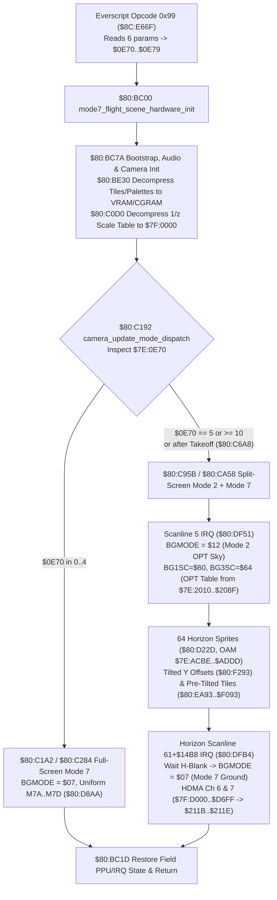

# Bank `$80` Mode 7 Overworld Flight & Split-Screen Engine (`$80:BC00` – `$80:F982`)

- **ROM Region**: `$80:BC00` – `$80:F982` (15,747 bytes in Bank `$80`, invoked from Everscript opcode `0x99` at `$8C:E66F`)
- **VFS Entry Points**:
  - `soe://rom/assets/scripts/opcodes/99.md` (`script_op_99_mode7_scene`, `$8C:E66F`)
  - `soe://rom/code/mode7_flight_scene_hardware_init/info.md` (`$80:BC00`)
  - `soe://rom/code/camera_update_mode_dispatch/info.md` (`$80:C192`)
  - `soe://tags/mode7/index.md`
- **PPU / Hardware Registers**:
  - `$2105` (`BGMODE`): `$07` (full-screen Mode 7, or below the horizon scanline in split-screen flight) and `$12` (PPU Mode 2 Offset-Per-Tile above the horizon scanline in split-screen flight)
  - `$2107` (`BG1SC`), `$2109` (`BG3SC`), `$210B` (`BG12NBA`): Configured at scanline 5 IRQ (`$80:DF51`) for the Mode 2 sky layer (`BG1SC = $60`, `BG3SC = $64`, `BG12NBA = $44`)
  - `$210D` / `$210E` (`BG1HOFS` / `BG1VOFS` / `M7HOFS` / `M7VOFS`), `$211B`–`$2120` (`M7A`–`M7D`, `M7X`, `M7Y`)
  - `$4360`–`$4367` (HDMA Channel 6 → `$211B`/`$211C` `M7A`/`M7B`), `$4370`–`$4377` (HDMA Channel 7 → `$211D`/`$211E` `M7C`/`M7D`)
  - `$4207`–`$420A` (`HTIME` / `VTIME` raster IRQ timers), `$4212` (`HVBJOY` H-Blank spin wait)

---

## 1. End-to-End Architecture

Unlike standard field rooms (`BGMODE = $01`), *Secret of Evermore* implements a dedicated Mode 7 subsystem in Bank `$80` (`$80:BC00–$80:F982`) entered synchronously from Everscript opcode `0x99` (`$8C:E66F`). Depending on the scene index in `$7E:0E70`, the engine runs one of **two distinct rendering pipelines**:

1. **Full-Screen Mode 7 Loop (`$80:C1A2` / `$80:C284`, for `$7E:0E70 < 5`)**:
   - Used for top-down/tilted overworld transitions (e.g. Pod arrival, early transitions, states `0..4`).
   - Runs `BGMODE = $07` across the entire screen without HDMA or raster IRQs, updating a uniform 2×2 matrix (`$7E:1498..$7E:149E` → `$211B..$211E`) every V-Blank via `$80:D8AA`.
2. **Split-Screen Mode 2 (OPT Sky) + Mode 7 (Perspective Ground) Loop (`$80:C95B` / `$80:CA58`, for `$7E:0E70 == 5` or `>= 10`, and after takeoff via `$80:C6A8`)**:
   - Used for interactive Windwalker flight and scripted high-altitude overworld flights.
   - Splits the screen vertically with a **two-stage scanline raster IRQ** (`$80:DF51` at scanline 5, `$80:DFB4` at scanline `61 + $7E:14B8`):
     - **Top of Screen (Scanline 5 to Horizon)**: PPU **Mode 2 (Offset-Per-Tile)** (`$2105 = $12`). `BG1` (`$6000`) renders the sky/clouds tilemap, while `BG3` (`$6400`, DMA'd from `$7E:2010..$7E:208F`) supplies 32 per-column vertical scroll offsets (`$7E:2050..$7E:208E`) that shear the sky columns when banking left or right (`$7E:14C6`).
     - **Horizon Seam**: Because the raster IRQ at `$80:DFB4` can only switch from Mode 2 to Mode 7 on a flat horizontal scanline (`Y = 61 + $7E:14B8`), the engine masks the horizontal split with **64 priority-3 16×16 sprites** (`4 rows × 16 columns`, Low OAM `$7E:ACBE..$7E:ADDD`) whose per-column Y coordinates (`$80:F293`) and pre-tilted tile graphics (`$80:EA93..$80:F093`) rotate to match the roll angle `$7E:14C6`.
     - **Bottom of Screen (Horizon to Scanline 223)**: PPU **Mode 7** (`$2105 = $07`). **HDMA Channels 6 and 7** stream per-scanline `(M7A, M7B)` and `(M7C, M7D)` pairs from `$7F:D000..$7F:D6FF` via indirect tables at `$7F:D700..$7F:D70D`, shrinking the `1/z` scale (`$7F:0000`) from the horizon toward the bottom of the screen to create a 3D ground plane.

---

## 2. Script Entry (`0x99`), Bootstrap & Asset Loading

### 2.1 Everscript Opcode `0x99` (`$8C:E66F`)
[`script_op_99_mode7_scene`](../../../src/games/evermore/localizations/knowledge/routines/script_op_99_mode7_scene.md) reads 6 script expressions into WRAM before calling `JSL $80BC00`:
- **`$7E:0E70`** (word): [`MODE7_FLIGHT_STATE`](../../../src/games/evermore/localizations/knowledge/wram/MODE7_FLIGHT_STATE.md) — Scene mode / substate selector:
  - `0` (`$00`): Initial descent/arrival scene (`$14C4 = $003F`, `$14B8 = $0050`, `$14BE = $0200`)
  - `1`, `2`, `3`: Takeoff / ascent scenes (`$14C4 = $0007`, `$14B8 = $0020`, `$14BE = $0038`)
  - `4`: Launch with screen shake (`$14C4 = $007F`, `$14B8 = $0000`, `$14BE = $0038`)
  - `5`: Interactive split-screen flight (`$14C4 = $0006`, `$14B8 = $0000`, `$14BE = $0180`)
  - `10..15` (`$0A..$0F`): Scripted waypoint cutscene flights (`$80:CBD1` stepping through waypoint tables at `$80:CAAD`)
- **`$7E:0E74` / `$7E:0E75`** (bytes): [`MODE7_DEPARTURE_MAP_X`](../../../src/games/evermore/localizations/knowledge/wram/MODE7_DEPARTURE_MAP_X.md) / [`MODE7_DEPARTURE_MAP_Y`](../../../src/games/evermore/localizations/knowledge/wram/MODE7_DEPARTURE_MAP_Y.md) — Initial tile X/Y (`* 8` → pixel coords `$7E:14AC` / `$7E:14AE`).
- **`$7E:0E76` / `$7E:0E77`** (bytes): [`MODE7_ARRIVAL_MAP_X`](../../../src/games/evermore/localizations/knowledge/wram/MODE7_ARRIVAL_MAP_X.md) / [`MODE7_ARRIVAL_MAP_Y`](../../../src/games/evermore/localizations/knowledge/wram/MODE7_ARRIVAL_MAP_Y.md) — Destination tile X/Y (`* 8` → `$7E:14B0` / `$7E:14B2`).
- **`$7E:0E79`** (byte): [`MODE7_INITIAL_HEADING_ANGLE`](../../../src/games/evermore/localizations/knowledge/wram/MODE7_INITIAL_HEADING_ANGLE.md) — Initial direction index (`0..7`, shifted `<< 5` into `$7E:14BA` for a `0..255` heading angle).

### 2.2 Hardware Init (`$80:BC00`), Bootstrap (`$80:BC7A`) & Asset Load (`$80:BE30`, `$80:C0D0`)
1. **`$80:BC00` ([`mode7_flight_scene_hardware_init`](../../../src/games/evermore/localizations/knowledge/routines/mode7_flight_scene_hardware_init.md))**:
   - Calls `$80:82A4` (fade out), preserves `DB` and `DP`, sets `DP = $0000`, `DB = $80`, and runs:
     - `JSR $BC7A` (bootstrap WRAM, audio, camera, and initial Mode 2 OPT table via `$80:CFA5`)
     - `JSR $BE09` (clear BG1–BG3 scroll shadows `$010E..$0118`)
     - `JSR $BE30` (decompress and DMA graphics/tilemaps/palettes into VRAM and CGRAM)
     - `JSR $C0D0` (clear OAM, decompress scanline `1/z` perspective scale table from asset `#3` into `$7F:0000`)
     - `JSR $C192` (run the main Mode 7 loop until landing or waypoint completion)
   - At `$80:BC1D`, fades out, disables HDMA (`$72 = 0`, `$420C = 0`), sets `INIDISP = $80`, resets PPU registers (`$2101..$210C`, `$2123..$2131`) and CGRAM, and returns (`RTL` at `$80:BC79`).
2. **`$80:BE30` ([`mode7_flight_scene_load_assets_and_dma_init`](../../../src/games/evermore/localizations/knowledge/routines/mode7_flight_scene_load_assets_and_dma_init.md))**:
   - Loads the 128×128 Mode 7 tilemap into VRAM `$0000` low bytes (`VMAIN = $00`, via `$80:C15B`) and the 256 8-bit chunky Mode 7 pixels into VRAM `$0000` high bytes (`VMAIN = $80`, via `$80:C16D`), choosing Prehistoria (`$0E70` high bit `$80` set) or Omnitopia/modern overworld assets (`$0E70` bit 7 clear, masked `AND #$FF7F` at `$80:BE9A`).
   - Decompresses the Mode 2 sky tilemap into VRAM `$6000` (`BG1SC = $60`), sky 4bpp tiles into VRAM `$4000` (`BG12NBA = $44`), and aircraft/cloud/horizon/HUD sprite tiles into VRAM `$4000`/`$5000` (`OBSEL = $02`).

---

## 3. Split-Screen Mode 2 + Mode 7 Rendering Pipeline (`$80:C95B`)

When `$7E:0E70 == 5` (interactive Windwalker flight), `$7E:0E70 >= 10` (scripted waypoint flight), or after a takeoff scene transitions via `$80:C6A8`/`$80:C6B0`, execution enters `$80:C95B` (`sub_80C95B` → main loop at `$80:CA58`).

### 3.1 Two-Stage Scanline Raster IRQ (`$80:DF3F`, `$80:DF51`, `$80:DFB4`)

`$80:DF3F` ([`install_raster_irq_handler_at_df51`](../../../src/games/evermore/localizations/knowledge/routines/install_raster_irq_handler_at_df51.md)) arms a scanline timer IRQ at **scanline `Y = 5`** pointing to `$80:DF51`. Every frame, two raster IRQs alternate:

| IRQ Stage | Address | Trigger Scanline | PPU Mode & Registers Written | Next IRQ Armed |
|---|---|---|---|---|
| **Stage 1: Sky Layer** | `$80:DF51` | `Y = 5` (re-armed at `Y = $00FF` by Stage 2) | Sets `BG1SC = $60`, `BG3SC = $64`, `BG12NBA = $44`, **`BGMODE = $12` (Mode 2 OPT with BG3 priority)**, `TM = $11` (BG1 + OBJ), `TS = $01`, `CGADSUB = $10`. Writes column 0 vertical scroll `$7E:2050` to `BG1VOFS` (`$210E`) and `$7E:14C2` to `BG1HOFS` (`$210D`). | `$80:DFB4` at `Y = (60 + $7E:14B8 + 1) & $FF` (`61 + $14B8`) |
| **Stage 2: Ground Plane** | `$80:DFB4` | `Y = 61 + $7E:14B8` (dynamic horizon line) | Spins on `$4212` bit 6 (`BIT #$40; BEQ`) until H-Blank. Writes Mode 7 pivot `$7E:14A0` / `$7E:14A2` to `M7X` / `M7Y` (`$211F` / `$2120`), scroll `$7E:0110` / `$7E:010E` to `M7VOFS` / `M7HOFS` (`$210E` / `$210D`), and switches **`BGMODE = $07` (Mode 7)**. | `$80:DF51` at `Y = $00FF` |

### 3.2 Mode 2 Offset-Per-Tile (OPT) Sky Shear (`$80:CFA9`, `$80:D113`, `$80:D91B`)

Because the raster IRQ at `$80:DFB4` can only switch `BGMODE` from `$12` to `$07` along a flat horizontal scanline (`Y = 61 + $7E:14B8`), the engine simulates aircraft roll (`$7E:14C6` in `0..30`, neutral `15`) above the horizon using **PPU Mode 2 Offset-Per-Tile vertical scrolling**:
1. **ROM Table `$80:E293` (`$80:E293..$80:EA52`, 31 rows × 32 words = 1,984 bytes)**:
   - Each 64-byte row corresponds to one roll angle `$7E:14C6` (`0..30`) and contains 32 16-bit Mode 2 OPT vertical scroll entries (`$A000 | vscroll`, where bit 15 = vertical scroll select and bit 13 = apply to BG1).
   - At neutral roll (`$14C6 = 15`, `X = $03C0`, `$80:E653`), all 32 columns have identical vertical scroll (`$A020`), keeping the sky flat. At `$14C6 < 15` or `$14C6 > 15`, the 32 columns ramp linearly up or down across the screen, shearing the sky tilemap to match the bank angle.
2. **`$80:CFA9` ([`mode7_camera_matrix_projection_update`](../../../src/games/evermore/localizations/knowledge/routines/mode7_camera_matrix_projection_update.md))**:
   - Indexes `$80:E293` by `X = $7E:14C6 << 6`, adds the pitch-derived sky vertical offset `$7E:14C8` (`($3C - $14B8) & $7F`, computed at `$80:CEA2`), and writes the 32 words to **`$7E:2050..$7E:208E`** ([`MODE7_TRANSFORM_MATRIX_WORDS`](../../../src/games/evermore/localizations/knowledge/wram/MODE7_TRANSFORM_MATRIX_WORDS.md)).
   - At the end of the routine (`$80:D223`), strips the `$A000` OPT bits from column 0 (`$7E:2050 &= $01FF`) because Mode 2 OPT only applies to tile columns `1..31`; column `0` is scrolled directly via hardware `BG1VOFS` (`$210E`) inside the scanline 5 IRQ (`$80:DF72`).
   - *Note*: The fallthrough at `$80:D113` ([`row_table_low_bytes_from_bank_b0`](../../../src/games/evermore/localizations/knowledge/routines/row_table_low_bytes_from_bank_b0.md)) contains the known vanilla Bank `$B0` out-of-bounds ROM read bug, writing 32 unread bytes to `$7E:2090..$7E:20AF` (see [`docs/vanilla-bugs/mode7-bank-b0-oob-read.md`](../../vanilla-bugs/mode7-bank-b0-oob-read.md)).
3. **VRAM DMA Upload (`$80:D91B` / `$80:CA5E`)**:
   - Transfers **128 bytes (`$0080`)** from **`$7E:2010..$7E:208F`** to **VRAM word `$6400`** (`BG3SC = $64`):
     - `$7E:2010..$7E:204F` (64 zero bytes): Row 0 of `BG3` (horizontal OPT offsets = 0).
     - `$7E:2050..$7E:208F` (64 bytes from `$80:CFA9`): Row 1 of `BG3` (vertical OPT offsets for columns `1..31`).

### 3.3 64-Sprite Tilted Horizon Seam (`$80:D22D`, `$80:D508`, `$80:D537`, `$80:D23A`, `$80:D58B`)

To hide the horizontal scanline where `BGMODE` switches from Mode 2 (`$12`) to Mode 7 (`$07`) at `Y = 61 + $7E:14B8` and draw a smoothly tilted horizon line during turns, `$80:D22D` (`hud_window_oam_setup`) populates **64 16×16 priority-3 sprites** in Low OAM slots `56..119` (`$7E:ACBE` – `$7E:ADDD`, 256 bytes) and sets High OAM `$7E:ADEC` – `$7E:ADFB` to `$AAAA` (16×16 size, X bit 8 = 0):
- **`$80:D508` & `$80:D524`**: Arranges the 64 sprites into **4 rows of 16 columns** spanning the full 256-pixel screen width (`X = 0, 16, 32, ..., 240`).
- **`$80:D537`**: Initializes the attribute bytes (`+$03`) of the 4 rows to `$30` (Row 0, palette 0, priority 3) and `$32` (Rows 1–3, palette 1, priority 3).
- **`$80:D23A` ([`mode7_compass_and_horizon_hud_sprite_render`](../../../src/games/evermore/localizations/knowledge/routines/mode7_compass_and_horizon_hud_sprite_render.md))**: Computes the per-column Y coordinates (`+$01`) for all 64 sprites across the 4 rows (`base Y = $14B8 + $1D`, `+$2D`, `+$3D`, `+$4D`, where `$3D = 61` sits directly on the Mode 2 / Mode 7 IRQ split scanline `61 + $14B8`) plus the per-column tilt offset from ROM table **`$80:F293`** (`$80:F293..$80:F672`, indexed by `$7E:14C6 << 5`).
- **`$80:D58B` ([`mode7_flight_hud_indicator_oam_formatter`](../../../src/games/evermore/localizations/knowledge/routines/mode7_flight_hud_indicator_oam_formatter.md))**: Selects pre-tilted horizon tile numbers (`+$02`) for each of the 4×16 sprites from 4 ROM lookup tables indexed by `$7E:14C6 << 4`:
  - Row 0: **`$80:EA93`** (`$80:EA93..$80:EC72`)
  - Row 1: **`$80:EC93`** (`$80:EC93..$80:EE72`)
  - Row 2: **`$80:EE93`** (`$80:EE93..$80:F072`)
  - Row 3: **`$80:F093`** (`$80:F093..$80:F272`)

### 3.4 Per-Scanline Ground Perspective via HDMA Channels 6 & 7 (`$80:D934` & `$80:D9F5`)

Below the horizon scanline (`61 + $7E:14B8`), the ground plane is rendered in Mode 7 with per-scanline perspective scaling:
1. **`$80:D934` ([`mode7_flight_heading_yaw_rotation_matrix_calc`](../../../src/games/evermore/localizations/knowledge/routines/mode7_flight_heading_yaw_rotation_matrix_calc.md))**:
   - Computes `sin(yaw)` (`$B5`) and `cos(yaw)` (`$B7`) from the 256-entry heading angle (`$BB = ($14BA >> 3) & $FF`) via quadrant helper `$80:DA6B` and cosine table `$80:F693`.
   - Starting at scanline offset `X = (60 + $7E:14B8) * 4` down to scanline 223 (`X = $037C`), reads the decompressed per-scanline `1/z` perspective scale word from **`$7F:0000,Y`** (`Y` advancing by 2 bytes per scanline from `($3C - $14B8) * 2`), multiplies by `cos` and `sin` via `$80:AD28` (`math_fixed_point_sin_cos_multiply`), and writes:
     - **`$7F:D000,X`** = `M7A` (`+cos * scale`) and **`$7F:D002,X`** = `M7B` (`+sin * scale`) across `$7F:D000..$7F:D37F` (224 scanlines × 4 bytes = 896 bytes).
     - **`$7F:D380,X`** = `M7C` (`-sin * scale`) and **`$7F:D382,X`** = `M7D` (`+cos * scale`) across `$7F:D380..$7F:D6FF` (224 scanlines × 4 bytes = 896 bytes).
2. **`$80:D9F5` ([`mode7_flight_shadow_projection_geometry_calc`](../../../src/games/evermore/localizations/knowledge/routines/mode7_flight_shadow_projection_geometry_calc.md))**:
   - Builds two 7-byte indirect HDMA tables in **`$7F:D700..$7F:D70D`**:
     - `$7F:D700..$7F:D706`: `[$F0, $00, $D0]` (112 continuous scanlines from `$7F:D000`), `[$F0, $C0, $D1]` (112 continuous scanlines from `$7F:D1C0`), `[$00]` (end).
     - `$7F:D707..$7F:D70D`: `[$F0, $80, $D3]` (112 continuous scanlines from `$7F:D380`), `[$F0, $40, $D5]` (112 continuous scanlines from `$7F:D540`), `[$00]` (end).
   - Configures **HDMA Channel 6** (`DMAP6 = $43` indirect 2-reg write-twice, `BBAD6 = $1B` → `$211B`/`$211C` `M7A`/`M7B`, `A1T6 = $7F:D700`, `DAS6B = $7F`) and **HDMA Channel 7** (`DMAP7 = $43`, `BBAD7 = $1D` → `$211D`/`$211E` `M7C`/`M7D`, `A1T7 = $7F:D707`, `DAS7B = $7F`), and sets **`$7E:0072 = $C0`** (enabling HDMA channels 6 and 7 on the next V-Blank).

---

## 4. Sprites, Minimap HUD, Waypoints & Landing Zones

| Routine / Table | Address | Role in Mode 7 Scene |
|---|---|---|
| [`mode7_flight_aircraft_sprite_animation_tick`](../../../src/games/evermore/localizations/knowledge/routines/mode7_flight_aircraft_sprite_animation_tick.md) | `$80:C6D2` – `$80:C762` | Updates aircraft banking sprite tiles and coordinates in Low OAM (`$7E:AC02+`) using roll angle `$7E:14C6` and table `$80:E211`. |
| [`mode7_flight_cloud_layer_and_wind_stream_tick`](../../../src/games/evermore/localizations/knowledge/routines/mode7_flight_cloud_layer_and_wind_stream_tick.md) | `$80:C763` – `$80:C7BB` | Animates thruster/propeller sub-sprites in OAM (`$7E:AC02..$7E:AC19`). |
| [`mode7_flight_cloud_shadow_and_terrain_occlusion_tick`](../../../src/games/evermore/localizations/knowledge/routines/mode7_flight_cloud_shadow_and_terrain_occlusion_tick.md) | `$80:C7BC` – `$80:C880` | Projects the ground shadow sprite (`$7E:AC8A..$7E:AC91`) below the aircraft as a function of pitch/altitude `$7E:14B8` (`$80:E18F`). |
| [`mode7_cockpit_heading_indicator_frame_tick`](../../../src/games/evermore/localizations/knowledge/routines/mode7_cockpit_heading_indicator_frame_tick.md) | `$80:C881` – `$80:C95A` | Updates secondary wing/tail OAM sprites (`$7E:AC1A..$7E:AC89`) from `$80:E2B5`. |
| [`mode7_sky_color_gradient_and_fade_cgram_dma`](../../../src/games/evermore/localizations/knowledge/routines/mode7_sky_color_gradient_and_fade_cgram_dma.md) | `$80:D7B0` – `$80:D8A9` | Pulses CGRAM color `$C1` (`$7E:0E7E` via `$80:85FA`), copies 11 HUD minimap/compass template sprites from `$80:E163` into OAM `$7E:AC92..$7E:ACBD`, positions the player map marker at `($14AC >> 4) + $98`, `($14AE >> 4) + $28`, and orbits the compass heading indicator around `($B8, $48)` using `$80:88A3`/`$80:8923`. |
| [`mode7_flight_waypoint_path_step`](../../../src/games/evermore/localizations/knowledge/routines/mode7_flight_waypoint_path_step.md) & `tbl_80CAAD` | `$80:CBD1` – `$80:CD80`, `$80:CAAD` – `$80:CBD0` | Steps scripted overworld flights (`$7E:0E70` = `10..15`) through 6-byte `(target_x, target_y, target_heading)` waypoint lists (`$80:CAEF`..`$80:CB95`), steering `$14B0`, `$14B2`, `$14B4`, and `$14B6`. |
| Landing Zone Bounding-Box Check (tail of [`install_raster_irq_handler_at_df51`](../../../src/games/evermore/localizations/knowledge/routines/install_raster_irq_handler_at_df51.md)) & `data_80E061` | `$80:DFFF` – `$80:E060`, `$80:E061` – `$80:E0D8` | Called when the player presses B/A to land (`$80:CD74`). Converts `MODE7_CENTER_X/Y` (`$14A0`/`$14A2`) to tile coordinates `(($14A0 >> 3) + 1) & $7F` and scans 5-byte bounding boxes `(x_min, y_min, x_max, y_max, landing_id)` at `$80:E061` (terminated by bit 7 `$FF`), writing the matched landing ID (or `$FFFF`) to [`MODE7_FLIGHT_STATUS_FLAG`](../../../src/games/evermore/localizations/knowledge/wram/MODE7_FLIGHT_STATUS_FLAG.md) (`$7E:237D`). |

