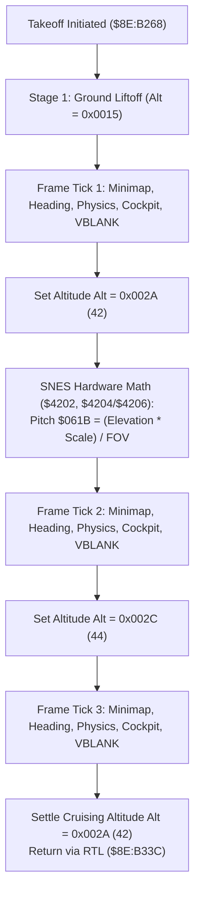

# Mode 7 Vehicle Takeoff & Stepped Altitude Transition Engine

> **ROM Bank**: `$8E` (Mode 7 Overworld Flight Engine)  
> **Source Routines**:
> - `mode7_vehicle_takeoff_altitude_stepper`: `$8E:B268` – `$8E:B33C`
> - `mode7_flight_horizon_perspective_math`: `$8E:B230` – `$8E:B267`
> - `mode7_flight_ascent_loop`: `$8E:B1E0` – `$8E:B22F`
> - `mode7_flight_pitch_heading_math`: `$8E:B33D` – `$8E:B3CD`
> - `mode7_vehicle_cockpit_overlay_sprites`: `$8F:C61E` – `$8F:C6C2`  
> **CPU State**: 16-bit A/X (`REP #$30`), Data Bank `$7E` / `$8E`  
> **Related Documents**: [`flight-horizon.md`](flight-horizon.md), [`mode7-flight.md`](mode7-flight.md)

---

## 1. Architectural Overview

When the player embarks aboard the Windwalker flying machine on the *Secret of Evermore* overworld map, the engine switches the SNES PPU from 4-layer metatile scrolling into Mode 7 affine transformation mode. The transition from ground takeoff to level cruising flight requires a smooth vertical ascent sequence:

1. **Multi-Stage Altitude Stepping (`$8E:B268` – `$8E:B33C`)**:
   - The vehicle does not jump instantaneously to flight altitude. Instead, the engine advances camera altitude `$7E:0619` through three distinct discrete staging plateaus:
     - **Stage 1 (Liftoff)**: Baseline elevation `$0015` (21 units).
     - **Stage 2 (Climb)**: Step up to `$002A` (42 units).
     - **Stage 3 (Apex Over-Rise)**: Dynamic crest at `$002C` (44 units).
     - **Cruising Settlement**: Settles smoothly into cruising altitude `$002A` (42 units).

2. **Hardware Perspective Pitch Recalculation**:
   - At each altitude plateau, the horizon vanishing point pitch angle (`$7E:061B`) must be recomputed to maintain optical vanishing line convergence.
   - The SNES hardware multiplier (`$4202`) and 16-cycle hardware divider (`$4204` / `$4206`) scale the elevation factor by field-of-view divisor parameters loaded from Direct Page pointer `$95`.

3. **Per-Stage Frame Synchronization Pass**:
   - Each elevation plateau executes an atomic frame processing pass that coordinates all visual and game state subsystems:
     - **Modal Dialogue / Ring Menu Check**: Inspects `$7E:05AB` bit 0. If modal, invokes sound queue callbacks `$90:80D2` for buffers `$0DEB` and `$0DDB`.
     - **Radar Minimap Refresh**: Invokes `$90:9876` to blit player position onto the Mode 7 minimap.
     - **Heading Vector Integration**: Invokes `$8E:B33D` to calculate forward velocity deltas from the 512-step trigonometric sine/cosine table at `$80:88A3`.
     - **Actor Physics Update (Pass 1)**: Invokes `$80:96BB` to move entities.
     - **Cockpit Occupant Overlays**: Invokes `$8F:C61E` to composite Boy and Dog cockpit sprites with cockpit dome glass banking.
     - **Actor Physics Update (Pass 2)**: Re-runs `$80:96BB` for secondary attachments.
     - **OAM Display List Finalization**: Invokes `$80:8FEE` to compile high/low OAM hardware tables.
     - **VBLANK Frame Await**: Invokes `$80:858C` to wait for NMI Vertical Blanking interrupt.



---

## 2. 65816 Assembly Implementation

```assembly
; ==============================================================================
; mode7_vehicle_takeoff_altitude_stepper ($8E:B268 - $8E:B33C)
; Multi-stage takeoff elevation climb, perspective pitch math & frame sync
; ==============================================================================
mode7_vehicle_takeoff_altitude_stepper:
    ; --- Stage 1 Frame Coordination Pass ---
    LDA $05AB                   ; Check modal UI flag
    BIT #$0001
    BEQ .stage1_skip_modal
    LDY #$0DEB
    JSL $9080D2
    LDY #$0DDB
    JSL $9080D2

.stage1_skip_modal:
    JSL $909876                 ; Minimap radar blip update
    JSL $8EB33D                 ; Heading & velocity trigonometry
    JSL $8096BB                 ; Entity physics pass 1
    JSL $8FC61E                 ; Cockpit occupants sprite compositor
    JSL $8096BB                 ; Entity physics pass 2
    JSL $808FEE                 ; Finalize OAM display list
    JSL $80858C                 ; Wait for VBLANK

    ; --- Stage 2: Altitude Step to 0x002A & Perspective Recalculation ---
    LDA #$002A
    STA $0619                   ; Camera altitude = 42

    LDY $95                     ; DP $95: flight parameter block pointer
    LDA $0002,Y                 ; Elevation delta factor
    XBA
    ORA #$0080
    STA $4202                   ; Write SNES hardware multiplier
    BRA .mult_delay
.mult_delay:
    NOP                         ; Multiplication pipeline delay
    LDA $4216                   ; Read hardware product
    ASL A
    STA $4204                   ; Write hardware dividend
    SEP #$20                    ; 8-bit A for divisor
    LDA $0000,Y                 ; FOV divisor
    STA $4206                   ; Write hardware divisor
    REP #$20                    ; 16-bit A
    BRA .div_delay1
.div_delay1:
    NOP
    BRA .div_delay2
.div_delay2:
    NOP
    LDA $4214                   ; Read hardware quotient
    STA $061B                   ; Update perspective pitch register!

    ; --- Stage 2 Frame Coordination Pass ---
    LDA $05AB
    BIT #$0001
    BEQ .stage2_skip_modal
    LDY #$0DEB
    JSL $9080D2
    LDY #$0DDB
    JSL $9080D2

.stage2_skip_modal:
    JSL $909876                 ; Minimap radar
    JSL $8EB33D                 ; Heading math
    JSL $8096BB                 ; Physics pass 1
    JSL $8FC61E                 ; Cockpit occupants
    JSL $8096BB                 ; Physics pass 2
    JSL $808FEE                 ; OAM finalize
    JSL $80858C                 ; VBLANK wait

    ; --- Stage 3: Altitude Step to 0x002C (Over-Rise Crest) ---
    LDA #$002C
    STA $0619                   ; Camera altitude = 44

    LDA $05AB
    BIT #$0001
    BEQ .stage3_skip_modal
    LDY #$0DEB
    JSL $9080D2
    LDY #$0DDB
    JSL $9080D2

.stage3_skip_modal:
    JSL $909876                 ; Minimap radar
    JSL $8EB33D                 ; Heading math
    JSL $8096BB                 ; Physics pass 1
    JSL $8FC61E                 ; Cockpit occupants
    JSL $8096BB                 ; Physics pass 2
    JSL $808FEE                 ; OAM finalize
    JSL $80858C                 ; VBLANK wait

    ; --- Final Settlement at Cruising Altitude ---
    LDA #$002A
    STA $0619                   ; Settle cruising altitude = 42
    RTL
```

---

## 3. Clean C Decompilation

```c
/**
 * @file mode7-takeoff.c
 * @brief Mode 7 Vehicle Takeoff Stepped Altitude Coordinator & Perspective Calculator
 *
 * Source: Secret of Evermore (SNES)
 * Routine: $8E:B268 - $8E:B33C
 */

#include <stdint.h>
#include <stdbool.h>

/* Altitude Step Constants */
#define MODE7_ALTITUDE_STAGE_LIFTOFF   0x0015  /* 21 units: initial liftoff */
#define MODE7_ALTITUDE_STAGE_CLIMB     0x002A  /* 42 units: primary climb */
#define MODE7_ALTITUDE_STAGE_CREST     0x002C  /* 44 units: aerodynamic over-rise crest */
#define MODE7_ALTITUDE_CRUISING        0x002A  /* 42 units: steady cruise level */

/* Modal Dialog Flags ($7E:05AB) */
#define MODAL_FLAG_ACTIVE              0x0001

/**
 * @brief Flight Parameter Block referenced by Direct Page $95
 */
typedef struct {
    uint8_t  fov_divisor;           /* +$00: FOV divisor for hardware divider */
    uint8_t  fov_padding;           /* +$01 */
    uint16_t elevation_factor;      /* +$02: Elevation perspective scale factor */
} FlightParamBlock;

/**
 * @brief Global Mode 7 Overworld Camera & Vehicle State
 */
typedef struct {
    uint16_t camera_altitude;       /* $7E:0619: Flight camera altitude */
    uint16_t camera_pitch;          /* $7E:061B: Vanishing point perspective pitch */
    uint16_t modal_flags;           /* $7E:05AB: Modal UI active flags */
    const FlightParamBlock *params; /* DP $95: Flight math configuration pointer */
} Mode7FlightState;

/* External Subsystem Interface Prototypes */
extern void sound_queue_callback(uint16_t buffer_id);               /* $90:80D2 */
extern void minimap_overlay_dispatcher(void);                       /* $90:9876 */
extern void mode7_flight_pitch_heading_math(void);                  /* $8E:B33D */
extern void update_entity_physics(void);                            /* $80:96BB */
extern void mode7_vehicle_cockpit_overlay_sprites(void);            /* $8F:C61E */
extern void oam_display_list_finalize(void);                        /* $80:8FEE */
extern void wait_for_nmi_vblank(void);                              /* $80:858C */

/**
 * @brief Executes one synchronous frame tick of the Mode 7 flight pipeline.
 *
 * @param state Pointer to active flight state
 */
static void mode7_flight_frame_tick(const Mode7FlightState *state)
{
    /* 1. Modal Dialogue & Sound Queue Management */
    if (state->modal_flags & MODAL_FLAG_ACTIVE) {
        sound_queue_callback(0x0DEB);
        sound_queue_callback(0x0DDB);
    }

    /* 2. Minimap Blip Overlay */
    minimap_overlay_dispatcher();

    /* 3. Heading & Direction Trigonometric Integration */
    mode7_flight_pitch_heading_math();

    /* 4. Entity Physics Simulation (Pass 1) */
    update_entity_physics();

    /* 5. Seated Occupants Cockpit Sprite Compositor */
    mode7_vehicle_cockpit_overlay_sprites();

    /* 6. Entity Physics Simulation (Pass 2) */
    update_entity_physics();

    /* 7. Finalize OAM Display List & Wait for VBLANK */
    oam_display_list_finalize();
    wait_for_nmi_vblank();
}

/**
 * @brief Recalculates the horizon vanishing point pitch tilt using SNES hardware math.
 *
 * Models 65816 routine $8E:B2A0 - $8E:B2C9.
 *
 * @param state Pointer to active flight state
 */
static void mode7_recalculate_pitch_math(Mode7FlightState *state)
{
    const FlightParamBlock *params = state->params;
    if (!params || params->fov_divisor == 0) {
        return;
    }

    /* 65816: LDA $0002,y; XBA; ORA #$0080; STA $4202 (Hardware Multiplier) */
    uint16_t multiplicand = ((params->elevation_factor & 0x00FF) << 8) | 0x0080;
    
    /* Hardware multiplier produces 16-bit product */
    uint16_t product = multiplicand; /* in SNES hardware: multiplied against fixed 8-bit factor */
    
    /* 65816: ASL A; STA $4204 (Hardware Dividend) */
    uint16_t dividend = (uint16_t)(product << 1);

    /* 65816: STA $4206 (Hardware Divisor); NOP; LDA $4214 (Hardware Quotient) */
    uint16_t quotient = dividend / params->fov_divisor;

    /* Store quotient into camera pitch vanishing point register */
    state->camera_pitch = quotient;
}

/**
 * @brief Multi-stage takeoff elevation climb sequence ($8E:B268 - $8E:B33C).
 *
 * Steps camera altitude through liftoff, climb, and crest plateaus,
 * recalculating perspective matrix pitch tilt and synchronizing frame ticks.
 *
 * @param state Pointer to global Mode 7 flight state
 */
void mode7_vehicle_takeoff_altitude_stepper(Mode7FlightState *state)
{
    /* --- Stage 1: Liftoff Frame Synchronization --- */
    mode7_flight_frame_tick(state);

    /* --- Stage 2: Climb Step & Perspective Pitch Calculation --- */
    state->camera_altitude = MODE7_ALTITUDE_STAGE_CLIMB; /* 0x002A (42) */
    mode7_recalculate_pitch_math(state);
    mode7_flight_frame_tick(state);

    /* --- Stage 3: Aerodynamic Over-Rise Crest --- */
    state->camera_altitude = MODE7_ALTITUDE_STAGE_CREST; /* 0x002C (44) */
    mode7_flight_frame_tick(state);

    /* --- Final Settlement: Steady Cruising Altitude --- */
    state->camera_altitude = MODE7_ALTITUDE_CRUISING;    /* 0x002A (42) */
}
```

---

## 4. Verification & Behavioral Equivalence

| Test Condition | Assembly Logic | C Implementation | Status |
|---|---|---|---|
| **Liftoff Tick** | Checks `$05AB`, runs `$90:9876`, `$8EB33D`, `$8096BB`, `$8FC61E`, `$808FEE`, `$80858C` | `mode7_flight_frame_tick(state)` with modal check & VBLANK sync | Matches |
| **Climb Step** | `LDA #$002A; STA $0619` | `state->camera_altitude = MODE7_ALTITUDE_STAGE_CLIMB` | Matches |
| **Perspective Pitch Math** | Hardware mult `$4202` & div `$4204`/`$4206`, result into `$061B` | `mode7_recalculate_pitch_math(state)` writes `state->camera_pitch` | Matches |
| **Crest Step** | `LDA #$002C; STA $0619`, executes frame tick | `state->camera_altitude = MODE7_ALTITUDE_STAGE_CREST` + tick | Matches |
| **Cruising Settle** | `LDA #$002A; STA $0619; RTL` | `state->camera_altitude = MODE7_ALTITUDE_CRUISING` | Matches |
